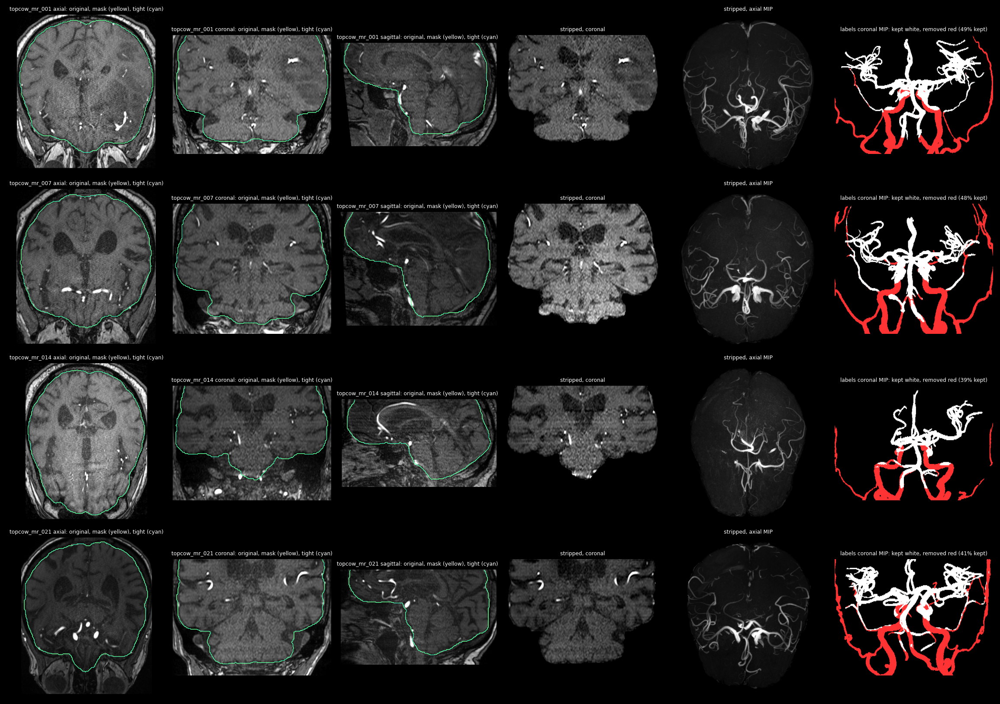
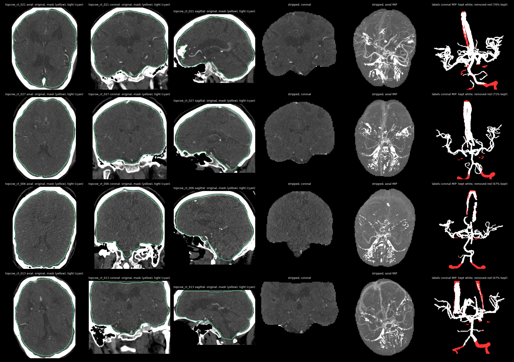
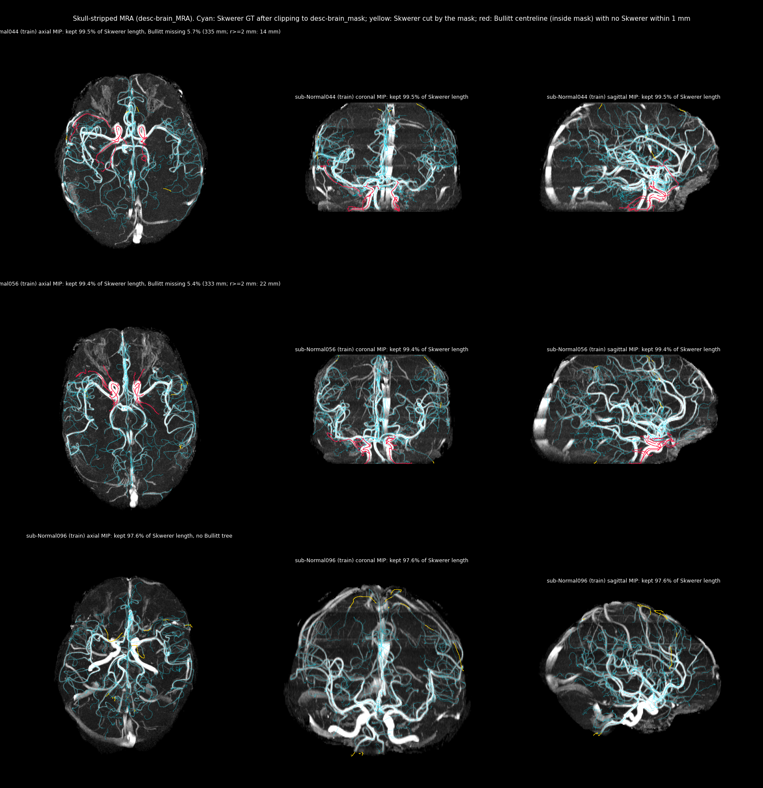

# Data loading and augmentation (RelationFormer pipeline)

How `train.py` and `evaluate.py` load patches and augment them. The dense traced model has its
own loader in its scripts and uses only 90° rotations and Gaussian noise
([`research/dense_traced_model_20261102.md`](research/dense_traced_model_20261102.md) §2.5).

## Entry points

`load_config` and `build_data_loaders` are the configuration-driven entry points:

```python
from configs import load_config
from data.loaders import build_data_loaders

config = load_config("configs/pretrain_mixed.yaml")
train_loader, validation_loader = build_data_loaders(config)
```

`build_evaluation_loader` serves `evaluate.py`. Configuration-driven loading needs separate
`root/train` and `root/val` (and `root/test` for test evaluation) directories, each with `raw`,
`seg` and `vtp`. Split CSV files are provenance only and are not read. Direct leaf roots remain
available to the low-level discovery functions for inspection and tests, but they cannot serve
as both training and validation data.

Supported dataset keys are `plants`, `synthetic_mri` and `source_mri`. IXI, TopBrain and BRAVA
patch sets use the same on-disk layout and are loaded through the `synthetic_mri` key, by
pointing `SYNTHETIC_MRI_DATASET` at their root (for example
`configs/finetune_ixi_vessels_q256.yaml`).

## Coordinate convention

All graph nodes use spatial order `[D, H, W]` and are normalized as

```text
normalized_coordinate = voxel_index / axis_size
```

The largest valid value on an axis of size `S` is `(S - 1) / S`; `1.0` is outside the
voxel-centre grid. Loaders must declare whether stored points are normalized or voxel
coordinates (`coordinate_space_on_disk`); they never guess from the value range. Image,
segmentation and graph always receive the same sampled geometric transform.

## Model-facing batch

`image_graph_collate` returns six parts:

1. images: float tensor `[B,C,D,H,W]`;
2. segmentations: float tensor `[B,C,D,H,W]`, foreground positive;
3. nodes: list of float tensors `[N,>=3]` in normalized `(D,H,W)` order;
4. edges: list of long tensors `[E,2]`;
5. projection positions: one value per sample (`None` for native 3D);
6. domain labels: long tensor, source `0` and target `1`.

## SyntheticMRI-layout datasets

Discovery accepts complete `*_data.nii` or `*_data.nii.gz` files with matching `*_seg` and
`*_graph.vtp` partners, in sorted order. Missing partners fail at discovery rather than later in
a worker.

The loader subtracts the configured `foreground_mean`, shifts the segmentation by `-0.5`, and
resizes only when necessary. `patch_selection` (`all`, `foreground`, `graph_positive`) filters
before any sample cap; `sample_cap_selection` is `first` or `seeded_random`.
`data.input_modality: vessel_mask` feeds the segmentation through the image slot instead of
the raw MRA (used by segmentation-input diagnostics).

Training augmentation (defaults in `configs/base.yaml`):

1. independent 90° rotations in the `(D,H)`, `(D,W)` and `(H,W)` planes;
2. isotropic zoom sampled uniformly from `[0.6, 1.0]` (trilinear for the image, nearest
   neighbour for the segmentation);
3. Gaussian noise with probability `0.35`, standard deviation sampled uniformly from
   `[0, 0.015]` as in MONAI `RandGaussianNoise`;
4. no intensity clamp (`augmentation.synthetic_mri.intensity_clamp: null`).

The inherited `[-0.5, 0.5]` clamp is available as an explicit override only to reproduce legacy
experiments; without it, bright centred values and noise tails are preserved. This does not
change the MAD clipping applied when patches are generated.

When the spline head is enabled, zoom must be disabled (configuration validation enforces it):
spline targets are transformed exactly for 90° rotations by `data/spline_augmentation.py`, but
not for zoom.

## Plants

Plants PNGs are decoded to grayscale and divided by 255, then resized with MONAI's area-style
resize. The segmentation is thresholded at `0.3` at native resolution and downsampled as a
foreground-occupancy mask, so thin branches are not averaged away. The 2D sample is projected
into the configured odd number of central slices (default 5). Stored graph points use the
generator's `(y,x)` order and are swapped once to match the array axes before z is appended.

Training augmentation:

1. independent 90° rotations in all three planes;
2. independent flips on D, H and W with probability `0.5` per axis;
3. min-max intensity scaling to `[-0.5, 0.5]`;
4. symmetric padding to the model input size, with graph coordinates remapped.

Plants file order follows `os.listdir`, preserving the subset selected by the established sample
cap. The old elastic deformation, `real_set_augment`, Gaussian smoothing and the inactive
continuous-rotation option were removed.

`data/source_augmentation.py` adds an optional non-planar depth deformation and textured
rendering for plant and leaf sources, used by the October source-augmentation study
([`research/HISTORY.md`](research/HISTORY.md)).

## Prepared 3D target datasets (November 2026)

All under `/lustre/fsn1/projects/rech/vnc/upz25mj/datasets` (SCRATCH: purged when unread; originals and caches
are archived in `$STORE/datasets-originals-20261105` and `$STORE/datasets-derived-20261105`). Every cache is a K8
transfer-spline cache with loop subdivision (breaking-point anchors, `inserted` mask; no patch excluded for loops).
Splits are by patient/subject; test patches are never used before the locked evaluation.

- **TopBrain** (`TopBrain_tight_20261105/`, `scripts/prepare_topbrain_stripped_20261104.py --mask braintight`):
  images and multi-class labels masked with the TopCoW *tight* brain mask (HD-BET for MRA, TotalSegmentator for CTA),
  reoriented onto the TopBrain grid; the widened mask kept skull-base bone (CTA) and was rejected. Vessels kept:
  median 47% (MRA) and 70% (CTA), mostly extracranial losses. MRA and CTA are separate datasets sharing one
  patient split (15/5/5). CTA uses a fixed [-100, 400] HU window. Caches: `transfer_splines_k8_loops_20261105/{mr,ct}`.
- **TubeTK** (`TubeTK_skwerer_20261105/`, `scripts/prepare_tubetk_skwerer_20261105.py`): ground truth = the Skwerer
  trees (`vessel/`, original centrelines with tube links; 97 subjects), imported directly, never re-extracted;
  `graph/` (CaravelMetrics re-extraction) is not used. Image `desc-brain_MRA` (= preproc MRA x `desc-brain_mask`);
  trees clipped to the same mask (median 99.98% of length kept). Decisions (user, 6 Nov 2026):
  - exact duplicate subtrees removed in Normal-008 (README) and Normal-014 (found by the duplicate count);
  - in Normal-008 the two copy edges that link original roots (0.62 and 0.81 mm) are kept;
  - family-aware split: families split by the seed-42 helper go wholly to train, val/test refilled from family-free
    subjects (67/14/16).
  Known GT limits: Skwerer lacks some Bullitt tubes, notably carotid siphons (median 2.3% of Bullitt length missing,
  up to 40 mm of large-calibre vessel; flags in `preparation.json`, nothing excluded), and tracings are incomplete
  (untraced bright vessels count as false positives). Cache: 12,395 / 2,514 / 2,775 patches, median 20 nodes.
  QC: `docs/research/figures/tubetk_20261105/`.
- **IXI** loop cache (`IXI/transfer_splines_k8_loops_20261105`, train/val) from the patch grid regenerated after
  the SCRATCH purge (verified identical); the 21 purged test images were restored and verified against 2,178
  September test patches.

QC figures. TopBrain, tight mask: original image with the brain-mask outline, the stripped image, and vessel labels
kept (white) or removed by the mask (red):





TubeTK: MIPs of the stripped MRA with the clipped Skwerer graph (cyan), Skwerer parts cut by the mask (yellow) and
Bullitt centreline not covered by Skwerer within 1 mm (red); no test subjects shown:



Interactive 3D ground-truth patches (validation): [TopBrain MRA](research/figures/topbrain_3d_20261105/topbrain_mr_patch_3d.html),
[TopBrain CTA](research/figures/topbrain_3d_20261105/topbrain_ct_patch_3d.html),
[TubeTK](research/figures/tubetk_20261105/tubetk_patch_3d.html). Download and open in a browser.

## Mixed-domain sampling

Source and target datasets are concatenated. With
`data.mixed_sampling.balance_source_target: true`, every source item has weight `1`, every
target item has weight `source_size / target_size`, and draws are made with replacement.
`data.mixed_sampling.epoch_size` is `twice_source` (default: `2 * source_size` draws per epoch)
or `combined` (the combined dataset length). This balances dataset roles; it does not enable
adversarial domain adaptation. Validation is concatenated without sampling or augmentation.

## Evaluation policy

Validation and test use identity augmentation. Deterministic preprocessing (normalization,
2D-to-3D projection, padding) still applies, but no rotation, zoom, flip or noise is sampled.

## Tests

Dependency-light geometry tests:

```bash
python -m unittest -v tests.test_augmentation_geometry tests.test_data_loaders
```

Integration tests on real data run automatically when the dataset variables are set. On Jean
Zay run them in a CPU or GPU job, not on a login node:

```bash
export SYNTHETIC_MRI_DATASET="$SCRATCH/datasets/syntheticMRI/new_patches_boundary"
export PLANTS_DATASET="$SCRATCH/datasets/plants_3d2cut/patches_3d"
export AUGMENTATION_DATASET_SAMPLES=8

python -m unittest -v tests.test_data_loader_datasets
python -m unittest -v tests.test_augmentation_dataset tests.test_augmentation_plants_dataset
```

- The augmentation integration tests pick `AUGMENTATION_DATASET_SAMPLES` evenly spaced files
  (default 8), so they cover the start, middle and end of each sorted dataset without random
  sampling.
- SyntheticMRI points are normalized by default; set `SYNTHETIC_MRI_COORDINATES=voxel` only for
  an explicitly voxel-space dataset.
- The SyntheticMRI check measures graph/foreground alignment on every selected patch. Rotations
  and flips must preserve exact foreground hits. The zoom check allows a one-voxel neighbourhood,
  because nearest-neighbour shrinking can remove one-voxel-wide segmentation branches even when
  the graph transform is correct.
- The Plants check uses the `*_data.png`, `*_seg.png` and `*_graph.vtp` triplets with the
  generator's `coordinate / patch_size` convention and `(y,x)` order
  (`PLANTS_COORDINATE_ORDER=yx`; set `xy` only for a dataset written in that order). Exact hits
  are printed but not required: an endpoint may sit next to a one-pixel skeleton, and rounding a
  node exactly between pixels does not always commute with rotation or padding. The dataset must
  meet the baseline hit rate within a one-voxel neighbourhood, and rotations, flips and padding
  must preserve it. Integer-landmark unit tests remain the strict off-by-one guard.
- Override the baseline hit-rate threshold only when investigating a known dataset:
  `AUGMENTATION_MIN_NODE_HIT_RATE=0.70`, `PLANTS_MIN_NODE_HIT_RATE=0.70`.
