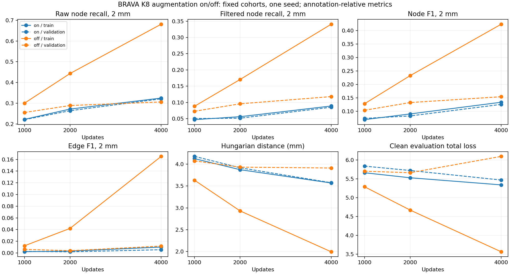

# BRAVA continuous vascular graph reconstruction — staged experiments

Latest reviewed result: [D08 final tables and interpretation](#reviewed-final-d08-results--28-october-2026), 28 October 2026. Earlier launch and pending statements are retained as history.

21 October 2026. Stage 1 implementation and submission record; no model-performance results are claimed before collection. Prior dataset construction: [BRAVA_preparation.md](../../../../research/BRAVA_preparation.md). The nine test subjects remain closed to model evaluation, threshold selection and checkpoint selection.

## Questions and scope

1. How do existing SyntheticMRI and IXI models generalize to manually traced BRAVA anatomy without weight updates?
2. On exactly the same predicted graph, does learned continuous geometry recover annotated centerlines better than straight chords?
3. Can a stable scratch-trained BRAVA continuous model learn useful connectivity, and does coordinate-only local CNN refinement help?
4. What geometric accuracy/node-count trade-offs exist in the supplied annotations, before making model-level query-efficiency claims?

Stage 1 submits these bounded comparisons and a CPU GT representation analysis. Independently trained straight controls, source-transfer comparisons, scarce-annotation training and a second seed remain **Stage 2, unsubmitted**.

## Dataset and annotation audit

Model root: `/lustre/fsn1/projects/rech/vnc/upz25mj/datasets/Brava/prepared_swc_20261020-132057/transfer_splines_k8`.

|Split|Subjects|Patches|Permitted use now|
|---|---:|---:|---|
|Train|39|8,768|Optimization; fixed 96-patch monitoring subset|
|Validation|8|1,796|Zero-shot evaluation, development and checkpoint selection|
|Test|9|2,043|Membership metadata only; no new target/image reads or model evaluation|

`READY`, `manifest.json`, `brava_semantics.json`, `generation_config.json`, source mappings, extraction QC and per-subject completion markers establish provenance. All 56 paired subjects/111 valid trace variants passed the repaired preparation audit. Primary original traces are used once per subject; BH0027 uses its valid ColorCoded counterpart because the original lacks a parent field. Other complete variants are exported but are not extra independent training subjects. No trace variant crosses the subject split. Six unpaired SWC subjects are not part of the image benchmark.

Coordinates: SWC uses the fixed0.62-unit tracer lattice; map to native voxels `[x/.62, Ny-1-z/.62, Nz-1+y/.62]`, with explicit x reflections for BG0014/BG0019–BG0022. Source-file hashes pin those corrections. The NIfTI affine supplies physical geometry. Targets use normalized native DHW with `metric = affine[:3,:3] @ diag(64,64,64)`. Native voxel-cell clipping and the existing boundary policy remain unchanged.

**`seg/` contains brain masks, never vessel labels.** The loader reads this required legacy slot, but the predictor receives only `image`; the criterion uses nodes/edges/spline targets, and the new evaluator never reads masks or invokes vessel-support/Dice categories. Masks are not concatenated with MRA or used as vessel supervision.

The validated target dataset is not regenerated. The read-only development audit checks split integrity, every train/validation cache's finite values/shapes/capacity, original path endpoints, source affine metrics and file readiness. On the47 development subjects, dense-source coordinates are checked against transformed SWC coordinates; junction/adaptive guide segments must belong to original SWC segments, and component/cycle counts must match the dense graph. Source graph hashes must agree with the target manifest. Actual loader samples exercise VTP/cache correspondence, MRI normalization and spline-aware rotation. Test membership/QC metadata are inspected without loading test images or targets.

### Target representation convention

Dense exports preserve every SWC vertex/parent link. Junction exports contract degree-two chains while preserving their original polylines. Curvature-adaptive exports add subdivisions under the established radius-scaled simplifier, retaining unsmoothed original paths; no vessel-lumen criterion is available.

**The supplied model-compatible continuous cache contracts these guides to shared junction/end/crop anchors.** Intermediate adaptive degree-two samples are geometry, not necessarily object-query targets. Each edge has8 endpoint-constrained cubic B-spline controls and its original `full_paths`/`path_offsets`. Stage 1 trains those existing caches. Calling this a dense-versus-adaptive object-node experiment would be incorrect. Any alternative node sampling requires a separately named Stage 2 comparison.

## Checks completed before submission

Four focused tests passed: paired configuration identity, zero-initialized coordinate-only refinement, unchanged connectivity in a crafted curved graph, and reproducible full-population ordering. Syntax and Slurm shell checks passed. All three source checkpoints loaded strictly, and both fresh training arms had identical shared parameter hashes.

The local read-only preflight passed: all47 development subjects ×3 graph representations preserved source SWC segments/topology and physical transforms;12 target patches passed cache/endpoint/metric checks. Actual native loader reads passed for eight validation patches (one per subject) and two augmented training samples. No test targets were read. Evidence: `docs/research/evidence/brava_stage1_20261021/local-preflight.json`. Optional local reader packages were incomplete; using the fixed cluster archive resolved the import problems without changing data or dependencies in the shared environment.

The submitted full-cache audit, real GPU forward/backward, tiny end-to-end prediction/evaluation/collection and throughput benchmark are **pending gates**, not claimed successful checks. Training cannot start unless these gates succeed. The exact common update count will be chosen automatically by the benchmark rule below.

## Stage 1A — zero-shot models

Exact paths/hashes: `experiments/brava_graph_study/plan.json`; CPU strict-load inventory: `checkpoint-inventory.json` in the same directory.

|Label|Candidate checkpoint|Queries|Interpretation|
|---|---|---:|---|
|synthetic_spline|`plant_generalization_20261014_da_b32_w1_restart/runs/vessels_spline/best.pt`|120|SyntheticMRI-only graph pretraining and spline fine-tuning|
|synthetic_straight|Same source study, `runs/vessels_straight/best.pt`|120|Current compatible straight-edge control, not a verified exact original GrEVe checkpoint|
|ixi_spline|Original delayed-spline IXI parent identified by the full-query pilot manifest|256|IXI-trained continuous model, no node-refinement overlay|

Source study root is `/lustre/fsn1/projects/rech/vnc/upz25mj/experiments/gnbm/spline_learning/`. Models must load strictly from their own saved configurations, retain their original query structure and decoded node/edge decisions, and use compatible one-channel 3D images and8-control B-splines. Only evaluation dataset roots, batching and augmentation are replaced. No relation adapter or local-refinement overlay is grafted onto zero-shot checkpoints. Cross-model results are descriptive: source histories and query capacities differ.

Use source MRI normalization/foreground centering, the existing prepared MRA intensity scale, frozen saved BatchNorm state, augmentation off and inference batch1. There is no BN recalibration, GT query selection or threshold tuning in the primary comparison. Source node/edge thresholds (including argmax semantics) are preserved in prediction metadata. Any later BRAVA-validation calibration must be reported separately and must not use test data.

Full validation predictions are cached once. Besides decoded curves/scores, retain all raw node coordinates/confidences and all relation scores among normally retained nodes, with query IDs/pair ordering. Normal-decoder edge-score parity and evaluation-state invariance are asserted. These caches support metrics and same-graph comparisons without another model pass; no enormous all-pair image-feature tensor is stored.

## Stage 1B — same-predicted-graph chords versus curves

For every zero-shot model and every saved BRAVA baseline checkpoint, evaluate:

- Spline geometry from the learned checkpoint.
- Straight chords after removing curve controls from the **same nodes and edges**.

Node/edge counts, positional TP/FP/FN, graph topology and common-v2 Branch connectivity must remain equal. Curve F1, geometric distance and tortuosity may differ. The evaluator explicitly checks connectivity parity.

For direct predicted edges whose endpoints recover a GT adjacency at1/2mm, compare symmetric arc-sampled point-to-polyline distance of both chord and learned curve against the exact corresponding original annotated path. Both geometry versions use the identical recovered-connection set and predicted endpoints. GT never supplies coordinates or edges to the prediction. Save per-connection, per-patch, per-subject and aggregate tables; zero eligible connections are NA, not zero error. Native SMD is retained with its straight-edge point-cloud convention and is not relabeled as continuous-curve SMD.

Fixed examples from the first three validation subjects show annotated full paths, predicted curves, same-graph chords and reference-relative matched/unmatched edges. Examples are selected in manifest order, without outcome selection.

## Stage 1C — two matched BRAVA-only continuous baselines

|Arm|Node prediction|Image/backbone/transformer/relation|Spline head|
|---|---|---|---|
|standard|Existing classifier/coordinate predictor|Trainable|Trainable|
|coordinate_refinement|Same plus early-layer0 CNN coordinate residual|Trainable|Trainable|

Both start **from the same fresh random seed211039**, with no external source checkpoint. Shared initial parameter hashes are checked, and zero-initialized refinement must leave initial outputs identical. This supplies the BRAVA-only Stage 2 reference without conflating it with vascular pretraining.

Architecture: stable single-channel SE-ResNet/3D RelationFormer,256 object queries/two relation tokens, existing residual B-spline head with8 controls and local CNN geometry features. The local node module samples the established3×3×3 layer0 neighborhood,4-voxel radius. Its new `refine_classification: false` option leaves classification logits untouched; default `true` preserves all prior experiments. Its existing5-output layer is retained for compatibility, but the two classification residual outputs are unused in this arm. Added local-module parameters are counted explicitly. No verification head, heatmap, new relation adapter or transformer modification is introduced.

Stable graph recipe: weighted node CE `[.25,.75]`, existing node/box/cardinality coefficients, edge focal gamma2 with matched-only candidate population and unchanged balancing/caps. No node focal, unmatched negatives or new hard-mining objective. Actual Hungarian matching uses the final coordinates and unchanged classification outputs. Shared spline weight1.4739989612791453 and residual-control supervision reuse the established stable geometry recipe. Spline gradients detach detector tokens/endpoints and sampled CNN features (`graph_only` route), while graph objectives train the full detector. Geometry-head parameters receive finite nonzero gradients. No image/segmentation loss is introduced.

Training uses every one of the8,768 training patches in common seeded permutation order, batch8/workers0, exact quarter-turn graph/spline-aware rotations, existing Gaussian image noise and no zoom. Both arms share AdamW7e-5, inherited betas/epsilon/weight decay, one full-pass linear warmup followed by polynomial power0.9 over the common budget. No early stopping or validation-based hyperparameter tuning.

### Throughput-selected bounded budget

Benchmark3 warm-up plus32 timed full-network updates per arm, discarded afterward. Let `P=ceil(8768/8)=1096` and `s` be the slower measured seconds/update. Select:

`updates = min(40P, max(20P, floor(10800/(1.2s)/100)*100))`.

Thus the common budget is **21,920–43,840 updates**, covering20–40 complete-data passes in draw count. The target is roughly3 hours with a safety factor; if the minimum budget's conservative estimate exceeds4.5 hours, block training rather than silently reduce subjects/updates. Actual throughput, parameter counts and chosen budget are written automatically to `benchmark/`. Each training arm requests **6 hours**; the internal deadline saves an interrupted checkpoint and fails rather than evaluating mismatched incomplete runs. This is a learning-curve baseline, not proof of convergence.

Checkpoints:1k,5k,10k,20k and common final, deduplicated; recovery snapshot every1k. All predefined checkpoints receive full validation evaluation and the same fixed96-training-patch monitor. No per-step validation metric selection affects optimization. Primary comparison is matched final updates. Secondary checkpoint selection per arm uses full-eight-subject validation Branch F1, then Curve F1, positional edge F1 at2mm, then earlier update on ties. Learning curves retain both training and validation populations separately.

## Evaluation definitions and incomplete-annotation limitations

Use unchanged one-to-one physical1/2mm positional matching and common-v2 definitions (1mm branch-anchor/curve support,0.25mm curve sampling). Report node precision/recall/F1, matched localization mean/p95, raw-query recovery, duplicates per recovered GT node, high-confidence duplicates at0.9, node-count bias/MAE, edge TP/FP/FN/F1, endpoints-recovered GT edges, conditional direct relation recall, relation AP within each patch's retained/conditional populations, Branch/Curve F1, component/cycle errors and native detection AP/AR/SMD. Save raw counts and candidate prevalence; per-patch AP must not be confused with pooled AP. Native detection caps remain checkpoint-specific for zero-shot models; positional/common metrics use all decoded predictions.

**All false-positive/false-negative terminology is relative to available annotations.** A predicted vessel absent from SWC is unconfirmed, not proven anatomically wrong. Do not prune it merely because it lies outside traced structures, or use the brain mask to label it as vessel-supported/off-vessel. SWC parent-link forests do not prove the actual vasculature has no additional connections or cycles. Betti errors measure disagreement with those annotations. Manual centerlines provide geometric references but do not certify complete coverage or exact registration. Graph-positive patch selection is not a whole-volume deployment evaluation.

Eight validation subjects are the independent development units. Use1,000 paired subject-bootstrap resamples, seed211039, for coordinate-refinement differences and same-graph Curve-F1 differences. These are exploratory intervals from one training seed, with few subjects and no multiple-comparison correction. Per-connection geometry errors and source-specific candidate populations remain explicit. Compare geometry with connectivity and cycle errors; geometric coverage alone does not establish faithful graph reconstruction.

## CPU-only GT representation analysis

On the47 development subjects, compare dense straight graphs, junction-only chords, adaptive chords and8-control least-squares splines on junction anchors against original dense SWC polylines. This is annotation approximation, not learned-model output. Report object-node/edge counts, internal control counts, Branch/Curve F1, geometric guide distance and component/cycle preservation. Original full guide segments are verified to belong to dense SWC edges. Full-volume reference arrays created for this analysis are evaluation artifacts on SCRATCH; the validated dataset is unchanged. Model-target patch count statistics are reported separately from full-volume representation counts.

Fewer annotation anchors do **not** demonstrate lower learned-query requirements. Stage 2 must measure reconstruction accuracy against controlled object-query budgets on a common population, preserving capacity-limited cases rather than silently dropping them.

## Stage 0 gates, resources and automation

Local focused tests cover paired configurations/order, zero/coordinate-only refinement behavior and same-graph geometry against a crafted curved annotation without any mask. CPU checkpoint checks load source states strictly and verify common fresh detector weights. Local actual-reader checks use the same MedPy/SimpleITK readers as jobs. The protected module alone lacks MedPy; local checks use the existing installed readers, while jobs stage the existing fixed dependency archive. No package upgrade or loader substitution is introduced.

Full CPU dataset audit gates GPU smoke. GPU smoke performs two real training updates in both arms, finite-gradient/spline-gradient checks, identical fresh shared-state/output checks and tiny prediction passes through all three source checkpoints and both trained arms. Tiny CPU evaluation and collection must succeed before benchmarking or full jobs. Predictions verify batch-one cache/decoder parity and unchanged frozen state.

GPU sequence: smoke → benchmark → zero-shot array (`0-2%2`) → paired training (`0-1%2`) → trained-checkpoint prediction (`0-1%2`). CPU zero-shot evaluation runs alongside training; CPU GT analysis is independent after the dataset audit. CPU trained evaluations follow corresponding prediction tasks; final collection depends on all CPU evaluations and GT analysis. Failed prerequisites cancel/block dependent work. This serialization caps this work at two H100s. Existing limited-botanical GPU jobs are respected through an additional initial dependency on all active/pending H100 jobs, even though it may delay BRAVA execution.

Large outputs/runtime staging live on SCRATCH, with short job-specific temporary paths to avoid the previous AF_UNIX limit. Source data, old checkpoints and experiments are preserved. No unsupported `--mem` option, full300-epoch run or Stage 2 training sweep is submitted.

## Stage 2 — prepared matrix, no training submitted

|Comparison|Locked controls|Remaining choice after Stage 1|
|---|---|---|
|Independent straight versus spline|Same shared anchors/connectivity, detector initialization, image input, splits/order/updates and graph losses|Straight has frozen zero-residual geometry; spline has trainable curve parameters and explicit geometry loss; report trainable/allocated counts and gradient route|
|A: BRAVA-only|Current fresh Stage 1 arm, chosen refinement policy|Confirm convergence/common target budget before treating it as final reference|
|B: SyntheticMRI transfer|Compatible source checkpoint, identical BRAVA fine-tuning IDs/budget|Preserve source query count or document common query expansion before all arms; list pretraining and target updates separately|
|C: botanical transfer|Same BRAVA fine-tuning controls|A current plants+SyntheticMRI mixed checkpoint is available, but is not botanical-only; verify a pure botanical-compatible initializer or label the mixed-source comparison honestly|
|25% versus100% annotations|Deterministic10-of39 training subjects versus all39; same8 validation subjects|Record actual patch counts, equal target exposure versus equal total updates, and coverage of sites where metadata supports it|
|Object-query efficiency|Same annotated reference paths, image population and evaluation; no capacity-based outcome filtering|Choose query budgets after measuring target maxima; vary graph sampling separately from geometry modeling|
|Second seed|Identical selected Stage 1 protocol|Confirm only the promising comparison|

No new source dataset is created. Repeated BRAVA training samples across stages represent extra in-domain optimization, not independent source data. Current biological mixed-source pretraining also changes vascular exposure and possibly its auxiliary domain objective; these must not be hidden in a data-only transfer claim. Equal fine-tuning budgets do not imply equal overall training compute. Pure botanical checkpoint compatibility and exact legacy GrEVe compatibility remain unverified, so neither is silently substituted into Stage 1.

Prepared scarce-annotation membership: `experiments/brava_graph_study/stage2-plan.json` contains a deterministic10-subject subset with **2,243 training patches**, the unchanged validation IDs and an explicit `training_allowed: false` flag. For a future matched transfer study, prefer the source study's graph-only pretraining checkpoints (`pretrain_vessels` / accurately labeled `pretrain_mixed`) rather than silently comparing different amounts of subsequent SyntheticMRI fine-tuning. Their pretraining budgets must be read from saved summaries before launching. A valid detector-only transfer can retain120 source object embeddings, add136 common seeded embeddings, move both relation embeddings to256–257 and initialize the spline head/refinement identically and freshly across A/B/C; strict compatible shared detector tensors can transfer. This policy and any domain-loss/source-exposure confound require review before Stage 2. No source training or BRAVA transfer job is submitted now.

## Outputs and retrieval

Implementation: `scripts/{brava_graph_study,audit_brava_study,evaluate_brava_study,collect_brava_study}.py`, focused tests, existing model refinement with a backward-compatible coordinate-only flag, and `cluster/jean_zay/brava_study_{cpu,gpu}.slurm`.

Manifests: `experiments/brava_graph_study/{plan,submission,checkpoint-inventory}.json`; output root is recorded after submission. Large outputs: `audit/`, `representations/`, `benchmark/`, `runs/<arm>/`, `predictions/<model>/<checkpoint>/`, `evaluation/<model>/<checkpoint>/`, `results/`. Per-subject/per-patch and same-connection geometry CSVs are retained. Compact comparative results, bootstrap intervals, checkpoint selection and learning curves are copied to `docs/research/evidence/brava_stage1_20261021/`; the collector appends results here.

```bash
# Read completed results immediately; no inference, training or waiting.
python3 scripts/collect_brava_study.py --show
# Rebuild summaries only if needed after all evaluations have finished:
python3 scripts/collect_brava_study.py --root <submitted-output-root>
```

No scientific model result is asserted by dataset readiness or job acceptance. Failure of a source checkpoint or QC gate blocks affected downstream work rather than introducing an arbitrary transform, target change or silent checkpoint substitution.

## Accepted Stage 1 jobs

Output: `/lustre/fsn1/projects/rech/vnc/upz25mj/experiments/gnbm/brava_graph_study_20261021-102438`.

|Stage|Job|Dependency|Wall time|
|---|---|---|---|
|dataset_audit|1374050|None|02:00:00|
|GT_representation_analysis|1374051|afterok:1374050|04:00:00|
|gpu_smoke|1374052|afterok:1374050,afterany:1372129:1372131:1372132:1372133:1372134:1373095|00:45:00|
|cpu_smoke|1374053|afterok:1374052|00:45:00|
|throughput_benchmark|1374054|afterok:1374053|00:30:00|
|zero_shot_prediction|1374055|afterok:1374054|01:30:00|
|zero_shot_evaluation|1374056|aftercorr:1374055|04:00:00|
|training|1374057|afterok:1374055|06:00:00|
|trained_prediction|1374058|afterok:1374057|03:00:00|
|trained_evaluation|1374059|aftercorr:1374058|08:00:00|
|collection|1374060|afterok:1374056:1374059:1374051|02:00:00|

GPU stages wait for all existing H100 jobs: 1372129, 1372131, 1372132, 1372133, 1372134, 1373095. No Stage 2 training was submitted.

## Completion review — 22 October 2026

Both training arms completed23,500 updates each (batch8; approximately21.44 full-population passes), in2h31m and2h26m including job overhead. All three zero-shot evaluations and both five-checkpoint trained evaluations completed on1,796 validation patches/eight subjects. Full development audit passed10,564 patches and141 volume-representation checks; no test targets were evaluated.

All table values are percentages except predicted/correct edge counts. Trained rows use the common final checkpoint, not separately selected best checkpoints. Branch/Curve metrics use the existing common-v2 convention (1 mm geometry tolerance); positional node/edge metrics below use2 mm.

|Model|Node recall|Edge F1|Branch F1|Curve F1 spline|Curve F1 same-graph chord|Predicted edges|Correct edges|
|---|---:|---:|---:|---:|---:|---:|---:|
|synthetic_spline|3.446|0.067|0.000|1.441|1.398|10526|10|
|synthetic_straight|3.567|0.076|0.000|1.667|1.667|30349|19|
|ixi_spline|23.095|2.687|0.243|5.802|5.538|8536|376|
|standard|10.784|0.041|0.000|0.034|0.032|230|4|
|coordinate_refinement|7.955|0.010|0.000|0.013|0.013|69|1|

### Interpretation and outstanding work

The IXI zero-shot checkpoint is the strongest measured starting point here, although source histories and query capacities differ. Both scratch-trained models predict very few edges; the final standard model predicts230 edges across validation (4 correct), and coordinate refinement69 (1 correct). Their geometry comparison therefore cannot meaningfully establish the value of continuous representation. These bounded scratch runs do not establish convergence or rule out refinement.

Coordinate refinement increases all-query2-mm coverage from32.19% to34.68%, while post-filter node recall drops from10.78% to7.95%. Thus the measured coverage change did not yield better decoded graphs. These are single-seed, annotation-relative measurements, without the planned paired-bootstrap collector intervals.

GT representation analysis job1374051 failed with `ValueError: invalid edge polyline` in common-v2 degree-two contraction. Final collector1374060 was automatically cancelled because that prerequisite failed. The underlying model prediction/evaluation caches and checkpoints are intact. No training rerun is required to recover collection; the malformed full-volume reference polyline needs diagnosis. No recovery jobs or Stage2 training were submitted in this review.

Output root: `/lustre/fsn1/projects/rech/vnc/upz25mj/experiments/gnbm/brava_graph_study_20261021-102438`.


## BRAVA Stage 1 recovery — 22 October 2026

The one-point full-volume reference path was traced to a coincident SWC parent/child pair. The evaluation adapter now writes both coincident endpoints while retaining the original link and geometry. The unchanged common-v2 metric accepts it; a focused regression test and replay of the failing BH0009 edge pass. No source data, model predictions, checkpoints or training were changed.

CPU recovery jobs: 1421288 (GT representation analysis,4h allocation) → 1421289 (collector,2h allocation; afterok dependency). Results are pending. The collector will replace this section with model/representation tables and paired subject-bootstrap intervals in both complete review files.

Retrieve without rerunning computation: `python3 scripts/collect_brava_study.py --show`.
## Completed Stage 1 results

All scores are relative to available manual annotations. Reference-unmatched predictions are not confirmed anatomical false positives. Test subjects were not evaluated. Primary trained comparison uses matched final updates; secondary checkpoints are selected on the full eight-subject validation split.

|Model|Queries|Node recall 2 mm|Edge F1 2 mm|Branch F1|Curve F1 spline|Curve F1 same-graph chord|Component MAE|Cycle MAE|
|---|---:|---:|---:|---:|---:|---:|---:|---:|
|synthetic_spline|120|0.0345|0.0007|0.0000|0.0144|0.0140|106.3252|0.5741|
|synthetic_straight|120|0.0357|0.0008|0.0000|0.0167|0.0167|97.9722|3.1609|
|ixi_spline|256|0.2309|0.0269|0.0024|0.0580|0.0554|7.6464|0.4343|
|standard|256|0.1078|0.0004|0.0000|0.0003|0.0003|17.1804|0.0011|
|coordinate_refinement|256|0.0795|0.0001|0.0000|0.0001|0.0001|12.4360|0.0000|

|Model|Recovered connections at 2 mm|Chord error mm|Spline error mm|
|---|---:|---:|---:|
|synthetic_spline|10|0.8771|0.8694|
|synthetic_straight|19|0.8518|0.8518|
|ixi_spline|376|0.9874|0.9780|
|standard|4|0.9683|0.9744|
|coordinate_refinement|1|0.8298|0.8401|

### GT representation analysis (not learned predictions)

All geometry is evaluated against original dense development centerlines. Spline rows are oracle fits, not model predictions; fewer anchors alone do not demonstrate learned query efficiency.

|Split|Representation|Mean nodes|Mean edges|Branch F1|Curve F1|Guide distance mm|Component error|Cycle error|
|---|---|---:|---:|---:|---:|---:|---:|---:|
|train|dense|3121.1538|3120.1538|1.0000|1.0000|0.0000|0.0000|0.0000|
|train|junction_only|203.4359|202.4359|1.0000|0.1900|3.0951|0.0000|0.0000|
|train|adaptive|2512.1026|2511.1026|1.0000|0.9992|0.0462|0.0000|0.0000|
|train|junction_spline_k8|203.4359|202.4359|1.0000|0.8385|0.2911|0.0000|0.0000|
|val|dense|3143.3750|3142.3750|1.0000|1.0000|0.0000|0.0000|0.0000|
|val|junction_only|203.0000|202.0000|1.0000|0.1866|3.1478|0.0000|0.0000|
|val|adaptive|2471.3750|2470.3750|1.0000|0.9991|0.0492|0.0000|0.0000|
|val|junction_spline_k8|203.0000|202.0000|1.0000|0.8413|0.2903|0.0000|0.0000|

### Paired subject-bootstrap uncertainty

95% percentile intervals;1,000 resamples of eight subjects, seed211039. Values are differences on the0–1 scale. These intervals do not measure training-seed uncertainty.

|Comparison|Metric (2 mm positional protocol)|95% interval|
|---|---|---|
|coordinate_refinement minus standard|node_precision|[-0.010484, +0.001837]|
|coordinate_refinement minus standard|node_recall|[-0.030636, -0.025552]|
|coordinate_refinement minus standard|f1|[-0.000789, +0.000196]|
|coordinate_refinement minus standard|conditional_recall|[-0.042105, +0.017504]|
|coordinate_refinement minus standard|common_branch_f1|[+0.000000, +0.000000]|
|coordinate_refinement minus standard|common_curve_f1|[-0.000374, -0.000019]|
|coordinate_refinement minus standard|beta0_mae|[-6.263949, -2.617365]|
|coordinate_refinement minus standard|beta1_mae|[-0.002703, +0.000000]|
|coordinate_refinement minus standard|duplicates_per_recovered_gt|[+0.020069, +0.033597]|
|synthetic_spline: same-graph spline minus chord|common_curve_f1|[+0.000266, +0.000606]|
|synthetic_straight: same-graph spline minus chord|common_curve_f1|[+0.000000, +0.000000]|
|ixi_spline: same-graph spline minus chord|common_curve_f1|[+0.001993, +0.003249]|
|standard: same-graph spline minus chord|common_curve_f1|[+0.000006, +0.000031]|
|coordinate_refinement: same-graph spline minus chord|common_curve_f1|[-0.000024, +0.000007]|

### Recovery and interpretation

The full-volume analysis originally failed because the source reader deduplicated a coincident SWC parent/child pair to a one-point path. The analysis now explicitly writes both coincident endpoints, retaining the annotated edge without inventing spatial extent, changing common-v2 metrics, or modifying training data. Completed subject analyses are checkpointed for safe CPU-only resumption. Original failure1374051 and cancelled collector1374060 remain in accounting; recovery job IDs are in `experiments/brava_graph_study/recovery.json`.
Both scratch arms completed23,500 updates on8,768 training patches, with all1,796 validation patches evaluated. IXI zero-shot is the strongest measured starting point; its differing pretraining history prevents a controlled causal claim about initialization. Scratch training yields too few recovered connections to establish whether learned spline geometry or refinement is beneficial. Refinement increases raw-query coverage but reduces filtered node recall in this pilot. These runs do not establish convergence. No new inference, training or Stage2 experiment was needed for reporting recovery.

Recovery jobs: 1421288 (CPU GT analysis) → 1421289 (CPU collection, afterok). No training or inference rerun.

### Interpretation boundaries

Same-graph geometry comparisons share identical nodes, edges and scores; differences in Curve F1/guide distance isolate geometry. Branch connectivity must be unchanged. Recovered-connection distance tables quantify spline/chord error on exactly the same direct GT connections, without GT input features or GT endpoint replacement.
The two scratch-trained arms isolate the enabled coordinate refinement module, including its added parameters; logits receive no local residual. Both use the full same training population and matched updates. Their initial shared weights and outputs are checked, but these single-seed development results do not establish convergence or robustness across seeds.
Zero-shot models differ in source training history and may have different query capacities; they are starting points, not an isolated causal comparison of source domains. Source straight-versus-spline checkpoints are independently trained current-compatible controls, not a verified rerun of the exact original GrEVe checkpoint.
Inspect per-subject errors, duplicates, conditional recall, native detection and same-connection geometry alongside coverage. Better SMD/Curve F1 or fewer cycles alone cannot establish correct anatomy. Native SMD samples straight edges; continuous geometry is measured separately. No source-transfer, separate straight-training or query-budget arm was automatically launched.

Output root: `/lustre/fsn1/projects/rech/vnc/upz25mj/experiments/gnbm/brava_graph_study_20261021-102438`.


## Fully trainable representation follow-up — 26 October 2026

**Completed.** Both diverse-subject learnability tests, both fully trainable 4,000-update pilots and all six evaluations finished successfully. Degree-2 subdivision improves partial curve coverage and GT-conditioned geometry, but does **not** establish useful BRAVA detector reconstruction: all arms recover zero complete common-reference branches at the established 1-mm protocol. K24 and fixed-section C1 offer substantially better GT fitting capacity but no convincing inference gain over K8 in this pilot.

**Recommendation:** retain the original graph with K8 as the controlled baseline for diagnosing BRAVA detector learning and subsequent refinement. Retain `split_K8` as the promising alternative for a targeted follow-up once detection is functional; do not promote it solely on Curve F1, because it increases cycle errors and predicted graph size. Defer K24/C1 capacity expansion and adaptive-K selection until learned geometry can be evaluated on reliably recovered branches. No longer training, new architecture, or additional sweep was launched.

This is a new bounded follow-up, not completion of the older unsubmitted Stage 2 matrix. Implementation is isolated in `../Graph-Native-Betti-Matching-Representation-BRAVA-20261026`, branch `brava-representation-20261026`, based on commit `5b3274d` plus the hash-recorded source snapshot. The primary repository's model/training files and other agents' uncommitted changes were not edited. Numeric artifacts are accessible through [experiments/brava_representation_20261026](../../../../../experiments/brava_representation_20261026/), a link to the isolated experiment directory.

### Protocol and target audit

The existing [BRAVA preparation audit](../../../../research/BRAVA_preparation.md) is reused. SWC coordinates use the validated 0.62-unit tracer lattice transform, not direct NIfTI-world interpretation; the five explicit subject reflections and input hashes remain unchanged. The original 39/8/9 subject split is preserved. No test targets or images were opened. The brain mask is a legacy loader input, not a vessel label. Incomplete annotations make precision and topology errors annotation-relative.

The pilot contains 32 hash-selected patches per development subject: 1,248 training patches from 39 subjects and 256 validation patches from eight subjects. This is a subject-balanced bounded cohort, not full-population performance. Audit job 1584757 verified all 1,504 targets:

- 24,863 original nodes become 30,446 nodes after meaningful degree-2 subdivision; 1,159 patches change. Maximum nodes increase from 62 to 69, below the unchanged 120-query budget.
- All 15,718 original paths and graph components/cycles are preserved; added nodes have degree two. The existing error-driven K8 splitter uses 0.5-mm tolerance, minimum 2-mm arc length and at most 32 sections, with adjacent merging. No unresolved branches remain in this cohort.
- `boundary` records clipping provenance, not every geometric face point. There are 7,595 original nodes outside the sigmoid voxel-center range, including 270 without this flag. All remain valid within the existing voxel-cell bounds. Maximum physical clamp displacement is 0.4402 mm. Targets were neither clamped nor relabeled; this limitation cannot explain multi-millimetre assignment errors.

GT fitting bounds are independent of learned detector performance. Values below are sampled symmetric maximum curve errors, not the mean-distance metric used in the learned-geometry table.

| Validation fitting diagnostic | K8 | K24 | Fixed-section C1 |
|---|---:|---:|---:|
| Median / p95 maximum error, all 2,698 branches (mm) | 0.1763 / 1.0183 | 0.0479 / 0.3048 | 0.0431 / 0.2791 |
| Mean maximum error, 141 difficult branches (mm) | 1.5710 | 0.3971 | 0.3604 |

Full audit and split-specific fitting summaries: `target-audit.json`, `target-summary.json`. The earlier full development audit covered 10,564 patches; the new subdivision checks cover only the bounded cohort above.

### Controlled training and correctness

All shared weights start from the clean SyntheticMRI epoch-95 checkpoint:
`experiments/fine_feature_architecture/runs/baseline/best.pt`, SHA256
`d4bc78ad3eb7c1c29c9be8ec3e2927e88f2f45e6f34a3cb8be9ade5fd9d2431c`.
The recipe is node **softmax focal gamma 2**, weights `[1, 1]`, no focal curriculum; edge **cross-entropy**, weights `[1, 1]`, established ratio-upsample balancing. The Hungarian costs remain class 2 and normalized L1 node 5. The relation architecture, targets outside the explicit subdivision change, graph losses and existing `graph_only` spline route remain fixed. No edge focal or node refinement is added.

There are two detector trajectories: original graph and subdivided graph. Backbone, transformer and active prediction heads are trainable throughout. For the original graph, K8, K24 and C1 heads train independently on the same evolving detector features. This is valid because spline loss sends exactly zero gradient to the detector under `graph_only`; there is no global gradient clipping to couple the heads. These are not frozen-detector head experiments. Shared detector metrics are therefore identical across K8/K24/C1 **by design**, not evidence that independently coupled architectures converge identically.

C1 uses four fixed parameter sections and 26 controls, with continuity enforced by knot multiplicity. It is not a GT-error-adaptive piecewise model. K24/C1 copy compatible hidden layers and project token/local-image residual output layers into the new bases. The original-graph pilot's maximum initial coordinate difference was 0.00002124 mm for K24 and 0.00000708 mm for C1. CPU tests verify migration, C1 derivative continuity, rotated target correspondence, real boundary cases and common-reference reconstruction. GPU tests verify finite losses/gradients, nonzero gradients in every active detector group and geometry head, zero geometry-to-detector gradients, and exact gradient equality at decoder tokens/prediction tensors with one versus three geometry objectives.

The custom CUDA backward uses atomic accumulation: full parameter gradients are not bitwise repeatable. In the original pilot, repeating the same objective gave relative-L2 variation 0.0001952; the multiplex objective differed by 0.0001883. The corrected test requires the multiplex difference to remain within three times observed repeat variation, with a 1e-7 relative-L2 floor. No optimizer, matcher or loss was changed to pass this check.

Both pilots use seed 261039, batch 8, 4,000 updates, fresh AdamW, detector/head LR 7e-5 and backbone LR 3.5e-5, 100-update warmup and cosine decay to 30% of peak. Quarter-turn/noise augmentation is matched. The complete image-stream SHA256 is identical across trajectories: `3b66787ad35b1a1058ad76ef1a20f569e4aa33f4c3892d8a6c317672bddeb3a9`. Geometry loss gives each original parent branch total weight one, with inverse subedge-count weighting for split targets; graph-loss normalization stays unchanged. Higher-capacity heads retain residual-control Smooth L1 supervision, rather than introducing another loss variant.

Primary results use the fixed 4,000-update budget. Secondary selection was predefined as validation common Branch F1, then Curve F1, then earlier checkpoint. All arms select update 4,000. Node/edge thresholds are 0.5; physical node/edge metrics use 1/2 mm. Common-vessel metrics use the unchanged `shared-guides-v2` protocol: original anatomical reference, 1-mm anchors and curve support, 0.25-mm sampling. Paired uncertainty resamples eight validation subjects 1,000 times. There is one training seed; intervals do not establish seed robustness.

### Diverse-subject learnability and monitoring limitations

Both 512-update checks use the same 16 patches from 16 training subjects, augmentation off, starting from the clean source. The predefined eval-mode gate was node F1 >= 0.8 and edge F1 >= 0.65 at 2 mm. Both passed and completed the downstream prediction/evaluation smoke test.

| Representation | Tiny eval node F1 | Tiny eval edge F1 | Hungarian distance (mm) | Train-mode, batch-1 node / edge F1 |
|---|---:|---:|---:|---:|
| Original | 0.9900 | 0.9685 | 0.3059 | 0.7989 / 0.6893 |
| Subdivided | 0.9919 | 0.9770 | 0.3672 | 0.7570 / 0.6431 |

The lower train-mode result is a **batch-1 diagnostic**, whereas optimization uses batch 8; buffers were restored afterward. It shows sensitivity to batch statistics/composition, not proof that evaluation BN caused the larger-cohort failure. The pilot does not contain a matched batch-8 train/eval intervention.

The pilot's training monitor is also limited: one lexicographically first selected patch per training subject (39 patches), with 8.67 original nodes per patch versus 16.70 on validation. Its lower filtered scores must not be interpreted as a representative train-versus-validation generalization gap. Both training monitors nevertheless remain weak, so the current evidence does not support a simple “fits training but overfits validation” explanation. A representative same-population, matched-batch monitor is needed before attributing failure to BN, augmentation, or subject transfer.

<!-- BRAVA REPRESENTATION 20261026 RESULTS -->
### Completed bounded measurements — 26 October 2026

Primary: fixed 4,000 updates, one training seed and eight paired validation subjects. Native positional metrics use each arm’s own node/edge targets; subdivision changes those denominators. Use original-anchor recall and common Branch/Curve F1 for graph-representation comparisons. Intervals are paired subject bootstrap intervals, not seed uncertainty.

| Arm | Raw R1/R2, native | Filtered R1/R2, native | Node F1, 2 mm | Edge F1, 2 mm | Original-anchor R2 | Branch F1 | Curve F1 |
|---|---|---|---:|---:|---:|---:|---:|
| K8 | 0.0833/0.3070 | 0.0225/0.0767 | 0.1183 | 0.0089 | 0.0767 | 0.0000 | 0.0241 |
| K24 | 0.0833/0.3070 | 0.0225/0.0767 | 0.1183 | 0.0089 | 0.0767 | 0.0000 | 0.0242 |
| C1 | 0.0833/0.3070 | 0.0225/0.0767 | 0.1183 | 0.0089 | 0.0767 | 0.0000 | 0.0243 |
| split_K8 | 0.0782/0.2772 | 0.0262/0.0919 | 0.1297 | 0.0080 | 0.1022 | 0.0000 | 0.0665 |

| Comparison | Branch F1 delta [95% interval] | Curve F1 delta [95% interval] |
|---|---:|---:|
| K24-minus-K8 | +0.0000 [+0.0000, +0.0000] | +0.0001 [-0.0002, +0.0003] |
| C1-minus-K8 | +0.0000 [+0.0000, +0.0000] | +0.0002 [-0.0001, +0.0005] |
| split_K8-minus-K8 | +0.0000 [+0.0000, +0.0000] | +0.0424 [+0.0348, +0.0494] |

| Arm | Train/val node F1, 2 mm | Train/val edge F1, 2 mm | Hungarian mm | Components MAE | Cycles MAE | Duplicates |
|---|---|---|---:|---:|---:|---:|
| K8 | 0.0335/0.1183 | 0.0000/0.0089 | 3.603 | 4.441 | 0.176 | 0.0220 |
| K24 | 0.0335/0.1183 | 0.0000/0.0089 | 3.603 | 4.441 | 0.176 | 0.0220 |
| C1 | 0.0335/0.1183 | 0.0000/0.0089 | 3.603 | 4.441 | 0.176 | 0.0220 |
| split_K8 | 0.0385/0.1297 | 0.0000/0.0080 | 3.663 | 4.344 | 0.785 | 0.0149 |

All geometry rows below are **GT-edge-conditioned diagnostics**: Hungarian associations select annotated positive edges regardless of predicted confidence or relation scores. They are not geometry metrics on the inferred graph. Subedges are joined per original parent branch. Endpoint-neutral geometry linearly corrects the two original endpoints; oracle-endpoint geometry reevaluates the head with GT endpoints (including every added subdivision anchor) and predicted query features. Difficult means original K8 GT-fit sampled maximum error > 1 mm; localized means both original endpoints within 2 mm. Distances are symmetric mean point-to-polyline distances with 0.1-mm sampling. Zero eligible branches are NA.

| Arm | Stratum | Branches | GT-conditioned predicted-endpoint mean mm | Endpoint-neutral mean mm | Oracle-endpoint mean mm |
|---|---|---:|---:|---:|---:|
| K8 | all | 2698 | 3.0220 | 1.4738 | 1.4641 |
| K8 | difficult | 141 | 5.5233 | 4.7876 | 4.7850 |
| K8 | localized | 180 | 1.6361 | 1.2318 | 1.2295 |
| K8 | difficult_localized | 5 | 4.5663 | 4.5457 | 4.5394 |
| K24 | all | 2698 | 3.0195 | 1.4737 | 1.4640 |
| K24 | difficult | 141 | 5.5126 | 4.7797 | 4.7796 |
| K24 | localized | 180 | 1.6298 | 1.2254 | 1.2239 |
| K24 | difficult_localized | 5 | 4.5159 | 4.4989 | 4.5020 |
| C1 | all | 2698 | 3.0183 | 1.4725 | 1.4629 |
| C1 | difficult | 141 | 5.5080 | 4.7757 | 4.7758 |
| C1 | localized | 180 | 1.6285 | 1.2243 | 1.2220 |
| C1 | difficult_localized | 5 | 4.4968 | 4.4746 | 4.4747 |
| split_K8 | all | 2698 | 2.6444 | 1.2672 | 1.0523 |
| split_K8 | difficult | 141 | 3.0284 | 3.1404 | 1.9668 |
| split_K8 | localized | 216 | 1.4008 | 1.0700 | 0.9462 |
| split_K8 | difficult_localized | 3 | 2.3625 | 2.3381 | 2.1044 |

| Arm | Primary update | Secondary validation-selected update |
|---|---:|---:|
| K8 | 4000 | 4000 |
| K24 | 4000 | 4000 |
| C1 | 4000 | 4000 |
| split_K8 | 4000 | 4000 |

Full numeric results, assignment/confidence/BN monitors, train/validation trajectories and target audit: `experiments/brava_representation_20261026/analysis.json`. Negative results remain in the same register.
<!-- END BRAVA REPRESENTATION 20261026 RESULTS -->

### Bottleneck, confidence and interpretation

**Both before and after filtering remain limiting.** Original-graph validation raw recall at 2 mm rises from 0.0550 at initialization to 0.3070 at update 4,000, and mean Hungarian distance falls from 5.727 to 3.603 mm. This is real adaptation, but 69.3% of annotated nodes remain unrecoverable even with one-to-one oracle selection. Thresholding then reduces recall to 0.0767: 984 of the 1,312 recoverable GT nodes are lost. Subdivision has almost identical raw recovery of the **original** anchors, 0.3081 versus 0.3070 (five additional anchors), while filtered original-anchor recall rises to 0.1022. Its apparent native-node recall uses a different GT denominator.

| Validation confidence diagnostic, native targets at 2 mm | Original | Subdivided |
|---|---:|---:|
| Correct versus false-candidate AUC | 0.7779 | 0.7732 |
| Correct versus duplicate AUC | 0.5180 | 0.5421 |
| Mean confidence: correct / duplicate / false candidate | 0.4092 / 0.4023 / 0.2848 | 0.4366 / 0.4153 / 0.3056 |
| Reliable-subset Brier / ECE | 0.1023 / 0.2461 | 0.1150 / 0.2620 |
| Train-monitor correct-versus-false / duplicate AUC | 0.8205 / 0.5426 | 0.7930 / 0.4606 |

“Correct,” “duplicate” and “false” are spatial annotation-relative labels, not anatomical certainty. Calibration uses the existing reliable-subset rules, ignoring ambiguous matches. Confidence is useful against far false candidates but barely distinguishes duplicate alternatives; the mean correct-node score is below the default 0.5 threshold. No threshold was tuned on validation, and no claim of optimal achievable inference is made.

Oracle selection below retains one-to-one spatially associated candidates and then applies the **unchanged learned relation head** at threshold 0.5. Only node recall is a proposal-recovery bound. The resulting edge score is conditional on that particular spatial selection, **not** a maximum over graph-aware selections.

| Validation diagnostic, 2 mm | Original | Subdivided |
|---|---:|---:|
| Native oracle node recall / F1 | 0.3070 / 0.4697 | 0.2772 / 0.4340 |
| Native edge F1 after oracle node selection | 0.0655 | 0.0630 |
| Recovered / eligible GT edges after oracle selection | 96 / 248 | 123 / 267 |
| Default retained-node conditional relation recall | 14 / 36 = 0.3889 | 19 / 59 = 0.3220 |

These oracle edge results remain poor. The failure cannot be attributed only to the classification threshold, and spline capacity cannot repair it under the deliberately isolated `graph_only` route. Assignment identities also remain unstable between updates 2,000 and 4,000: aggregate churn is 0.608 for original and 0.550 for split. This is a long-interval diagnostic over monitored train/validation patches, not per-update instability.

**Subdivision has a partial-coverage benefit with a topology cost.** The paired common Curve F1 gain is +0.04235 [0.03477, 0.04944], and original-anchor recall gain is +0.02550 [0.01458, 0.03776]. However, predicted nodes increase from 1,271 to 2,154 and edges from 435 to 1,147. Common curve precision barely changes (0.2440 to 0.2495), while coverage recall rises from 0.01268 to 0.03834. Cycle MAE increases by +0.6094 [0.5195, 0.7031]; component MAE changes by -0.0977 [-0.3751, 0.0938]. No complete common-reference branch is recovered by any arm. The [0, 0] Branch F1 interval is a floor effect, not evidence of general equivalence. Matched retained-count/precision comparisons were not run, so increased output size is an unresolved contributor to the Curve F1 gain.

**GT-conditioned geometry improves more than detector recovery.** On the same 141 difficult parent branches, subdivision reduces predicted-endpoint mean distance by 2.4949 mm; paired subject interval for split minus K8 is [-2.9340, -2.0890] mm. Endpoint-neutral and oracle-endpoint errors also improve, but oracle subdivision supplies additional exact internal GT anchors and therefore gives a more informative oracle input than the original two-endpoint graph. This is not evidence that the learned head alone accounts for the improvement. The localized difficult strata contain only five original versus three split branches and are not identical subsets; they cannot establish robust practical geometry superiority.

**Higher spline capacity remains unproven in learned reconstruction.** K24/C1 have excellent fitting bounds, but their common Curve F1 intervals overlap zero. Even with GT endpoints, difficult-branch mean distance stays near 4.78 mm for K8/K24/C1, far from the fitting capability. This points toward deficient learned residuals/features and supervision conditions rather than an exhausted K8 basis alone. The pilot does not separate those causes, prove convergence, or test GT-error-adaptive trainable C1. K24 and fixed C1 must not be described as rejected representations.

The next informative step is a representative, matched-batch check of detector learning, confidence, augmentation alignment and BN behavior across the larger training cohort, retaining the original K8 control. The tiny-set success rules out a universal inability to optimize this implementation but does not explain the larger-cohort failure. Do not increase duration or begin a long BRAVA refinement run merely on the strength of the tiny-set gate. Previous 23,500/30,000-update failures used different initialization/recipes, including edge focal, and different populations; historical scores are context, not a controlled causal comparison to this pilot.

### Artifacts, commands and resources

The dedicated experiment directory contains:

- `plan.json`: exact data IDs, subjects, seed, source, loss/matcher configuration, schedules and selection rules. `runs/{original,split}/config.json` records instantiated model configuration; the plan defines the study-specific optimizer schedule.
- `analysis.json`: final results, checkpoint trajectories, paired subject intervals, confidence/oracle diagnostics and monitors. `per-subject-results.json` and `geometry-paired-uncertainty.json` provide additional paired results. The latter uses 1,000 Python-RNG subject resamples with seed 261039, separately from the primary NumPy bootstrap.
- `runs/original/model-004000.pt`: selected shared detector and K8/K24/C1 states. `runs/split/model-004000.pt`: selected subdivided detector and K8 state. Updates 1,000 and 2,000 and both tiny-set checkpoints are preserved. Exported `geometry-*-final.pt` files identify their required shared checkpoint; they are not standalone detectors.
- `checkpoint-manifest.json`: exact paths, byte sizes and SHA256 hashes for every pilot checkpoint and exported geometry head. `source-snapshot.json`, initial Git status/patch, and `source-<jobid>.zip` preserve source provenance. Cached predictions are bundled as `predictions/{original,split}/{001000,002000,004000}.zip` with matching record manifests; evaluation rows, geometry and summaries are in the corresponding `evaluation/` directories. Archives need not be unpacked wholesale.
- `jobs.json`, `slurm-accounting.psv`, `resource-summary.json`, runtime/target recovery records and preserved failed-attempt manifests record execution and failures. Existing compressed historical predictions remain in their original archives.

Successful jobs (all exit 0):

| Stage | Job IDs | Actual elapsed |
|---|---|---|
| CPU target preparation | 1584757 | 5m42s |
| Original / split tiny tests | 1586043 / 1586044 | 2m26s / 2m09s |
| Original / split pilots | 1586045 / 1586046 | 17m14s / 14m22s |
| Original CPU evaluations, 1k / 2k / 4k | 1586047 / 1586048 / 1586049 | 5m35s / 5m20s / 5m55s |
| Split CPU evaluations, 1k / 2k / 4k | 1586050 / 1586051 / 1586052 | 3m40s / 3m38s / 3m53s |

Total H100 allocation was **0.6214 GPU-hours**, including the 66-second failed correctness check; successful GPU jobs used 0.6031 hours. Summed CPU-job elapsed time, including preparation failures, was 0.7400 hours. Peak measured PyTorch GPU allocation was 3.144 GiB. BRAVA used one serial H100; other agents' IXI/diagnostics jobs shared the other slot through verified scheduler dependencies. The BRAVA reservation is now released.

Preserved failures: CPU 1569387 exhausted node-local `/tmp` while staging the runtime; CPU 1583536 exposed the invalid assumption that every face vertex has a clipping flag; GPU 1584776 stopped before an optimizer update because of the overly strict bitwise gradient test. Their dependent jobs were cancelled automatically. The fixes reused the SHA-verified runtime on SCRATCH, retained valid targets, and measured CUDA repeat variation explicitly. No failed training checkpoint or prior experiment was overwritten.

Commands executed from the isolated worktree (the existing plan/preparation commands intentionally refuse overwrites):

```bash
python scripts/brava_representation_study.py prepare
python -m unittest tests.test_brava_representation_study tests.test_brava_representation_evaluation -v
sbatch cluster/jean_zay/brava_representation_study_cpu.slurm targets
python cluster/jean_zay/submit_brava_representation_study.py 1584757
# The submitter executes these modes through the recorded wrappers/dependencies:
python scripts/brava_representation_study.py tiny --group original
python scripts/brava_representation_study.py tiny --group split
python scripts/brava_representation_study.py train --group original
python scripts/brava_representation_study.py train --group split
# evaluate --group original|split --step 1000|2000|4000 (six CPU jobs)
python scripts/report_brava_representation_study.py
python experiments/brava_representation_20261026/collect_paired_geometry.py
```

Wrappers source `cluster/jean_zay/env.sh` (PyTorch 2.3.1), use the protected base Python, and set `PYTHONPATH` to the verified runtime at `$SCRATCH/tmp/br-1583536/gnbm-spline-runtime-1583536/ixi-protected` and its parent. Exact accepted SLURM arguments and per-job source are retained in the artifacts. Collection and report publication required no additional GPU run.

<!-- BRAVA LEARNING PREFLIGHT 20261026 report -->
### K8 larger-population diagnostic — submitted 26 October 2026

The failure was reproduced directly from the saved K8 evaluation: node F1 0.1183048 and edge F1 0.0089371 at 2 mm. No detector or geometry change has been made. The isolated follow-up is in `../gnbm-brava-learning-diagnosis-20261026`, branch `research/brava-learning-diagnosis-20261026`, with numeric metadata in `experiments/brava_learning_diagnosis_20261026` and large predictions on SCRATCH under the same study name.

Completed CPU checks: a 160-patch, 39-subject representative training monitor spans node/edge-complexity quartiles plus four high-complexity stress examples; the unchanged 256-patch/eight-subject validation cohort and original 16-patch tiny reference remain separate. The old training monitor had mean 8.67 nodes and 82.25% boundary anchors, versus 16.70 nodes and 69.93% boundary anchors on validation. All 1,504 existing development images were audited: no exact repeated-array groups were found; this does not exclude partial-annotation/overlapping-crop inconsistencies. Brain masks are not vascular labels. Two focused metric tests and a real-cache collector smoke passed.

**Inference results pending.** Accepted GPU job 1598674 (one H100, 25-minute wall limit, no optimizer/training), followed by CPU collector 1598675 (`afterok:1598674`). It evaluates checkpoints 1,000/2,000/4,000 on the same representative train/validation populations; compares saved BN at batch one/eight against matched batch-eight training statistics; uses 312 training patches from all 39 subjects for BN-only recalibration with forward/reverse ordering; checks actual augmentation alignment and fixed noisy/rotated probes; and replays the tiny-set checkpoint as a positive control. Numerical/model parity and augmentation smoke gates precede the larger inference stage. The collector appends completed results and updates the roadmap only if their audit hashes remain unchanged; otherwise it stages integration JSON and preserves concurrent edits.

Tiny training used 256 draws per patch, versus about 25.64 in the larger run, with different augmentation and LR schedules. These are confounds to distinguish, not evidence that longer training alone solves BRAVA. No next training experiment or geometry sweep has been submitted. Print results later from the parent `projects` folder:

```bash
python3 gnbm-brava-learning-diagnosis-20261026/scripts/show_brava_learning_diagnosis.py
```


**Diagnostic smoke recovery:** job 1598674 stopped before prediction export because float32 `cdist` produced a nonzero self-distance in the checker; collector 1598675 was automatically cancelled. The checker now uses direct float64 `pdist` with a tighter 0.0001-mm tolerance. The actual loader passed all 256 rotation checks on CPU after this fix. The unchanged frozen-K8 inference is resubmitted as **1598848**, with automatic CPU collection **1598849** (`afterok:1598848`). No model, data, target or training recipe was changed. Earlier failed-job logs remain archived.

<!-- BEGIN BRAVA LEARNING DIAGNOSIS 20261026 -->
## Larger-cohort K8 learning diagnosis — 26 October 2026

**Scope:** existing original K8 checkpoints only, no representation/geometry change and no optimizer updates. All precision/false-edge statements are relative to incomplete SWC annotations. The `seg/` loader slot contains brain masks and is never vessel supervision or a vascular support oracle.

Isolated code and compact results: `/lustre/fswork/projects/rech/vnc/upz25mj/projects/DenseVesselGraph/experiments/brava_learning_diagnosis_20261026`. Large prediction caches and BN-only states: `/lustre/fsn1/projects/rech/vnc/upz25mj/experiments/gnbm/brava_learning_diagnosis_20261026`. The source checkpoint, 1,248-patch/39-subject training population, 256-patch/eight-subject validation population, graph targets and 0.5 node/edge cutoffs remain unchanged.

### Representative populations and controls

The new training monitor contains 160 patches: four node/edge-complexity-stratified patches per subject, plus four high-complexity stress examples from distinct subjects. It covers all 39 training subjects and the full observed node-count range. The old 39-patch monitor and the exact 16-patch learnability subset remain separate references. Training-only BN calibration uses 312 patches (eight complexity-spread patches per training subject), 39 batches of eight, augmentation off. BN running means/variances are reset and cumulatively estimated; forward/reversed ordering are separate controls. This is standard layerwise minibatch-statistic recalibration, not an exact jointly pooled population variance.

| Population | Patches / subjects | Mean nodes | Mean edges | Boundary-anchor fraction |
|---|---:|---:|---:|---:|
| representative_train | 160/39 | 16.52 | 10.35 | 0.703 |
| validation | 256/8 | 16.70 | 10.54 | 0.699 |
| tiny_reference | 16/16 | 12.56 | 7.94 | 0.736 |
| old_monitor | 39/39 | 8.67 | 5.13 | 0.822 |
| training_population | 1248/39 | 16.50 | 10.43 | 0.699 |

Saved BN is evaluated at batch one and eight; training batch statistics are evaluated at the same batch eight and identical sample compositions. A smoke comparison checks actual `model.train()` against the isolated BN-only mode. Weights and non-BN buffers are hash-checked; temporary BN changes are restored. Calibration sees training images only, never validation data. The same 256 validation patches are retained throughout.

### Measured localization, selection and connectivity

| Checkpoint | Population / condition | Raw R2 | Filtered R2 | Node F1 | Edge F1 | Conditional relation recall / AP | Hungarian mm | β₀ / β₁ MAE |
|---|---|---:|---:|---:|---:|---|---:|---|
| 1000 | representative_train / saved_b8 | 0.2316 | 0.0590 | 0.0866 | 0.0031 | 0.3333 / 0.2771 | 4.043 | 4.950 / 0.138 |
| 1000 | validation / saved_b8 | 0.2384 | 0.0529 | 0.0783 | 0.0013 | 0.1667 / 0.1362 | 4.087 | 4.930 / 0.160 |
| 2000 | representative_train / saved_b8 | 0.2603 | 0.0590 | 0.0918 | 0.0010 | 0.2000 / 0.1579 | 3.976 | 4.244 / 0.269 |
| 2000 | validation / saved_b8 | 0.2529 | 0.0494 | 0.0773 | 0.0033 | 0.5000 / 0.4618 | 4.022 | 4.344 / 0.148 |
| 4000 | representative_train / saved_b8 | 0.3280 | 0.0863 | 0.1325 | 0.0114 | 0.3793 / 0.5295 | 3.593 | 4.619 / 0.212 |
| 4000 | representative_train / saved_b1 | 0.3277 | 0.0863 | 0.1325 | 0.0114 | 0.3793 / 0.5295 | 3.594 | 4.619 / 0.212 |
| 4000 | representative_train / batch_bn_b8 | 0.3205 | 0.0636 | 0.1040 | 0.0076 | 0.5385 / 0.3927 | 3.595 | 4.650 / 0.106 |
| 4000 | representative_train / recal_train_b8 | 0.3246 | 0.0795 | 0.1253 | 0.0105 | 0.4167 / 0.5279 | 3.551 | 4.581 / 0.156 |
| 4000 | representative_train / recal_reverse_b8 | 0.3246 | 0.0795 | 0.1253 | 0.0105 | 0.4167 / 0.5324 | 3.552 | 4.581 / 0.156 |
| 4000 | validation / saved_b8 | 0.3070 | 0.0767 | 0.1183 | 0.0089 | 0.3889 / 0.4521 | 3.603 | 4.441 / 0.176 |
| 4000 | validation / saved_b1 | 0.3070 | 0.0767 | 0.1183 | 0.0089 | 0.3889 / 0.4517 | 3.603 | 4.441 / 0.176 |
| 4000 | validation / batch_bn_b8 | 0.3049 | 0.0604 | 0.0991 | 0.0047 | 0.3333 / 0.2634 | 3.679 | 4.254 / 0.105 |
| 4000 | validation / recal_train_b8 | 0.3159 | 0.0700 | 0.1108 | 0.0078 | 0.4800 / 0.4948 | 3.578 | 4.453 / 0.148 |
| 4000 | validation / recal_reverse_b8 | 0.3159 | 0.0700 | 0.1108 | 0.0078 | 0.4800 / 0.4948 | 3.579 | 4.449 / 0.148 |

The same queries, GT targets and original relation head are used within each checkpoint. BN/mode interventions change predictions through the unchanged model; they are not cached-score threshold manipulations. Training and validation 1-mm results, node precision, duplicates, all-retained AP and candidate prevalence are preserved in `analysis.json`.

| Tiny-reference checkpoint / condition | Raw R2 | Filtered R2 | Node F1 | Edge F1 |
|---|---:|---:|---:|---:|
| tiny512 / saved_b1 | 0.9900 | 0.9900 | 0.9900 | 0.9685 |
| tiny512 / saved_b8 | 0.9900 | 0.9900 | 0.9900 | 0.9685 |
| tiny512 / batch_bn_b8 | 0.9900 | 0.9900 | 0.9900 | 0.9685 |
| 4000 / saved_b1 | 0.4179 | 0.0547 | 0.0932 | 0.0000 |
| 4000 / saved_b8 | 0.4179 | 0.0547 | 0.0932 | 0.0000 |
| 4000 / batch_bn_b8 | 0.3035 | 0.0647 | 0.1016 | 0.0141 |

### Confidence, assignment and supervision

| Population / condition | Correct-vs-far / duplicate confidence AUC | Mean correct / duplicate / unmatched confidence | Reliable Brier / ECE |
|---|---|---|---|
| representative_train / batch_bn_b8 | 0.8007 / 0.5350 | 0.4055 / 0.3851 / 0.2734 | 0.0966 / 0.2330 |
| validation / batch_bn_b8 | 0.7831 / 0.5054 | 0.3973 / 0.3937 / 0.2763 | 0.0968 / 0.2376 |
| representative_train / recal_train_b8 | 0.8057 / 0.5449 | 0.4142 / 0.3928 / 0.2735 | 0.0969 / 0.2321 |
| validation / recal_train_b8 | 0.7778 / 0.5194 | 0.4021 / 0.3914 / 0.2801 | 0.1003 / 0.2400 |
| representative_train / saved_b8 | 0.8057 / 0.5575 | 0.4221 / 0.3929 / 0.2786 | 0.0994 / 0.2372 |
| validation / saved_b8 | 0.7779 / 0.5179 | 0.4092 / 0.4023 / 0.2848 | 0.1023 / 0.2461 |

Confidence categories use the existing spatial canonical/reliable-subset rules, not anatomical truth. A coarse predeclared node-threshold grid {0.1,…,0.9} is selected solely on representative training node F1; validation receives that threshold unchanged, edge threshold stays 0.5. This is exploratory operating-point calibration, not a new detector.

| Condition | Training-selected node cutoff | Training node F1 | Validation node F1 / Edge F1 / recall |
|---|---:|---:|---|
| saved_b8 | 0.4 | 0.1770 | 0.1599 / 0.0138 / 0.1692 |
| batch_bn_b8 | 0.4 | 0.1686 | 0.1557 / 0.0121 / 0.1551 |
| recal_train_b8 | 0.4 | 0.1793 | 0.1642 / 0.0143 / 0.1668 |

Exact Hungarian query IDs and targets are cached. `assignment_churn` reports long-interval 1,000→2,000→4,000 changes and same-checkpoint batching/BN changes; these are not per-update instability estimates. The unchanged matcher uses classification cost 2 and normalized-coordinate L1 cost 5. Matched queries are not necessarily physically localized. The established relation sampler preserves all GT-positive edges, uses matched-query negatives with its existing cap and ratio-upsample balancing, and excludes unmatched-query mining. Final snapshot candidate counts are not a transcript of the stochastic pairs used at every training update.

### Augmentation and optimization checks

The actual loader passed 256 checks over four real patches and all 64 quarter-turn compositions: image/node transformation, graph connectivity, endpoint correspondence and physical pair-distance preservation. Intensity noise is independent of target geometry. Actual noisy/rotated predictions on a fixed 32-training-patch probe are saved under `aug_saved_b8` / `aug_batch_bn_b8`, with clean counterparts and input hashes. Correct alignment does not prove augmentation is easy to optimize or innocuous for invariance learning.

Original loss/gradient snapshots are copied into `training-history.json`: seven sampled minibatches, not a densely measured convergence curve. Fixed-checkpoint graph losses on representative train/validation batches are retained in `losses-by-batch.json`; stochastic endpoint orientation and positive balancing are seeded. Tiny training had 256 sample draws per patch and no augmentation, versus about 25.64 draws per patch and augmentation in the larger run; its schedule also differed. This is a substantial comparison confound, not proof that duration alone explains failure. Spline objectives used the previously validated zero-geometry-to-detector `graph_only` route; K24/C1 therefore cannot explain detector gradients in this reference. Annotation/image audit is in `annotation-audit.json` and `image-audit.json`; exact repeated inputs with different graph targets are counted, but lack of exact duplicates cannot rule out missing annotations or overlapping-trace contradictions.

### Interpretation and next decision

**Main measured diagnosis: representative cohort fitting remains weak.** Representative training node/edge F1 at saved-BN batch eight are 0.1325/0.0114, versus 0.1183/0.0089 on validation. Raw train/validation recall is 0.3280/0.3070; confidence filtering adds another loss. Train-only BN recalibration yields validation 0.1108/0.0078, while current-batch BN yields 0.0991/0.0047. These interventions distinguish saved statistics from batch-conditioned behavior; none demonstrates that BRAVA annotations are complete.

Do not label failure as pure held-out-subject overfitting when representative optimized-on patches are also poor. Conversely, training-batch improvements alone do not establish that recalibration repairs generalization. No single cause is declared from tiny-set success or a decreasing aggregate loss.

**Recommended next single training comparison, not launched:** repeat original K8 with the same source checkpoint, 1,248 patches, patch order, seed and fixed 4,000 updates, changing only spatial/intensity augmentation off versus the unchanged augmentation-on control. This is justified only after reviewing the table above: tiny learnability and larger training differ in both population and augmentation; the frozen probes test alignment/robustness but cannot identify augmentation’s optimization effect. Keep losses, optimizer, LR, BN training policy and evaluation identical. Treat it as a learning-curve diagnostic, not a geometry comparison.

Original K8 remains the reference. K24, fixed C1, adaptive piecewise geometry and degree-2 subdivision are not promoted while graph detection remains weak.

Whole-subject paired intervals (1,000 draws, seed 261026) for mode/BN differences are in `analysis.json`; per-patch and per-subject tables preserve denominators and topology errors. These quantify development-subject uncertainty, not training-seed robustness. No validation threshold tuning, test inspection, optimizer update or new pretraining was performed.

Print completed results from the parent `projects` folder:

```bash
python3 gnbm-brava-learning-diagnosis-20261026/scripts/show_brava_learning_diagnosis.py
```

<!-- END BRAVA LEARNING DIAGNOSIS 20261026 -->

<!-- D07 AUGMENTATION SUBMITTED 20261027 -->
### D07 matched augmentation training submitted — 27 October 2026

GPU smoke **1600406** completed exit 0. Fresh K8-only augmentation-on/off array **1612527** (task 0 on, task 1 off), with dependent CPU collector **1612529**, uses the unchanged clean SyntheticMRI source, seed 261039, 1,248 training/256 validation patches, batch eight and 4,000-update schedule. Historical auxiliary-head whole-run parity was not established, so both matched controls are newly trained. Exact source/data/target/order hashes, config and saved code are in `experiments/brava_augmentation_20261026`; checkpoints are isolated on SCRATCH via its `runs` symlink. Representative 160-train, fixed 256-validation and unchanged 16-tiny monitors are evaluated at 1k/2k/4k, clean saved-BN inference. Smoke verified clean inputs, identical post-loader RNG for stochastic loss sampling, finite backward passes, and zero geometry-to-detector gradients. No K24/C1/split/refinement/relation variants or follow-up were submitted. Results remain pending until collection; previous negative results above are preserved.

<!-- D07 FINAL EVALUATION RECOVERY 20261027 -->
**Final-evaluation recovery:** both tasks in 1612527 reached and saved update 4,000, then stopped on the batch1/8 checker (first observed coordinate drift 0.00863 mm); collector 1612529 cancelled. GPU 1612855 now evaluates the unchanged saved checkpoints with zero optimizer updates, records numerical drift and threshold crossings rather than requiring near-bitwise invariance, and gates CPU collector 1612856. Primary evaluation remains clean batch eight, with unchanged targets/thresholds/metrics. Failed logs and checker source remain archived.

<!-- BEGIN BRAVA AUGMENTATION COMPARISON 20261026 -->
## D07: controlled original-K8 augmentation on/off — 27 October 2026

Disabling augmentation improves representative training reconstruction on node and edge F1. Validation node F1 improves modestly, but the edge-F1 gain is uncertain across subjects (its paired 95% interval includes zero). Validation raw 2-mm localization recall decreases and Hungarian distance worsens. The much larger train gain, declining clean training loss and worse final validation loss are consistent with increased memorization/overfitting; this is not a broadly improved or recovered detector. The matched comparison supports an optimization cost of this augmentation regime under the fixed budget, while one seed and reused development subjects limit the generalization claim. Connectivity remains weak in both training arms and on validation. Recommended follow-up, not launched: separately isolate exposure/training budget with a predefined schedule, or assignment/optimization with fixed exposure; change one factor at a time and retain the generalization gap as an explicit endpoint.

Final off−on train node/edge F1: +0.2908/+0.1551; validation: +0.0285/+0.0062. These are annotation-relative graph errors against incomplete SWC traces. Brain masks are not vessel masks.

**Execution and evaluation recovery.** Smoke 1600406 passed. Both training tasks in array 1612527 reached 4,000 updates and saved net/optimizer, then exited with the final batch-parity assertion; initial collector 1612529 was cancelled. Inference-only job 1612855 recovered the final saved checkpoints with **zero optimizer updates**, followed by CPU collector 1612856. Failed logs and the original checker source are preserved. Complete image-stream hashes were not written before that failure; patch order is reconstructed exactly from the frozen deterministic runner and saved plan, rather than represented as a recovered live hash. Primary evaluation stays at batch eight. The batch-one/eight audit covers the first eight fixed patches per population per arm: maximum coordinate drift 0.140169 mm, node-score drift 0.000308961, relation-score drift 0.00502178; node/relation 0.5-threshold crossings across this audit: 0/21. This is measured numerical drift, not exact batch-size invariance.

**Matched protocol.** Fresh K8-only control and treatment use the identical clean SyntheticMRI source, 1,248 training patches/39 subjects, fixed seed 261039, batch eight, patch order, fully trainable active detector/relation parameters, node focal gamma 2, established edge CE, AdamW and 4,000-update warmup/cosine schedule. Backbone LR 3.5e-5, other parameters 7e-5, 100-step warmup, 30% floor. `graph_only` spline route; no K24/C1/split/refinement/relation variants. Saved BN, clean inputs, batch eight and unchanged 0.5 node/edge thresholds are used for evaluation at exactly 1k/2k/4k. All targets, matching and physical metric functions are unchanged.

The historical augmentation-on run included auxiliary geometry heads, so whole-run exact parity was not established and it was not reused as the causal control. Both new arms remove those heads. Existing augmentation is three independent quarter-turn draws and Gaussian noise (probability 0.35, maximum standard deviation 0.015). The off loader draws and discards that transform before returning the clean image/target, preserving Python/NumPy/Torch RNG state for stochastic loss sampling. Smoke checks verified exact clean inputs and identical post-loader RNG, finite backward passes, and zero geometry-to-detector gradients. Initial parameter hashes match, and both arms use the identical deterministic patch stream recorded in `training-patch-stream.jsonl.gz` (32,000 draws; 25 or 26 per patch).

Source checkpoint: `/lustre/fswork/projects/rech/vnc/upz25mj/projects/DenseVesselGraph/experiments/fine_feature_architecture/runs/baseline/best.pt`; SHA256 `d4bc78ad3eb7c1c29c9be8ec3e2927e88f2f45e6f34a3cb8be9ade5fd9d2431c`. Full checkpoint paths/hashes: `experiments/brava_augmentation_20261026/analysis.json` → `checkpoint_provenance`. Source snapshot, target/manifest hashes, plans, Slurm jobs, losses and all prediction caches are isolated under `experiments/brava_augmentation_20261026`.

| Updates | Population | Aug | Raw R1 / R2 | Filtered R1 / R2 | Node / edge F1 (2mm) | Hungarian mm | Relation recall / AP (2mm) |
|---:|---|---|---|---|---|---:|---|
|1000|representative_train|on|0.0549 / 0.2225|0.0098 / 0.0469|0.0685 / 0.0022|4.128|0.2000 / 0.4119|
|1000|representative_train|off|0.0768 / 0.3004|0.0246 / 0.0882|0.1278 / 0.0123|3.633|0.4444 / 0.3969|
|1000|validation|on|0.0536 / 0.2211|0.0129 / 0.0503|0.0732 / 0.0027|4.180|0.2500 / 0.4707|
|1000|validation|off|0.0646 / 0.2555|0.0199 / 0.0728|0.1035 / 0.0062|4.076|0.3333 / 0.3942|
|1000|tiny_reference|on|0.0448 / 0.3035|0.0000 / 0.0398|0.0661 / 0.0000|3.330|0.0000 / 0.5000|
|1000|tiny_reference|off|0.0846 / 0.3184|0.0299 / 0.0647|0.1036 / 0.0150|3.056|0.5000 / 0.6667|
|2000|representative_train|on|0.0734 / 0.2720|0.0159 / 0.0560|0.0898 / 0.0032|3.875|0.3000 / 0.2387|
|2000|representative_train|off|0.1566 / 0.4434|0.0613 / 0.1706|0.2324 / 0.0421|2.929|0.5875 / 0.5368|
|2000|validation|on|0.0688 / 0.2642|0.0154 / 0.0515|0.0823 / 0.0020|3.918|0.2727 / 0.2413|
|2000|validation|off|0.0859 / 0.2892|0.0307 / 0.0957|0.1322 / 0.0038|3.933|0.2121 / 0.1626|
|2000|tiny_reference|on|0.0697 / 0.3284|0.0050 / 0.0398|0.0645 / 0.0000|3.285|0.0000 / undefined|
|2000|tiny_reference|off|0.1841 / 0.4876|0.0647 / 0.1443|0.2014 / 0.0000|2.534|0.0000 / 0.3250|
|4000|representative_train|on|0.0878 / 0.3250|0.0253 / 0.0889|0.1334 / 0.0101|3.569|0.3030 / 0.4478|
|4000|representative_train|off|0.3394 / 0.6810|0.1809 / 0.3409|0.4242 / 0.1652|1.992|0.7884 / 0.7395|
|4000|validation|on|0.0927 / 0.3215|0.0250 / 0.0852|0.1255 / 0.0056|3.576|0.2368 / 0.2467|
|4000|validation|off|0.0943 / 0.3063|0.0381 / 0.1179|0.1540 / 0.0118|3.913|0.3846 / 0.3398|
|4000|tiny_reference|on|0.0995 / 0.3731|0.0149 / 0.0299|0.0513 / 0.0000|3.060|0.0000 / undefined|
|4000|tiny_reference|off|0.3731 / 0.7463|0.1791 / 0.3234|0.4235 / 0.1530|1.711|0.7368 / 0.6440|

Confidence quantiles, correct-versus-duplicate ranking, canonical AP, eligible-relation denominators/AP, components/cycles, signed node/edge/component/cycle counts, subject bootstrap differences and assignment churn are retained in `analysis.json`. `per-patch.json`, `per-subject.json` and `reconstruction-differences.json` preserve paired denominators and nearest-GT displacement differences. Conditional relation recall/AP depend on localized endpoints and may have small positive denominators.

| Population (4k, off−on) | Node F1 difference [95% subject CI] | Edge F1 difference [95% subject CI] |
|---|---|---|
|representative_train|+0.2908 [+0.2658, +0.3146]|+0.1551 [+0.1294, +0.1785]|
|validation|+0.0285 [+0.0189, +0.0379]|+0.0062 [-0.0009, +0.0125]|
|tiny_reference|+0.3722 [+0.2884, +0.4513]|+0.1530 [+0.0864, +0.2200]|

Intervals use 1,000 paired whole-subject bootstrap draws. They quantify development-subject uncertainty, not training-seed uncertainty.

| Population / aug (4k) | β0 / β1 MAE | Signed nodes / edges per patch | Signed β0 / β1 per patch |
|---|---|---|---|
|representative_train / on|4.537 / 0.244|-11.012 / -8.344|-2.425 / +0.244|
|representative_train / off|2.519 / 1.681|-6.487 / -3.225|-1.581 / +1.681|
|validation / on|4.465 / 0.246|-10.723 / -8.480|-1.996 / +0.246|
|validation / off|3.047 / 1.480|-7.816 / -4.523|-1.812 / +1.480|
|tiny_reference / on|3.438 / 0.062|-10.500 / -7.000|-3.438 / +0.062|
|tiny_reference / off|1.312 / 0.312|-5.938 / -4.438|-1.188 / +0.312|

**Fit versus generalization:** clean representative-training total loss falls 5.341→3.563 with augmentation off, while validation total loss rises 5.469→6.098 and validation edge CE rises 0.269→0.354. Validation raw 2-mm recall changes 0.3215→0.3063, despite improved confidence-filtered recall 0.0852→0.1179. Validation predicted edges increase 527→1540, true edges 9→25, with cycle MAE 0.246→1.480. Thus the modest validation operating-point gain does not establish improved anatomical reconstruction or justify a general recommendation to disable augmentation.

| Population / aug (4k) | Correct-versus-duplicate AUC | Canonical node AP | Assignment churn 2k→4k |
|---|---:|---:|---:|
|representative_train / on|0.5265|0.1880|0.5918|
|representative_train / off|0.6610|0.4954|0.3852|
|validation / on|0.5093|0.1563|0.6067|
|validation / off|0.5273|0.1707|0.4839|

Lower assignment churn does not itself prove better localization; the validation off arm has more stable assignments but larger Hungarian distance. Correct/duplicate labels and confidence quantiles use the established 2-mm spatial association.




Losses on optimization minibatches are logged every 10 updates in each run’s `training.json`; the on/off optimization inputs differ by design. Clean representative-training/validation/tiny losses at each checkpoint use the identical evaluation code and batching and are in `analysis.json` → `losses`; these are the matched fit/generalization comparisons.

The unchanged 16-patch subset is an additional diagnostic evaluated by both cohort-trained models; it is not a new tiny-set training arm. Earlier tiny-set overfit had 256 draws/patch versus about 25.64 here, with a different LR schedule and augmentation. It does not prove that the larger experiment merely needs more epochs. No test subjects were inspected, no threshold/checkpoint was selected from validation, and no follow-up was launched. Previous negative results remain unchanged.

<!-- END BRAVA AUGMENTATION COMPARISON 20261026 -->


<!-- BEGIN BRAVA LONG 20261027 -->
## D08: full-cohort BRAVA long-training initialization comparison — 27 October 2026

**Status: completed through epoch 300; reviewed 28 October 2026; graph reconstruction remains weak.**

This is distinct from the older full-data 20–40-pass weighted-node-CE/edge-focal runs and the modern 1,248-patch/4k-update pilots. It compares scratch against compatible SyntheticMRI initialization under one fixed modern recipe. It does not isolate every difference from those historical studies.

Population: **8,768 training patches / 39 subjects**, full **1,796 validation patches / eight disjoint subjects**. Fixed representative train160 and val256 monitors are reused for learning curves. No test images/targets are loaded. Shared 256 queries, original K8 cubic B-splines, two relation tokens, single-level detector and existing `graph_only` route; no node refiner, token adapter, extra loss or unmatched supervision.

Node softmax focal gamma 2 / equal weights; matched-edge CE / equal weights / ratio upsampling 0.15; all established graph/spline coefficients and physical metrics retained. Both arms use the existing three-plane quarter turns plus Gaussian noise p=.35 and std 0–.015, no zoom. Augmentation is deterministically seeded per epoch/sample. Every epoch visits every patch once; complete augmented input/target stream hashes must match between arms.

Shared AdamW: LR 7e-5, encoder 3.5e-5, weight decay 1e-4, betas (.9,.999), eps 1e-8. Five full epochs of linear warmup, followed by cosine to 1e-6 over **300 full epochs**. Optimizer/global-step/LR continuity is preserved through 25-epoch Slurm chunks. No early stopping or validation-based LR choice. Float32; no AMP/accumulation.

Source: `/lustre/fswork/projects/rech/vnc/upz25mj/projects/DenseVesselGraph/experiments/local_refinement_long/92741/runs/B0/model-12000.pt`; SHA256 `8b90d07292761244991f7f1e2fbe07d52c1a0fb93175c1fa863176a2c6337afe`. Selected by source-only SyntheticMRI validation edge F1 (**0.596715**) among the documented compatible B0 continuations; source parent scored 0.5881. Refined A/A-xyz variants require architecture changes and are excluded. Preserve 120 learned object-query rows; move the two learned relation rows from 120/121 to 256/257; retain the 136 added rows from the identical seeded scratch model. Every other source tensor must transfer exactly. Fresh target AdamW for both arms.

CPU audit and GPU smoke passed. Selected **batch 32**, four data workers, **274 updates/epoch**, **82,200 target updates/arm**. Benchmark estimate: **7.89 training GPU-hours/arm**, excluding evaluation/startup/queue. Measured costs are recorded separately. Benchmark optimizer updates are discarded.

| Arm | Batch | Seconds/update | Patches/s | Peak reserved GiB |
|---|---:|---:|---:|---:|
|scratch|16|0.1965|81.42|4.58|
|synthetic|16|0.1718|93.12|6.84|
|scratch|32|0.3455|92.61|9.86|
|synthetic|32|0.3137|102.02|10.85|

Predefined milestone evaluations: **25, 50, 100, 150, 200, 300 epochs**. Primary comparison is epoch 300 at unchanged .5 node/edge thresholds. Saved-BN, clean evaluation batch eight. Positional 1/2-mm metrics and common-v2 (1-mm anchors/curve support, .25-mm sampling) remain separate. Report node/edge TP/FP/FN/F1, raw recall, localization/Hungarian distances, conditional connectivity/AP and prevalence, duplicate/count biases, components/cycles, Branch/Curve F1, losses and paired subject uncertainty.

| Epoch | Arm | Train node / edge F1 (2mm) | Full val node / edge F1 | Val raw recall | Val conditional recall | Branch / Curve F1 |
|---:|---|---|---|---:|---:|---|
|25|scratch|0.00000 / 0.00000|0.00000 / 0.00000|0.33103|NA|0.00000 / 0.00000|
|25|synthetic|0.18246 / 0.01285|0.17416 / 0.01278|0.51075|0.49135|0.00028 / 0.03006|
|50|scratch|0.00376 / 0.00000|0.00213 / 0.00000|0.39073|0.00000|0.00000 / 0.00001|
|50|synthetic|0.27246 / 0.02640|0.25999 / 0.02762|0.55480|0.41101|0.00201 / 0.05563|
|100|scratch|0.00000 / 0.00000|0.00006 / 0.00000|0.42750|NA|0.00000 / 0.00005|
|100|synthetic|0.30836 / 0.05234|0.28721 / 0.04082|0.58991|0.60023|0.00301 / 0.07119|
|150|scratch|0.01668 / 0.00119|0.01279 / 0.00040|0.46040|0.28571|0.00000 / 0.00213|
|150|synthetic|0.34526 / 0.07265|0.31325 / 0.04997|0.61879|0.63336|0.00293 / 0.09322|
|200|scratch|0.02213 / 0.00000|0.02242 / 0.00040|0.47184|0.22222|0.00000 / 0.00272|
|200|synthetic|0.38119 / 0.09041|0.34843 / 0.06542|0.64347|0.61164|0.00492 / 0.11495|
|300|scratch|0.02282 / 0.00000|0.02544 / 0.00110|0.48288|0.40741|0.00000 / 0.00302|
|300|synthetic|0.39449 / 0.08989|0.35572 / 0.06794|0.65530|0.61979|0.00647 / 0.12174|

Results are descriptive pending review of the complete trajectory. Paired intervals resample eight whole validation subjects and do not measure training-seed uncertainty. All graph discrepancies are relative to incomplete SWC annotations. Brain masks are not vessel labels.


Interpretation predefined before training: increasing train **and** validation recovery supports a benefit from additional optimization/exposure under this recipe; strong train fit with persistently weak validation supports a generalization bottleneck; weak fit in both retains optimization/assignment/supervision alternatives. Tiny-set overfit does not prove the cohort needs only more epochs. Initialization gains are conditional on this shared schedule; pretraining adds source-data compute. No architecture/loss follow-up launches automatically.

Isolated worktree: `/lustre/fswork/projects/rech/vnc/upz25mj/projects/DenseVesselGraph`; artifacts: `/lustre/fswork/projects/rech/vnc/upz25mj/projects/DenseVesselGraph/experiments/brava_long_20261027` with large checkpoints/caches at `/lustre/fsn1/projects/rech/vnc/upz25mj/experiments/gnbm/brava_long_20261027`. `plan.json`, `cpu-preflight.json`, `gpu-smoke.json`, `batch-selection.json`, frozen code hashes/archive, per-epoch histories/input hashes, immutable checkpoint identities, prediction ZIPs, per-patch/subject metrics and Slurm accounting preserve provenance.

Submission record:
```json
{
  "preflight": "1636355",
  "smoke": "1636935",
  "smoke_prior_gpu_jobs": [],
  "smoke_queue": "",
  "frozen_source_manifest_sha256": "477645e496e8ee5a93d71536b8f8825c0df9d46c26ccbb2027f3c3ec9af01031",
  "previous_smokes": [
    {
      "job": "1636588",
      "status": "CANCELLED by 307254|0:0",
      "reason": "Shorten multiprocessing temporary socket path; correct aggregation of one-off gradient diagnostics. No long-training updates or scientific settings changed."
    }
  ],
  "training_arrays": [
    "1637025",
    "1637027",
    "1637032",
    "1637034",
    "1637036",
    "1637037",
    "1637039",
    "1637040",
    "1637042",
    "1637044",
    "1637045",
    "1637046"
  ],
  "arrays_by_end_epoch": {
    "25": "1637025",
    "50": "1637027",
    "75": "1637032",
    "100": "1637034",
    "125": "1637036",
    "150": "1637037",
    "175": "1637039",
    "200": "1637040",
    "225": "1637042",
    "250": "1637044",
    "275": "1637045",
    "300": "1637046"
  },
  "collectors": [
    "1637026",
    "1637029",
    "1637035",
    "1637038",
    "1637041",
    "1637047"
  ],
  "collector_epochs": {
    "25": "1637026",
    "50": "1637029",
    "100": "1637035",
    "150": "1637038",
    "200": "1637041",
    "300": "1637047"
  },
  "global_h100_limit": 2,
  "training_prior_gpu_jobs": [],
  "training_queue": "",
  "chunk_walltime": "01:20:00",
  "selected_batch": 32
}
```

<!-- END BRAVA LONG 20261027 -->


<!-- BEGIN D08 LAUNCH PROVENANCE 20261027 -->
### D08 launch verification and execution provenance

Both production tasks `1637025_0` (scratch) and `1637025_1` (SyntheticMRI) were verified running. At the recorded launch check, both had completed 3 full epochs; complete augmented image/target stream hashes and patch-order hashes agree across arms. Added query rows also have identical initialization hashes. Epoch summaries and clean monitor evaluations succeeded with finite losses. These are startup checks, not evidence of recovered generalization.

CPU audit `1636355` passed all 10,564 train/validation targets (maximum 69 nodes). Corrected GPU smoke `1636935` passed five focused tests, both batch benchmarks, active-group gradient checks, zero geometry-to-detector gradients, strict checkpoint/optimizer reload, input parity, and the common Branch/Curve evaluation path. Original smoke `1636588` was stopped after a multiprocessing temporary-socket path failure; the short temporary directory and epoch-summary aggregation were corrected before production launch. Its logs, source archive and allocation remain preserved. Successful/failed GPU smokes consumed 311 allocated GPU-seconds in total (0.08639 GPU-hours); CPU preflight used 226 seconds. See [preflight/recovery accounting](../../../../../../gnbm-brava-long-20261027/experiments/brava_long_20261027/preflight-and-recovery-accounting.psv).

The custom driver implements the actual global warmup/cosine schedule from immutable `plan.json`. Generic scheduler fields inherited in the model configuration are inactive; [effective training configuration](../../../../../../gnbm-brava-long-20261027/experiments/brava_long_20261027/effective-training-config.json) explicitly records this distinction. [Launch verification](../../../../../../gnbm-brava-long-20261027/experiments/brava_long_20261027/launch-verification.json) and [initial fixed-monitor learning curves](../../../../../../gnbm-brava-long-20261027/experiments/brava_long_20261027/learning-curves.png) are available now. Milestone collectors update the existing results section and curves automatically.
<!-- END D08 LAUNCH PROVENANCE 20261027 -->


<!-- BEGIN D08 COMPLETION REVIEW 20261028 -->
## D08 completion review — 28 October 2026

Both arms completed **300 full epochs / 82,200 target updates**, with all 24 training tasks and all six milestone collectors exiting successfully. All epoch losses were finite; the paired patch-order and complete augmented image/target hashes agree for every one of the 300 epochs. Final checkpoint SHA256 values were rechecked against the actual files. No additional training, threshold tuning or test evaluation was run during this review.

**Additional training helps the pretrained arm but does not recover a functional graph detector.** Its 2-mm representative training edge F1 rises from 0.01285 at epoch 25 to 0.08989 at 300; full validation rises from 0.01278 to 0.06794. Improvement is small after epoch 200 (train 0.09041→0.08989; val 0.06542→0.06794). At 300, train/val node F1 is 0.39449/0.35572 and raw node recall 0.71774/0.65530. A train–validation gap remains, but both reconstructions are poor. These measurements support a persistent cohort-fitting/optimization limitation alongside a generalization gap; they do not establish a purely generalization-only bottleneck or show that further epochs will solve it.

**Scratch remains strongly underpredictive under this shared schedule.** Train/val 2-mm node F1 is 0.02282/0.02544 and edge F1 0/0.00110 despite decreasing loss. It retains only 1,680 nodes against 30,786 validation GT nodes. The pretrained arm retains 18,793 nodes. The experiment compares initializations under one shared schedule and one target seed; it does not establish an optimal scratch learning rate or budget.

Final full-validation physical metrics (unchanged .5 node/edge thresholds):

| Arm | Tolerance | Node F1 | Edge TP / FP / FN | Edge F1 | Raw node recall |
|---|---:|---:|---|---:|---:|
| Scratch | 1 mm | 0.00702 | 1 / 489 / 19,445 | 0.00010 | 0.13051 |
| Scratch | 2 mm | 0.02544 | 11 / 479 / 19,435 | 0.00110 | 0.48288 |
| SyntheticMRI | 1 mm | 0.14740 | 167 / 9,706 / 19,279 | 0.01139 | 0.29932 |
| SyntheticMRI | 2 mm | 0.35572 | 996 / 8,877 / 18,450 | 0.06794 | 0.65530 |

For the pretrained arm at 2 mm, **17,839/18,450 missed edges (96.69%) lack a recovered retained endpoint pair**. Conditional relation recall is 0.61979 and conditional AP 0.60471 (32,880 candidates / 1,607 positives; prevalence 4.887%). All-retained AP is 0.17897 (158,454 candidates / 1,607 positives; prevalence 1.014%). About 89.40% of false edges touch a spatially unmatched endpoint. Raw-versus-retained node recall (0.65530 vs 0.28643) warrants examining localization, confidence and assignment together; it does not by itself prove a calibration fix. Common-v2 Branch/Curve F1 is 0.00647/0.12174, node/edge count bias −6.678/−5.330 per patch, component MAE 2.626 and cycle bias +1.059. Thus the improvement is incomplete graph reconstruction, with substantial missed structure and false loops.

The paired eight-subject bootstrap gives pretrained-minus-scratch 2-mm node F1 +0.33027 [0.32262, 0.33879] and edge F1 +0.06684 [0.06245, 0.07032]. These are subject-resampling intervals on reused development subjects, not training-seed uncertainty. Clean train/full-val total losses are 4.42483/4.59476 for scratch and 3.75477/4.21577 for pretraining. All graph errors remain relative to incomplete SWC annotations; brain masks are not vessel masks. K8 capacity and raw-image quality were held fixed and are not isolated causal explanations here.

Measured allocation: **7.9694 H100-hours scratch + 8.0197 pretrained = 15.9892 H100-hours** for the two long arms, including within-job evaluation/startup. Smoke/recovery adds 0.08639, giving 16.07556 H100-hours total; source pretraining and CPU collection are excluded. Both arms ran in parallel subject to the global two-H100 limit. Final accounting and the review are saved as `completion-slurm-accounting.psv` and `completion-review.json` in the isolated experiment outputs.

Final checkpoint identities: scratch `large/runs/scratch/model-epoch-300.pt`, SHA256 `7d19b56e91666ce6aabec1e56396cf23abb096011e3af7d64aa6d8ae7c9854c6`; pretrained `large/runs/synthetic/model-epoch-300.pt`, SHA256 `aeab859b5c8bc435ae1205baf598b9aca24b91ddde2a4d181364e0fab611fe59`. The source checkpoint and all milestone artifacts remain preserved at the paths documented above.

**Next recommendation:** review cached assignment/localization/confidence and annotation-relative target coverage before another training extension or representation change. This is a recommendation only. No follow-up, new architecture/loss, or held-out-test evaluation was launched.

<!-- END D08 COMPLETION REVIEW 20261028 -->


<!-- D08 FINAL REVIEW 20261028 -->
## Reviewed final D08 results — 28 October 2026

**DONE — measured.** Both K8 training arms completed **300 epochs / 82,200 updates**. All 24 production GPU tasks and six milestone collectors exited successfully; final GPU array 1637046 completed at 04:04 and collector 1637047 at 04:08 on 28 October (Europe/Paris). The earlier cancelled smoke 1636588 remains a documented pre-production infrastructure recovery, not a failed training arm. No inference or training was repeated for this review.

The primary comparison uses the predeclared final epoch, unchanged 0.5 node/edge thresholds, **1,796 validation patches from eight subjects**, with **8,768 training patches from 39 subjects**. Clean training numbers below use the fixed160-patch representative monitor, not every training patch. Node focal gamma2/equal weights, matched-edge CE ratio0.15, original K8 geometry and detached `graph_only` are unchanged. Full augmented sample streams and data order match across both arms.

| Final validation metric | From scratch | SyntheticMRI initialization |
|---|---:|---:|
| Node F1, 1 mm | 0.00702 | 0.14740 |
| Positional edge F1, 1 mm | 0.00010 | 0.01139 |
| Node F1, 2 mm | 0.02544 | 0.35572 |
| Positional edge F1, 2 mm | 0.00110 | 0.06794 |
| Node precision, 2 mm | 0.24583 | 0.46922 |
| Filtered node recall, 2 mm | 0.01342 | 0.28643 |
| All-query node recall, 2 mm | 0.48288 | 0.65530 |
| Edge precision, 2 mm | 0.02245 | 0.10088 |
| Full-GT edge recall, 2 mm | 0.00057 | 0.05122 |
| Conditional relation recall, 2 mm | 0.40741 | 0.61979 |
| Hungarian mean assignment distance, mm | 2.42702 | 2.25564 |
| Component-count MAE | 5.69321 | 2.62584 |
| Cycle-count MAE | 0.03396 | 1.05902 |
| Duplicate candidates per patch, 2 mm | 0.00668 | 0.34577 |
| Branch F1, common-v2 | 0.00000 | 0.00647 |
| Curve F1, common-v2 | 0.00302 | 0.12174 |
| Edge TP / FP / FN, 2 mm | 11 / 479 / 19435 | 996 / 8877 / 18450 |

**Paired whole-subject uncertainty:** SyntheticMRI minus scratch at 2 mm gives node F1 **+0.33027 [0.32262, 0.33879]**, edge F1 **+0.06684 [0.06245, 0.07032]**, and raw node recall **+0.17242 [0.16780, 0.17741]**. These are existing 1,000 paired resamples of eight reused validation subjects; they do not quantify training-seed uncertainty. One target seed 271039 was run. Pretraining has additional source optimization/data exposure.

### What improved, and what still fails

**Initialization matters under this controlled recipe.** Scratch remains poor on representative training data too: node/edge F1 at 2 mm is **0.02282 /0.00000**, versus **0.39449 /0.08989** after SyntheticMRI initialization. Thus the scratch failure is not explained solely by held-out-domain generalization. Training-loop time was 7.51/7.54 GPU-hours, respectively (excluding evaluation/startup). The transferred model progresses from validation node/edge F1 **0.17416 /0.01278** at 25 epochs to **0.35572 /0.06794** at 300. Its edge F1 moves only 0.06542→0.06794 between 200 and 300; these curves do not justify another automatic duration extension. This study does not isolate epochs alone from its schedule, population and initialization differences relative to older4k pilots.

**Node coverage and selection remain the dominant measured missed-edge bottleneck.** The transferred model has raw 2 mm coverage **65.53%**, but only **28.64%** after confidence filtering. It retains18,793 nodes over 1,796 patches (10.46/patch), versus 30,786 GT nodes (17.14/patch). Only **1,607/19,446 GT edges (8.26%)** have both endpoints recovered under that filtered spatial association. Of18,450 missed edges, **17,839 (96.69%)** lack a recovered endpoint pair;611 have both endpoints but fail the relation decision. Even perfect edge decisions on those fixed associations cannot exceed the8.26% direct-edge recall ceiling. This accounting is diagnostic, not a deployable oracle or proof of the cause of confidence failure.

The scratch model retains only 0.94 nodes/patch: raw coverage48.29% collapses to filtered recall1.34%. Its tiny cycle error therefore cannot be treated as improved topology. The transferred model also underpredicts total nodes/edges, despite many annotation-relative false detections: it predicts5.50 edges/patch versus10.83 GT, with **996 TP /8,877 FP**. About **89.40%** of its FP edges touch at least one spatially unmatched node. Component MAE decreases5.693→2.626, while cycle MAE increases0.034→1.059; neither scalar alone establishes correct anatomy. BRAVA traces are incomplete and SWC forest topology is annotation-relative.

**Connectivity is improved but remains weak in absolute terms.** Transferred edge precision/recall is10.09%/5.12%; only 86 branches match common-v2, giving Branch F1 **0.00647**. Curve F1 **0.12174** combines32.11% geometric precision with7.51% coverage recall. Better curve coverage does not establish a sufficiently reconstructed vascular graph or select a better spline representation.

### Relation ranking and calibration limits

Transferred conditional relation AP at 2 mm is **0.60471** on **32,880 pairs /1,607 positives** (prevalence 4.887%); all-retained AP is **0.17897** on **158,454 pairs /1,607 positives** (1.014%). Scratch values are0.37041 on 433/27 and0.02390 on 6,851/27. These arms select different query populations: this is **not** a matched-candidate proof that the relation scorer alone improved. Scratch's 1 mm conditional AP/recall of1.0 rests on **one** recovered positive edge and cannot support a robustness claim. Report AP, denominators and node recovery together.

Only the fixed 0.5 operating point is evaluated in D08; training-selected thresholds, matched-count controls and oracle endpoint substitutions were not performed here. No validation threshold was tuned. The next inexpensive diagnostic is a **training-only node/edge operating-point audit using these caches**, followed by unchanged validation application and candidate-aware error accounting. Do not conflate the raw-versus-filtered recall gap with a guaranteed threshold fix, or repeat the failed generic NMS/verifier/mining studies. No further job was submitted.

### Current decision and evidence

Use the SyntheticMRI-initialized K8 detector as the stronger **measured BRAVA reference under this recipe**. Preserve the scratch negative result. Do not present D08 as validating K24, adaptive K, C1, degree2 splitting, node refinement or a new relation architecture: none changes in this comparison. Prioritize confidence/coverage and assignment consistency before another geometry or long-training sweep. No final journal representation is selected.

Final checkpoint SHA256: scratch `7d19b56e91666ce6aabec1e56396cf23abb096011e3af7d64aa6d8ae7c9854c6`; transferred `aeab859b5c8bc435ae1205baf598b9aca24b91ddde2a4d181364e0fab611fe59`. Source SHA256 remains `8b90d07292761244991f7f1e2fbe07d52c1a0fb93175c1fa863176a2c6337afe`. Earlier protocol, milestone tables, source-selection history and checkpoint manifests are preserved above.

Review tables and input hashes: `experiments/completed_result_review_20261028/{review.json,brava-milestones.csv,brava-final-per-subject.csv,provenance.json}`. Original analysis and predictions: sibling `gnbm-brava-long-20261027/experiments/brava_long_20261027/`; learning curves remain linked in the D08 section. To print the saved full report without rerunning a model:

```bash
cat /lustre/fswork/projects/rech/vnc/upz25mj/projects/DenseVesselGraph/experiments/brava_long_20261027/report.md
```


<!-- D08 CACHE CALIBRATION 20261028 -->
## D08 training-only operating-point audit — 28 October 2026

**Completed on CPU from saved epoch-300 predictions. No detector inference, optimizer updates or GPU jobs.**

Calibration uses the **160 representative training patches /39 training subjects** already cached, not all 8,768 training patches. The selected cuts are frozen before evaluating **1,796 validation patches /eight disjoint subjects**. Primary selection maximizes micro positional F1 at 2 mm; the same cuts are also evaluated at 1 mm. Validation does not choose a threshold. Both original D08 checkpoints and every saved coordinate/score remain unchanged.

### Node calibration using all 256 raw queries

A fixed 23-cut confidence grid (0…1, listed in `protocol.json`) is evaluated on training only. Highest cutoff wins exact F1 ties. No GT grouping, query replacement, NMS, classifier fitting or changed matching enters inference. Raw0-cut results diagnose all-query coverage and are not a selected full-graph policy.

| Arm | Policy | Node cut | Train node F1 @2 mm | Val node P/R/F1 @2 mm | Val nodes/patch | Val duplicates/patch | GT edges with endpoints recovered |
|---|---|---:|---:|---|---:|---:|---:|
| scratch | normal_0p5 | 0.500 | 0.02282 | 0.24583/0.01342/0.02544 | 0.935 | 0.007 | 27 |
| scratch | training_node_f1 | 0.350 | 0.16683 | 0.12095/0.21292/0.15427 | 30.175 | 0.281 | 1099 |
| scratch | all_raw | 0.000 | 0.06000 | 0.03233/0.48288/0.06061 | 256.000 | 1.364 | 3634 |
| synthetic | normal_0p5 | 0.500 | 0.39449 | 0.46922/0.28643/0.35572 | 10.464 | 0.346 | 1607 |
| synthetic | training_node_f1 | 0.450 | 0.41641 | 0.40828/0.33431/0.36761 | 14.036 | 0.669 | 2230 |
| synthetic | all_raw | 0.000 | 0.08701 | 0.04388/0.65530/0.08225 | 256.000 | 9.898 | 7826 |

Node-only validation differences (train-selected minus 0.5;1,000 paired whole-subject bootstrap draws, seed 281028):

- scratch: node F1 +0.12883,95% interval [0.12268,0.13487]; cut 0.350. This changes proposal counts as well as recovery.
- synthetic: node F1 +0.01190,95% interval [0.01009,0.01359]; cut 0.450. This changes proposal counts as well as recovery.

### Edge calibration on the unchanged originally retained node population

All cached pairs among original node-confidence >0.5 queries are retained as the ranking population. Select either training-max positional edge F1, or the most recalled tied score group meeting the original training precision. Strict `>` and native-float32 `nextafter` preserve whole score ties; seven targeted tests include the earlier R07 threshold-rounding failure mode. All positives/candidate labels are evaluation labels; no relation retraining or negative mining.

| Arm | Policy | Edge cut | Train edge F1 | Val edge P/R/F1 @2 mm | Val TP /FP /FN | Branch F1 | Cycle MAE |
|---|---|---:|---:|---|---|---:|---:|
| scratch | fixed_0p5 | 0.500000000 | 0.00000 | 0.02245/0.00057/0.00110 | 11/479/19435 | 0.00000 | 0.03396 |
| scratch | train_max_f1 | 0.156702042 | 0.00196 | 0.00780/0.00129/0.00221 | 25/3180/19421 | 0.00000 | 1.09298 |
| scratch | train_preserve_precision | 0.156702042 | 0.00196 | 0.00780/0.00129/0.00221 | 25/3180/19421 | 0.00000 | 1.09298 |
| synthetic | fixed_0p5 | 0.500000000 | 0.08989 | 0.10088/0.05122/0.06794 | 996/8877/18450 | 0.00647 | 1.05902 |
| synthetic | train_max_f1 | 0.425374478 | 0.09130 | 0.08648/0.05729/0.06892 | 1114/11767/18332 | 0.00576 | 1.82461 |
| synthetic | train_preserve_precision | 0.497195870 | 0.09116 | 0.10034/0.05153/0.06809 | 1002/8984/18444 | 0.00630 | 1.08129 |

Training precision targets are scratch=0.00000, synthetic=0.13397. Scratch has zero training TP at the original cutoff; its zero precision constraint is **uninformative**, not evidence of a useful precision-controlled operating point. Training precision is not guaranteed on validation.

Paired validation edge-F1 differences versus 0.5 on these identical node candidates:

- scratch/train_max_f1: +0.00110 [0.00068,0.00159], TP change+14, FP change+2701, cycle-MAE change+1.05902.
- scratch/train_preserve_precision: +0.00110 [0.00068,0.00159], TP change+14, FP change+2701, cycle-MAE change+1.05902.
- synthetic/train_max_f1: +0.00098 [0.00017,0.00192], TP change+118, FP change+2890, cycle-MAE change+0.76559.
- synthetic/train_preserve_precision: +0.00015 [-0.00011,0.00044], TP change+6, FP change+107, cycle-MAE change+0.02227.

### Ranking, candidate identity and cache limits

| Arm | Val conditional AP (pairs/positives) | Val all-retained AP (pairs/positives) |
|---|---|---|
| scratch | 0.37041 (433/27) | 0.02390 (6851/27) |
| synthetic | 0.60471 (32880/1607) | 0.17897 (158454/1607) |

Edge threshold changes **do not change AP or relation ranking** on this fixed candidate population. Differences between scratch and transferred AP still have different candidate populations and cannot isolate relation-head quality. Branch F1 uses the established1 mm role-aware contraction/matching convention; baseline branch TP/FP/FN and original positional counts reproduce exactly. All1/2 mm per-patch/per-subject metrics, near-nonadjacent FP rates, signed components/cycles and subject intervals are saved separately.

**Missing data boundary:** D08 archives save raw256-query positions/confidences, but relation scores only for the original>0.5 node population, and K8 controls only for original predicted edges. They contain no full raw-query decoder embeddings. Therefore the node-calibrated graph Edge/Curve F1 and new-edge learned spline geometry are **not recoverable from these caches alone**. Do not combine node-only gains with cached edge-only gains, substitute GT edges/coordinates, fill missing scores, or report straight chords as the learned Curve F1. Node-calibrated recovered endpoint counts above are diagnostic ceilings, not predicted correct edges.

### Interpretation and next gate

scratch: training-selected node threshold changes validation F1 from 0.02544 to 0.15427, precision from 0.24583 to 0.12095, recall from 0.01342 to 0.21292. Edge-only calibration changes F1 from 0.00110 to 0.00221, while FP changes479→3180 and cycle MAE0.03396→1.09298. Assess these trade-offs together; additional recall is not an improved relation representation.
synthetic: training-selected node threshold changes validation F1 from 0.35572 to 0.36761, precision from 0.46922 to 0.40828, recall from 0.28643 to 0.33431. Edge-only calibration changes F1 from 0.06794 to 0.06892, while FP changes8877→11767 and cycle MAE1.05902→1.82461. Assess these trade-offs together; additional recall is not an improved relation representation.

**Decision:** retain the original 0.5/0.5 graph decoder as the reported reference. The transferred node cut 0.45 is a modest node-only calibration candidate, not an established graph improvement. Its validation precision falls 0.46922→0.40828, duplicate candidates increase 621→1,201, and correct node detections increase 8,818→10,292 while annotation-relative FP increase 9,975→14,916. Endpoint-pair recovery rises 1,607→2,230 of 19,446 GT edges (8.26%→11.47% under the same spatial matching convention), still a small fraction of the graph.

For transferred edge-only max-F1 calibration, the gain is **+0.00098** but adds 118 TP and 2,890 FP. Branch F1 falls 0.00647→0.00576; its paired difference interval excludes zero in the negative direction. Cycle MAE rises 1.05902→1.82461. Near-nonadjacent negative-pair FP rate increases 44.51%→57.54% (304→393 FP among 683 unchanged eligible pairs). The training-precision policy stays near the baseline (edge cut 0.49720), has an edge-F1 interval including zero and slightly worse Branch/cycle outcomes. These are operating-point trades, not a connectivity rescue.

Scratch node calibration gives a much larger F1 change but only 12.10% validation node precision, about 30.17 retained nodes/patch and greater count MAE (16.21→17.66). It does not establish a recovered scratch detector. Its edge-only cutoff0.15670 raises conditional recall on only 27 recovered validation GT edges while producing3,180 FP; do not treat that conditional recall as good whole-graph reconstruction.

This audit tests operating points, not new discrimination or a complete recovered BRAVA graph. Incomplete SWC annotations make unmatched/false edges annotation-relative. Confidence filtering is only one possible bottleneck; improved node recall at a lower cutoff can increase ambiguity, false relations and cycles. Neither an architecture nor a longer training run is justified automatically.

If combined graph evaluation is subsequently justified, the smallest missing computation is one frozen epoch-300 replay of the same 160 training and 1,796 validation patches per chosen arm, with inference batch 8 and strict original-cache node/score parity. Retrieve only relations involving newly retained queries and learned K8 geometry for newly accepted edges; select any additional edge cutoff on training only. This is a bounded inference task, not retraining, and **was not launched here**. No test set is needed.

Calibration grid/decisions were saved before validation in `thresholds.json`, `training-node-curves.json` and `protocol.json`. Source/checkpoint identities, eight baseline parity blocks, seven tests, raw summaries,1,000-draw subject intervals and compressed per-patch/per-subject tables are in `experiments/d08_operating_points_20261028/`. Validation subjects are reused development data; uncertainty does not include training-seed variation. The training calibration monitor is 160 patches rather than the full cohort.

```bash
python3 /lustre/fswork/projects/rech/vnc/upz25mj/projects/DenseVesselGraph/scripts/report_d08_operating_points.py --show
```

