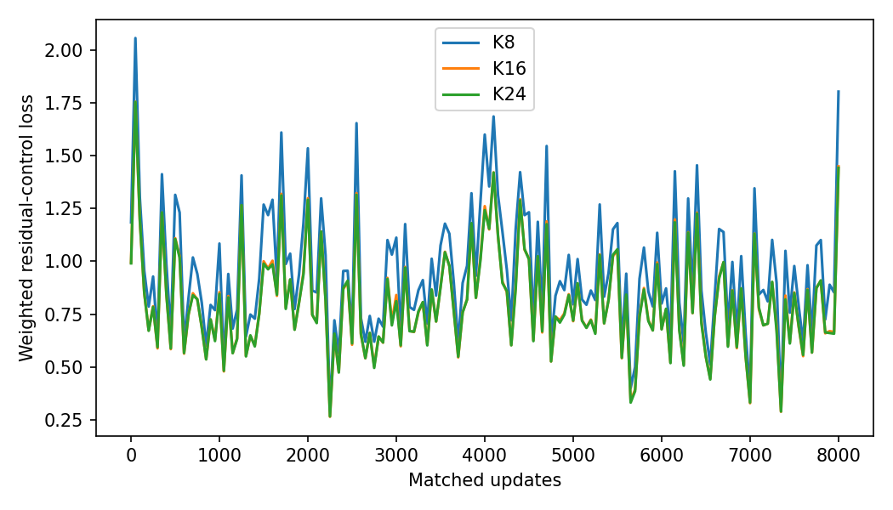

# Continuous vascular representations: fixed, adaptive and piecewise splines

## Status and scope

22 October 2026. GT study and frozen-detector geometry pilot completed successfully. Full end-to-end training is **not submitted**: the BRAVA scratch baseline is too weak to interpret a representation comparison. Completed previous results, local correctness examples, queued GT results and queued neural results are distinguished below. No test subjects are used.

## Existing evidence reused

Read [latest review](EXPERIMENT_REVIEW_20261022.md), [capacity audit](spline_learning/ixi-brava-control-capacity.md), [preparation](../../../../research/BRAVA_preparation.md) and [BRAVA study](BRAVA_experiment_plan.md).

The completed K8 audit covers 23,213 IXI/BRAVA development patches and 349,357 patch-edge occurrences. BRAVA validation has 5.01% of branches definitely above 1 mm; IXI has 0.18%. Previous K12/K16 fits were an enriched difficult subset, not population estimates. This study reuses cached K8 controls and original paths, and computes K8 distances within the new paired comparison as required for per-edge adaptive decisions. It does not repeat old GPU inference or the botanical experiment.

## Implementation audit

- `data/spline_targets.py::fit_spline` already accepts K. Cubic (degree 3) **B-splines**, uniform interior knots, four repeated endpoint knots; each K has its own basis. First/last controls are fixed to dense-path endpoints. Interior controls minimize least squares on 257 arc-length-resampled guide points. Fits need not improve monotonically in maximum error as K changes.
- `models/spline.py::SplineHead` and `models/local_spline_geometry.py` already accept K. The head predicts physical residuals relative to the endpoint chord at Greville abscissae; endpoints copy predicted graph nodes exactly. Local CNN features are sampled along the provisional curve. Both output projections depend on K; hidden trunks are reusable.
- `scripts/prepare_transfer_splines.py` currently fixes K8 during export; caches include controls, 64 curve/guide samples, nodes/edges, physical metric and **original dense full_paths/path_offsets**. Loader validates graph/cache correspondence and K. This experiment leaves the validated datasets untouched and refits dense targets in a local training adapter. Checkpoint configs record the actual head K; the loader view reads the source K8 cache before target replacement.
- `training/losses/criterion.py::loss_spline` uses Smooth L1 (beta 1 mm) on interior residual controls, averaged across controls and xyz per edge, then across supervised edges. Existing weight 1.4739989612791453 is retained. No additional detector loss. Increasing K does not multiply this mean loss. Explicit splitting would alter edge weighting and the supervised node population, so it requires a separate training design.
- Common-v2 Curve/Branch metrics read **original dense paths**, whereas control and fitted-curve training diagnostics compare with fitted spline targets. These references must not be conflated.
- BRAVA curvature-adaptive source graphs already retain geometrically useful guide points, but model spline target construction contracts degree-2 chains while retaining anatomical endpoints/junctions/crop boundaries. Existing contraction therefore cannot be assumed to preserve proposed extra query anchors.
- BRAVA paths inherit the validated SWC parent connectivity, physical affine and explicit subject reflection corrections. IXI/SyntheticMRI paths inherit their extracted/generated graph guides: uncertain geometric labels, not independently traced perfect anatomy. Brain masks are not vessel GT and are not used here.

## New GT comparison

BRAVA: **all 8,768 train / 1,796 validation patches (39/8 subjects)**. IXI: deterministic subject-balanced **1,024 train / 480 validation (123/26 subjects)**. SyntheticMRI: **1,024 train / 480 validation (64/13 source volumes)** from `transfer_source_k8_25k_20261015`. The smaller extensions are focused comparisons, not new full-population prevalence estimates. Exact IDs, input manifest SHA256 and subject mappings: `experiments/continuous_representation/plan.json`.

|Method|Geometry decision|Graph nodes|
|---|---|---|
|Fixed K4/8/12/16/24|Independent endpoint-constrained fit at each K|Unchanged|
|Oracle adaptive K|Smallest candidate meeting a predefined error bound; otherwise lowest-error candidate with explicit failure flag|Unchanged|
|K24 curve compression|Refit the high-capacity curve with smaller K, measuring compression against that curve, never using the dense reference to select K|Unchanged|
|Piecewise K8 inside one edge|Adaptive fitted subsegments with shared internal joins|Unchanged; internal joins are geometry parameters|
|Explicit degree-2 splitting|Exactly the same subsegments and joins|One extra graph node and edge per join|

Tolerance grid **0.25/0.5/1 mm**, fixed in advance. Dense references are the already cropped original paths. Greedy error-driven subdivision chooses an original vertex at the largest dense-to-spline error within a **2-mm minimum child arc length**; for overshoot it uses arc midpoint. Adjacent pieces merge when the merged fit passes. At most 32 segments. Unresolved tolerance failures are recorded. This is a bounded heuristic, **not a globally minimum segmentation proof**. Long straight paths need no split. Length and total turning angle are reported as strata, not used as a length-only splitting rule.

All subsegments keep their original ordered path intervals. Splitting preserves endpoints, junctions and patch boundaries; each subdivision adds one V and one E and therefore preserves connected components/cycle rank. Internal piecewise joins are C0 continuous; tangent continuity is **not enforced**. No global self-intersection guarantee is claimed.

Distances: physical coordinates, arc sampling at 0.1 mm plus original vertices for maxima, spline tessellation bound 0.01 mm. Continuous symmetric maximum lies in `[sampled maximum−0.01, sampled maximum+0.06]` mm. A tolerance passes only using the conservative upper bound. Directed errors, symmetric mean/max, P95, tolerance coverage, arc/chord length, tortuosity and turning are recorded. Piecewise maximum is bounded against each corresponding dense interval; mean is segment-arc-weighted and the reported piecewise P95 is the **largest segment P95**, not a pooled percentile. This conservative correspondence check avoids hiding a missed bend against a nearby unrelated segment.

Complexity includes raw controls, shared endpoint bookkeeping, graph nodes/edges, unique coordinate vectors, float32-coordinate and int64-edge-index bytes, and fraction of patches within 256 queries. Internal piecewise geometry and graph splitting have equal coordinate-vector costs but very different detector/relation demands. Counts are per original patch branch; overlapping crops are not independent anatomical branches. Actual CPU timing is saved per task.

## Completed local checks and example (not population results)

Five focused tests pass (including variable-K local-CNN head shapes, zero-chord initialization and finite CPU gradients): straight K4/no splitting, curved path splitting with exact joins/topology accounting, inference compression and reversal invariance, explicit failed tolerance. One full worker/collector smoke used the 34 edges of `sample_000002_0222`; it generated the tables and standalone 3D overlays without publishing smoke aggregates as population results.

For its 82.1-mm branch (edge14): K8/K12/K16/K24 sampled maximum errors are **2.930/1.272/0.680/0.444 mm**. K24 narrowly fails the conservative 0.5-mm certificate (upper bound 0.504 mm). Piecewise K8 at 0.5 mm uses **5 segments / 40 raw controls**, maximum 0.378 mm; explicit splitting adds four graph nodes, while internal segments add none. At 1 mm it uses two segments. This example justifies testing K24 and piecewise options; it does not establish learned superiority.

Local viewer: `experiments/continuous_representation/smoke/results/overlays.html` (edges14/25/18). Dense orange thick; K8 cyan; K16 magenta; K24 green; piecewise white, join diamonds. The collector produces the full report copy under evidence.

## BRAVA detector diagnosis and the training gate

Prior scratch runs completed 23,500 updates but produced only 4 true/226 false edges (standard) and 1 true/68 false (refinement) on validation. In the standard training log, total loss declined 13.22→4.61; the last logged batch still had approximately **4.93-mm spline endpoint error** (middle batch 5.27 mm). These are different minibatches, not a fixed-population learning-curve estimate. Reduced training losses do not establish adequate node localization or generalization. The polynomial LR reaches zero at the end; this run does not test whether a longer/different transfer schedule would recover performance.

The IXI-pretrained zero-shot model is stronger (previous full-validation positional edge F1 0.0269, Curve F1 0.0580), but still weak in absolute terms. Frozen-head comparisons below are therefore **conditional geometry learning diagnostics**, not a claim of a workable final BRAVA detector. Missing nodes/relations cannot be repaired by a frozen spline head. Next detector step is a bounded IXI→BRAVA fine-tuning pilot using unchanged losses, with fixed-population node/relation learning curves and raw-query versus filtered recovery. It is prepared as a recommendation, **not automatically submitted in this representation batch**.

## Focused learned geometry experiments

Common initializer: IXI delayed-spline `best.pt`, SHA256 `1cd9caf35a3683ef643c541ea4c4d06b247c490a4215d4a250f4519992d68eb3`; exact path in plan. Full detector/backbone/transformer/node/relation parameters and BN buffers frozen. Trunks copied from the existing spline/local-CNN head; both geometry output projections reset to zero in **all** K8/K16/K24 arms. All therefore start at identical straight chords; shared trunk parameters are identical. Existing cached original pretrained K8 decoded graphs are also evaluated separately where available.

Training **2,048 BRAVA patches across all 39 train subjects**, validation **512 patches across all 8 validation subjects**; 256 training-monitor patches cover all training subjects. Deterministic subject-balanced manifests, same batch order, batch size4; evaluation batch size1. No augmentation in this frozen geometry pilot, consistently across arms. Same AdamW parameters and 7e-5 base LR, 100-update warmup then polynomial decay. Existing residual-control Smooth L1 and local CNN conditioning; Hungarian assignment uses the actual frozen training matcher and predicted nodes. Source targets are refitted from original dense paths at each K. Geometry loss has no gradient path to detector components.

Budget is locked by a GPU smoke/benchmark after the GT gate: common `min(8000, floor(3600/(1.2 × slowest seconds/update)/100) × 100)` updates, minimum1000 or fail. All heads compare at the same updates; checkpoints at1000, halfway and final. Two-hour training allocation per arm, approximately one-hour target compute. Exact updates/timings/parameter counts will be in `budget.json` and final results. No validation-driven early selection/tuning; final matched update is primary.

The benchmark verifies zero-residual chords, exact node/logit parity across K, finite head gradients, no detector gradients, unchanged frozen-state hashes, a tiny training→prediction→CPU collection smoke, then emits the budget. Failed prerequisites block downstream jobs. Saved prediction arrays must have identical nodes, edges, query IDs, Hungarian edge populations and relation scores across heads; collector asserts parity.

Frozen feature maps were not saved in the earlier prediction caches. Training streams MRA through the frozen detector; original decoded predictions are reused where available. No all-pair image-feature tensors are generated. New caches contain geometry outputs and matched-positive controls, not enormous CNN maps.

### Adaptive inference experiments

- **B1:** simplify predicted K24 curves at 0.5-mm compression tolerance. No GT input and no new loss. Compression error is relative to the prediction; final error is still measured against original dense paths. It is output compression, not reduced neural output capacity.
- **B2 low-cost probe:** separately fit a standardized multinomial logistic classifier on predicted K24 curve-shape features from training subjects. Labels are the smallest GT-fit K meeting 0.5 mm; failed oracle fits are counted and assigned the best available fit. Validation subjects are disjoint. Inference features contain only the predicted curve. Predicted K selects an independently refitted B-spline of that predicted curve. Also report oracle-label selection of the same predicted curve as a diagnostic.
- This B2 probe is **learned compression selection**, not yet K-specific neural geometry projections. A shared trunk plus K-specific projections remains pending; variable target shapes and routing need their own correctness/optimization check. It is not mislabelled as genuine adaptive neural capacity.

Evaluation records predicted-versus-dense error, endpoint-neutral error (evaluation-only residual transfer), and matched-endpoint subsets separately from node/relation graph errors. Same decoded graph common-v2 metrics, original/chord comparisons, train/validation breakdown, subject-paired bootstrap differences and per-branch tables are collected. Fixed-head output sizes and trainable parameters quantify model costs. Actual graph metrics and predictions are saved; finer geometry cannot imply better connectivity when the graph is frozen.

## Explicitly pending experiments

1. Establish a useful IXI-initialized BRAVA fine-tuned detector; select by validation only. No detector training is launched here.
2. A learned K-specific projection bank and separate frozen-embedding selector; the current probe selects compressed outputs only.
3. A learned internal-piecewise head with predicted segment boundaries/count and a stable join convention. Current GT piecewise fits use oracle breakpoints; these cannot be passed to inference as features.
4. Explicit-splitting GT-anchor/oracle-topology geometry-head training and full graph prediction: added anchors need defined token/image features, modified graph caches and original-branch-normalized spline weights. Existing loaders/criterion accept one fixed-K target per edge; silently treating oracle split nodes as predicted queries would be invalid.
5. Once the detector gate passes: matched K8/larger-K/B1 pilots, then adaptive-head or explicit-split pilots only after their contracts are verified. Preserve node/edge losses and matcher; one seed, no factorial sweep.

Thus all four geometry/complexity options are tested at GT level now, with valid fixed-head and adaptive-compression neural comparisons. No claim that GT fit improvements alone establish model reconstruction gains.

## Execution and retrieval

Accepted IDs and dependencies are appended by the submitter. Large caches/checkpoints: `/lustre/fsn1/projects/rech/vnc/upz25mj/experiments/gnbm/continuous_representation_20261022`.

Compact evidence: `docs/research/evidence/continuous_representation/`. Detailed GT edge tables remain under SCRATCH `gt/`; learned tables, per-subject summaries and overlays under `results/`. The collector updates only this report's marked generated section, preserving prior reviews.

Retrieve without imports, inference or training:

```bash
python3 scripts/show_continuous_representation.py
```

### Accepted submission

|Stage|Job|Dependency|Array|Allocation|
|---|---|---|---|---|
|GT representations|1434268|none|0-17%4|06:00:00|
|GT collection|1434269|afterok:1434268|none|02:00:00|
|GPU correctness and benchmark|1434270|afterok:1434269|none|01:00:00|
|Frozen geometry heads K8 K16 K24|1434271|afterok:1434270|0-2%2|02:00:00|
|Frozen predictions|1434272|afterok:1434271|0-2%2|02:00:00|
|Learned metrics and adaptive selectors|1434273|afterok:1434272|none|06:00:00|

All stages use afterok prerequisites; GPU concurrency is at most two. No full detector training submitted. GPU correctness and actual update budget remain pending the gated benchmark.

## Recovery of the geometry smoke collector

All18 GT tasks and collector1434269 completed. GPU smoke1434270 passed the five original tests,36 short head-training updates and all six-patch prediction caches, then failed in common-v2 representation-control bookkeeping. A rectangular array conversion assumed equal K on every edge. The fix sums each edge's internal control count; geometric/topological metric definitions and existing uniform-K counts are unchanged. The cached replay also exposed string metadata being passed into the numeric metric aggregator; it now receives only common metric fields. A focused regression checks ragged and fixed-K counts and metric parity. Saved smoke outputs were replayed on CPU. No GT work or full training is repeated. The replacement benchmark uses a new smoke directory, preserving failed-run evidence, and saves timing before collection.

|Stage|Replacement job|Dependency|
|---|---|---|
|GPU correctness and benchmark|1446429|none|
|Frozen geometry heads K8 K16 K24|1446432|afterok:1446429|
|Frozen predictions|1446433|afterok:1446432|
|Learned metrics and adaptive selectors|1446434|afterok:1446433|

<!-- COMPLETED INTERPRETATION -->
## Completed results and interpretation — 22 October 2026

Final collector1446434 completed successfully in28m28s. All18 GT tasks completed; replacement GPU smoke1446429, all three training tasks1446432 and prediction tasks1446433 completed. The earlier collector bugs were fixed and verified against saved smoke outputs. No full detector training, test evaluation or further GPU work was launched.

### BRAVA GT: capacity and graph complexity

All1,796 validation patches /8 subjects /19,446 patch-edge occurrences, referenced to original dense paths. Coverage below uses the conservative continuous symmetric maximum bound, not just average distance.

|Representation|Mean symmetric error mm|P95 branch maximum mm|Branches within0.5 mm|Mean raw controls per original branch|
|---|---:|---:|---:|---:|
|Fixed K8|0.0898|1.0110|77.19%|8|
|Fixed K12|0.0437|0.6135|88.36%|12|
|Fixed K16|0.0266|0.4732|94.02%|16|
|Fixed K24|0.0131|0.3011|98.34%|24|
|Oracle adaptive K,0.5 mm|0.0690|0.4271|98.35%|7.79|
|Piecewise K8 inside one edge,0.5 mm|0.0460|0.4131|100%|10.61|
|Same segments with graph splitting|0.0460|0.4131|100%|10.61|

Adaptive K saves controls by spending the available error tolerance: it does not minimize mean distance. Its labels still fail the0.5-mm criterion on1.65% of branches because none of the available K values passes. Piecewise fitting succeeds on every evaluated BRAVA validation branch at0.5 mm, with22.81% of branches requiring subdivision. At0.25 mm, piecewise success is99.84%, with16.31 raw controls/branch; this is not a universal arbitrary-tolerance guarantee.

At0.5 mm, explicit graph splitting increases mean nodes17.14→20.67 (+20.6%), max nodes69→97, and mean all-node candidate pairs206.3→305.7 (+48.2%). All validation patches still fit256 queries. Internal piecewise segments retain17.14 graph nodes and the original pair population. Both store the same106.83 unique coordinate vectors/patch after shared-endpoint accounting, versus82.11 for fixed K8 and255.34 for fixed K24. Extra graph nodes therefore provide no GT geometry benefit over the identical internal segmentation; their learned detector/relation costs remain untested. Internal joins are C0, without enforced tangent continuity.

### IXI and SyntheticMRI extensions

Focused subject-balanced validation subsets of480 patches each, not repeated full-population audits. Fixed K8 already meets0.5 mm for99.14% of IXI branches and99.32% of SyntheticMRI branches. Oracle adaptive selection meets the tolerance for100% using4.38/4.58 controls on average. Piecewise K8 also reaches100%, using8.08/8.05 controls on average. The larger representation bottleneck is concentrated in BRAVA and rare complex branches; these results do not explain general IXI connectivity failures.

### Learned geometry: matched detector and training budget

Common frozen IXI detector;2,048 BRAVA training patches /39 subjects and512 validation patches /8 subjects. Each K8/K16/K24 head completed8,000 batch4 updates, identical order and frozen-state hash, approximately15.6 training-population passes. Actual training took17.6–18.7 minutes (job elapsed18–20 minutes), **shorter than the nominal one-hour target because the8,000-update cap bound the budget**. These are finite-budget geometry pilots, not convergence evidence. Trainable parameters1.578M/1.593M/1.608M.

|Method|Validation common-v2 Curve F1|Mean matched-pair error mm|Endpoint-neutral mean error mm|
|---|---:|---:|---:|
|Original IXI pretrained K8|0.05782|not cached|not cached|
|BRAVA-trained frozen head K8|0.06050|3.10090|1.39998|
|BRAVA-trained frozen head K16|0.06064|3.09981|1.39997|
|BRAVA-trained frozen head K24|0.06087|3.10013|1.40004|
|K24 + geometric compression|0.06058|3.10123|1.40081|
|K24 + separately learned compression selector|0.06062|3.10077|1.40017|

K24−K8 Curve F1 is+0.000363 (paired subject-bootstrap95% interval[+0.000145,+0.000611]). This is a small measurable change, not a substantial graph reconstruction improvement. K8 adaptation versus the original head is+0.002682 [0.001986,0.003408]. These intervals resample8 subjects and recompute pooled common-v2 Curve F1; they do not cover training-seed uncertainty. Endpoint-neutral K24−K8 mean-error interval[-0.001479,+0.001774] mm includes zero. Fine curve capacity therefore has no convincing benefit in that geometry diagnostic under this setup.

Only81/5,445 Hungarian-positive validation pairs (1.49%) have both predicted endpoints within1 mm of their assigned GT endpoints. For that small subset, mean errors K8/K16/K24 are0.8893/0.8875/0.8912 mm. Hungarian assignment is not correct localization. The large gap between near-perfect target fits and ~3.10-mm predicted-curve errors primarily reflects the weak detector/geometry learning setting; it does not invalidate adaptive representations.

All heads share node recall23.47% at2 mm, edge F10.02696, Branch F10.00250, component MAE7.564 and cycle MAE0.410. They predict106 correct and2,313 incorrect edges;97.84% of incorrect edges involve at least one spatially unmatched node. Of5,445 GT edges, only454 have both endpoints recovered at2 mm, and106 are predicted (conditional recall23.35%). These connectivity quantities are unchanged by construction. Node selection/localization and relation learning remain critical bottlenecks.

### Adaptive inference and limits

Geometric simplification compresses predicted K24 curves to4.04 controls on average, with nearly unchanged error and Curve F1. The separately trained classifier uses6.69 controls on validation and offers no accuracy advantage; even oracle GT labels selecting compression give essentially unchanged error. This is evidence for compact storage of these predictions, not genuine variable-capacity neural prediction. Compression tolerances are measured relative to the predicted curve and do not certify accuracy against anatomy. The classifier sees predicted curve features only; GT complexity labels are confined to training.

### Recommended direction

**Most promising representation candidate: piecewise geometry inside each existing graph edge**, because the GT study reaches the chosen accuracy with moderate geometric complexity and no additional detector queries or relations. This is a representation result, not yet a learned-model result. Keep fixed K16/K24 as simple controls; adaptive fixed-K labels are also attractive for output efficiency. Explicit degree-2 splitting should be an alternative only if its added graph supervision yields a measurable benefit.

Before full end-to-end comparisons, establish a useful IXI→BRAVA fine-tuned detector with unchanged losses and fixed-population monitoring. Then test a bounded internal-piecewise geometry head with GT-anchor/oracle-topology geometry learning and a valid inference-time segment decision. A K-specific projection bank and learned internal-piecewise or split-graph generators were **not trained in this batch**. No new joint detector losses or architectural sweeps are justified by these results alone.

Evidence: `docs/research/evidence/continuous_representation/`; standalone viewer `overlays.html`; learning curves `training-curves.png`. Additional paired Curve F1 bootstrap is reproducible with `python3 scripts/summarize_continuous_results.py` using saved caches only.

<!-- GENERATED RESULTS -->

## New GT results

All distances use original dense paths. Piecewise mean is segment-arc-weighted; its P95 field is the maximum segment P95, not a pooled percentile. Explicit splitting and internal segments share the same curves; only graph-node costs differ.

| dataset      | split   | method                |   tolerance_mm |   branches |   mean_mm |   p95_branch_max_mm |   worst_max_mm |   controls_per_branch |   extra_nodes_per_branch |   failed_fraction |   fraction_extra_controls |   fraction_split |   within_0.25 |   within_0.5 |   within_1.0 |
|:-------------|:--------|:----------------------|---------------:|-----------:|----------:|--------------------:|---------------:|----------------------:|-------------------------:|------------------:|--------------------------:|-----------------:|--------------:|-------------:|-------------:|
| BRAVA        | train   | compress_GT24         |           0.25 |      93248 |   0.03549 |             0.33602 |        1.26619 |              10.8338  |                  0       |           0.3553  |                   0.44081 |          0       |       0.6447  |      0.97988 |      0.99975 |
| BRAVA        | train   | compress_GT24         |           0.5  |      93248 |   0.08003 |             0.55618 |        1.26619 |               7.06898 |                  0       |           0.20338 |                   0.18679 |          0       |       0.31992 |      0.79662 |      0.99957 |
| BRAVA        | train   | compress_GT24         |           1    |      93248 |   0.14177 |             0.94968 |        1.68756 |               5.19067 |                  0       |           0.05403 |                   0.04512 |          0       |       0.29576 |      0.53466 |      0.94597 |
| BRAVA        | train   | fixed_12              |           0    |      93248 |   0.04503 |             0.63937 |        3.55373 |              12       |                  0       |           0       |                   1       |          0       |       0.65713 |      0.87393 |      0.98651 |
| BRAVA        | train   | fixed_16              |           0    |      93248 |   0.02756 |             0.49109 |        2.1727  |              16       |                  0       |           0       |                   1       |          0       |       0.75823 |      0.93322 |      0.99721 |
| BRAVA        | train   | fixed_24              |           0    |      93248 |   0.01347 |             0.31542 |        1.26619 |              24       |                  0       |           0       |                   1       |          0       |       0.8764  |      0.98051 |      0.99975 |
| BRAVA        | train   | fixed_4               |           0    |      93248 |   0.33762 |             3.09175 |       12.7198  |               4       |                  0       |           0       |                   0       |          0       |       0.29742 |      0.49842 |      0.73736 |
| BRAVA        | train   | fixed_8               |           0    |      93248 |   0.09222 |             1.02223 |        4.9988  |               8       |                  0       |           0       |                   0       |          0       |       0.50845 |      0.75865 |      0.93928 |
| BRAVA        | train   | oracle_K              |           0.25 |      93248 |   0.02927 |             0.31535 |        1.26619 |              12.0687  |                  0       |           0.12354 |                   0.49155 |          0       |       0.87646 |      0.98055 |      0.99976 |
| BRAVA        | train   | oracle_K              |           0.5  |      93248 |   0.06799 |             0.42786 |        1.26619 |               7.99983 |                  0       |           0.01945 |                   0.24135 |          0       |       0.34039 |      0.98055 |      0.99976 |
| BRAVA        | train   | oracle_K              |           1    |      93248 |   0.13306 |             0.84988 |        1.26619 |               5.36839 |                  0       |           0.00024 |                   0.0607  |          0       |       0.29757 |      0.55385 |      0.99976 |
| BRAVA        | train   | piecewise_inside_edge |           0.25 |      93248 |   0.0196  |             0.18346 |        0.35787 |              16.5817  |                  0       |           0.00153 |                   0.49129 |          0.49129 |       0.99847 |      1       |      1       |
| BRAVA        | train   | piecewise_inside_edge |           0.5  |      93248 |   0.04585 |             0.41285 |        0.44    |              10.8214  |                  0       |           0       |                   0.24135 |          0.24135 |       0.53227 |      1       |      1       |
| BRAVA        | train   | piecewise_inside_edge |           1    |      93248 |   0.0718  |             0.7508  |        0.93982 |               8.53852 |                  0       |           0       |                   0.06072 |          0.06072 |       0.50857 |      0.7684  |      1       |
| BRAVA        | train   | split_graph           |           0.25 |      93248 |   0.0196  |             0.18346 |        0.35787 |              16.5817  |                  1.07271 |           0.00153 |                   0.49129 |          0.49129 |       0.99847 |      1       |      1       |
| BRAVA        | train   | split_graph           |           0.5  |      93248 |   0.04585 |             0.41285 |        0.44    |              10.8214  |                  0.35267 |           0       |                   0.24135 |          0.24135 |       0.53227 |      1       |      1       |
| BRAVA        | train   | split_graph           |           1    |      93248 |   0.0718  |             0.7508  |        0.93982 |               8.53852 |                  0.06732 |           0       |                   0.06072 |          0.06072 |       0.50857 |      0.7684  |      1       |
| BRAVA        | val     | compress_GT24         |           0.25 |      19446 |   0.03566 |             0.33151 |        1.14826 |              10.6202  |                  0       |           0.35437 |                   0.43135 |          0       |       0.64563 |      0.98308 |      0.99985 |
| BRAVA        | val     | compress_GT24         |           0.5  |      19446 |   0.07992 |             0.54461 |        1.14826 |               6.94868 |                  0       |           0.18564 |                   0.17957 |          0       |       0.31976 |      0.81436 |      0.99979 |
| BRAVA        | val     | compress_GT24         |           1    |      19446 |   0.14065 |             0.93921 |        1.50724 |               5.15355 |                  0       |           0.04983 |                   0.04325 |          0       |       0.29718 |      0.55117 |      0.95017 |
| BRAVA        | val     | fixed_12              |           0    |      19446 |   0.04365 |             0.61349 |        3.23601 |              12       |                  0       |           0       |                   1       |          0       |       0.66466 |      0.88363 |      0.98781 |
| BRAVA        | val     | fixed_16              |           0    |      19446 |   0.0266  |             0.47316 |        1.59432 |              16       |                  0       |           0       |                   1       |          0       |       0.7688  |      0.94019 |      0.99712 |
| BRAVA        | val     | fixed_24              |           0    |      19446 |   0.01308 |             0.3011  |        1.14826 |              24       |                  0       |           0       |                   1       |          0       |       0.88039 |      0.98344 |      0.99985 |
| BRAVA        | val     | fixed_4               |           0    |      19446 |   0.33252 |             3.0869  |        9.87568 |               4       |                  0       |           0       |                   0       |          0       |       0.29867 |      0.51507 |      0.74596 |
| BRAVA        | val     | fixed_8               |           0    |      19446 |   0.08985 |             1.01097 |        5.25908 |               8       |                  0       |           0       |                   0       |          0       |       0.5179  |      0.77188 |      0.94045 |
| BRAVA        | val     | oracle_K              |           0.25 |      19446 |   0.02908 |             0.3011  |        1.14826 |              11.9083  |                  0       |           0.11956 |                   0.4821  |          0       |       0.88044 |      0.98354 |      0.99985 |
| BRAVA        | val     | oracle_K              |           0.5  |      19446 |   0.06896 |             0.42709 |        1.14826 |               7.78546 |                  0       |           0.01646 |                   0.22812 |          0       |       0.3357  |      0.98354 |      0.99985 |
| BRAVA        | val     | oracle_K              |           1    |      19446 |   0.13224 |             0.84456 |        1.14826 |               5.32531 |                  0       |           0.00015 |                   0.05955 |          0       |       0.29867 |      0.56958 |      0.99985 |
| BRAVA        | val     | piecewise_inside_edge |           0.25 |      19446 |   0.01973 |             0.18356 |        0.29338 |              16.3077  |                  0       |           0.00165 |                   0.48195 |          0.48195 |       0.99835 |      1       |      1       |
| BRAVA        | val     | piecewise_inside_edge |           0.5  |      19446 |   0.04599 |             0.41305 |        0.43998 |              10.6099  |                  0       |           0       |                   0.22812 |          0.22812 |       0.53919 |      1       |      1       |
| BRAVA        | val     | piecewise_inside_edge |           1    |      19446 |   0.07013 |             0.7363  |        0.93946 |               8.53317 |                  0       |           0       |                   0.05955 |          0.05955 |       0.51795 |      0.7835  |      1       |
| BRAVA        | val     | split_graph           |           0.25 |      19446 |   0.01973 |             0.18356 |        0.29338 |              16.3077  |                  1.03847 |           0.00165 |                   0.48195 |          0.48195 |       0.99835 |      1       |      1       |
| BRAVA        | val     | split_graph           |           0.5  |      19446 |   0.04599 |             0.41305 |        0.43998 |              10.6099  |                  0.32624 |           0       |                   0.22812 |          0.22812 |       0.53919 |      1       |      1       |
| BRAVA        | val     | split_graph           |           1    |      19446 |   0.07013 |             0.7363  |        0.93946 |               8.53317 |                  0.06665 |           0       |                   0.05955 |          0.05955 |       0.51795 |      0.7835  |      1       |
| IXI          | train   | compress_GT24         |           0.25 |      18339 |   0.01598 |             0.15723 |        0.54168 |               4.95949 |                  0       |           0.01178 |                   0.04073 |          0       |       0.98822 |      0.99984 |      1       |
| IXI          | train   | compress_GT24         |           0.5  |      18339 |   0.02878 |             0.29979 |        0.82863 |               4.45433 |                  0       |           0.00344 |                   0.01314 |          0       |       0.87535 |      0.99656 |      1       |
| IXI          | train   | compress_GT24         |           1    |      18339 |   0.04481 |             0.50424 |        1.09986 |               4.20546 |                  0       |           0.00049 |                   0.00278 |          0       |       0.82758 |      0.93555 |      0.99951 |
| IXI          | train   | fixed_12              |           0    |      18339 |   0.00417 |             0.07896 |        0.71196 |              12       |                  0       |           0       |                   1       |          0       |       0.9867  |      0.99842 |      1       |
| IXI          | train   | fixed_16              |           0    |      18339 |   0.00231 |             0.05021 |        0.68215 |              16       |                  0       |           0       |                   1       |          0       |       0.99504 |      0.99984 |      1       |
| IXI          | train   | fixed_24              |           0    |      18339 |   0.00125 |             0.03023 |        0.45162 |              24       |                  0       |           0       |                   1       |          0       |       0.99924 |      0.99995 |      1       |
| IXI          | train   | fixed_4               |           0    |      18339 |   0.08371 |             0.90693 |        6.59996 |               4       |                  0       |           0       |                   0       |          0       |       0.81548 |      0.89994 |      0.95136 |
| IXI          | train   | fixed_8               |           0    |      18339 |   0.01221 |             0.16759 |        2.21636 |               8       |                  0       |           0       |                   0       |          0       |       0.95638 |      0.98599 |      0.99706 |
| IXI          | train   | oracle_K              |           0.25 |      18339 |   0.01576 |             0.1524  |        0.45162 |               5.00485 |                  0       |           0.00076 |                   0.04362 |          0       |       0.99924 |      0.99995 |      1       |
| IXI          | train   | oracle_K              |           0.5  |      18339 |   0.02845 |             0.29292 |        0.45162 |               4.46393 |                  0       |           5e-05   |                   0.01401 |          0       |       0.87775 |      0.99995 |      1       |
| IXI          | train   | oracle_K              |           1    |      18339 |   0.04461 |             0.49807 |        0.93687 |               4.20634 |                  0       |           0       |                   0.00294 |          0       |       0.82845 |      0.93658 |      1       |
| IXI          | train   | piecewise_inside_edge |           0.25 |      18339 |   0.00648 |             0.10904 |        0.18964 |               8.40482 |                  0       |           0       |                   0.04362 |          0.04362 |       1       |      1       |      1       |
| IXI          | train   | piecewise_inside_edge |           0.5  |      18339 |   0.00889 |             0.1503  |        0.43969 |               8.11865 |                  0       |           0       |                   0.01401 |          0.01401 |       0.96477 |      1       |      1       |
| IXI          | train   | piecewise_inside_edge |           1    |      18339 |   0.01099 |             0.16619 |        0.9308  |               8.02356 |                  0       |           0       |                   0.00294 |          0.00294 |       0.95714 |      0.98811 |      1       |
| IXI          | train   | split_graph           |           0.25 |      18339 |   0.00648 |             0.10904 |        0.18964 |               8.40482 |                  0.0506  |           0       |                   0.04362 |          0.04362 |       1       |      1       |      1       |
| IXI          | train   | split_graph           |           0.5  |      18339 |   0.00889 |             0.1503  |        0.43969 |               8.11865 |                  0.01483 |           0       |                   0.01401 |          0.01401 |       0.96477 |      1       |      1       |
| IXI          | train   | split_graph           |           1    |      18339 |   0.01099 |             0.16619 |        0.9308  |               8.02356 |                  0.00294 |           0       |                   0.00294 |          0.00294 |       0.95714 |      0.98811 |      1       |
| IXI          | val     | compress_GT24         |           0.25 |      10075 |   0.0144  |             0.14993 |        0.28307 |               4.79722 |                  0       |           0.01012 |                   0.03047 |          0       |       0.98988 |      1       |      1       |
| IXI          | val     | compress_GT24         |           0.5  |      10075 |   0.02545 |             0.28914 |        0.58781 |               4.37558 |                  0       |           0.00169 |                   0.00824 |          0       |       0.8931  |      0.99831 |      1       |
| IXI          | val     | compress_GT24         |           1    |      10075 |   0.03977 |             0.46506 |        0.95256 |               4.15444 |                  0       |           0.0003  |                   0.00169 |          0       |       0.85032 |      0.94422 |      0.9997  |
| IXI          | val     | fixed_12              |           0    |      10075 |   0.00348 |             0.06531 |        0.9166  |              12       |                  0       |           0       |                   1       |          0       |       0.99097 |      0.99871 |      1       |
| IXI          | val     | fixed_16              |           0    |      10075 |   0.00196 |             0.04129 |        0.60399 |              16       |                  0       |           0       |                   1       |          0       |       0.99653 |      0.9997  |      1       |
| IXI          | val     | fixed_24              |           0    |      10075 |   0.00106 |             0.0251  |        0.27727 |              24       |                  0       |           0       |                   1       |          0       |       0.9996  |      1       |      1       |
| IXI          | val     | fixed_4               |           0    |      10075 |   0.06888 |             0.70051 |        8.33979 |               4       |                  0       |           0       |                   0       |          0       |       0.8398  |      0.91563 |      0.96298 |
| IXI          | val     | fixed_8               |           0    |      10075 |   0.0097  |             0.13428 |        1.91256 |               8       |                  0       |           0       |                   0       |          0       |       0.96744 |      0.99136 |      0.99831 |
| IXI          | val     | oracle_K              |           0.25 |      10075 |   0.0141  |             0.14432 |        0.27727 |               4.83335 |                  0       |           0.0004  |                   0.03256 |          0       |       0.9996  |      1       |      1       |
| IXI          | val     | oracle_K              |           0.5  |      10075 |   0.0253  |             0.28623 |        0.43983 |               4.37955 |                  0       |           0       |                   0.00864 |          0       |       0.89469 |      1       |      1       |
| IXI          | val     | oracle_K              |           1    |      10075 |   0.03964 |             0.46337 |        0.93868 |               4.15484 |                  0       |           0       |                   0.00169 |          0       |       0.85112 |      0.94452 |      1       |
| IXI          | val     | piecewise_inside_edge |           0.25 |      10075 |   0.00574 |             0.10021 |        0.18978 |               8.29935 |                  0       |           0       |                   0.03256 |          0.03256 |       1       |      1       |      1       |
| IXI          | val     | piecewise_inside_edge |           0.5  |      10075 |   0.00769 |             0.12775 |        0.43983 |               8.07543 |                  0       |           0       |                   0.00864 |          0.00864 |       0.97201 |      1       |      1       |
| IXI          | val     | piecewise_inside_edge |           1    |      10075 |   0.00904 |             0.13378 |        0.89724 |               8.01588 |                  0       |           0       |                   0.00169 |          0.00169 |       0.96764 |      0.99246 |      1       |
| IXI          | val     | split_graph           |           0.25 |      10075 |   0.00574 |             0.10021 |        0.18978 |               8.29935 |                  0.03742 |           0       |                   0.03256 |          0.03256 |       1       |      1       |      1       |
| IXI          | val     | split_graph           |           0.5  |      10075 |   0.00769 |             0.12775 |        0.43983 |               8.07543 |                  0.00943 |           0       |                   0.00864 |          0.00864 |       0.97201 |      1       |      1       |
| IXI          | val     | split_graph           |           1    |      10075 |   0.00904 |             0.13378 |        0.89724 |               8.01588 |                  0.00199 |           0       |                   0.00169 |          0.00169 |       0.96764 |      0.99246 |      1       |
| SyntheticMRI | train   | compress_GT24         |           0.25 |      16414 |   0.03382 |             0.18265 |        0.31992 |               6.10674 |                  0       |           0.02827 |                   0.09528 |          0       |       0.97173 |      1       |      1       |
| SyntheticMRI | train   | compress_GT24         |           0.5  |      16414 |   0.0676  |             0.38751 |        0.52539 |               4.57439 |                  0       |           0.00865 |                   0.00762 |          0       |       0.64128 |      0.99135 |      1       |
| SyntheticMRI | train   | compress_GT24         |           1    |      16414 |   0.08984 |             0.60673 |        1.02653 |               4.06165 |                  0       |           0.00128 |                   0.00012 |          0       |       0.58682 |      0.86816 |      0.99872 |
| SyntheticMRI | train   | fixed_12              |           0    |      16414 |   0.01135 |             0.1394  |        0.86765 |              12       |                  0       |           0       |                   1       |          0       |       0.97618 |      0.99933 |      1       |
| SyntheticMRI | train   | fixed_16              |           0    |      16414 |   0.00599 |             0.073   |        0.58687 |              16       |                  0       |           0       |                   1       |          0       |       0.9944  |      0.99994 |      1       |
| SyntheticMRI | train   | fixed_24              |           0    |      16414 |   0.00287 |             0.04351 |        0.28099 |              24       |                  0       |           0       |                   1       |          0       |       0.99976 |      1       |      1       |
| SyntheticMRI | train   | fixed_4               |           0    |      16414 |   0.09545 |             0.65941 |        5.15967 |               4       |                  0       |           0       |                   0       |          0       |       0.58651 |      0.8589  |      0.98386 |
| SyntheticMRI | train   | fixed_8               |           0    |      16414 |   0.02693 |             0.26373 |        1.17115 |               8       |                  0       |           0       |                   0       |          0       |       0.89491 |      0.99117 |      0.9997  |
| SyntheticMRI | train   | oracle_K              |           0.25 |      16414 |   0.03248 |             0.17441 |        0.28099 |               6.21323 |                  0       |           0.00024 |                   0.10509 |          0       |       0.99976 |      1       |      1       |
| SyntheticMRI | train   | oracle_K              |           0.5  |      16414 |   0.06665 |             0.37974 |        0.43999 |               4.6029  |                  0       |           0       |                   0.00883 |          0       |       0.64646 |      1       |      1       |
| SyntheticMRI | train   | oracle_K              |           1    |      16414 |   0.08955 |             0.60284 |        0.93984 |               4.0658  |                  0       |           0       |                   0.0003  |          0       |       0.5873  |      0.8692  |      1       |
| SyntheticMRI | train   | piecewise_inside_edge |           0.25 |      16414 |   0.01852 |             0.16006 |        0.18995 |               8.94358 |                  0       |           0       |                   0.10509 |          0.10509 |       1       |      1       |      1       |
| SyntheticMRI | train   | piecewise_inside_edge |           0.5  |      16414 |   0.02587 |             0.25359 |        0.43944 |               8.07213 |                  0       |           0       |                   0.00883 |          0.00883 |       0.8985  |      1       |      1       |
| SyntheticMRI | train   | piecewise_inside_edge |           1    |      16414 |   0.02687 |             0.26362 |        0.89549 |               8.00244 |                  0       |           0       |                   0.0003  |          0.0003  |       0.89491 |      0.99141 |      1       |
| SyntheticMRI | train   | split_graph           |           0.25 |      16414 |   0.01852 |             0.16006 |        0.18995 |               8.94358 |                  0.11795 |           0       |                   0.10509 |          0.10509 |       1       |      1       |      1       |
| SyntheticMRI | train   | split_graph           |           0.5  |      16414 |   0.02587 |             0.25359 |        0.43944 |               8.07213 |                  0.00902 |           0       |                   0.00883 |          0.00883 |       0.8985  |      1       |      1       |
| SyntheticMRI | train   | split_graph           |           1    |      16414 |   0.02687 |             0.26362 |        0.89549 |               8.00244 |                  0.0003  |           0       |                   0.0003  |          0.0003  |       0.89491 |      0.99141 |      1       |
| SyntheticMRI | val     | compress_GT24         |           0.25 |       7679 |   0.03334 |             0.18166 |        0.40486 |               6.07892 |                  0       |           0.02657 |                   0.09051 |          0       |       0.97343 |      1       |      1       |
| SyntheticMRI | val     | compress_GT24         |           0.5  |       7679 |   0.0671  |             0.39037 |        0.78313 |               4.55736 |                  0       |           0.00716 |                   0.00625 |          0       |       0.64683 |      0.99284 |      1       |
| SyntheticMRI | val     | compress_GT24         |           1    |       7679 |   0.08927 |             0.6121  |        0.97797 |               4.0599  |                  0       |           0.00091 |                   0       |          0       |       0.58927 |      0.87186 |      0.99909 |
| SyntheticMRI | val     | fixed_12              |           0    |       7679 |   0.01126 |             0.13936 |        0.73133 |              12       |                  0       |           0       |                   1       |          0       |       0.97643 |      0.99961 |      1       |
| SyntheticMRI | val     | fixed_16              |           0    |       7679 |   0.00597 |             0.07492 |        0.40107 |              16       |                  0       |           0       |                   1       |          0       |       0.9944  |      1       |      1       |
| SyntheticMRI | val     | fixed_24              |           0    |       7679 |   0.00287 |             0.04288 |        0.40486 |              24       |                  0       |           0       |                   1       |          0       |       0.99987 |      1       |      1       |
| SyntheticMRI | val     | fixed_4               |           0    |       7679 |   0.0947  |             0.66287 |        3.71524 |               4       |                  0       |           0       |                   0       |          0       |       0.58875 |      0.86222 |      0.98424 |
| SyntheticMRI | val     | fixed_8               |           0    |       7679 |   0.02636 |             0.26048 |        0.84945 |               8       |                  0       |           0       |                   0       |          0       |       0.89947 |      0.99323 |      1       |
| SyntheticMRI | val     | oracle_K              |           0.25 |       7679 |   0.03204 |             0.17409 |        0.40107 |               6.18414 |                  0       |           0.00013 |                   0.10053 |          0       |       0.99987 |      1       |      1       |
| SyntheticMRI | val     | oracle_K              |           0.5  |       7679 |   0.06638 |             0.3858  |        0.43992 |               4.57976 |                  0       |           0       |                   0.00677 |          0       |       0.65048 |      1       |      1       |
| SyntheticMRI | val     | oracle_K              |           1    |       7679 |   0.08899 |             0.60846 |        0.93875 |               4.06303 |                  0       |           0       |                   0       |          0       |       0.58953 |      0.8729  |      1       |
| SyntheticMRI | val     | piecewise_inside_edge |           0.25 |       7679 |   0.01844 |             0.15932 |        0.18998 |               8.9272  |                  0       |           0       |                   0.10053 |          0.10053 |       1       |      1       |      1       |
| SyntheticMRI | val     | piecewise_inside_edge |           0.5  |       7679 |   0.02558 |             0.24976 |        0.43896 |               8.05417 |                  0       |           0       |                   0.00677 |          0.00677 |       0.9022  |      1       |      1       |
| SyntheticMRI | val     | piecewise_inside_edge |           1    |       7679 |   0.02636 |             0.26048 |        0.84945 |               8       |                  0       |           0       |                   0       |          0       |       0.89947 |      0.99323 |      1       |
| SyntheticMRI | val     | split_graph           |           0.25 |       7679 |   0.01844 |             0.15932 |        0.18998 |               8.9272  |                  0.1159  |           0       |                   0.10053 |          0.10053 |       1       |      1       |      1       |
| SyntheticMRI | val     | split_graph           |           0.5  |       7679 |   0.02558 |             0.24976 |        0.43896 |               8.05417 |                  0.00677 |           0       |                   0.00677 |          0.00677 |       0.9022  |      1       |      1       |
| SyntheticMRI | val     | split_graph           |           1    |       7679 |   0.02636 |             0.26048 |        0.84945 |               8       |                  0       |           0       |                   0       |          0       |       0.89947 |      0.99323 |      1       |

### Patch complexity

|                                                          |   mean_nodes |   max_nodes |   mean_controls |   mean_coordinate_vectors |   query_coverage |
|:---------------------------------------------------------|-------------:|------------:|----------------:|--------------------------:|-----------------:|
| ('BRAVA', 'train', 'compress_GT24', 0.25)                |      16.7812 |          64 |        115.218  |                  110.729  |                1 |
| ('BRAVA', 'train', 'compress_GT24', 0.5)                 |      16.7812 |          64 |         75.1788 |                   70.69   |                1 |
| ('BRAVA', 'train', 'compress_GT24', 1.0)                 |      16.7812 |          64 |         55.203  |                   50.7142 |                1 |
| ('BRAVA', 'train', 'fixed_12', 0.0)                      |      16.7812 |          64 |        127.62   |                  123.132  |                1 |
| ('BRAVA', 'train', 'fixed_16', 0.0)                      |      16.7812 |          64 |        170.161  |                  165.672  |                1 |
| ('BRAVA', 'train', 'fixed_24', 0.0)                      |      16.7812 |          64 |        255.241  |                  250.752  |                1 |
| ('BRAVA', 'train', 'fixed_4', 0.0)                       |      16.7812 |          64 |         42.5401 |                   38.0513 |                1 |
| ('BRAVA', 'train', 'fixed_8', 0.0)                       |      16.7812 |          64 |         85.0803 |                   80.5915 |                1 |
| ('BRAVA', 'train', 'oracle_K', 0.25)                     |      16.7812 |          64 |        128.351  |                  123.862  |                1 |
| ('BRAVA', 'train', 'oracle_K', 0.5)                      |      16.7812 |          64 |         85.0785 |                   80.5896 |                1 |
| ('BRAVA', 'train', 'oracle_K', 1.0)                      |      16.7812 |          64 |         57.0931 |                   52.6042 |                1 |
| ('BRAVA', 'train', 'piecewise_inside_edge', 0.25)        |      16.7812 |          64 |        176.347  |                  160.45   |                1 |
| ('BRAVA', 'train', 'piecewise_inside_edge', 0.5)         |      16.7812 |          64 |        115.086  |                  106.846  |                1 |
| ('BRAVA', 'train', 'piecewise_inside_edge', 1.0)         |      16.7812 |          64 |         90.8075 |                   85.6028 |                1 |
| ('BRAVA', 'train', 'split_graph', 0.25)                  |      28.1896 |         108 |        176.347  |                  160.45   |                1 |
| ('BRAVA', 'train', 'split_graph', 0.5)                   |      20.5319 |          77 |        115.086  |                  106.846  |                1 |
| ('BRAVA', 'train', 'split_graph', 1.0)                   |      17.4971 |          65 |         90.8075 |                   85.6028 |                1 |
| ('BRAVA', 'val', 'compress_GT24', 0.25)                  |      17.1414 |          69 |        114.989  |                  110.475  |                1 |
| ('BRAVA', 'val', 'compress_GT24', 0.5)                   |      17.1414 |          69 |         75.2361 |                   70.7227 |                1 |
| ('BRAVA', 'val', 'compress_GT24', 1.0)                   |      17.1414 |          69 |         55.7996 |                   51.2862 |                1 |
| ('BRAVA', 'val', 'fixed_12', 0.0)                        |      17.1414 |          69 |        129.929  |                  125.415  |                1 |
| ('BRAVA', 'val', 'fixed_16', 0.0)                        |      17.1414 |          69 |        173.238  |                  168.725  |                1 |
| ('BRAVA', 'val', 'fixed_24', 0.0)                        |      17.1414 |          69 |        259.858  |                  255.344  |                1 |
| ('BRAVA', 'val', 'fixed_4', 0.0)                         |      17.1414 |          69 |         43.3096 |                   38.7962 |                1 |
| ('BRAVA', 'val', 'fixed_8', 0.0)                         |      17.1414 |          69 |         86.6192 |                   82.1058 |                1 |
| ('BRAVA', 'val', 'oracle_K', 0.25)                       |      17.1414 |          69 |        128.935  |                  124.422  |                1 |
| ('BRAVA', 'val', 'oracle_K', 0.5)                        |      17.1414 |          69 |         84.2962 |                   79.7829 |                1 |
| ('BRAVA', 'val', 'oracle_K', 1.0)                        |      17.1414 |          69 |         57.6592 |                   53.1459 |                1 |
| ('BRAVA', 'val', 'piecewise_inside_edge', 0.25)          |      17.1414 |          69 |        176.57   |                  160.813  |                1 |
| ('BRAVA', 'val', 'piecewise_inside_edge', 0.5)           |      17.1414 |          69 |        114.877  |                  106.832  |                1 |
| ('BRAVA', 'val', 'piecewise_inside_edge', 1.0)           |      17.1414 |          69 |         92.392  |                   87.157  |                1 |
| ('BRAVA', 'val', 'split_graph', 0.25)                    |      28.3853 |         135 |        176.57   |                  160.813  |                1 |
| ('BRAVA', 'val', 'split_graph', 0.5)                     |      20.6737 |          97 |        114.877  |                  106.832  |                1 |
| ('BRAVA', 'val', 'split_graph', 1.0)                     |      17.863  |          74 |         92.392  |                   87.157  |                1 |
| ('IXI', 'train', 'compress_GT24', 0.25)                  |      21.8291 |         106 |         88.8203 |                   74.8311 |                1 |
| ('IXI', 'train', 'compress_GT24', 0.5)                   |      21.8291 |         106 |         79.7734 |                   65.7842 |                1 |
| ('IXI', 'train', 'compress_GT24', 1.0)                   |      21.8291 |         106 |         75.3164 |                   61.3271 |                1 |
| ('IXI', 'train', 'fixed_12', 0.0)                        |      21.8291 |         106 |        214.91   |                  200.921  |                1 |
| ('IXI', 'train', 'fixed_16', 0.0)                        |      21.8291 |         106 |        286.547  |                  272.558  |                1 |
| ('IXI', 'train', 'fixed_24', 0.0)                        |      21.8291 |         106 |        429.82   |                  415.831  |                1 |
| ('IXI', 'train', 'fixed_4', 0.0)                         |      21.8291 |         106 |         71.6367 |                   57.6475 |                1 |
| ('IXI', 'train', 'fixed_8', 0.0)                         |      21.8291 |         106 |        143.273  |                  129.284  |                1 |
| ('IXI', 'train', 'oracle_K', 0.25)                       |      21.8291 |         106 |         89.6328 |                   75.6436 |                1 |
| ('IXI', 'train', 'oracle_K', 0.5)                        |      21.8291 |         106 |         79.9453 |                   65.9561 |                1 |
| ('IXI', 'train', 'oracle_K', 1.0)                        |      21.8291 |         106 |         75.332  |                   61.3428 |                1 |
| ('IXI', 'train', 'piecewise_inside_edge', 0.25)          |      21.8291 |         106 |        150.523  |                  135.628  |                1 |
| ('IXI', 'train', 'piecewise_inside_edge', 0.5)           |      21.8291 |         106 |        145.398  |                  131.144  |                1 |
| ('IXI', 'train', 'piecewise_inside_edge', 1.0)           |      21.8291 |         106 |        143.695  |                  129.653  |                1 |
| ('IXI', 'train', 'split_graph', 0.25)                    |      22.7354 |         106 |        150.523  |                  135.628  |                1 |
| ('IXI', 'train', 'split_graph', 0.5)                     |      22.0947 |         106 |        145.398  |                  131.144  |                1 |
| ('IXI', 'train', 'split_graph', 1.0)                     |      21.8818 |         106 |        143.695  |                  129.653  |                1 |
| ('IXI', 'val', 'compress_GT24', 0.25)                    |      24.8312 |         141 |        100.692  |                   83.5438 |                1 |
| ('IXI', 'val', 'compress_GT24', 0.5)                     |      24.8312 |         141 |         91.8417 |                   74.6938 |                1 |
| ('IXI', 'val', 'compress_GT24', 1.0)                     |      24.8312 |         141 |         87.2    |                   70.0521 |                1 |
| ('IXI', 'val', 'fixed_12', 0.0)                          |      24.8312 |         141 |        251.875  |                  234.727  |                1 |
| ('IXI', 'val', 'fixed_16', 0.0)                          |      24.8312 |         141 |        335.833  |                  318.685  |                1 |
| ('IXI', 'val', 'fixed_24', 0.0)                          |      24.8312 |         141 |        503.75   |                  486.602  |                1 |
| ('IXI', 'val', 'fixed_4', 0.0)                           |      24.8312 |         141 |         83.9583 |                   66.8104 |                1 |
| ('IXI', 'val', 'fixed_8', 0.0)                           |      24.8312 |         141 |        167.917  |                  150.769  |                1 |
| ('IXI', 'val', 'oracle_K', 0.25)                         |      24.8312 |         141 |        101.45   |                   84.3021 |                1 |
| ('IXI', 'val', 'oracle_K', 0.5)                          |      24.8312 |         141 |         91.925  |                   74.7771 |                1 |
| ('IXI', 'val', 'oracle_K', 1.0)                          |      24.8312 |         141 |         87.2083 |                   70.0604 |                1 |
| ('IXI', 'val', 'piecewise_inside_edge', 0.25)            |      24.8312 |         141 |        174.2    |                  156.267  |                1 |
| ('IXI', 'val', 'piecewise_inside_edge', 0.5)             |      24.8312 |         141 |        169.5    |                  152.154  |                1 |
| ('IXI', 'val', 'piecewise_inside_edge', 1.0)             |      24.8312 |         141 |        168.25   |                  151.06   |                1 |
| ('IXI', 'val', 'split_graph', 0.25)                      |      25.6167 |         141 |        174.2    |                  156.267  |                1 |
| ('IXI', 'val', 'split_graph', 0.5)                       |      25.0292 |         141 |        169.5    |                  152.154  |                1 |
| ('IXI', 'val', 'split_graph', 1.0)                       |      24.8729 |         141 |        168.25   |                  151.06   |                1 |
| ('SyntheticMRI', 'train', 'compress_GT24', 0.25)         |      20.9297 |          40 |         97.8867 |                   86.7578 |                1 |
| ('SyntheticMRI', 'train', 'compress_GT24', 0.5)          |      20.9297 |          40 |         73.3242 |                   62.1953 |                1 |
| ('SyntheticMRI', 'train', 'compress_GT24', 1.0)          |      20.9297 |          40 |         65.1055 |                   53.9766 |                1 |
| ('SyntheticMRI', 'train', 'fixed_12', 0.0)               |      20.9297 |          40 |        192.352  |                  181.223  |                1 |
| ('SyntheticMRI', 'train', 'fixed_16', 0.0)               |      20.9297 |          40 |        256.469  |                  245.34   |                1 |
| ('SyntheticMRI', 'train', 'fixed_24', 0.0)               |      20.9297 |          40 |        384.703  |                  373.574  |                1 |
| ('SyntheticMRI', 'train', 'fixed_4', 0.0)                |      20.9297 |          40 |         64.1172 |                   52.9883 |                1 |
| ('SyntheticMRI', 'train', 'fixed_8', 0.0)                |      20.9297 |          40 |        128.234  |                  117.106  |                1 |
| ('SyntheticMRI', 'train', 'oracle_K', 0.25)              |      20.9297 |          40 |         99.5938 |                   88.4648 |                1 |
| ('SyntheticMRI', 'train', 'oracle_K', 0.5)               |      20.9297 |          40 |         73.7812 |                   62.6523 |                1 |
| ('SyntheticMRI', 'train', 'oracle_K', 1.0)               |      20.9297 |          40 |         65.1719 |                   54.043  |                1 |
| ('SyntheticMRI', 'train', 'piecewise_inside_edge', 0.25) |      20.9297 |          40 |        143.359  |                  130.34   |                1 |
| ('SyntheticMRI', 'train', 'piecewise_inside_edge', 0.5)  |      20.9297 |          40 |        129.391  |                  118.117  |                1 |
| ('SyntheticMRI', 'train', 'piecewise_inside_edge', 1.0)  |      20.9297 |          40 |        128.273  |                  117.14   |                1 |
| ('SyntheticMRI', 'train', 'split_graph', 0.25)           |      22.8203 |          45 |        143.359  |                  130.34   |                1 |
| ('SyntheticMRI', 'train', 'split_graph', 0.5)            |      21.0742 |          41 |        129.391  |                  118.117  |                1 |
| ('SyntheticMRI', 'train', 'split_graph', 1.0)            |      20.9346 |          40 |        128.273  |                  117.14   |                1 |
| ('SyntheticMRI', 'val', 'compress_GT24', 0.25)           |      21      |          50 |         97.25   |                   86.2542 |                1 |
| ('SyntheticMRI', 'val', 'compress_GT24', 0.5)            |      21      |          50 |         72.9083 |                   61.9125 |                1 |
| ('SyntheticMRI', 'val', 'compress_GT24', 1.0)            |      21      |          50 |         64.95   |                   53.9542 |                1 |
| ('SyntheticMRI', 'val', 'fixed_12', 0.0)                 |      21      |          50 |        191.975  |                  180.979  |                1 |
| ('SyntheticMRI', 'val', 'fixed_16', 0.0)                 |      21      |          50 |        255.967  |                  244.971  |                1 |
| ('SyntheticMRI', 'val', 'fixed_24', 0.0)                 |      21      |          50 |        383.95   |                  372.954  |                1 |
| ('SyntheticMRI', 'val', 'fixed_4', 0.0)                  |      21      |          50 |         63.9917 |                   52.9958 |                1 |
| ('SyntheticMRI', 'val', 'fixed_8', 0.0)                  |      21      |          50 |        127.983  |                  116.987  |                1 |
| ('SyntheticMRI', 'val', 'oracle_K', 0.25)                |      21      |          50 |         98.9333 |                   87.9375 |                1 |
| ('SyntheticMRI', 'val', 'oracle_K', 0.5)                 |      21      |          50 |         73.2667 |                   62.2708 |                1 |
| ('SyntheticMRI', 'val', 'oracle_K', 1.0)                 |      21      |          50 |         65      |                   54.0042 |                1 |
| ('SyntheticMRI', 'val', 'piecewise_inside_edge', 0.25)   |      21      |          50 |        142.817  |                  129.967  |                1 |
| ('SyntheticMRI', 'val', 'piecewise_inside_edge', 0.5)    |      21      |          50 |        128.85   |                  117.746  |                1 |
| ('SyntheticMRI', 'val', 'piecewise_inside_edge', 1.0)    |      21      |          50 |        127.983  |                  116.987  |                1 |
| ('SyntheticMRI', 'val', 'split_graph', 0.25)             |      22.8542 |          56 |        142.817  |                  129.967  |                1 |
| ('SyntheticMRI', 'val', 'split_graph', 0.5)              |      21.1083 |          50 |        128.85   |                  117.746  |                1 |
| ('SyntheticMRI', 'val', 'split_graph', 1.0)              |      21      |          50 |        127.983  |                  116.987  |                1 |

## New learned geometry results

The detector is frozen and prediction/candidate parity is checked exactly. Hungarian GT-positive diagnostics include misplaced endpoints; the endpoint-neutral diagnostic is evaluation-only. It does not repair inference. B2 here is a separately trained **compression selector**, not a learned bank of K-specific spline heads. Explicit graph splitting and a learned internal-piecewise generator remain pending.

| split   | method                |   branches |   mean_mm |   max_p95_mm |   controls |   endpoint_neutral_mean_mm |   localized_branches |   localized_mean_mm |
|:--------|:----------------------|-----------:|----------:|-------------:|-----------:|---------------------------:|---------------------:|--------------------:|
| train   | K16                   |       2597 |   3.19406 |      13.3296 |   16       |                    1.39565 |                   27 |             1.0649  |
| train   | K24                   |       2597 |   3.1937  |      13.3415 |   24       |                    1.39542 |                   27 |             1.06758 |
| train   | K8                    |       2597 |   3.19711 |      13.4633 |    8       |                    1.40041 |                   27 |             1.06391 |
| train   | compress24_0.5        |       2597 |   3.19507 |      13.4528 |    4.04775 |                    1.3984  |                   27 |             1.0678  |
| train   | learned_K_compression |       2597 |   3.19437 |      13.3415 |    7.10512 |                    1.39656 |                   27 |             1.06718 |
| train   | oracle_K_compression  |       2597 |   3.19405 |      13.3415 |    8.30189 |                    1.39588 |                   27 |             1.06714 |
| val     | K16                   |       5445 |   3.09981 |      13.5747 |   16       |                    1.39997 |                   81 |             0.88752 |
| val     | K24                   |       5445 |   3.10013 |      13.5722 |   24       |                    1.40004 |                   81 |             0.89119 |
| val     | K8                    |       5445 |   3.1009  |      13.597  |    8       |                    1.39998 |                   81 |             0.88934 |
| val     | compress24_0.5        |       5445 |   3.10123 |      13.5927 |    4.036   |                    1.40081 |                   81 |             0.89186 |
| val     | learned_K_compression |       5445 |   3.10077 |      13.5747 |    6.68724 |                    1.40017 |                   81 |             0.89098 |
| val     | oracle_K_compression  |       5445 |   3.10047 |      13.5722 |    7.79063 |                    1.39931 |                   81 |             0.89093 |

### Paired validation-subject differences in endpoint-neutral mean error versus K8

| method                |   paired_subjects |   difference |      low |    high |
|:----------------------|------------------:|-------------:|---------:|--------:|
| K16                   |                 8 |     -1e-05   | -0.00084 | 0.00104 |
| K24                   |                 8 |      0.00012 | -0.00148 | 0.00177 |
| K8                    |                 8 |      0       |  0       | 0       |
| compress24_0.5        |                 8 |      0.00098 | -0.00085 | 0.00299 |
| learned_K_compression |                 8 |      0.00031 | -0.00186 | 0.00277 |
| oracle_K_compression  |                 8 |     -0.00053 | -0.00247 | 0.00191 |

Graph metrics, per-subject tables and complete branch-level files are saved alongside this report. No improvement in connectivity is possible from a frozen geometry head alone.

### Actual training budget

```json
{
  "completed": true,
  "updates": 8000,
  "batch_size": 4,
  "timing": {
    "8": {
      "seconds_per_update": 0.18571161155381966,
      "trainable_parameters": 1577876,
      "smoke_loss": 1.1909348964691162
    },
    "16": {
      "seconds_per_update": 0.1601152940032383,
      "trainable_parameters": 1592708,
      "smoke_loss": 1.0313318967819214
    },
    "24": {
      "seconds_per_update": 0.16169280089282742,
      "trainable_parameters": 1607540,
      "smoke_loss": 1.032149076461792
    }
  },
  "walltime": "02:00:00",
  "detector_sha256": "3055e743e868961125631dbc8032e1b5c096bdc40805bf77d1ef60fef6ce185b",
  "target_seconds": 3600,
  "checkpoints": [
    1000,
    4000,
    8000
  ]
}
```

### Graph reconstruction (frozen nodes and relations)

|Split|Method|Tolerance mm|Node recall|Edge F1|Branch F1|Curve F1|Component MAE|Cycle MAE|
|---|---|---:|---:|---:|---:|---:|---:|---:|
|train|K8|1|0.07473|0.00369|0.00174|0.05669|7.03906|0.45312|
|train|K8|2|0.22395|0.02055|0.00174|0.05669|7.03906|0.45312|
|train|K16|1|0.07473|0.00369|0.00174|0.05700|7.03906|0.45312|
|train|K16|2|0.22395|0.02055|0.00174|0.05700|7.03906|0.45312|
|train|K24|1|0.07473|0.00369|0.00174|0.05703|7.03906|0.45312|
|train|K24|2|0.22395|0.02055|0.00174|0.05703|7.03906|0.45312|
|val|K8|1|0.08005|0.00407|0.00250|0.06050|7.56445|0.41016|
|val|K8|2|0.23470|0.02696|0.00250|0.06050|7.56445|0.41016|
|val|K16|1|0.08005|0.00407|0.00250|0.06064|7.56445|0.41016|
|val|K16|2|0.23470|0.02696|0.00250|0.06064|7.56445|0.41016|
|val|K24|1|0.08005|0.00407|0.00250|0.06087|7.56445|0.41016|
|val|K24|2|0.23470|0.02696|0.00250|0.06087|7.56445|0.41016|
|val|original_pretrained_K8|1|0.08005|0.00407|0.00250|0.05782|7.56445|0.41016|
|val|original_pretrained_K8|2|0.23470|0.02696|0.00250|0.05782|7.56445|0.41016|

