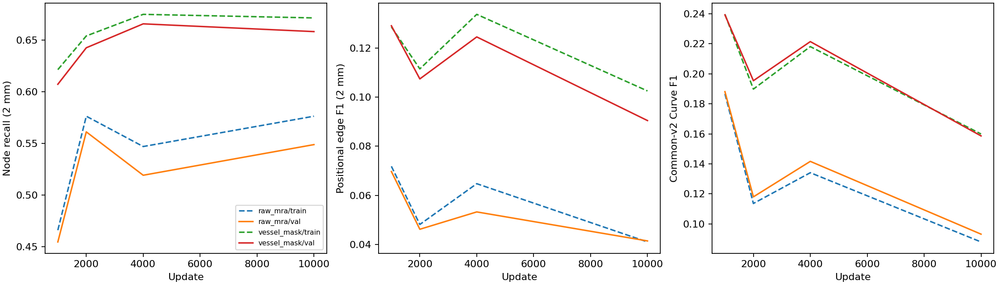

# 11 — IXI segmentation-input oracle

## Question and status

Does replacing MRA intensities with an explicit vessel mask improve node localization/selection and graph connectivity? This is a paired **mask-to-graph reconstruction diagnostic**, not an independent-label anatomical evaluation. No improvements are claimed before evaluation. Both arms and their automated checks are submitted together; training is conditional on successful alignment, forward/backward, cache-parity and collection smoke checks.

Related evidence: [relation isolation](4-ixi-relation-isolation.md), [query attribution](6-ixi-query-attribution.md), [mechanism batch](7-ixi-mechanism-batch.md), [matching/calibration](8-ixi-relation-matching-calibration.md), [image adapters](9-ixi-image-aware-relation-learning.md), and [node-loss study](10-ixi-node-focal-ablation.md). These studies do not provide an equivalent pre-IXI initialized raw/mask comparison.

## Mask provenance and alignment

**Provenance category 2:** supplied IXI `labelsTr` vessel masks were used to generate the existing reference graphs. The upstream masks' annotation method is undocumented; they are not claimed to be expert annotations. They are neither predictions produced by this experiment nor rasterizations of reference graphs.

Dataset: `/lustre/fsn1/projects/rech/vnc/upz25mj/datasets/IXI/transfer_splines_k8_20261015`.
Its `generation_config.json` points to `vascular_graph_sources/optimal_radius_0p75x_c095_vedo_original`. That directory's `source_manifest.csv` identifies each original MRI, supplied label, scan identifier and graph-extraction completion marker. `scripts/extract_vessel_graphs.py` / `ixi_vessel_graph.py` extract centerlines from those masks using `vedo_original`. Patch `seg/*_seg.nii.gz` files are crops of these upstream masks.

Four local examples (two train, two validation; distinct subjects) passed exact source-mask crop equality, binary/finite checks, native MRI/mask affine and shape agreement, and graph physical-metric checks. Maximum reference-node/guide distance to a foreground voxel center was 0.459–0.479 mm. Overlay inspection showed mask/reference correspondence. Preflight evidence: `experiments/ixi_segmentation_input/preflight/local-audit/`.

The complete audit repeats these checks across the paired manifest before training. Graph normalized DHW coordinates use `metric = native_affine[:3,:3] @ diag(64,64,64)`; patch NIfTI headers alone do not encode this transform. Binary mask and raw patch shapes must both be 64³. Reference nodes and full guide paths must lie within 1 mm of mask foreground voxel centers. Empty/unsupported examples are excluded from **both** arms with recorded reasons; structural/affine/crop mismatches abort. More than 148 training or 62 validation exclusions abort pending review. The audit saves exact input hashes, per-patch alignment statistics, exclusions, actual subject counts and fixed retained IDs. A historical empty-mask example `sample_000050_0096` is outside the proposed manifest.

## Paired population and input preprocessing

The initial manifest reuses the image-study **2,048 train / 512 validation patches**, covering **123 / 26 disjoint subjects**, preserving earlier pilot IDs where available. No held-out test data are used. `experiments/ixi_segmentation_input/plan.json` records IDs, sites, source dataset-manifest hash and initializer hash. `audit/manifest.json` is authoritative for post-audit counts. Training monitoring uses surviving previous 256 training IDs; validation uses the entire retained 512-patch manifest. Generalization estimates from training are descriptive only.

|Arm|Image tensor|Graph targets|
|---|---|---|
|raw_mra|Existing centered MRA, standard intensity noise|Same existing graph and spline caches|
|vessel_mask|Only binary supplied vessel-mask crop|Exactly the same targets|

`data.input_modality` defaults to `raw_mra`; the new `vessel_mask` path reads no MRA file for model input. It bypasses foreground-mean subtraction, noise, clamping and other intensity transforms. Resizing/zoom use nearest neighbor and masks must remain finite 0/1. Both arms share seeded quarter-turn spatial augmentations applied to image, nodes and spline geometry. Zoom remains disabled, as in the stable spline-data configuration. Raw-MRA noise retains probability 0.35 and maximum standard deviation 0.015. Training collation resets the model/pair-sampling RNG after modality-specific intensity augmentation, avoiding a stochastic candidate-policy confound.

## Architecture, initialization and optimization

Both arms use the stable local-refinement configuration from the previous full-query pilot, **configuration only**, without loading any IXI-trained parameters: one input channel, 256 object queries, two relation tokens, width 552, existing transformer/backbone and local CNN node refinement (4-voxel radius). Original graph/B-spline outputs and inference remain unchanged. No heatmap, verification head, image-relation adapter, unmatched mining or segmentation prediction head is added.

Common initializer:

`/lustre/fsn1/projects/rech/vnc/upz25mj/experiments/gnbm/spline_learning/runs/local_controlled_unfreeze_20261010/graph_only/model.pt`

Its saved config identifies **only SyntheticMRI**, 10,000 training patches, before IXI transfer. CPU construction/loading verified exact state compatibility except the explicitly fresh node-refinement module. The source has 120 object queries: preserve those 120, initialize 136 additional queries identically from seed 201021, and relocate the two original relation embeddings to slots 256–257. New local node refinement starts with its standard zero-output identity initialization. This is a shared pre-IXI initializer, not a mature IXI continuation. Synthetic pretraining nevertheless used raw intensities and can favor the raw arm's initial appearance statistics.

Train all detector/backbone/BN/transformer, classifier, coordinate, local-refinement and relation parameters. Preserve the existing frozen spline head and stable zero spline-loss coefficient. Both arms therefore share the same geometry-decoder constraint; Curve F1 must be interpreted with that limitation. Node classification is weighted CE `[0.25,0.75]`; edge classification is focal gamma 2, weights `[1,1]`, balancing `none`, matched-only candidates, unchanged cap and Hungarian matching. Node/edge coefficients remain 4/6; all coordinate, box and cardinality terms remain unchanged. The current stable checkpoint is **not** the newer CE/ratio node-study recipe.

AdamW uses the same inherited betas/epsilon/weight decay, constant learning rate 7e-5, batch size 8, identical seeded patch ordering and optimizer restart. Shared trainable names, initial state digest, update count and batch-order digest are checked across arms.

### Benchmark-selected bounded budget

Three warm-up plus 32 timed updates per modality; choose one common budget:

`min(30000, floor(4500 / (1.2 * slowest_seconds_per_update) / 100) * 100)`.

Require at least 2,000 updates, otherwise block training for resource review. This targets approximately 62.5 minutes of measured optimization, with a 75-minute planning budget and **2-hour Slurm allocation per arm** for loading, checkpointing and variance. Actual measured throughput, selected update count and elapsed training time are saved in `benchmark/{summary,budget}.json` and run summaries. They are unknown at submission. Save updates 1,000, 2,000, 4,000 when within budget, plus common final update and rolling recovery checkpoints. An interrupted/incomplete run fails rather than silently evaluating a shorter arm.

This is a learning-curve experiment; incomplete convergence cannot establish that segmentation input is ineffective. The primary comparison uses matched final updates. Secondary checkpoint selection uses validation common-v2 Branch F1, then Curve F1, then positional edge F1 at 2 mm, preferring earlier updates on ties; test labels are never consulted.

## Focused verification and execution

Five local tests passed: binary/no-intensity/no-MRA-read behavior, shared spatial graph augmentation and raw centering, nonbinary rejection, common configurations/minibatch prefix, and 120→256 query/relation-token transfer. The actual full CPU model accepted the initializer with only the four new node-refinement parameter tensors missing, as intended. Syntax and shell checks passed. Four real paired overlays passed local alignment checks.

Automated gates: complete CPU data audit → GPU two-update forward/backward smoke in both arms and batch-one prediction/cache decoder parity → CPU native/common-v2/calibration evaluation and collection smoke → GPU throughput benchmark → training array (two arms, at most two H100s) → GPU prediction array → corresponding CPU evaluation array → aggregate collector. Failed checks prevent downstream training/evaluation. Frozen evaluation-state hashes and batch-one inference are verified; all arms use the same evaluation batching.

Queue audit on 2026-10-20: image training 1331642 completed; image CPU evaluations 1331645 remain active/pending (original baseline evaluation 1331643 failed, outside this task). Node training 1332028 occupies two H100s and prediction array 1332029 remains pending. New GPU smoke additionally waits `afterany:1332029`, the last existing relevant GPU stage. No existing jobs are cancelled, duplicated or modified. New training/prediction arrays each cap concurrency at two and run sequentially, preserving the relevant global two-H100 limit.

## Evaluation and stored evidence

Reuse native detection mAP/mAR/F1, SMD and the original evaluation protocol (including its fold summaries/max detections), plus physical 1/2 mm matching and unchanged common-v2 Branch/Curve definitions. Record per patch/subject: node coverage/precision/F1, matched localization mean/p95, count bias/MAE, raw/retained query counts, duplicates/high-confidence duplicates and correct-versus-duplicate confidence AUC; edge TP/FP/FN/F1, recovered endpoints, conditional relation recall, unmatched-touching false edges, components/cycles and errors. Query confidence categories, edge-length breakdowns and detection matching states are retained.

Native box AP and normalized straight-edge SMD differ from positional edge correctness and continuous-curve topology. Primary graph comparison retains standard decoder thresholds and semantics. Final-checkpoint relation PR curves and training-selected maximal positional-F1 thresholds are saved separately at each physical tolerance and applied unchanged to validation. Calibration uses training only, which is stricter than validation tuning. Extra curves at those thresholds replay the same frozen spline head from cached tokens and learned CNN features, without repeating inference. Common retained nodes are fixed within each arm, but are expected to differ between modalities.

Paired subject bootstrap: 1,000 draws, seed 191032, same validation subjects in each arm; report mask-minus-raw differences and 95% intervals for node/edge quality, conditional recall, Branch/Curve F1, duplicates, count errors, unmatched false edges and component/cycle errors. Do not treat patches as independent subjects. Save train/validation learning curves and predefined validation checkpoint selection separately from the primary final-step comparison.

Large runtime caches/checkpoints live under the submitted SCRATCH root. Compact results/overlays are copied automatically to `docs/research/evidence/ixi_segmentation_input_20261020/`, and the collector appends completed results here. No results are fabricated when prerequisites fail.

## Reproduction and retrieval

Preparation/submission: `python3 cluster/jean_zay/submit_ixi_segmentation.py --submit` (duplicate submission record blocks accidental repeats).

Results, without inference/training or waiting:

```bash
python3 scripts/collect_ixi_segmentation_oracle.py --show
```

For a completed batch whose final collector needs rerunning: `python3 scripts/collect_ixi_segmentation_oracle.py --root <submitted-output-root>`.

Manifests: local `experiments/ixi_segmentation_input/{plan,submission}.json`; SCRATCH `audit/{manifest,inputs}.json`, `audit/alignment.csv`. Outputs: `runs/<arm>/`, `predictions/<arm>/<step>/`, `evaluation/<arm>/<step>/`, `results/results.md`, `results/{summary,paired-bootstrap,checkpoint-selection}.json`, and learning-curve/per-subject CSVs/figure.

## Interpretation after completion

Strong localization/recovery gains alone support an appearance bottleneck upstream of weak relations; joint node and conditional-edge gains support explicit vessel geometry simplifying extraction. Recall gains with duplicates, false edges or cycles do not establish better graphs. Little gain despite improving training curves may reflect insufficient adaptation/convergence; little gain after adequate fitting motivates representation/supervision diagnosis. Mask/graph label dependence and raw-intensity synthetic pretraining must accompany all conclusions. No architectural change is selected in advance.

## Accepted submissions

Output root: `/lustre/fsn1/projects/rech/vnc/upz25mj/experiments/gnbm/ixi_segmentation_input_20261020-143413`.

|Stage|Job|Dependency|Wall time|
|---|---|---|---|
|alignment_audit|1339156|None|01:30:00|
|gpu_smoke|1339159|afterok:1339156,afterany:1332029|00:45:00|
|cpu_smoke_collection|1339160|afterok:1339159|00:45:00|
|benchmark|1339161|afterok:1339160|00:30:00|
|training|1339163|afterok:1339161|02:00:00|
|prediction|1339164|afterok:1339163|02:00:00|
|evaluation|1339165|aftercorr:1339164|06:00:00|
|collection|1339166|afterok:1339165|02:00:00|

## Completed full local alignment audit

The full local audit completed before final handoff: **2,048 training / 511 validation patches**, **123 / 26 disjoint subjects**. One validation patch was excluded identically from both arms: `sample_000046_0030` (`GT_more_than_1mm_from_mask`). Detailed evidence: `experiments/ixi_segmentation_input/preflight/audit/{manifest,inputs}.json` and `alignment.csv`. The submitted CPU audit independently repeats the checks, including patch-header and image-statistics verification, and gates GPU training. No model-performance results are available yet.
## Completed results

Paired optimization population: {'train': 2048, 'val': 511}; subjects: {'train': 123, 'val': 26}. Evaluation uses the fixed training monitoring subset and complete paired validation manifest.

|Input|Final validation node mAP|Node mAR|Edge mAP|Edge mAR|SMD|
|---|---:|---:|---:|---:|---:|
|raw_mra|0.1347|0.2633|0.0097|0.0243|0.1089|
|vessel_mask|0.2210|0.3444|0.0276|0.0532|0.0610|

|Input|Node precision|Node recall|Edge F1|Conditional relation recall|Branch F1|Curve F1|Component MAE|Cycle MAE|
|---|---:|---:|---:|---:|---:|---:|---:|---:|
|raw_mra|0.4383|0.5488|0.0415|0.0635|0.0061|0.0931|21.9041|0.7065|
|vessel_mask|0.5871|0.6580|0.0904|0.1180|0.0243|0.1586|17.9041|0.8630|

### Interpretation

This is reconstruction from supplied masks that generated the graph references. It measures appearance removal under correlated supervision, not performance from independently annotated anatomical labels or a deployable raw-image pipeline.
Use paired-bootstrap.json to assess localization/recovery, duplicate multiplicity, conditional connectivity and false cycles separately. Node-only gains with persistently weak conditional relations implicate downstream graph reasoning; gains accompanied by duplicates or loops do not establish faithful reconstruction. Little gain in a short run does not establish an architectural impossibility.
Primary comparison is the matched final update. checkpoint-selection.json records a validation-only best checkpoint per arm; it is secondary and need not select the same update. Evaluation folders retain raw fixed-cutoff metrics and final training-calibrated policies. No test labels were used.
Original physical matching and common-v2 definitions are retained. Native box AP/AR and normalized straight-edge SMD have different meanings from positional connectivity and continuous-curve metrics. The pretrained spline head was frozen in this stable node/relation training configuration, so Curve F1 also reflects that geometry decoder constraint.
The common SyntheticMRI initializer already learned raw-image features. There is no prior IXI exposure, but it remains a modality pretraining bias; both arms train their CNN/BN state. Any absence of convergence or severe generalization gap calls for a bounded convergence check before rejecting segmentation input.
Outputs: `/lustre/fsn1/projects/rech/vnc/upz25mj/experiments/gnbm/ixi_segmentation_input_20261020-143413`. Detailed native/physical per-patch and per-subject tables, localization.csv, uniqueness.csv, thresholds.json and final calibration/ tables are retained.



