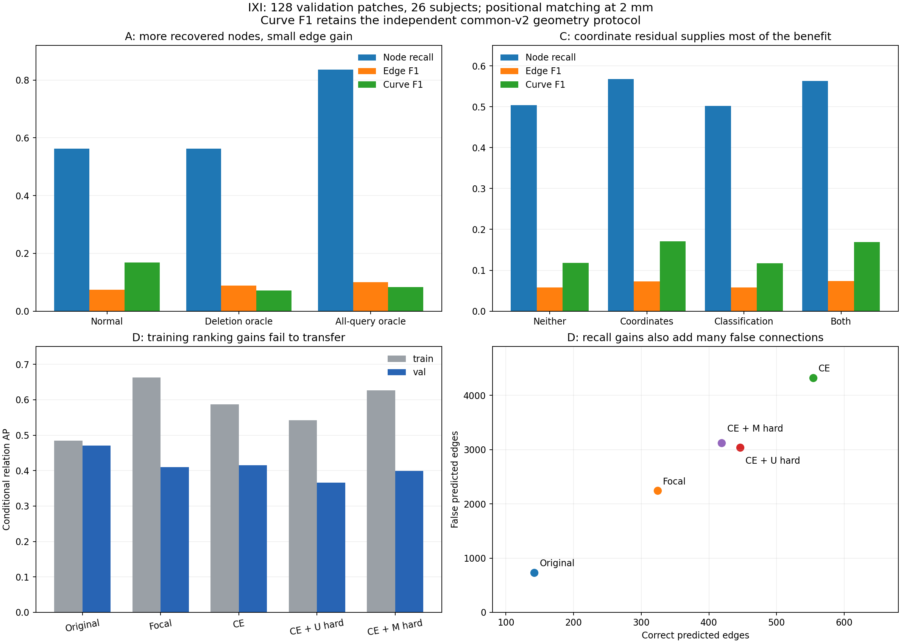

# 7. IXI bounded mechanism batch — 2026-10-19

## Questions and fixed population

Follow-up to [full-query attribution](6-ixi-query-attribution.md) and the
[roadmap](../IXI_graph_extraction_diagnostic_roadmap.md). All jobs in the replacement batch have now completed; reviewed results are
recorded below. The original experiment definitions are preserved. Reuse the exact 256 training
and 128 validation patches (26 validation subjects); no test data. Subject
membership is asserted disjoint. No full-validation expansion or architecture sweep.

The Representation checkout contains the prior experiments and is used here.
All inputs/checkpoints are read-only; each output directory is new.

## A — Can better query selection rescue the frozen relation head?

At 1 and 2 mm, compare normal decoding, previous deletion of unmatched retained
queries, and maximum-cardinality/minimum-distance selection from **all 256 raw
queries**, including confidence-rejected queries. Reserve that one-to-one mapping.
Use predicted coordinates, cached symmetric relation logits and the unchanged
argmax edge decision (ties reject). No GT edges or GT coordinates are inserted.

Report node precision/recall, duplicate candidates and multiplicity, positional
TP/FP/FN/F1, conditional relation recall, common-v2 Branch/Curve F1, components,
cycle rank and their GT errors. Raw selection is GT-assisted, not deployable.
An increase in endpoint recovery without a substantial relation improvement
would locate a remaining bottleneck downstream of node selection.

## B — Does confidence or a linear token readout separate node categories?

Reuse report 6's raw/retained query categories at both tolerances: matched,
duplicate candidate, foreground-supported extra and off-vessel/outside (retain
any near-unrecovered category if present). Save confidence quantiles, PR/AP,
ROC AUC, pairwise matched-versus-category discrimination, high-confidence
(≥0.9) duplicate counts and subject breakdowns.

Rematch GT for fixed cutoffs −1 (all), 0.1, 0.25, 0.5, 0.75, 0.9, 0.95 to measure
actual recoverability separately from PR against fixed assignment labels.
No cutoff is selected using validation.

Optional low-cost readouts are included: separate score-margin-only and token-only
linear SGD logistic classifiers, train-only standardization and balanced class
weights, alpha 0.001, seed 191032, maximum 200 epochs with tolerance 1e-4.
Train on cached training subjects; evaluate on disjoint validation subjects.
Only decoder embeddings or class-logit margin are inputs. GT-derived labels,
coordinates and distances are never input features. Save weights, confusion
matrices, per-class AP and per-subject breakdowns; record iteration-limit flags.
Failure of this linear probe does not establish absence of token information.

## C — Which inference-time residual helps?

Five conditions: separately trained baseline continuation, local model with
neither residual, coordinate residual only, class-logit residual only, and both.
The fifth/no-residual control is needed because the local model's original heads
were jointly trained with its residual module and differ from the separate
baseline continuation. All component comparisons use those same trained heads.

Reapply the standard decoder to cached pre/post outputs. Verify baseline/local
cached tokens and relation logits agree exactly. Relation weights/logits never
change. Regenerate geometry at changed endpoints with the original frozen spline
head. This is an inference-time intervention, not independent pathway training.
Report the A metrics and nearby-query multiplicity; independent retraining is
reserved for a later learning-interaction experiment.

## Cache reuse and the missing geometry feature cache

Inputs are report 6's parent/baseline/local-image caches under
`/lustre/fsn1/projects/rech/vnc/upz25mj/experiments/gnbm/ixi_query_diagnostics_20261019/`.
The parent is IXI-only delayed-spline `best.pt`, step 28170, under
`.../spline_learning/ixi_transfer_20261015/runs/ixi_delayed_spline/`.
Baseline/local adapters are the 1000-update `trained-heads.pt` files under
`.../spline_learning/ixi_node_refinement_20261018/{baseline,local_image}/`.
Prior manifest and checkpoint SHA256 identities are recorded in every run.

**Discovered during smoke:** the spline head includes a trained local-CNN geometry
module; cached tokens alone cannot reproduce new curves. A shared CPU preparation
job evaluates only `encoder.layer0.conv1/bn1/relu1`, with original intensity
normalization, float32, batch 1 and saved BN statistics. It writes approximately
3 GiB of reusable features for 384 patches. It does not rerun the transformer,
node heads or relation inference. Every patch must reproduce saved selected
queries/edges exactly and spline controls within 0.001 mm. Existing curves are
reused for unchanged endpoints/edges; only new/changed geometry needs new head
outputs. Earlier batch-4/32 predictions are not substituted for these batch-1 caches.

## D — Controlled, frozen-token relation learning

**Baseline discrepancy:** the actual initializer uses **focal loss with no ratio
upsampling**, despite the historical regularized-CE baseline described in the
roadmap. Four arms keep these comparisons explicit:

| Task | Arm | Base loss | Added term |
|---|---|---|---|
| 0 | focal_control | Actual checkpoint focal/no-upsampling | None |
| 1 | regularized | Original CE + ratio upsampling | None |
| 2 | hard_unmatched | Same regularized CE | Hard U–M/U–U negative CE |
| 3 | hard_matched | Same regularized CE | Hard nonadjacent M–M negative CE |

`GraphCriterion.loss_edges` supplies the unchanged base component. Retain
`max_per_graph=9999`, no positive cap, ratio 0.15/tolerance 0.02 and original class
weights. Existing HNM merges weighted sample counts into a shared denominator;
this pilot deliberately uses **L_base + lambda × mean(L_aux)** instead, so the
auxiliary population cannot dilute baseline positive weighting. Multiply by the
same original edge weight 6 in every arm. Other model/loss components cannot
update because only the relation MLP is instantiated for training.

Common parent relation initializer, seed 191032, eval mode, AdamW LR7e-5 and
inherited optimizer settings, 1000 updates, batch 32 drawn with replacement from
the **same cached 256 training patches**. This is a small fixed-feature learning
population, not a repeat of the previous full-training-population node pilot.
Use the original class/L1 Hungarian matcher on frozen refined outputs; this
training assignment is distinct from the physical evaluation assignment.
Baseline random pair sampling/orientations use identical per-update seeds.

U candidates: unmatched object probability ≥0.5, up to 32 highest-confidence
unmatched queries, all their U–M/U–U pairs. M candidates: every nonadjacent matched
pair. Select at most 64 highest predicted-probability pairs per patch, with detached
symmetric scores; differentiate original symmetric logits. No base pairs are
removed. Auxiliary weight is zero through update 100, linear ramp to 0.1 at 300,
then fixed. Log losses, selected MM/MU/UU counts and separate gradient norms.
Save only trained relation heads and scored pairs. GPU work is limited to MLP
training/scoring; no image-model inference. Initial cached-logit replay must agree
within 3e-6 absolute/relative and preserve all edge decisions.

CPU collectors decode the fixed node predictions using each trained relation
head's saved scores. Evaluate all 256/128 cached patches, same thresholds, both
positional tolerances and common-v2 geometry. Report U-related FPs, true relation
recall, training-defined GT arc-length quartiles and ≤5mm nonadjacent-pair FPR.
The latter numerator/denominator are saved explicitly. Count/cycle reduction
alone cannot demonstrate correct topology. Hard versus regularized compares added
hard supervision; a later equal-budget random-negative control would be needed
to attribute benefit specifically to probability mining.

Ranking loss is not included in this batch; retain it as a subsequent separate
shared-endpoint positive/hard-negative softplus objective if this pilot supports it.

## Evaluation, smoke checks and interpretation limits

Keep maximum-cardinality physical matching at 1/2 mm and original common-v2
1 mm anchors/curves with 0.25 mm sampling. Common metrics are independently
computed for each selected graph, never given the positional oracle mapping.
Paired bootstrap: 1000 fixed-seed subject resamples for node recall, edge F1,
Branch F1 and Curve F1, pooling all patches from sampled subjects. No favorable
checkpoint selection; compare fixed step 1000. One seed and reused development
subjects limit inference. GT/foreground categories are not anatomical certification.

Focused checks cover insertion of a rejected query without insertion of a GT
edge, residual selection, strict tie rejection, independent auxiliary normalization,
real-cache curve/decoder parity and short relation gradients. Cluster smoke uses
two training/two validation patches and three updates per relation arm, and runs
the complete collection path. Pilot jobs are gated by these smokes.

Local synthetic checks (three cases) and four-patch A/B/C checks passed.
Shared early-feature replay on these patches had maximum control displacement
0.000130 mm against the original GPU output (gate: 0.001 mm). The relation
smoke completed finite-gradient updates on CPU; the scheduled GPU smoke covers
all four arms and their complete collection path. These are execution checks,
not population results.

The first local checks caught and corrected the missing local-geometry features,
nonmetric fields passed to the common-metric aggregator, and a NumPy scalar in
JSON. The runtime archive also contains incomplete SymPy; these batch wrappers
use a job-local import overlay for protected SymPy/mpmath. Other runtime
packages and standard-library import precedence remain as before. No dependency upgrade or shared-environment edit.
Small-sample linear probes may reach their iteration limit; this is reported,
not treated as proof that embeddings lack information.

## Execution and retrieval

Submission record: `experiments/ixi_mechanisms/submission.json`. Logs:
`experiments/spline_learning/logs/ixi-mechanisms-{cpu,D}-ARRAY_TASK.{out,err}`.
Output paths and accepted IDs are appended below after submission.

Dependency graph:

```text
CPU smoke → shared features → CPU A/B/C array
          → GPU relation smoke (all arms + collectors) → GPU D array (max 2 concurrent)
shared features + corresponding D task → CPU D evaluation array
A/B/C + all D evaluations → CPU aggregate collector
```

All jobs are submitted together; dependencies enforce success, and failed
prerequisites cancel dependent jobs. CPU tasks request four cores with site-managed memory; GPU
tasks request one H100/six cores. Smokes/aggregate collection have 30-minute
limits, pilots/preparation have two-hour limits (upper bounds, not estimates).

The first submission was rejected before any job was accepted because Jean Zay
forbids explicit `--mem` requests. That directive was removed before resubmission.

After completion, from the Representation repository:

```bash
python3 scripts/collect_ixi_mechanisms.py --show
```

This lightweight command prints the automatically generated result table, or
reports that collection is incomplete and exits immediately. Full CSVs, per-patch
and per-subject summaries, bootstrap intervals, confidence probes and scored
graphs remain under the recorded output root. To regenerate aggregate results
in a configured scientific environment, omit `--show`.

Full 2649-patch evaluation, independent residual retraining, classification-loss
sweeps, ranking/random-negative controls and multiscale changes remain unlaunched.
The strongest findings can later reuse the same functions with an expanded cache;
the existing pilot caches do not contain the full validation population.

## First accepted batch — superseded after runtime staging failure

Output root: `/lustre/fsn1/projects/rech/vnc/upz25mj/experiments/gnbm/ixi_mechanisms_20261019-220355`.

|Stage|Job/array ID|Dependency|
|---|---|---|
|cpu_smoke|1312233|none|
|features|1312237|afterok:1312233|
|ABC|1312240 (0-2%3)|afterok:1312237|
|relation_smoke|1312241|afterok:1312233|
|D|1312248 (0-3%2)|afterok:1312241|
|D_evaluation|1312250 (0-3%2)|aftercorr:1312248,afterok:1312237|
|collection|1312251|afterok:1312240:1312250|

A/B/C task indices are 0/1/2. D and D-evaluation task indices are 0 focal_control,
1 regularized, 2 hard_unmatched, 3 hard_matched. D GPU concurrency is capped at two.
Submission was accepted; no claim of completed cluster smoke or pilot results.
No polling loop or active session is required: the final CPU job writes `results.md`.

Smoke 1312233 failed before executing any experiment: the CPU node ran out of
`/tmp` space while extracting the runtime archive. The dependent chain was
cancelled and replaced. Runtime staging now uses a dedicated per-job SCRATCH
folder under the batch output, cleaned on exit. Original submission metadata is
preserved as `experiments/ixi_mechanisms/submission-failed-runtime-1312233.json`.

## Current accepted batch

Output root: `/lustre/fsn1/projects/rech/vnc/upz25mj/experiments/gnbm/ixi_mechanisms_20261019-220459`.

|Stage|Job/array ID|Dependency|
|---|---|---|
|cpu_smoke|1312300|none|
|features|1312301|afterok:1312300|
|ABC|1312302 (0-2%3)|afterok:1312301|
|relation_smoke|1312303|afterok:1312300|
|D|1312304 (0-3%2)|afterok:1312303|
|D_evaluation|1312305 (0-3%2)|aftercorr:1312304,afterok:1312301|
|collection|1312307|afterok:1312302:1312305|

These jobs replaced the failed runtime-staging chain above. At submission,
cluster smokes and pilot results were pending; the completed review follows.
Retrieval: `python3 scripts/collect_ixi_mechanisms.py --show`.

## Completed results — reviewed 19 October 2026



All replacement-chain jobs exited **0**: CPU smoke 1312300 (3m14s), shared
features 1312301 (2m37s), A/B/C 1312302_0/1/2 (10m58s/4m39s/20m04s), relation
smoke 1312303 (1m29s), D 1312304_0–3 (1m14s–1m52s), their CPU evaluations
1312305_0–3 (7m37s–11m34s), and final collection 1312307 (3m42s).
Earlier submission/staging failures are documented above and superseded.

All comparisons use the fixed 256 training / 128 validation patches, 26 validation
subjects, 3,517 validation GT nodes and 2,977 GT edges. Main tables use **2 mm
positional matching**. Branch/Curve F1 retain common-v2's separate 1 mm geometry
protocol. Full 1 mm and 2 mm tables and compact evidence are preserved in
[the evidence directory](../../../../../research/evidence/ixi_mechanisms_20261019/README.md).

### A: raw-query selection recovers nodes, but connectivity stays weak

| Selection | Node recall | Edge TP / FP / FN | Edge F1 | Conditional recall | Branch F1 | Curve F1 |
|---|---:|---:|---:|---:|---:|---:|
| Normal | 0.5627 | 142 / 733 / 2835 | 0.0737 | 0.1257 | 0.0122 | 0.1686 |
| Previous deletion oracle | 0.5627 | 142 / 65 / 2835 | 0.0892 | 0.1257 | 0.0127 | 0.0718 |
| All-256 selection oracle | 0.8362 | 162 / 103 / 2815 | 0.0999 | 0.0722 | 0.0194 | 0.0827 |

The raw oracle doubles recoverable GT edges, **1,130→2,243**, but correctly
predicted edges increase only **142→162**. At 1 mm, recall rises 0.3674→0.5988
and edge F1 0.0296→0.0636, while conditional recall falls 0.1124→0.0779.
Thus this location-based oracle does not substantially rescue connectivity with
the original relation scores. Node precision 1 and zero duplicate candidates
are consequences of GT selection, not achievable deployment performance.

Paired subject-bootstrap 95% intervals, raw oracle minus normal at 2 mm:
node recall [+0.2560, +0.2887], edge F1 [+0.0062, +0.0445], Branch F1
[−0.0014, +0.0158], Curve F1 [−0.1008, −0.0705]. Fragmentation error remains
large: component MAE 19.29 / 9.40 / 16.19 for normal / deletion / raw oracle;
cycle MAE 1.04 / 0.65 / 0.67. More selected nodes often remain isolated.

**Assignment caveat:** selecting the closest one-to-one raw queries is not a
nested expansion of the retained graph. Of 1,979 original assigned queries,
1,065 are removed or assigned to a different GT node; only 1,136 query IDs
remain in both assignments. Only **42** correctly recovered GT edges are shared:
the raw oracle loses 100 previously correct edges and recovers 120 different
ones, for a net +20. It is a node-recovery upper bound under this matching rule,
not an upper bound over all GT-assisted choices of graph-friendly queries.
The lower conditional recall also reflects a different, harder endpoint population.

GT arc-length bins are defined once from training (cuts 1.144, 3.384, 8.775 mm).
For the longest validation quartile, normal decoding recovers 9/237 relations
with available endpoints; raw selection recovers only 1/486. Better spatial
coverage alone therefore does not recover long relations under this selection.

### B: confidence poorly distinguishes duplicates; tokens retain some signal

Among retained validation queries, matched-versus-duplicate confidence AUC is
**0.5495**, close to chance ranking. Of 584 retained duplicate candidates,
**411 (70.4%) have confidence ≥0.9**. Their median confidence is 0.9521 versus
0.9632 for correctly matched retained queries. AUC is higher against
foreground-supported extras (0.6272) and off-vessel/outside queries (0.7726).
Confidence therefore contains some foreground discrimination but little useful
uniqueness discrimination among already accepted queries.

Of 2,941 queries assigned under raw matching, **1,805 are rejected at 0.5**.
This is not 1,805 additionally recoverable GT nodes: retained and raw assignments
can choose different queries for the same GT node. Actual rematched recovery
increases only 1,979→2,155 (56.27%→61.27%) when the cutoff falls 0.5→0.1;
accepted nodes increase 3,827→4,749 and node precision falls 51.71%→45.38%.
Only retaining all queries reaches 83.62%, with precision 8.98%.

The frozen-token four-class linear probe reaches validation balanced accuracy
**0.4836**, versus **0.3550** for the score-only probe (training 0.5350 vs 0.3655).
Validation duplicate AP is 0.4353 vs 0.3139; matched-query AP is only 0.3007 vs
0.2847. Some category information is linearly accessible beyond object confidence,
but neither probe provides strong correct-query selection. Both full-population
probes converged before the iteration limit at both tolerances; iteration-limit
warnings occurred only in the tiny smoke. These are diagnostic category readouts,
not a demonstrated improved graph decoder.

### C: coordinates explain most of local refinement's benefit

| Inference condition | Node recall | Node precision | Duplicate candidates | Edge F1 | Branch F1 | Curve F1 |
|---|---:|---:|---:|---:|---:|---:|
| Separate baseline continuation | 0.5118 | 0.4707 | 440 | 0.0583 | 0.0050 | 0.1179 |
| Local checkpoint, neither residual | 0.5041 | 0.4533 | 404 | 0.0581 | 0.0055 | 0.1182 |
| Coordinate residual only | 0.5672 | 0.5101 | 594 | 0.0730 | 0.0116 | 0.1709 |
| Classification residual only | 0.5018 | 0.4612 | 400 | 0.0582 | 0.0056 | 0.1172 |
| Both | 0.5627 | 0.5171 | 584 | 0.0737 | 0.0122 | 0.1686 |

Coordinate-only captures nearly all the gain. Against the same local checkpoint
with neither residual, its paired 95% intervals are edge F1 [+0.0087,+0.0207],
node recall [+0.0481,+0.0790], Curve F1 [+0.0452,+0.0593]. Classification-only
edge-F1 change spans zero [−0.0025,+0.0020]. Adding classification to coordinates
accepts fewer nodes (3,911→3,827), slightly improving precision but reducing
recall and Curve F1; no independently trained class-path benefit is established.

Duplicate categories depend on coordinates: moving predictions closer to a
recovered GT node can increase duplicate-candidate counts without changing
selected query IDs. Coordinate-only and neither select exactly the same nodes
and edges; their graph count topology is identical, although positional labels
and geometric metrics change. Independent pathway retraining remains untested.

### D: fixed-cutoff recall rises, but validation ranking worsens

Nodes are identical in every row. Original is the unmodified local-refinement
checkpoint; other rows have exactly 1,000 relation-only updates.

| Relation scorer | TP / FP | Edge F1 | Conditional recall | Branch F1 | Curve F1 | Component MAE | Cycle MAE |
|---|---:|---:|---:|---:|---:|---:|---:|
| Original | 142 / 733 | 0.0737 | 0.1257 | 0.0122 | 0.1686 | 19.29 | 1.04 |
| Focal continuation | 324 / 2244 | 0.1169 | 0.2867 | 0.0227 | 0.3032 | 11.43 | 5.70 |
| Regularized CE | 554 / 4325 | 0.1410 | 0.4903 | 0.0360 | 0.3884 | 4.80 | 16.51 |
| CE + unmatched hard negatives | 446 / 3037 | 0.1381 | 0.3947 | 0.0355 | 0.3355 | 9.27 | 10.73 |
| CE + matched hard negatives | 419 / 3121 | 0.1286 | 0.3708 | 0.0241 | 0.3398 | 8.19 | 9.71 |

The regularized CE arm increases true relation recall and curve coverage but
also creates many false connections and cycles. It should not be adopted as a
better anatomical graph simply because edge F1 or component error improves.
Focal versus CE changes both classification shape and positive balancing;
this batch cannot assign their difference to either ingredient alone.

Relative to CE, unmatched mining reduces U-involved FPs **3,497→2,348 (−32.9%)**,
but loses 108/554 true edges (−19.5%). Its edge-F1 change is inconclusive across
subjects [−0.0099,+0.0037], while Curve F1 declines [−0.0651,−0.0405]. Matched
mining loses 135/554 true edges and reduces edge F1 with interval
[−0.0191,−0.0068]. Neither auxiliary arm is a demonstrated overall improvement.

For the longest quartile, correct relations are 9 original, 30 focal, 39 CE,
28 unmatched-hard and 34 matched-hard, with 237 recoverable pairs in each arm.
Nearby nonadjacent-pair FPR (2,176 fixed candidates) is 2.44% original,
12.13% focal, 29.55% CE, 25.00% unmatched-hard and 18.11% matched-hard.
Reducing nearby mistakes therefore coexists with lost long-positive recall.

Unmatched mining improves training edge F1 over CE (0.2615 vs 0.2213), but not
validation (0.1381 vs 0.1410), indicating a generalization limitation of this
small fixed-feature learning setup. At update 1000 the unmatched auxiliary's
weighted gradient norm is 0.518 versus base 0.244: separate normalization
preserves the base loss but does not guarantee a small auxiliary gradient.
This is one logged batch, not an estimate of the entire optimization trajectory.

### D score-ranking audit from saved pair logits

The fixed-threshold gains do **not** demonstrate improved validation ranking.
Additional CPU analysis of existing pair caches uses precisely the same 24,054
validation M–M candidate pairs (1,130 positives), 2 mm positional assignment and
natural prevalence; no model inference or updates are repeated. AP uses symmetric
logit margin, which has the same ordering as symmetric edge probability.

| Relation scorer | Training conditional AP | Validation conditional AP | Validation all-retained-pair AP |
|---|---:|---:|---:|
| Original | 0.4848 | **0.4702** | **0.1361** |
| Focal continuation | 0.6624 | 0.4098 | 0.1164 |
| Regularized CE | 0.5874 | 0.4153 | 0.1136 |
| Unmatched hard negatives | 0.5417 | 0.3659 | 0.1173 |
| Matched hard negatives | 0.6268 | 0.3996 | 0.1110 |

All-retained-pair AP includes 83,229 candidate pairs and 1,130 positives;
it is candidate-level ranking, not GT-complete edge recall (1,847 GT edges lack
recovered endpoints). Conditional and all-retained AP use different populations
and should not be compared numerically to each other.

Every trained head improves training conditional AP but worsens validation AP.
The original scorer retains the best validation ranking in this batch. Gains at
cutoff 0.5 partly reflect changing the operating point and positive weighting;
this batch supplies no evidence that any trained head improves the full validation
PR ranking. The AP differences have not been given bootstrap intervals. A fair
next comparison would calibrate each head on training data and compare validation
at matched precision, before selecting a replacement relation loss.

### Integrity checks and interpretation

All 384 patches passed CPU/GPU spline replay tolerance; maximum displacement was
**0.000563 mm** (gate 0.001 mm). All four D arms exactly reproduced original
cached logits on the original GPU path (maximum error **0**), shared initializer
and batch-order hashes, and matched baseline sampling counts. The three CE arms
have identical baseline loss at updates 1 and 100, before auxiliary activation.
No node/backbone/transformer parameters were trainable in D.

The strongest supported findings are coordinate-localization benefit, weak
confidence-based uniqueness discrimination, and a remaining relation selection/
generalization limitation. The original relation scorer has the best validation
AP among these heads; fixed-cutoff gains should not be mistaken for better ranking. Raw spatial selection is not
sufficient; confidence is weak at duplicate discrimination; extra negative
pressure alone trades recall for precision. Further comparisons should examine
ranking/calibration at matched precision and the relation heads on improved node
selection using the saved pair scores. No additional jobs were launched during
this results review. All claims remain limited to this seed and reused pilot
population; no full-validation or test-set result is claimed.
