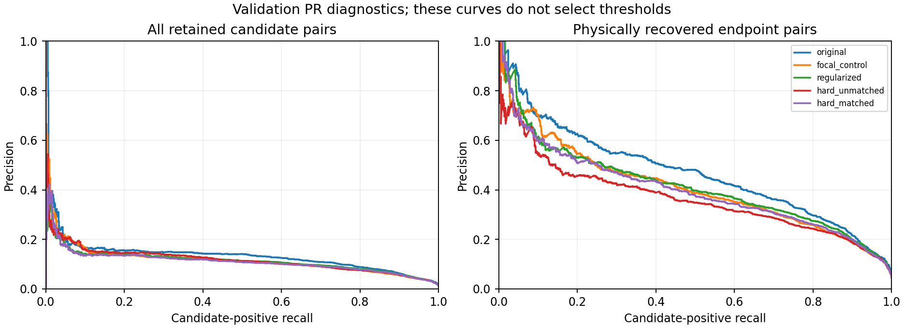

# 8. IXI relation matching, generalization and calibration

## Status and research questions

Cache audit and implementation complete; full results pending the CPU batch below.
The collector will add tables, uncertainty, figures and interpretation automatically.
No training, detector inference, full-validation sweep or test data are included.

Does the original relation head work better on training-style Hungarian-selected
queries? Does this transfer from training to validation subjects? Do experiment-7
heads improve connectivity discrimination or mainly the operating point?
Matching mismatch, weak ranking, generalization and calibration are competing
explanations; none is assumed to be the sole cause.

Prior evidence: [query attribution](6-ixi-query-attribution.md),
[relation isolation](4-ixi-relation-isolation.md),
[threshold calibration](5-ixi-threshold-calibration.md),
[mechanism batch](7-ixi-mechanism-batch.md).

## Cached inputs and identities

Reuse the fixed 256 training / 128 validation patches, with disjoint subjects.
Original/parent and local-refinement full-query caches are under
`/lustre/fsn1/projects/rech/vnc/upz25mj/experiments/gnbm/ixi_query_diagnostics_20261019/`,
`pilot-1291324-parent` and `pilot-1291329-local_image`.
Parent: IXI delayed-spline best checkpoint, step 28170. Local adapter: existing
1000-update `ixi_node_refinement_20261018/local_image/trained-heads.pt`.

Experiment-7 scores and geometry features are under
`/lustre/fsn1/projects/rech/vnc/upz25mj/experiments/gnbm/ixi_mechanisms_20261019-220459/`.
All four trained heads have all 32,640 pair logits on all 384 patches, including
confidence-rejected queries. Early-CNN feature caches also cover all patches.
No essential cache is missing. The frozen spline head supplies new curves on
CPUs from saved tokens/features; no CNN/transformer inference is repeated.

Checks: checkpoint/adapter hashes, prior original-logit replay error zero,
identical relation initializers and update batches, full query IDs 0–255,
lexicographic pair order, GT nodes/edges/metric and normal node decisions.
Parent/refined tokens and relation logits must agree exactly. Input files and
relation-head files are hashed. D files do not independently store pair IDs:
ordering is verified through original caches, full shape and the unchanged
archived score-writer source hash; this limitation is explicit.

## A: actual Hungarian matching and physical validity

The model applies local node/class residuals before returning `pred_nodes` and
`pred_logits`; `GraphCriterion.forward` passes those outputs to the matcher.
The exact cost is **5 × normalized DHW L1 distance − 2 × object probability**.
It is not physical Euclidean distance and does not include node/class loss weights.
Each assignment is independently reproduced from this cost.

Conditions using original frozen pair logits:

1. Normal object-confidence/argmax filtering.
2. Spatial oracle: maximum-cardinality/minimum-distance assignment over all 256
   queries, independently at 1 and 2 mm.
3. Refined-output Hungarian query selection, preserving assigned GT identities.
   Only assignments within the physical tolerance count as recovered; distant
   selected nodes remain in the graph and their edges can count as false.
4. The same Hungarian query set with ordinary physical rematching, a sensitivity
   check separating selected queries from assignment correspondence.
5. Parent-checkpoint Hungarian selection with parent predicted coordinates/logits,
   a historical sensitivity condition: the original head was frozen during local
   refinement, while experiment-7 relation pilots trained on refined assignments.
   This condition changes node outputs and is not a pure selection intervention.

GT only selects/labels diagnostic queries. It supplies no predicted coordinates
or edges. Report per-query assignment distances, confidence rejection, per-subject
quality, and metrics at both physical tolerances. Unrestricted Hungarian adjacency
AP is additionally labeled **assignment-only**, not positional graph correctness.
These are retrospective checkpoint assignments, not a reconstruction of every
evolving training minibatch assignment.

A common-identity pair population requires normal/spatial/localized-Hungarian
methods to assign each endpoint to the same GT node. On this fixed population,
compare all five heads. Changing selection/prevalence can change AP with unchanged
scores; paired intervals across selections do not remove that confounding.

## B: independent train calibration, common precision target

All five heads use identical normally retained query IDs and physical labels.
Exact label/subject/score equality is checked between A and every B head.
Conditional AP uses recovered-endpoint pairs; all-retained-pair AP includes
unmatched-endpoint negatives. Full-graph recall includes every GT edge in FN.

For each head at each positional tolerance, select on training patches only:

- Fixed probability >0.5.
- Maximum aggregate positional edge F1.
- Maximum recall while preserving **the original head's training precision at
  0.5**, the same target for every head at that tolerance.

Apply each threshold unchanged on validation. Ties are indivisible under strict
`>`; objective ties choose the highest threshold. Unattainable precision is
reported explicitly with an empty graph, without validation fallback. A training
precision constraint is not a guarantee on validation precision.

Probabilities are derived in float64 from cached symmetric logits for every
head. This preserves 0.5 argmax decisions and is checked within 2e-6 of original
cached probabilities. The conversion avoids float32 rounding that can split
calibration ties; its discrepancy is recorded. Curves retain canonical physical
orientation and reuse saved controls for unchanged edges.

Outputs: train/validation AP and PR with counts/positive prevalence, node/edge
counts, conditional recall, U-involved FPs, GT-near-nonedge FPR (chord ≤5 mm),
Branch/Curve F1 and components/cycles/errors; per-patch and per-subject summaries.
GT arc-length bins reuse experiment-7 training quartiles; GT chord-distance bins
use training-only quartiles. Assignment localization distances are separate.
Common-v2 keeps its own 1 mm geometry and 0.25 mm sampling conventions.

## Uncertainty, combined diagnosis and limitations

Seed 191032; 1000 paired validation-subject bootstrap draws, retaining all patches
of sampled subjects. AP is recomputed from pooled, subject-weighted candidate
pairs with full score-tie groups, not averaged over patches. Tests compare weighted
AP with sklearn/explicit replication, including ties. Undefined AP resamples are
excluded and usable counts reported. Graph intervals preserve pooled edge and
Curve F1 definitions. Training is in-sample; validation is reused development data.

The collector reports head-minus-original AP differences on identical populations,
selection differences with population caveats, and graph/Curve/Betti differences
against the original under the same calibration policy. Validation PR curves are
diagnostic only; their candidate-positive recall differs from complete GT recall.

The final interpretation answers matching benefit, train/validation transfer,
node-versus-relation errors, calibrated head comparisons and implications for
mining/sampling/features. Favorable F1 or Curve F1 alone does not establish better
topology when false edges/cycles rise. Local-feature probes remain hypotheses;
earlier chord-image evidence was weak. Multiscale attention is not established
as necessary by this diagnostic. No further training is launched before review.

## Execution and retrieval

Source: `scripts/ixi_relation_matching_calibration.py`,
`scripts/collect_ixi_relation_matching_calibration.py`,
`tests/test_ixi_relation_matching_calibration.py`.

Focused local checks passed matching/physical-validity, tied thresholds, candidate
labels, score parity and weighted AP. The first two validation smoke patches have
no eligible normal-population positive relation pairs; AP/PR are explicitly
undefined there, not converted into performance evidence.

CPU smoke: two training/two validation patches, every analysis path and collection
with 40 bootstrap draws (execution evidence only). Full preparation depends on
smoke; a six-task CPU array (maximum three concurrent) runs A and each of five
B heads. Full collection depends on the entire array. Four CPU cores per job;
site-managed memory, no GPUs. Smoke limit 30 minutes, other jobs two hours.
Protected module packages supply all dependencies, so no runtime archive extraction
or new installation is needed. Original experiment files remain read-only.

```bash
python3 scripts/collect_ixi_relation_matching_calibration.py --show
```

Run from this repository after completion. This prints the collected report or
exits immediately if results are absent. The collector updates this document,
copies compact evidence to
`docs/research/evidence/ixi_relation_matching_calibration_20261019/`, and appends
the completed tests/priorities to the roadmap without replacing earlier findings.

Submission: `experiments/ixi_relation_matching_calibration/submission.json`.
Logs: `experiments/spline_learning/logs/ixi-match-calib-ARRAY_TASK.{out,err}`.


## Accepted submission

Output root: `/lustre/fsn1/projects/rech/vnc/upz25mj/experiments/gnbm/ixi_relation_matching_calibration_20261019-234456`.

|Stage|ID|Dependency|
|---|---|---|
|smoke|1316105|none|
|preparation|1316106|afterok:1316105|
|analyses|1316107|afterok:1316106|
|collection|1316108|afterok:1316107|

Array indices: 0 Hungarian/query-selection analysis; 1 original; 2 focal; 3 regularized; 4 unmatched-hard; 5 matched-hard.
## Computed results

Completed cache-only analysis; 256 training / 128 validation patches.
Paired subject bootstrap: 26 validation subjects, 1000 resamples. Tables below use 2 mm; CSVs contain both tolerances.

### A: original scorer under each query selection

|Selection|Node recall|Node precision|Recovered edges|Edge F1|Conditional recall|Branch F1|Curve F1|Cycle MAE|
|---|---:|---:|---:|---:|---:|---:|---:|---:|
|normal|0.5627|0.5171|1130.0000|0.0737|0.1257|0.0122|0.1686|1.0391|
|spatial|0.8362|1.0000|2243.0000|0.0999|0.0722|0.0194|0.0827|0.6719|
|hungarian|0.6267|0.6267|1285.0000|0.1121|0.1619|0.0199|0.1631|1.0469|
|hungarian_rematched|0.6773|0.6773|1547.0000|0.1208|0.1448|0.0199|0.1631|1.0469|
|parent_hungarian|0.5485|0.5485|958.0000|0.0979|0.1900|0.0096|0.1184|1.0312|

|Selection / population|Train AP|Validation AP|Validation candidates|Positives|Prevalence|
|---|---:|---:|---:|---:|---:|
|normal / conditional|0.4848|0.4702|24054|1130|0.0470|
|spatial / conditional|0.4251|0.3685|51918|2243|0.0432|
|hungarian / conditional|0.5100|0.4658|29768|1285|0.0432|
|hungarian_rematched / conditional|0.5011|0.4424|35819|1547|0.0432|
|parent_hungarian / conditional|0.5286|0.4790|22333|958|0.0429|
|hungarian_training_labels / assignment_only|0.4153|0.3558|77550|2977|0.0384|
|common_identity / conditional|0.4690|0.4453|2969|138|0.0465|

Hungarian training labels include distant assignments; their AP is not positional graph accuracy.
Hungarian and normal AP generally condition on different pairs; common_identity uses identical endpoint identities across all selections.

### B: training-calibrated operating points

|Head|Policy|Threshold|Validation precision|Recall|Edge F1|Curve F1|Component MAE|Cycle MAE|
|---|---|---:|---:|---:|---:|---:|---:|---:|
|original|fixed_0p5|0.50000000|0.1623|0.0477|0.0737|0.1686|19.2891|1.0391|
|original|train_max_f1|0.38203655|0.1226|0.2338|0.1608|0.4178|2.3203|19.5234|
|original|train_preserve_precision|0.49767304|0.1654|0.0511|0.0780|0.1751|19.0234|1.0859|
|focal_control|fixed_0p5|0.50000000|0.1262|0.1088|0.1169|0.3032|11.4297|5.7031|
|focal_control|train_max_f1|0.40448664|0.1099|0.1834|0.1374|0.3844|4.6562|16.9297|
|focal_control|train_preserve_precision|0.43983041|0.1189|0.1589|0.1360|0.3572|6.8984|11.8828|
|regularized|fixed_0p5|0.50000000|0.1135|0.1861|0.1410|0.3884|4.8047|16.5078|
|regularized|train_max_f1|0.45868195|0.1116|0.2052|0.1446|0.3993|3.9609|19.9375|
|regularized|train_preserve_precision|0.76723074|0.1433|0.0699|0.0939|0.2208|16.3672|2.2891|
|hard_unmatched|fixed_0p5|0.50000000|0.1281|0.1498|0.1381|0.3355|9.2734|10.7266|
|hard_unmatched|train_max_f1|0.53953152|0.1350|0.1337|0.1343|0.3155|10.8281|8.1562|
|hard_unmatched|train_preserve_precision|0.42711208|0.1156|0.1787|0.1404|0.3759|6.5781|16.6250|
|hard_matched|fixed_0p5|0.50000000|0.1184|0.1407|0.1286|0.3398|8.1875|9.7109|
|hard_matched|train_max_f1|0.42542359|0.1115|0.1743|0.1360|0.3742|5.2500|15.2500|
|hard_matched|train_preserve_precision|0.54534786|0.1233|0.1233|0.1233|0.3147|10.1641|7.4297|

|Head|Train conditional AP|Validation conditional AP|Train all-retained AP|Validation all-retained AP|
|---|---:|---:|---:|---:|
|original|0.4848|0.4702|0.1574|0.1361|
|focal_control|0.6624|0.4098|0.1895|0.1164|
|regularized|0.5874|0.4153|0.1688|0.1136|
|hard_unmatched|0.5417|0.3659|0.2756|0.1173|
|hard_matched|0.6268|0.3996|0.1762|0.1110|

### Uncertainty for principal comparisons

|Comparison|Population/policy|95% interval|
|---|---|---|
|AP: focal_control vs original normal|all_selected|[-0.026840464299980674, -0.01242950729055655]|
|AP: regularized vs original normal|all_selected|[-0.028311605279191573, -0.01678044139984555]|
|AP: hard_unmatched vs original normal|all_selected|[-0.027570462666467434, -0.0077889478339268695]|
|AP: hard_matched vs original normal|all_selected|[-0.030880347839521156, -0.01852875664169949]|
|AP: hungarian vs original normal|all_selected|[0.053315052624815853, 0.10456667904972167]|
|AP: focal_control vs original normal|conditional|[-0.07772375904541104, -0.03981385659439307]|
|AP: regularized vs original normal|conditional|[-0.07353633544719848, -0.0300515422962983]|
|AP: hard_unmatched vs original normal|conditional|[-0.12916322824334348, -0.0779884329672799]|
|AP: hard_matched vs original normal|conditional|[-0.09155203340266391, -0.04345971362546333]|
|AP: hungarian vs original normal|conditional|[-0.03310441396380175, 0.026844180783197953]|
|Edge F1: focal_control vs original|common training-precision target|[0.041268113171204275, 0.07514666178735611]|
|Curve F1: focal_control vs original|common training-precision target|[0.16225111393719285, 0.20088948786673477]|
|Edge F1: regularized vs original|common training-precision target|[0.0010695871793901565, 0.03207102880968755]|
|Curve F1: regularized vs original|common training-precision target|[0.03217403763509626, 0.05907983989758092]|
|Edge F1: hard_unmatched vs original|common training-precision target|[0.04546679318469856, 0.08014894652146629]|
|Curve F1: hard_unmatched vs original|common training-precision target|[0.17778534163997367, 0.2248511345394622]|
|Edge F1: hard_matched vs original|common training-precision target|[0.03091209257150521, 0.05983896576206674]|
|Curve F1: hard_matched vs original|common training-precision target|[0.12352546127525195, 0.15363730817297488]|

### C: combined diagnosis and next experiment

1. Original conditional AP is 0.4658 on localized Hungarian-selected validation pairs versus 0.4702 on normal pairs. Candidate differences and their paired AP intervals above prevent attributing this gap solely to matching.
2. Under localized Hungarian correspondence, training AP is 0.5100 versus validation 0.4658. Training is an in-sample fit measure, not an independent generalization estimate.
3. Node selection and ranking remain distinct: compare recovered edges with conditional recall and AP in A. Distant Hungarian assignments are not counted as recovered endpoints; the rematching sensitivity row isolates correspondence from selected query identity.
4. Heads with positive paired AP intervals on both candidate populations: none. Heads with positive edge-F1 and Curve-F1 intervals at the common training precision target and no larger point cycle error: none. These are descriptive comparisons, not a pre-registered selection rule. Threshold changes cannot improve AP; training precision need not transfer.
5. Another mining/sampling change remains unsupported unless it survives ranking and calibrated connectivity comparisons. Positive intervals identify candidates for confirmation, not a replacement model or proof of anatomical topology. No random-negative auxiliary control was trained in experiment 7, so mining-specific causality remains unresolved.
6. The next bounded experiment should first address the weakest measured link: if matching/calibration leaves poor localized-pair validation ranking, compare a small relation readout using additional local image evidence against an equal-capacity token/geometry control on the same pairs. This is a hypothesis to test, not proof that image features will help. Existing chord-image results were weak, so a new feature probe must change its context explicitly. Multiscale transformer attention is not justified by this diagnostic alone.

Recommended priority: retain the original scorer unless a calibrated alternative shows a convincing validation gain without harmful topology tradeoffs; review these results before any further training.

Outputs: `/lustre/fsn1/projects/rech/vnc/upz25mj/experiments/gnbm/ixi_relation_matching_calibration_20261019-234456`. Detailed AP intervals, graph intervals, per-patch/per-subject tables, assignment distances, PR curves, length/distance strata and input hashes are preserved.


<!-- R07 SUBMITTED 20261027 -->
## R07 — modern SyntheticMRI reliable matched-negative supervision: audit and submission — 27 October 2026

**Stage 1 completed; controlled training/evaluation submitted, results pending.** N08 is already DONE — negative/mixed: its GT-free relation-aware selectors did not consistently outperform exact node-count controls. R07 is independent: original node confidence filtering, query coordinates, embeddings, relation architecture and decoder semantics remain the reference. No new selector, image adapter, unmatched-negative mining, geometry variant or test evaluation is introduced. Earlier IXI relation experiments above remain historical evidence, not the R07 control.

### Measured supervision audit

The actual modern criterion uses all unordered Hungarian-assigned query pairs, keeps all assigned GT-positive edges, randomly orients endpoints, and applies batch-wide deterministic minority-class duplication with positive:negative ratio 0.15 and tolerance 0.02. Pair cap 9,999 exceeds the entire 120-query pair population; positive cap is unset. **Every matched negative already enters S0 on these frozen patches.** The question is therefore its relative loss contribution, not omitted binary exposure. Retrospective Hungarian matching is the actual classification/normalized-L1 cost on refined predicted coordinates, not a substitution of physical spatial matching.

| Seed / split | Patches / subjects | GT-positive pairs | Negative pairs | Negative GT chord <5 mm | Reliable nearby negatives | Negatives >=20 mm | Potential spatial-label conflicts |
|---|---|---:|---:|---:|---:|---:|---:|
|364505 / train|128 / 32|2132|28494|111|18|26287|160|
|364505 / val|480 / 13|7679|101129|491|93|93441|621|
|92741 / train|128 / 32|2132|28494|111|18|26287|166|
|92741 / val|480 / 13|7679|101129|491|107|93441|613|

Reliability requires each assigned query to lie within 2 mm of its assigned GT anchor, identify that anchor as its nearest, and have at least a 0.5-mm distance margin to the next GT anchor. The pair must be a GT nonedge with chord <5 mm. Strict 1-mm counts are retained as a sensitivity in the per-patch audit. These are training-supervision/offline gates, never inference features. Potential conflicts flag assigned-negative pairs whose nearby alternative spatial identities are adjacent or coincident; they are not proof of wrong GT labels. Hungarian-assigned does not imply correctly localized.

On training, nearby negatives are only 111/28,494 (0.390%); the reliable subset is 18/28,494 (0.063%) in 17 patches per seed. About 92.25% of negatives have chord >=20 mm. Of the reliable nearby negatives, **7/18 and 6/18** score above 0.5; among all nearby Hungarian negatives, **79/111 and 83/111** do. Those populations differ from the historical ~47–48% FPR among normally retained, spatially matched nonadjacent vertices. Do not merge their denominators. Original dense paths supply positive arc lengths strictly for offline stratification. Full audit, ambiguity counts, score quantiles and physical lengths are preserved in `supervision-audit.json`, `supervision-audit-per-patch.csv.gz`, and `training-negative-scores.json`.

### Controlled S0/S1 protocol

- **S0:** unchanged matched-pair CE, original orientation and ratio-upsample policy.
- **S1:** after the same balancing, replace at most 25% of each graph's negative slots with copies of reliable nearby negatives, capped at four times their S0 balanced multiplicity. All positive slots, per-graph negative counts, total effective pair budget, class prevalence and mean CE reduction are preserved. This is bounded resampling with replacement; unique negative coverage can decrease. No auxiliary loss is added. It is not a probability-selected or unmatched-query mining sweep.
- Both policies train **only the original relation MLP** from the same source weights per seed; CNN, transformer, node/refinement/classification and K8 geometry are frozen. Physical nodes and inference candidate pairs remain identical. The original frozen scorer is an additional reference.
- Seeds **364505 / 92741**, A-xyz update **12,000** sources; checkpoint SHA256 **`a1210fe958dffe0e588d38222cb62bf48b58e9b238fc57c027ec1c7a795277c9` / `9646b7b266dec3463d94d16cfbcef0332044a9bf0d599c2319a2eff2c93d3e53`**. Actual source/config/cache identities and all 608 sample IDs per seed are in `plan.json`.
- **128 training-monitor patches / 32 subjects; 480 validation patches / 13 disjoint subjects per seed.** The source detector saw a much broader training population; this is a bounded frozen-feature continuation, not a full-data retraining claim.
- **1,000 updates, batch 8**, identical seeded sample order. AdamW LR 7e-6, 20-update linear warmup, weight decay 1e-4, betas (0.9, 0.999), epsilon 1e-8; unchanged edge-loss coefficient 6. Fixed evaluations at **0/100/300/1,000**, with 1,000 predefined as primary. No validation-selected stopping/checkpoint.
- Full-query probability caches already exist, but full decoder embeddings/CNN-conditioned candidate curves do not. The batch therefore extracts those missing frozen features once at inference batch 1, checking node/confidence/all-pair score parity against the existing archives and reusing the smoke feature cache. Predicted K8 controls are cached for all normally retained candidate pairs, including negatives, so changed relations can be evaluated without replacing curves with chords or GT geometry. No all-pair feature tensor is stored.

### Evaluation and interpretation gates

Report positional node/edge precision/recall/F1 at 1/2 mm, TP/FP/FN, raw/filtered node recovery, duplicate counts, nearby nonadjacent FPR, conditional recall, long-positive recall using the training arc-length upper quartile, signed node/edge/component/cycle counts and count errors. Node quantities should be identical across relation policies. AP is separated into fixed **spatially recovered endpoint**, **all-retained**, and **Hungarian-assigned** populations, with labels/query IDs checked across heads. These populations have different prevalence.

Operating policies are fixed cutoff 0.5, training-max positional Edge F1 and a training-selected threshold meeting the original training precision. Thresholds transfer unchanged to validation. Validation PR comparisons at matched original precision/recall are diagnostic only. Common-v2 Branch/Curve uses the established 1-mm anchor/geometry support and 0.25-mm sampling, independent of 1/2-mm positional matching. The unchanged K8/CNN geometry is compared against original dense GT paths. Whole-subject paired uncertainty: 1,000 graph/Branch/Curve draws, 500 AP draws, seed 271026; per-patch and per-subject evidence is saved.

The two-seed benefit gate is frozen in `plan.json`: conditional AP and fixed-cutoff Edge F1 CI lower bounds >0 versus S0; no TP/long-recall loss or FP increase; nearby FPR decreases; S1 also improves original AP/F1 point estimates without sacrificing TP/long recall or increasing FP, and cycle MAE does not worsen against either control. A gain caused mainly by suppressing edges does not pass. Even a positive result does not automatically launch unfrozen confirmation or R08.

**Limitations:** only 18 reliable nearby training negatives per seed, including 7/6 currently accepted false pairs; frozen clean eval-mode features do not recreate stochastic augmented train-mode assignments; validation subjects are reused development data; two continuation seeds share source history. A negative result cannot rule out broader populations or other bounded supervision policies. Prior attribution found ~90.7–90.8% of missed GT edges lack a recovered endpoint pair; relation-only changes cannot fix those missing candidates. Neither a null result nor the historical 65% assigned-endpoint FP figure proves that query representations alone cause the remaining errors. No R08 recommendation is established by this reliability audit.

### Checks, accepted jobs and retrieval

Six focused tests passed. Real-cache CPU smoke on two patches reproduced archived positional counts and original relation scores (atol 1e-5); original CE loss differed by 3.73e-9 and gradients by at most 2.05e-8. The arithmetic difference arises from duplicating frozen feature rows before the MLP instead of duplicating output logits; pair membership, labels and balance are unchanged. Threshold ties, positive preservation, multiplicity bounds, no cross-graph replacement, curve endpoints and identical-subject bootstrap were checked. GPU smoke and tiny real-patch collection are automatic prerequisites; they are not claimed complete at submission.

Accepted chain: **1613828 GPU smoke (10-minute cap)** → **1613829_0/1 GPU array (45-minute cap each; each runs S0 then S1 for its seed, at most two H100s)** → **1613830 CPU collector (90-minute cap)**. Dependencies are `afterok:1613828` and `afterok:1613829` with invalid dependencies killed. The shared submission lock and actual queue check found no prior GPU jobs at submission. No unrelated jobs were cancelled or changed.

Isolated worktree/branch: `../gnbm-r07-matched-supervision-20261027`, `research/r07-matched-supervision-20261027`. Compact evidence: `experiments/r07_matched_supervision_20261027` in that worktree. Tokens, scores and head checkpoints: `/lustre/fsn1/projects/rech/vnc/upz25mj/experiments/gnbm/r07_matched_supervision_20261027` via its `large` symlink. The collector appends results here and updates R07 in the canonical registry; raw metrics, calibrated thresholds, paired differences and learning curves remain isolated.

From the parent `projects` folder, display pending status or completed results without inference/training:

```bash
python3 gnbm-r07-matched-supervision-20261027/scripts/show_r07.py
```

<!-- R07 FAILED SMOKE AUDIT 20261027 -->
### R07 execution audit — 27 October 2026, 14:01 Paris

**PARTIAL / RECOVERY: GPU smoke failed; relation training did not run.** Slurm 1613828 exited 1 after 34 seconds at strict checkpoint loading: `node_refinement.network.2.weight` / bias are `[3,128]` / `[3]` in the coordinate-only A-xyz checkpoint, but the constructed model expects `[5,128]` / `[5]`. This is a model-construction/checkpoint compatibility failure, not a negative scientific result. The preceding CPU smoke exercised the relation head and existing token caches, so it did not establish full detector-construction compatibility.

The `afterok` gates cancelled training array 1613829_[0-1%2] and collector 1613830 before execution. No feature cache, GPU-smoke completion, trained R07 head or final summary exists. The completed CPU supervision audit and original checkpoints remain intact. The earlier submission entry is historical; it must not be read as completed training. Compatibility correction and a new gated submission are needed; this status check did not modify model code or launch jobs. Evidence: isolated `experiments/r07_matched_supervision_20261027/status-check-20261027.json` and `gpu-1613828_4294967294.err`.

<!-- R07 CHECKPOINT LOADER RECOVERY 20261027 -->
### R07 checkpoint-loader recovery — 27 October 2026

**Compatibility fix verified; unchanged experiment resubmitted.** The reusable audit helper prepended the worktree root to `sys.path` before `GraphCriterion` imported `models.matcher`. Python consequently cached the legacy model package, which constructs a five-output node-refinement head. R07 now pins the frozen `models` package before any helper import and asserts its resolved location. The checkpoint/configuration, source snapshot, data, pair sampling, optimizer, loss and training budget are unchanged. No weights were sliced, padded, reinitialized or migrated.

The new CPU regression `scripts/check_r07_checkpoint_loading.py` reproduced constructed `(5,128)` versus source `(3,128)` before the fix, and then strictly loaded **both** complete A-xyz source checkpoints with the correct coordinate-only head and frozen model path. The six existing sampler/evaluation tests and real-cache CE/gradient/graph-count smoke also passed after the fix. GPU replay/collection remain gated checks, not claimed complete here.

Accepted replacement chain: **1624151 GPU smoke → 1624152_0/1 two-seed S0/S1 training → 1624153 CPU collector**, `afterok` dependencies and maximum two H100s. Same 1,000 updates per arm and 128 train/480 validation patches per seed; no R08 or unfrozen confirmation. The submission lock verified an empty GPU queue. Old smoke 1613828 failed and its array/collector were cancelled with zero training time; the resubmitter verified that accounting before accepting recovery. Failed logs, submission, code snapshot and verification remain under `failed-attempt-1613828` / `submission-failed-1613828.json` in the isolated experiment output. New proof: `checkpoint-loading-smoke.json`, `recovery-verification.json`, `recovery-accounting.psv`, refreshed `code-identities.json`, and `submission.json`.

No scientific R07 outcome is claimed until collection. Retrieval from `projects` remains:

```bash
python3 gnbm-r07-matched-supervision-20261027/scripts/show_r07.py
```

<!-- R07 COMPLETED TRAINING FIXED CUTOFF REVIEW 20261027 -->
### R07 completed-training results at the fixed cutoff — 27 October 2026

**Both GPU seeds completed successfully; fixed-cutoff score review completed. Final integrated CPU collection remains pending.** Smoke 1624151 completed; training 1624152_0/1 completed exit 0 in 1m38s/1m35s, including frozen feature preparation and all four 1,000-update S0/S1 fits. The original CPU collector 1624153 was stopped after a float32 threshold-tie decoding issue was identified. Its replacement, **1624612**, evaluates the existing saved outputs with the correction; no GPU inference or training was repeated. The correction affects training-selected thresholds, not the fixed 0.5 results below. See `threshold-decoding-fix.json` and current `submission.json`.

All rows use the unchanged 480 validation patches/13 subjects per seed, 2-mm spatial matching, original object confidence and edge cutoff 0.5. Candidate identities and node predictions are fixed. AP populations remain separate and identical across heads within each seed.

| Seed | Head | Edge F1 | TP / FP / FN | Conditional AP | All-retained AP | Near-nonadjacent FP / candidates | Long-edge recall | Cycle MAE |
|---:|---|---:|---|---:|---:|---|---:|---:|
|364505|original|0.634134|4912 / 2901 / 2767|0.977632|0.827375|51 / 109|0.7321|1.4708|
|364505|S0|0.630497|4875 / 2910 / 2804|0.974766|0.820168|52 / 109|0.7184|1.5021|
|364505|S1|0.631252|4872 / 2885 / 2807|0.974666|0.819538|49 / 109|0.7189|1.4625|
|92741|original|0.633730|4932 / 2954 / 2747|0.977971|0.821966|51 / 112|0.7245|1.5417|
|92741|S0|0.630732|4897 / 2952 / 2782|0.975690|0.815416|50 / 112|0.7138|1.5833|
|92741|S1|0.631416|4896 / 2933 / 2783|0.975581|0.814551|48 / 112|0.7138|1.5583|

| Seed | Comparison | Edge F1 difference [95% subject CI] | Conditional AP difference [95% subject CI] | TP / FP change |
|---:|---|---|---|---|
|364505|S1 minus original|-0.002882 [-0.004292, -0.001239]|-0.002966 [-0.003815, -0.002107]|-40 / -16|
|364505|S1 minus S0|+0.000755 [+0.000233, +0.001358]|-0.000100 [-0.000229, +0.000015]|-3 / -25|
|92741|S1 minus original|-0.002313 [-0.003593, -0.000716]|-0.002390 [-0.003452, -0.001460]|-36 / -21|
|92741|S1 minus S0|+0.000684 [+0.000092, +0.001255]|-0.000110 [-0.000175, -0.000049]|-1 / -19|

**Measured interpretation:** S1 versus S0 removes 25/19 false edges but also 3/1 true edges; Edge F1 increases only +0.000755/+0.000684. Conditional AP does not improve: the first seed interval crosses zero, and the second is negative. Versus the original scorer, S1 loses 40/36 true edges for only 16/21 fewer false edges; both Edge F1 and conditional AP differences have negative subject intervals. Long-edge recall falls by 1.32/1.07 percentage points versus original, with negative intervals. Nearby FPR decreases by only 2/3 edges versus original on 109/112 candidates, and its intervals include zero. Cycle MAE improves slightly in one seed but worsens in the other. This supports a small suppression/operating-point effect relative to continued S0, not a demonstrated ranking or reconstruction improvement over the original. Matched operating-point results are still pending; no claim about their outcome is made here.

| Seed | Population | Original conditional AP | S0 conditional AP | S1 conditional AP |
|---:|---|---:|---:|---:|
|364505|train|0.976743|0.987204|0.987217|
|364505|val|0.977632|0.974766|0.974666|
|92741|train|0.980446|0.989949|0.989929|
|92741|val|0.977971|0.975690|0.975581|

Both continuations improve conditional ranking on the 128 optimized-on training-monitor patches but decrease it on validation. This is consistent with overfitting under this frozen-feature/short-continuation protocol; it does not establish a universal failure of matched-negative supervision. Every positive supervised slot is preserved, but that does not guarantee unchanged positive predictions after optimization.

**Exposure check:** complete manifests confirm identical S0/S1 sample-order and effective class-budget hashes. S1 increases reliable-hard negative slots exactly 4x: 1,161→4,644 / 1,160→4,640, out of approximately 1.787 million negative slots per seed. Only 3,483/3,480 slots are replaced (about 0.195% of negatives). This very narrow intervention acts on just 18 unique reliable nearby training negatives per seed; it cannot support a broad claim that all reliable-negative learning is ineffective. Hungarian/spatial identity disagreements are separately recorded in `assignment-spatial-audit.json`; these are ambiguity flags, not proof of incorrect annotations.

**Decision supported now:** retain the original relation head; do not promote S1 from its small gain over S0. Do not launch R08 or unfrozen confirmation. Current S0 does not omit matched negatives; their relative contribution and query-identity ambiguity remain distinct issues. Historical absent-endpoint errors remain beyond the reach of this relation-only intervention.

**Still pending:** training-calibrated operating policies, complete early-checkpoint tables, common-v2 Branch/Curve scores and their paired intervals, plots and integrated collector summary. These will be appended automatically by 1624612. Until then, R07 is partial rather than fully collected. The results above use only immutable saved predictions, at fixed cutoff; this review launched no jobs and changed no code, weights or scores.

Numerical evidence: sibling `gnbm-r07-matched-supervision-20261027/experiments/r07_matched_supervision_20261027/completed-training-fixed-cutoff-review-20261027.json` and `completed-training-fixed-cutoff-per-patch-20261027.csv.gz`. Whole-subject draws: 1,000 graph / 500 AP, seed 271026. Development validation is reused, both seeds share source history, and intervals omit source-training uncertainty. The original baseline counts/AP were reproduced exactly.

<!-- R07 COLLECTED 20261027 -->
## R07 — modern SyntheticMRI matched-pair negative redistribution — 27 October 2026

Completed frozen-detector relation-only diagnostic. N08 remained negative/mixed and no query-selection mechanism was changed. Same two A-xyz step-12,000 sources; 128 training-monitor patches/32 subjects and 480 validation patches/13 disjoint subjects per seed. One 1,000-update relation-only continuation per policy and source; fixed early checkpoints 100/300/1,000. No test data, unmatched mining, image adapter or unfrozen confirmation.

The existing 9,999-pair cap already includes every Hungarian-matched negative on these patches. S1 tests relative negative multiplicity, not missing binary exposure: preserve all positive slots and exact per-graph/batch post-ratio-balancing negative counts; replace at most 25% of negative slots with copies of reliable <5-mm nonadjacent pairs, bounded at 4x their S0 multiplicity. Reliability: each Hungarian query within 2 mm of its own nearest GT anchor, with at least 0.5-mm margin to the next GT anchor. All GT-based gates are training supervision/offline evaluation only. Existing CE, edge weight 6, ratio 0.15/tolerance 0.02 and random endpoint orientation are unchanged.

| Seed | Scorer | Step | Validation policy | Edge F1 2mm | TP / FP / FN | Conditional AP 2mm | Near-negative FPR | Long-edge recall | Branch / Curve F1 | β1 MAE |
|---|---|---:|---|---:|---|---:|---:|---:|---|---:|
|92741|S0|1000|baseline_precision|0.62613|4938/3156/2741|0.97569|0.4821|0.7239|0.2737/0.6662|1.8687|
|92741|S0|1000|fixed|0.63073|4897/2952/2782|0.97569|0.4464|0.7138|0.2745/0.6668|1.5833|
|92741|S0|1000|max_f1|0.63840|4593/2117/3086|0.97569|0.3125|0.6396|0.2680/0.6559|0.6458|
|92741|S1|1000|baseline_precision|0.62659|4935/3138/2744|0.97558|0.4643|0.7245|0.2736/0.6655|1.8521|
|92741|S1|1000|fixed|0.63142|4896/2933/2783|0.97558|0.4286|0.7138|0.2750/0.6670|1.5583|
|92741|S1|1000|max_f1|0.63863|4640/2212/3039|0.97558|0.3125|0.6512|0.2713/0.6598|0.7063|
|92741|original|0|baseline_precision|0.63438|4931/2936/2748|0.97797|0.4554|0.7239|0.2792/0.6692|1.5146|
|92741|original|0|fixed|0.63373|4932/2954/2747|0.97797|0.4554|0.7245|0.2788/0.6692|1.5417|
|92741|original|0|max_f1|0.64274|4754/2360/2925|0.97797|0.3036|0.6792|0.2775/0.6656|0.8417|
|364505|S0|1000|baseline_precision|0.62908|4898/2995/2781|0.97477|0.4954|0.7265|0.2700/0.6697|1.6146|
|364505|S0|1000|fixed|0.63050|4875/2910/2804|0.97477|0.4771|0.7184|0.2699/0.6703|1.5021|
|364505|S0|1000|max_f1|0.63878|4773/2492/2906|0.97477|0.3761|0.6904|0.2704/0.6692|0.9667|
|364505|S1|1000|baseline_precision|0.62919|4903/3003/2776|0.97467|0.4954|0.7295|0.2705/0.6690|1.6313|
|364505|S1|1000|fixed|0.63125|4872/2885/2807|0.97467|0.4495|0.7189|0.2712/0.6702|1.4625|
|364505|S1|1000|max_f1|0.63903|4786/2514/2893|0.97467|0.3761|0.6945|0.2718/0.6701|1.0021|
|364505|original|0|baseline_precision|0.63429|4904/2880/2775|0.97763|0.4587|0.7300|0.2743/0.6704|1.4458|
|364505|original|0|fixed|0.63413|4912/2901/2767|0.97763|0.4679|0.7321|0.2740/0.6709|1.4708|
|364505|original|0|max_f1|0.64325|4780/2403/2899|0.97763|0.3394|0.7006|0.2759/0.6703|0.8625|

Seed 364505, S1−S0 at fixed cutoff: Edge F1 {'delta': 0.0007549822393000394, 'ci95': [0.0002334660254226767, 0.0013581403056465852], 'subjects': 13, 'draws': 1000}; TP {'delta': -3.0, 'ci95': [-10.0, 3.0], 'subjects': 13, 'draws': 1000}; FP {'delta': -25.0, 'ci95': [-34.0, -16.0], 'subjects': 13, 'draws': 1000}; conditional AP {'seed': 364505, 'split': 'val', 'tolerance': 2.0, 'population': 'conditional', 'comparison': 'S1 minus S0 AP', 'delta': -0.00010044800840158796, 'ci95': [-0.00022888565194880973, 1.4747737628906241e-05], 'subjects': 13, 'draws': 500}.

Seed 92741, S1−S0 at fixed cutoff: Edge F1 {'delta': 0.0006844616735348641, 'ci95': [9.153004214462469e-05, 0.001255298863892609], 'subjects': 13, 'draws': 1000}; TP {'delta': -1.0, 'ci95': [-3.0, 0.0], 'subjects': 13, 'draws': 1000}; FP {'delta': -19.0, 'ci95': [-33.0, -4.0], 'subjects': 13, 'draws': 1000}; conditional AP {'seed': 92741, 'split': 'val', 'tolerance': 2.0, 'population': 'conditional', 'comparison': 'S1 minus S0 AP', 'delta': -0.00010950947327237337, 'ci95': [-0.00017497864450132238, -4.850882614635683e-05], 'subjects': 13, 'draws': 500}.

S1 does not pass the predefined two-seed ranking/F1/TP gate. Do not promote the sampler or launch unfrozen/R08 training automatically.

Interpretation: current sampling does not omit these matched negatives. This study tests a bounded change in their relative loss contribution. The prior attribution assigned about 90.7–90.8% of missed GT edges to absent recovered endpoint pairs; that historical budget still bounds relation-only recovery here because node proposals remain fixed. This experiment cannot causally establish that query representations are the sole remaining problem. Potential false-negative flags in the audit reflect conflicting spatial identities, not proof of incorrect annotations.

Only 18 reliable close negatives occur in the 128 training snapshots per seed (17 patches), so this is a limited-data intervention. Frozen clean eval-mode features do not reproduce augmented train-mode query distributions. Two continuation seeds share source history; development validation is reused. Whole-subject intervals do not quantify source-training uncertainty. Reported same-population AP and PR diagnostics must not be compared across differing candidate prevalence. Long edges use the training arc-length upper-quartile boundary.

Operating points: fixed 0.5, training-max positional F1 and training-selected threshold meeting the original training precision; thresholds are applied unchanged to validation. Validation-only PR comparisons at the original precision/recall are explicitly diagnostic. Original node threshold remains 0.5. Common-v2 uses 1-mm anchor/geometry support with 0.25-mm arc sampling, independently of 1/2-mm positional matching. Curves use the unchanged frozen K8/CNN geometry for every retained pair.

Detailed early learning curves, training/validation AP, 1/2-mm positional metrics, pair counts/prevalence, per-subject results, graph biases, loss/multiplicity histories and whole-subject uncertainty are saved in `../gnbm-r07-matched-supervision-20261027/experiments/r07_matched_supervision_20261027`. Checkpoint/cache/source identities and accepted jobs are in `plan.json`, `code-identities.json` and `submission.json`.

Retrieve from projects: `python3 gnbm-r07-matched-supervision-20261027/scripts/show_r07.py`. No subsequent experiment is automatically authorized.

<!-- BEGIN R07 REVIEWED RESULTS 20261027 -->
## R07 reviewed conclusions and recovery record — 27 October 2026

**Completed: a small precision trade-off versus continued S0, without improved relation ranking or a net gain over original A-xyz.** S1 passes neither the predeclared discrimination/true-edge gate nor the original-checkpoint comparison. Retain the original checkpoint. No fully unfrozen confirmation, R08 or combined R06/N08 mechanism was launched.

1. **Are reliable difficult negatives missing from the current objective? No.** The 9,999-pair cap exceeds all unordered pairs from 120 queries, and the actual frozen-cohort audit confirms every matched negative enters S0. Only 18/28,494 training negatives per seed (0.063%) meet the conservative reliability gate; 92.25% have GT chord >=20 mm. Counts alone do not establish gradient dominance or prove inadequate supervision. S1 tests relative multiplicity, not newly discovered negatives.

2. **Does better sampling improve discrimination and reconstruction? Only a small operating-point trade-off was measured.** At fixed 0.5, S1−S0 Edge F1 is +0.000755 / +0.000684, with subject intervals above zero. It removes 25/19 FP but also loses 3/1 TP. Those losses are much smaller than the FP reductions, so this is not the earlier aggressive-mining collapse; nevertheless it fails the predefined no-TP-loss requirement. Conditional AP decreases slightly, and all-retained AP decreases in both seeds with intervals below zero. Small Branch-F1 gains versus S0 remain below the original checkpoint; Curve-F1 differences versus S0 include zero. Original A-xyz remains better on primary Edge F1, conditional/all-retained AP, Branch F1 and long-edge recall.

3. **Are the remaining errors primarily selection/representation rather than supervision? The endpoint budget remains dominant, but this is not a causal proof.** Earlier attribution put about 90.7–90.8% of missing GT edges in absent recovered-endpoint pairs, which fixed-node R07 cannot repair. The new audit separately identifies Hungarian-versus-spatial identity disagreements. Together these support prioritizing spatial quality, assignment/alternative-query label coherence and training-to-inference candidate coverage over more of this tiny matched-negative subset. They do not establish representation as the sole cause. N08 already rejected the tested selection heuristics; R07 introduces no selector. This matched-only audit does not establish reliable unmatched-query negatives, so it does not justify launching R08.

### Verified exposure and normalization

| Seed | Effective pair slots | Positive / negative slots (both arms) | Reliable hard slots S0 → S1 | Replaced negative slots |
|---:|---:|---|---|---:|
|364505|2054432|267559 / 1786873|1161 → 4644|3483 (0.1949%)|
|92741|2056026|267764 / 1788262|1160 → 4640|3480 (0.1946%)|

Every positive slot and each graph/batch negative count is preserved after the original ratio balancing (0.15, tolerance 0.02). CE mean reduction, coefficient 6, optimizer and patch order match. The 4x exposure change is real, but the actual replaced fraction is about 0.195%, far below the 25% ceiling because the reliable subset is rare.

### Positional validation metrics, fixed 0.5

| Seed | Arm | 1-mm precision / recall / F1 | 2-mm precision / recall / F1 |
|---:|---|---|---|
|364505|original|0.305132 / 0.310457 / 0.307772|0.628696 / 0.639667 / 0.634134|
|364505|S0|0.302890 / 0.307071 / 0.304966|0.626204 / 0.634848 / 0.630497|
|364505|S1|0.304499 / 0.307592 / 0.306038|0.628078 / 0.634458 / 0.631252|
|92741|original|0.309409 / 0.317750 / 0.313524|0.625412 / 0.642271 / 0.633730|
|92741|S0|0.309084 / 0.315927 / 0.312468|0.623901 / 0.637713 / 0.630732|
|92741|S1|0.309746 / 0.315796 / 0.312742|0.625367 / 0.637583 / 0.631416|

The full table above retains TP/FP/FN, nearby FPR, long-edge recall, graph errors and common-v2 Branch/Curve F1 for all fixed and training-calibrated policies. Common-v2 uses its own 1-mm anchor/curve support and 0.25-mm sampling; it is not the 1/2-mm positional edge protocol.

### Fixed 2-mm AP populations and prevalence

| Seed / split | Conditional pairs / positives / prevalence | All-retained pairs / positives / prevalence | Hungarian pairs / positives / prevalence |
|---|---|---|---|
|364505 / train|18943 / 1425 / 0.075226|27307 / 1425 / 0.052184|30626 / 2132 / 0.069614|
|364505 / val|67858 / 5170 / 0.076189|99280 / 5170 / 0.052075|108808 / 7679 / 0.070574|
|92741 / train|19165 / 1436 / 0.074928|27485 / 1436 / 0.052247|30626 / 2132 / 0.069614|
|92741 / val|68128 / 5185 / 0.076107|100100 / 5185 / 0.051798|108808 / 7679 / 0.070574|

Within each population, sample/query IDs, labels and prevalence are identical across heads. Hungarian nominal labels, spatially recovered endpoint labels and all-retained inference labels are not interchangeable. Full 1-mm AP populations are preserved in `summary.json` and `ranking/*.npz`.

### Discrimination, learning curves and operating points

| Seed | S1−S0 all-retained AP [95% subject CI] | S1−original Edge F1 [95% subject CI] |
|---:|---|---|
|364505|-0.000630 [-0.001151, -0.000126]|-0.002882 [-0.004292, -0.001239]|
|92741|-0.000865 [-0.001258, -0.000426]|-0.002313 [-0.003593, -0.000716]|

At 1k, S1 training conditional AP reaches 0.987217/0.989929 while validation is 0.974666/0.975581; both continuations fit training increasingly well while validation ranking declines. Final S1−S0 conditional AP is −0.000100/−0.000110; the second interval is below zero and the first includes zero. Thus the fixed-cutoff F1 increase is not improved discrimination.

Training-max-F1 and original-training-precision policies were calibrated at **2 mm**, then applied unchanged at both positional tolerances. At max-F1, S1 slightly raises TP and FP together relative to S0; nearby-negative FPR is unchanged. Training-precision constraints need not yield exactly matched validation precision. The saved validation-only PR readouts are diagnostic, not deployable thresholds. Neither policy overturns the original-checkpoint/gate conclusion.


### Hungarian versus spatial identity audit

| Seed / split | Assigned queries | Nearest GT differs from Hungarian GT | Assigned query >2 mm from own GT | Comparable nominal-negative / spatial-positive pairs |
|---|---:|---:|---:|---:|
|364505 / train|2764|241|388|33|
|364505 / val|10080|874|1383|163|
|92741 / train|2764|231|373|44|
|92741 / val|10080|866|1357|129|

Raw spatial identities use the established one-to-one 2-mm maximum-cardinality/minimum-distance association. Pair-disagreement counts condition on both Hungarian-assigned endpoints also having spatial identities. Categories overlap; being unselected by the raw nearest-query association does not make a query invalid. These are correspondence disagreements, not proof of wrong annotations, and no targets were relabelled. Positive arc-length quartiles use training-derived boundaries; the training set contributes 533 positive edges per quartile. Exact counts and cutoffs are in `assignment-spatial-audit.json`.

### Execution recovery and verification

Original smoke 1613828 failed before training because an older import constructed a five-output rather than compact three-output coordinate head; dependent 1613829/1613830 were cancelled. Pinning the exact frozen model package restored strict checkpoint loading without changing architecture or weights. Recovery smoke **1624151** and both tasks in **1624152** completed exit 0. All four S0/S1 runs reached 1,000 updates.

CPU collector **1624153** was stopped after a demonstrated float32 tie-boundary bug was found: a float64 `nextafter` threshold could round back onto a float32 score during `>` decoding. The fix steps down in the actual probability dtype before storing the cutoff. All seven targeted checks passed, including this regression. Corrected collector **1624612** completed exit 0; every baseline-precision target is feasible in the corrected training calibration. Only CPU reporting was repeated; fixed-0.5 predictions and all training weights/slots are unchanged. Original failed logs and code identities are retained in the experiment folder.

The result is limited to 128 training-monitor patches/32 subjects, the same 480 development-validation patches/13 subjects and a fixed 1k frozen-head continuation. Two seeds share a pretrained source. Whole-subject intervals quantify neither source-training uncertainty nor all choices of reliability/sampling policy. No test data, BRAVA, R06 token module, new matcher, node refinement, additional loss or unmatched-query supervision entered this comparison.
<!-- END R07 REVIEWED RESULTS 20261027 -->
