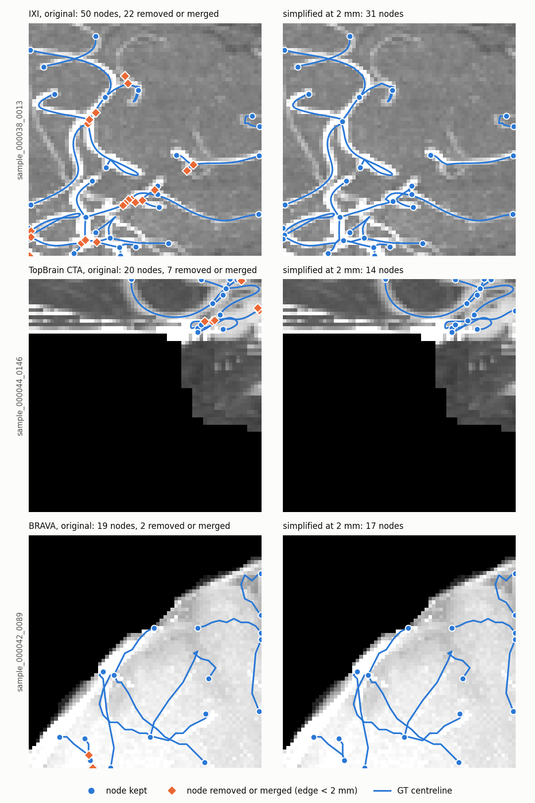
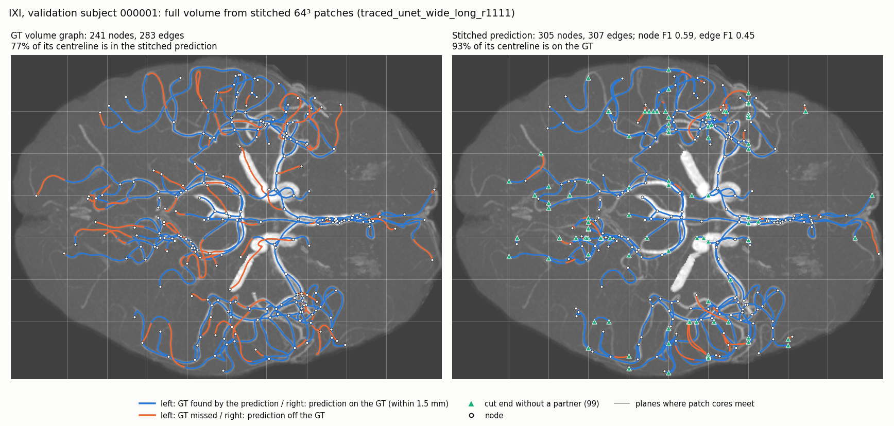
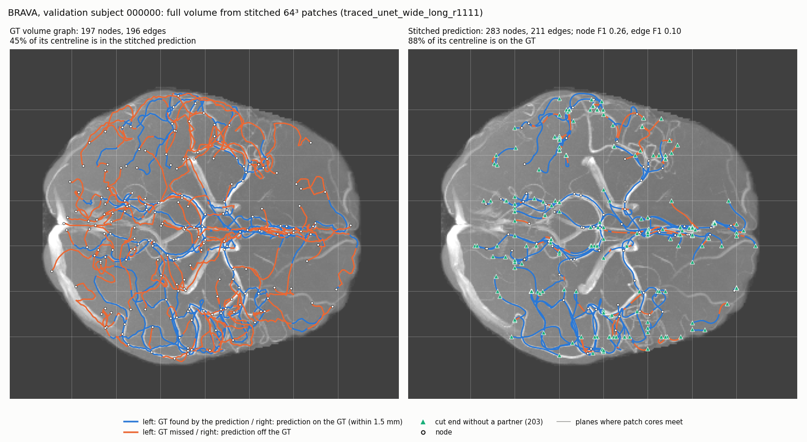

# Dense two-stage model with traced connectivity — description and main results (2 Nov 2026)

Short companion to [`network_proposals_20261030.md`](network_proposals_20261030.md), which has
the full design, the glossary and every intermediate experiment. All numbers below are
**validation** results, single seed. Node and edge thresholds are selected on 256 training
patches (`monitor_train`) only. No test data has been used.

## 1. Summary

- **New model.** A full-resolution 3D U-Net detects nodes as heatmap peaks. Edges are proposed
  by tracing the predicted vessel centreline between nodes (plus a 16-nearest-neighbour
  fallback), then scored and shaped from image features sampled *along the traced path*.
  Edge shapes are B-splines with 8, 16 or 24 controls, chosen per edge.
- **It beats every RelationFormer variant on all three 3D datasets.** On IXI, edge F1 is 0.31
  vs 0.16, Curve F1 0.77 vs 0.34, and SMD 0.023 vs 0.039. It trains from scratch, with no
  pretraining.
- **Traced connectivity vs plain 16-NN** (same model otherwise):
  - Curve F1 +0.10 on IXI and BRAVA;
  - Branch F1 +0.01–0.02;
  - fewer spurious components on IXI (β₀ error 4.0 → 1.7);
  - better recovery of long edges;
  - edge F1 unchanged.
- **Curved edges, separately from the full model.** With the true graph given, learned curved
  edges are 2–3× closer to the real centreline than straight ones. Training RelationFormer
  with or without splines gives identical graphs; only curve quality differs.
- **Main remaining limit: node recall on real data.** About 80% of missed BRAVA long edges
  lack a detected endpoint.
- **Variants tested 3–4 Nov (§4.7–4.9; single seed, validation only).** Neighbourhood offsets lower node error
  slightly. The pass-through decision adds Edge F1 +0.003–0.010 on a fixed model, without improving long edges.
  U-KAN does not beat the U-Net or its MLP control at this budget. On BRAVA the choice of node threshold
  (0.25 vs 0.30) moves Edge F1 by about 0.03, more than any of these changes.
- **Curve shape and feature width (9 Nov, §4.12–4.13; single seed, validation only).** Short straight edges were
  drawn as sub-millimetre coils (arc/chord 2–4, invisible to Curve F1). An arc-length penalty in the geometry loss
  removes them with no metric loss and is now the training default; compressing each output curve to the fewest
  controls within 0.5 voxel cuts the representation from about 13 to 8 controls per edge at no cost. The 32 feature
  channels are kept: stage 2 uses about 12–16 directions, and a 16-channel model loses Curve F1 on TopBrain CTA.

- **Why nodes are missed (10 Nov, §4.14; single seed, validation only).** The misses are the same on training
  patches, so this is not a generalisation gap. In the skeleton-derived GTs (IXI, TopBrain) 37–38% of the edges are
  shorter than the 2 mm matching tolerance, and the nodes on them hold 70% of the IXI misses. With perfect nodes
  stage 2 reaches edge F1 0.66–0.70 on real data. A GT simplified at 2 mm is PROPOSED: trained on it, the model gains
  +0.08 edge F1 on IXI and +0.05 on TopBrain CTA on the same validation GT (BRAVA unchanged). Stage 1 was not converged
  at 15k updates (+0.02 node F1 at 2×). On BRAVA and TopBrain CTA, interior nodes get weak heat and most false detections lie on structures the GT
  does not label.

- **Decisions and long edges (11 Nov, §4.15).** The 2 mm GT, one K24 head with output compression, and a stage 1 of
  about 100 epochs are adopted, and U-Net wide is the backbone (12 Nov). Long edges are lost mainly to a missing endpoint (43–70%), then to spurious
  detections that break them (8–29% at ≥ 40 mm). Removing intermediate nodes before tracing has an oracle ceiling of
  +0.08 edge F1, but neither the node-role head nor the two-hop candidates reach it (no edge F1 gain). At the long
  schedule U-Net wide is the best backbone on IXI and BRAVA (BRAVA edge F1 +0.060); stage 2 is converged at 7.5k.

## 2. The new approach: two-stage dense model with traced connectivity

### 2.1 The idea

RelationFormer predicts a graph with a fixed set of learned "object queries". It reads the
image through a 2×2×2 feature grid and pairs queries with ground truth by Hungarian matching,
which exists only during training. Our diagnostics showed this is what fails on real data:
- nodes are not localised;
- the training-time matching does not match what happens at inference;
- edges are scored without ever looking at the image between the two nodes.

The new model replaces this with two simple, image-grounded stages:

1. **Stage 1, where are the nodes?** A full-resolution 3D U-Net predicts, for every voxel, how
   likely it is to be a graph node (a heatmap), plus where the vessels' centrelines run. Nodes
   are the peaks of the heatmap.
2. **Stage 2, which nodes are connected, and how does the vessel run between them?**
   - Starting from every node, we *follow the predicted centreline* to find which other nodes
     are reachable along a vessel. Each reachable pair becomes a candidate edge, at any distance.
   - For each candidate, a small network looks at the image features *along the traced path*.
     It decides whether the edge exists, and draws its curved shape as a B-spline whose
     number of control points depends on how long and tortuous the path is.

No Hungarian matching is involved. Training builds its edge candidates from the model's *own*
predicted nodes, exactly as inference does.

### 2.2 Overview

```
 64³ MRA patch (intensity − foreground mean)
   │
   ▼  Stage 1: MONAI BasicUNet, full resolution, 37 output channels at 64³
   ├─ ch0      node heatmap (logit) ─► 3×3×3 peak NMS + threshold ─► nodes
   ├─ ch1–3    sub-voxel offsets ───────────────────────────────────┘ (refine peak position)
   ├─ ch4      centreline probability ─► mask (p ≥ 0.5)
   └─ ch5–36   32 feature channels F
   │
   ▼  Stage 2
   nodes + centreline mask ─► geodesic Voronoi tracing ─► candidate pairs + traced paths
                                   (∪ 16 nearest neighbours, straight paths, as fallback)
   per candidate pair (a, b):
     features F sampled in a 24×11×11 tube that follows the path ─► corridor CNN ─► 6,912-d
     + chord length/direction + F at a and b + heat at a and b + path arc length ─► 6,983-d
       ├─► edge head ─────────────────────────────► P(a–b is an edge)
       └─► geometry head K8 / K16 / K24 (fixed rule on the path) ─► B-spline from a to b
```

### 2.3 Stage 1: dense node and centreline maps

**Network.** MONAI `BasicUNet` (3D), used as-is. **Since 12 Nov 2026 (user decision, §4.15) the default is the wide
variant: feature widths (56, 56, 104, 208, 424, 56), 15.57M parameters.** The results of §4.1–4.14 use the widths
(32, 32, 64, 128, 256, 32) described here (5.75M backbone parameters; 9.6M with the corridor CNN, the edge head and
one geometry head):
- four 2× down-sampling levels and back up to the full 64³ resolution, with skip connections;
- instance normalisation, which behaves identically in training and evaluation;
- LeakyReLU, about 9.6M parameters.

Its 37 output channels are read as follows:

| Channel(s) | Meaning | Training target and loss |
|---|---|---|
| 0 | node heatmap logit | One Gaussian blob per GT node (σ = 1.5 voxels, peak 1 at the node's rounded voxel). **CenterNet penalty-reduced focal loss** (α = 2, β = 4), normalised by the number of nodes. The output bias starts at −4.6 (probability ≈ 0.01) |
| 1–3 | sub-voxel offset of a node from its voxel centre | L1, only at GT node voxels |
| 4 | centreline logit | The GT dense centreline of every edge, rasterised (each edge's 64-point path upsampled to 256 points, then dilated by one voxel). Binary cross-entropy with positive weight 5. Auxiliary: it makes the features vessel-aware and is used for tracing |
| 5–36 | 32 general feature channels F | no direct target; shaped by the edge and geometry losses of stage 2 |

**Node extraction.**
1. Take σ(heatmap).
2. Keep voxels that are the maximum of their 3×3×3 neighbourhood and above a threshold.
3. Position = voxel index + predicted offset, clamped to the patch.

Peaks are sorted by score. During training, peaks ≥ 0.2 are used (at most 200 per patch). At
inference the threshold is the one selected on training patches (§2.6).

Stage-1 outputs of `traced_adaptive` on one validation patch per dataset (detections at the train-selected node
threshold, 2 mm matching):


A second set of patches: [`unet_outputs_3d_example2.png`](figures/unet_outputs_20261102/unet_outputs_3d_example2.png).
Interactive 3D views of the same patches, prediction vs GT:
[SyntheticMRI](figures/interactive_3d_20261103/prediction_3d_SyntheticMRI.html),
[IXI](figures/interactive_3d_20261103/prediction_3d_IXI.html),
[BRAVA](figures/interactive_3d_20261103/prediction_3d_BRAVA.html). GitHub shows HTML as source, so download the
file and open it in a browser.

### 2.4 Stage 2: from nodes to edges

**(a) Tracing the centreline: geodesic Voronoi regions.**
- **Domain.** Voxels with centreline probability ≥ 0.5, plus a 2-voxel ball around every node,
  so each node connects to its nearby centreline.
- **Propagation.**
  - Starting from all nodes simultaneously, a geodesic distance is propagated over the
    26-neighbour voxel grid on the GPU, by Bellman–Ford relaxation (up to 320 sweeps, stopping
    early once stable).
  - Entering a voxel costs (step length) × 1/(p + 0.05): cheap where the vessel is confident,
    expensive where it is uncertain.
  - Each voxel ends up *owned* by the node that reaches it most cheaply: its geodesic Voronoi
    region.
- **Candidates.**
  - Two nodes form a candidate pair when their regions *touch* somewhere inside the domain;
    the cheapest touching point is kept.
  - Properties: there is no distance limit. A node lying between two others on the same
    vessel separates their regions, so **"skip" pairs (a–c when the vessel runs a–b–c) are
    never proposed**.
  - The pairs among each node's **16 nearest neighbours** (in mm) are added as a fallback
    with straight paths, so tracing can only add candidates, never remove the old ones.
- **Path.**
  - From the touching point, the path is read back by steepest descent of the distance field
    to each of the two nodes, then the two halves are joined.
  - It is resampled to 64 points by arc length, smoothed (moving average of 5) and pinned to
    the exact sub-voxel node positions.

**(b) Corridor features.**
- The path is resampled to 24 points. At each point a local frame is built: the tangent t,
  plus two perpendicular directions u and w.
- The 32 feature channels F are sampled by trilinear interpolation on an 11×11 cross-section
  spanning ±12 voxels in the (u, w) plane, at each of the 24 points.
- The result is a "tube" of features that **follows the vessel**, of shape 32×24×11×11. The
  first, 16-NN-only version of the model sampled a straight tube around the chord instead.
- A small 3D CNN encodes it to a 6,912-d vector: three 3×3×3 convolutions, 32→64→64→64
  channels, with strides 1, 2 and (1, 2, 2), and GELU activations.
- It is concatenated with:
  - chord length and direction (4);
  - F at both nodes (64);
  - heatmap value at both nodes (2);
  - path arc length (1).

  That gives a 6,983-d pair vector.

**(c) Edge head.** A two-layer MLP (6,983 → 256 → 1, GELU) outputs P(a and b are directly
connected).

**(d) Geometry head with adaptive K.**
- The curve is a clamped cubic B-spline that starts at node a and ends exactly at node b.
- Its interior control points start *on the traced path*, at the B-spline's standard
  parameter positions (Greville abscissae). A head predicts small 3D residuals for them in the
  local path frame, scaled by 4 voxels. For fallback chord pairs the scale is 12 voxels.
- The last layer is zero-initialised, so the initial curve follows the traced path.
- There are three heads, chosen per edge by a fixed rule on the traced path (no learned
  selector):

  | Edge | Controls | Interior points |
  |---|---|---|
  | default, and all fallback pairs | **K8** | 6 |
  | traced, arc ≥ 15 mm or arc/chord ≥ 1.15 | **K16** | 14 |
  | traced, arc ≥ 35 mm or arc/chord ≥ 1.5 | **K24** | 22 |

  Each head is 6,983 → 256 → 3 × (interior points).
- The curve is sampled at 64 points.
- **Default since 11 Nov 2026 (user decision): one K24 head for every pair, and output compression at 0.5 voxel.**
  The rule in the table above describes the runs before that date.
- K is never learned: it is a fixed rule on the predicted traced path, or (option, 9 Nov) a compression of the
  predicted curve. Options in `dense_graph_traced_20261030.py`, all recorded in each run's `final.json` (§4.12):
  - `--k-rule ratio` (default): the table above; `--k-min-arc 8 20` (training default since 9 Nov) lets the arc/chord
    ratio raise K only once the traced arc reaches 8 mm (K16) or 20 mm (K24);
  - `--k-rule fit`: the fewest controls whose least-squares fit of the traced path (smoothed at 1 mm) is within a
    tolerance; tested and not adopted;
  - `--k-rule fixed24`: a single K24 head for every pair;
  - output compression (`MODE['compress_tol']`, evaluation only): each predicted curve is replaced by the
    fewest-control (K8, then K16) endpoint-pinned least-squares spline that reproduces it within 0.5 voxel
    (Hausdorff), never more controls than it had.

### 2.5 Training

**Labels without Hungarian matching.** Each training patch contributes two sets of candidate
pairs:

| Source | Nodes | Node → GT mapping | Pair label |
|---|---|---|---|
| Predicted | the model's own peaks (≥ 0.2, at most 200) | one-to-one matching to GT nodes within 2 mm, the *same* rule the evaluation uses | positive iff both peaks are matched and their GT nodes share an edge; every pair touching an unmatched (false or duplicate) peak is a negative |
| Jittered GT | GT nodes + 0.5 mm Gaussian jitter | identity | positive iff a GT edge |

The jittered-GT source bootstraps the edge and geometry heads before the heatmap is good. In
the from-scratch dense model it is used alone for the first 2,000 updates. All positives are
kept; negatives are randomly subsampled to at most 256 per patch and source.

**Losses** (all weights 1):
- **L_node:** heatmap focal;
- **L_offset:** L1;
- **L_centreline:** BCE;
- **L_edge:** BCE with positive weight min(#neg/#pos, 20);
- **L_geometry:** symmetric chamfer distance in mm between the predicted curve and the GT dense
  centreline (the original traced path, not a fitted spline), on positive pairs.
  - The reference is the GT dense path resampled to 64 points by arc length (cache key `guides`, within about
    0.1 mm of the path). The K8 fit stored in the caches (`curves`, drawn as "GT edge (B-spline)" in the 3D viewers)
    is never used by the dense model; on long tortuous edges it leaves the vessel (§4.12).
  - **Arc-length penalty (training default since 9 Nov 2026, weight λ = 0.1):** each positive pair adds
    λ · max(0, L_pred − 1.02 · L_GT − 0.1 mm), where L_pred and L_GT are the arc lengths of the predicted curve and of
    the reference (both from their 64 samples). The chamfer averages point distances, so a curve that coils inside the
    vessel costs almost nothing; a coil is pure extra length, which this term charges. It never fires on a curve no
    longer than the GT (+2% + 0.1 mm slack for sampling), so smooth bends and sideways shifts are not penalised.
    `--arc-penalty 0` restores the original loss; runs before `traced_arcpen_r1109` used 0. Stage 1
    (`dense_graph_20261030.py`) is unchanged.

**Gradient flow.**
- The edge and geometry losses train the corridor CNN, the heads and, through the sampling,
  the U-Net's shared feature channels.
- Peak positions, offsets, endpoint heat values and tracing are computed without gradient.
  So node placement stays a pure detection problem, trained only by L_node and L_offset.

**Recipe.**
- **Optimizer:** AdamW, LR 1e-3, OneCycle schedule (5% warm-up), weight decay 1e-4, gradient
  clipping at norm 5, batch 8, bf16 for the U-Net.
- **Augmentation:** random 90° rotations in all three planes, and Gaussian noise (p 0.35,
  std ≤ 0.015). No zoom.
- **Dense 16-NN model:** 15,000 updates from scratch.
- **Traced model:** continued from that checkpoint for 7,500 updates at LR 3e-4. The U-Net and
  corridor CNN are inherited; the edge and geometry heads are new, because their input grew by
  the arc-length feature.
- **Speed:** about 0.2 s/update (16-NN) and 0.76 s/update (traced, because of the tracing) on
  one H100.

### 2.6 Inference and threshold selection

1. **Nodes:** run the U-Net, then keep peaks ≥ the node threshold.
2. **Candidates:** trace on the predicted centreline; candidates = touching regions ∪ 16-NN
   pairs among the kept nodes.
3. **Edges:** keep pairs with P(edge) ≥ the edge threshold; draw each kept edge with its
   adaptive-K curve.
4. **Thresholds**, chosen on 256 *training* patches only:
   - first the node threshold maximising node F1 (grid 0.10–0.70);
   - then the edge threshold maximising edge F1 (grid 0.10–0.90).

   Validation is never used for any choice.

### 2.7 Building blocks and their origin

| Block | Origin |
|---|---|
| 3D U-Net (`monai.networks.nets.BasicUNet`) | third-party, used as-is (U-Net: Ronneberger et al., 2015) |
| Heatmap target, penalty-reduced focal loss, offset head, peak NMS | formulation of CenterNet (Zhou et al., 2019), re-implemented here |
| Trilinear feature sampling (`torch.nn.functional.grid_sample`) | PyTorch, as-is |
| One-to-one node matching (`scipy.optimize.linear_sum_assignment`) | SciPy, as-is |
| Cubic B-spline basis (`models/spline.py`) | earlier in this project (used by the RelationFormer K8 head) |
| Geodesic-Voronoi tracing, path read-back, path-following corridor, corridor CNN, edge head, adaptive-K geometry heads, label construction from predicted peaks | new in this project. Tracing follows the classic minimal-path idea for vessel tracking (Cohen & Kimmel, 1997) |

### 2.8 How it differs from RelationFormer

| | RelationFormer (B0) | Dense + traced |
|---|---|---|
| Resolution the decisions see | 2×2×2 feature grid (stride 32) | full 64³ |
| Nodes | fixed set of learned queries; coordinates regressed | heatmap peaks + sub-voxel offsets |
| Training assignment | Hungarian on moving predictions; training only | same one-to-one 2 mm matching as the evaluation; train = inference |
| Edge candidates | all pairs of kept queries | nodes connected along the predicted centreline (+ 16-NN) |
| Edge evidence | two node tokens + global relation tokens; never the image between the nodes | image features sampled along the path between the nodes |
| Edge shape | K8 spline from tokens; the loss never reaches the detector | adaptive K8/K16/K24 spline around the traced path; the loss shapes the shared features |
| Pretraining | SyntheticMRI, then fine-tuning | none (from scratch on the target) |

Code:
- [`scripts/dense_graph_20261030.py`](../../scripts/dense_graph_20261030.py): stage 1, 16-NN stage 2, training, evaluation;
- [`scripts/dense_graph_traced_20261030.py`](../../scripts/dense_graph_traced_20261030.py): tracing, path corridor, adaptive K;
- [`scripts/dense_graph_2d_20261030.py`](../../scripts/dense_graph_2d_20261030.py): the 2D port (16-NN version).

## 3. How the models were trained

| Model | Initialization | Training |
|---|---|---|
| Dense 16-NN | **from scratch** | 15k updates × batch 8 on the target dataset |
| Dense + traced | the dense 16-NN checkpoint | +7.5k updates × 8, same dataset, LR 3e-4 |
| Dense 16-NN continued (control for traced) | the same checkpoint | the same +7.5k updates |
| RelationFormer B0 / D08 / literature scale / anchored | **SyntheticMRI-pretrained** checkpoint | fine-tuned on the target: IXI 31k × 32, BRAVA 82k × 32, anchored ~15k × 32 |
| RelationFormer trained without spline (straight) | same as B0 | B0's exact recipe, spline loss weight 0 |

Training cohorts (subject-disjoint, fixed splits):

| Dataset | Train patches | Val patches |
|---|---|---|
| SyntheticMRI | 4,096 | 480 |
| IXI | 4,096 (literature-scale RelationFormer: all 10,000) | 512 |
| BRAVA | 8,768 | 1,796 |

The dense models therefore win with **no pretraining** and **8–20× fewer patch exposures**.

## 4. Main results (3D, validation)

### 4.1 Graph detection: node / edge / Branch / Curve F1

| Model | SyntheticMRI | IXI | BRAVA |
|---|---|---|---|
| RelationFormer, straight (trained) | 0.794 / 0.608 / 0.197 / 0.567 | 0.504 / 0.154 / 0.022 / 0.314 | 0.364 / 0.069 / 0.005 / 0.146 |
| RelationFormer B0 (K8 spline) | 0.794 / 0.607 / 0.197 / 0.615 | 0.508 / 0.156 / 0.024 / 0.344 | 0.368 / 0.073 / 0.005 / 0.161 |
| Heatmap-anchored RelationFormer | — | 0.640 / 0.263 / 0.123 / 0.472 | 0.547 / 0.154 / 0.035 / 0.229 |
| Dense 16-NN | 0.890 / 0.792 / 0.429 / 0.936 | 0.648 / 0.315 / 0.163 / 0.677 | 0.543 / 0.217 / 0.054 / 0.365 |
| **Dense + traced** | **0.894 / 0.797 / 0.441 / 0.945** | 0.649 / 0.313 / **0.179 / 0.770** | **0.546** / 0.206 / **0.062 / 0.395** |

- RelationFormer IXI is the literature-scale run (100 epochs); BRAVA is D08 (300 epochs).
- Paired 95% CIs over validation subjects:
  - dense − RelationFormer: every metric's CI excludes zero;
  - traced − 16-NN continued: Curve F1 +0.097 [+0.085, +0.112] (IXI) and +0.104 [+0.096, +0.113]
    (BRAVA); Branch F1 +0.01–0.02; edge F1 within ±0.006.
- The 16-NN continued control's own BRAVA scores are 0.545 / 0.202 / 0.050 / 0.291.

### 4.2 Average precision (dense 16-NN)

| | Node AP @2 mm | Box node mAP | Box edge mAP |
|---|---|---|---|
| SyntheticMRI | 0.860 | 0.638 | 0.622 |
| IXI | 0.613 | 0.337 | 0.215 |
| BRAVA | 0.502 | 0.220 | 0.089 |
| RelationFormer literature scale, IXI | 0.446 | 0.126 | 0.066 |

- Box mAP is the Relationformer/GrEVe metric (IoU 0.50:0.95). The dense model uses fixed
  GT-size boxes; RelationFormer uses its regressed boxes.
- AP was not computed for the traced model.

### 4.3 Topology (per patch; GT in brackets)

| Model | β₀ error | β₁ error | Loops | SMD ×10³ |
|---|---|---|---|---|
| SyntheticMRI: RelationFormer straight / B0 | 1.77 / 1.73 | 0.56 / 0.65 | 0.56 / 0.64 (0.04) | 3.01 / 2.99 |
| SyntheticMRI: dense | 1.01 | 0.32 | 0.29 | 1.84 |
| SyntheticMRI: **traced** | 1.02 | **0.22** | **0.20** | **1.81** |
| IXI: RelationFormer straight / B0 | 2.97 / 2.98 | 8.33 / 8.65 | 9.0 / 9.3 (0.71) | 43.0 / 38.6 |
| IXI: anchored | 1.93 | 3.63 | 4.29 | 29.5 |
| IXI: dense | 4.02 | **3.05** | 3.64 | 27.0 |
| IXI: **traced** | **1.68** | 3.50 | 4.10 | **23.2** |
| BRAVA: RelationFormer straight / B0 | **2.22** / 2.59 | 3.32 / 2.52 | 3.3 / 2.5 (0.00) | 62.6 / 62.5 |
| BRAVA: anchored | 3.28 | 4.73 | 4.73 | **57.7** |
| BRAVA: dense | 7.15 | 1.50 | 1.50 | 61.0 |
| BRAVA: **traced** | 4.08 | **0.62** | **0.62** | 63.8 |

Notes:
- **Definitions.** β₀ = connected components; β₁ = independent loops. SMD is the street mover
  distance, native protocol: 100 points, normalized coordinates, straight segments.
- **Loops.** The dense models create far fewer spurious loops than RelationFormer (IXI 3.6–4.1
  vs 9.0–9.3 per patch; BRAVA traced 0.6 vs 2.5–3.3).
- **Components on BRAVA.** The dense models still fragment the graph (9.6–13.3 components vs
  6.3 GT): many detected nodes end up without an accepted edge. Tracing halves the excess,
  and RelationFormer is closer here.
- **SMD.** It ignores patches where a graph has no edges. The number of such patches differs
  between arms (BRAVA 78–236), so BRAVA SMD should be read with care.

Script: [`scripts/topology_metrics_20261102.py`](../../scripts/topology_metrics_20261102.py).
Output: `experiments/dense_graph_20261030/topology-validation.json`.

### 4.4 Long edges: fraction of GT edges recovered, by arc length

| Arc length | IXI: 16-NN | IXI: traced | BRAVA: 16-NN | BRAVA: traced |
|---|---|---|---|---|
| 0–10 mm | 0.27 | 0.26 | 0.19 | 0.18 |
| 20–40 mm | 0.17 | **0.30** | 0.08 | **0.11** |
| ≥ 40 mm | 0.01 | **0.15** | 0.02 | **0.05** |

The remaining BRAVA misses at ≥ 20 mm are mostly missing endpoints (78–82%), not rejected
edges.

### 4.5 Curved vs straight edges

- **Learnability, given the true graph.** Mean distance to the real centreline:
  - BRAVA: straight 1.48 mm → K8 0.62 → K24 0.49;
  - IXI: 0.54 → 0.19;
  - SyntheticMRI: 0.52 → 0.15.

  At equal output count, a learned polyline (points inside the edge) performs like the spline.
- **Within RelationFormer.** Training with vs without the spline loss gives the same detector:
  node, edge and Branch F1 differ by ≤ 0.005, with CIs spanning about zero. The spline adds only
  Curve F1, +0.015–0.048 over chords. In this recipe the geometry loss cannot reach the
  detector, so the edge representation does not change detection.
- **Within the dense model.** Curve F1 is 0.68–0.95, against 0.31–0.62 for RelationFormer.

### 4.6 Soft tracing and gap features (DONE, 3 Nov 2026)

Two variants of the traced model (Dense + traced, called `traced_adaptive` here), with the same
recipe and budget: warm start from `spline6`, 7500 updates, lr 3e-4.
- `traced_gap`: the edge and geometry heads also read the centreline probability along the path.
- `traced_soft`: `traced_gap`, plus no hard centreline mask (ink may cross any voxel at cost
  1/(p+0.05)), plus candidates from geodesic contacts only, with no 16-NN fallback pairs.

**Main result.** Neither variant improves long-edge recovery on IXI or BRAVA. Gap features alone
change little. Soft tracing helps BRAVA Curve F1, hurts IXI, and removes most spurious IXI loops
at the cost of edge recall.

Paired differences in F1, with 95% CIs over validation subjects:

| Dataset | Comparison | Node F1 | Edge F1 | Branch F1 | Curve F1 |
|---|---|---|---|---|---|
| SyntheticMRI | gap − adaptive | −0.001 [−0.003, +0.002] | 0.000 [−0.004, +0.005] | −0.004 [−0.012, +0.004] | +0.002 [−0.001, +0.006] |
| SyntheticMRI | soft − gap | +0.001 [−0.001, +0.002] | +0.001 [−0.004, +0.005] | −0.002 [−0.008, +0.004] | **−0.008 [−0.011, −0.006]** |
| IXI | gap − adaptive | +0.004 [−0.003, +0.011] | **+0.010 [+0.004, +0.018]** | **+0.010 [+0.002, +0.017]** | **+0.012 [+0.004, +0.022]** |
| IXI | soft − gap | −0.005 [−0.012, +0.001] | **−0.019 [−0.026, −0.012]** | **−0.017 [−0.027, −0.005]** | **−0.084 [−0.093, −0.075]** |
| BRAVA | gap − adaptive | −0.002 [−0.004, +0.000] | 0.000 [−0.005, +0.005] | −0.003 [−0.008, +0.003] | +0.002 [−0.001, +0.006] |
| BRAVA | soft − gap | **+0.003 [+0.001, +0.005]** | **−0.003 [−0.005, −0.001]** | **+0.009 [+0.004, +0.013]** | **+0.025 [+0.019, +0.032]** |

Bold marks a CI that excludes zero. Absolute node / edge / Branch / Curve F1:

| Dataset | `traced_adaptive` | `traced_gap` | `traced_soft` |
|---|---|---|---|
| SyntheticMRI | 0.894 / 0.797 / 0.441 / 0.945 | 0.893 / 0.797 / 0.437 / 0.948 | 0.893 / 0.798 / 0.435 / 0.939 |
| IXI | 0.649 / 0.313 / 0.179 / 0.770 | 0.653 / 0.323 / 0.189 / 0.783 | 0.648 / 0.305 / 0.173 / 0.699 |
| BRAVA | 0.546 / 0.206 / 0.062 / 0.395 | 0.544 / 0.206 / 0.059 / 0.397 | 0.547 / 0.203 / 0.068 / 0.423 |

Fraction of long GT edges recovered:

| Dataset | Arc length (GT edges) | adaptive | gap | soft | gap − adaptive | soft − gap |
|---|---|---|---|---|---|---|
| SyntheticMRI | ≥ 20 mm (1556) | 0.809 | 0.814 | 0.797 | +0.004 [−0.001, +0.011] | **−0.017 [−0.027, −0.008]** |
| SyntheticMRI | ≥ 40 mm (145) | 0.710 | 0.717 | 0.697 | +0.007 [−0.037, +0.044] | −0.021 [−0.060, +0.025] |
| IXI | ≥ 20 mm (648) | 0.279 | 0.279 | 0.219 | 0.000 [−0.024, +0.023] | **−0.060 [−0.089, −0.031]** |
| IXI | ≥ 40 mm (83) | 0.145 | 0.108 | 0.120 | −0.036 [−0.086, +0.014] | +0.012 [−0.052, +0.071] |
| BRAVA | ≥ 20 mm (5042) | 0.092 | 0.092 | 0.091 | −0.001 [−0.008, +0.007] | −0.001 [−0.007, +0.005] |
| BRAVA | ≥ 40 mm (1251) | 0.052 | 0.050 | 0.058 | −0.002 [−0.011, +0.010] | +0.008 [−0.003, +0.020] |

Topology per patch, in the format of §4.3 (GT loops in brackets):

| Dataset: arm | β₀ error | β₁ error | Loops | SMD ×10³ | Patches without SMD |
|---|---|---|---|---|---|
| SyntheticMRI: `traced_adaptive` | 1.02 | 0.22 | 0.20 (0.04) | 1.81 | 0 |
| SyntheticMRI: `traced_gap` | 0.99 | 0.26 | 0.24 (0.04) | 1.69 | 0 |
| SyntheticMRI: `traced_soft` | 1.17 | 0.12 | 0.09 (0.04) | 1.96 | 0 |
| IXI: `traced_adaptive` | 1.68 | 3.50 | 4.10 (0.71) | 23.24 | 42 |
| IXI: `traced_gap` | 3.00 | 2.69 | 3.25 (0.71) | 21.35 | 32 |
| IXI: `traced_soft` | 3.17 | 0.74 | 0.86 (0.71) | 23.19 | 50 |
| BRAVA: `traced_adaptive` | 4.08 | 0.62 | 0.62 (0.00) | 63.79 | 225 |
| BRAVA: `traced_gap` | 3.96 | 0.72 | 0.72 (0.00) | 62.45 | 226 |
| BRAVA: `traced_soft` | 3.85 | 0.60 | 0.60 (0.00) | 58.63 | 190 |

Reading the results:
- **Traced pair fraction.** On validation candidates: `traced_adaptive` and `traced_gap` 0.10–0.13,
  `traced_soft` 1.0. In the last training log: 0.09–0.23 and 1.0.
- **Why long edges do not improve.** Most misses on BRAVA are missing endpoints: 79–80% of edges
  ≥ 20 mm in all three arms, which no change to stage 2 can fix. Soft tracing halves rejections there
  (537 → 274 against `traced_gap`), but edges that are not candidates rise from 41 to 320, so
  recovery is unchanged. These two effects come from the soft domain and the dropped fallback
  together and cannot be separated here.
- **IXI loops.** `traced_soft` comes close to the GT loop count (0.86 vs 0.71), but keeps 10.9 edges
  per patch against 16.9 for `traced_gap`: edge precision rises from 0.366 to 0.451 and recall
  falls from 0.289 to 0.230.

Caveats:
- Single seed, validation only, all arms warm-started from the same `spline6`. The CIs cover
  subject sampling, not training variation, and are not corrected for multiple comparisons, so
  small effects such as the IXI gain from `traced_gap` need more seeds.
- Thresholds differ between arms, each selected on `monitor_train`. On IXI the node threshold is
  0.30 for `traced_gap` and 0.35 for the other two (21.3 vs 17.8 nodes per patch). This probably
  explains part of its worse β₀ error (3.00 vs 1.68) and fewer missing endpoints, and it confounds
  both IXI comparisons.
- SMD skips patches with no predicted edges, and their number differs between arms.
- `traced_adaptive` was trained on 30 Oct, before the flags were added. The new code was not rerun
  with the flags off to confirm it reproduces that run.

Scripts: `scripts/compare_traced_knn_20261030.py <dataset> <arm_a> <arm_b>`,
`scripts/compare_arc_length_20261102.py` and `scripts/topology_metrics_20261102.py`.
Outputs in `experiments/dense_graph_20261030/`: `paired-traced_*-vs-*.json`,
`paired-arc-traced_*-vs-*.json` and `topology-validation.json`.

### 4.7 Neighbourhood offsets (DONE, 3–4 Nov 2026)

`traced_offset` is `traced_adaptive` with one training change: the node offset is supervised on every
voxel within 1.75 voxels of a GT node, not only on the rounded GT voxel (`--offset-radius 1.75`, now the
default). Same warm start from `spline6`, 7500 updates, lr 3e-4.

**Main result.** Offsets lower node error slightly and, where thresholds are equal, raise Branch F1
sharply on SyntheticMRI. The large BRAVA gains come mostly from a lower selected node threshold, and
they cost fragmentation.

Paired differences, `traced_offset` − `traced_adaptive`, with 95% CIs over validation subjects. Bold
marks a CI that excludes zero (some bounds round to 0.000):

| Dataset | Thresholds, offset vs adaptive (node, edge) | Node F1 | Edge F1 | Branch F1 | Curve F1 |
|---|---|---|---|---|---|
| SyntheticMRI | 0.45, 0.9 vs 0.45, 0.9 | +0.003 [0.000, +0.006] | +0.001 [−0.005, +0.006] | **+0.086 [+0.067, +0.106]** | **+0.008 [+0.003, +0.012]** |
| IXI | 0.35, 0.8 vs 0.35, 0.75 | −0.001 [−0.004, +0.002] | +0.006 [−0.002, +0.012] | **+0.007 [0.000, +0.014]** | **−0.009 [−0.015, −0.002]** |
| BRAVA | 0.25, 0.75 vs 0.3, 0.75 | **+0.007 [+0.002, +0.013]** | **+0.031 [+0.025, +0.038]** | **+0.013 [+0.008, +0.017]** | **+0.071 [+0.064, +0.079]** |

The same comparison with `traced_offset` decoded at `traced_adaptive`'s thresholds, to remove the shift:

| Dataset | Node F1 | Edge F1 | Branch F1 | Curve F1 |
|---|---|---|---|---|
| IXI (exact) | −0.001 [−0.004, +0.002] | +0.003 [−0.004, +0.009] | +0.006 [−0.002, +0.013] | **+0.009 [+0.002, +0.016]** |
| BRAVA (approximate) | **+0.004 [+0.002, +0.006]** | +0.003 [0.000, +0.007] | **+0.007 [+0.003, +0.012]** | **−0.048 [−0.052, −0.043]** |

- **IXI** is exact, because an edge threshold only filters scores. The Curve F1 loss above reverses into a
  gain, so that loss was the threshold shift.
- **BRAVA** is approximate. Saved rows were traced among nodes ≥ 0.25, and filtering them to ≥ 0.30 does
  not repeat tracing among the retained nodes. Candidates that ran through a removed node are lost, which
  penalises `traced_offset`, so its Curve F1 here is not a fair estimate. An exact answer needs a GPU
  re-evaluation with the node threshold fixed; this was not run.

Matched-node error in mm, median / 90th percentile (each arm's own matched nodes, no CI):

| Dataset | `traced_adaptive` | `traced_offset` |
|---|---|---|
| SyntheticMRI | 0.65 / 1.39 | 0.57 / 1.16 |
| IXI | 0.46 / 1.05 | 0.43 / 1.04 |
| BRAVA | 0.74 / 1.44 | 0.73 / 1.41 |

Reading the results:
- **Fragmentation on BRAVA.** The lower threshold keeps 20.4 nodes per patch against 15.1, and β₀ error rises
  from 4.08 to 6.28 and loops from 0.62 to 1.28 (table in §4.8). Missing endpoints among edges ≥ 20 mm fall
  from 4024 to 3553, which accounts for the +0.030 in long-edge recovery.
- **Branch F1 on SyntheticMRI.** This is the largest effect at equal thresholds and it comes with the lower
  node error. Why it is confined to SyntheticMRI was not investigated.

### 4.8 Pass-through decision (DONE, 3–4 Nov 2026)

`traced_passthrough` is `traced_offset` plus two-hop candidates and a pass-through head (`--passthrough`).
The head scores each traced chain A–C–B, where C is a detected node between A and B. At inference, chains
are visited by decreasing score q. If q ≥ τ and C has no accepted edge other than to A or B, then C, A–C
and C–B are replaced by A–B. τ is selected on `monitor_train` after the node and edge thresholds. Two-hop
rows are never ordinary edges, so A–B can be accepted only through this decision.

**Main result.** On a fixed model the decision helps a little on all three datasets: Edge F1 rises by
0.003–0.010, because it removes more false edges than true ones. It does not improve long-edge recovery,
and on real data the arm recovers fewer blocked edges than `traced_offset`. Its clearest gain is fewer
spurious loops, and that comes from training with the two-hop rows rather than from the decision.

**How the head works.** Scores for 2 mm-labelled chains on validation (log scale, because real nodes
outnumber correct chains 19–43×):


The head separates correct chains well on SyntheticMRI and only partly on IXI and BRAVA. On all three, most
chains above τ are still not correct (100 of 277, 76 of 242, 232 of 1096 are), because the other categories are
so much larger. Examples, before and after the decision:


**The decision alone:** the same model with contraction on vs off, at the same node and edge thresholds.
This is the only comparison here free of threshold shifts and of training differences:

| Dataset | τ | Node F1 | Edge F1 | Branch F1 | Curve F1 | True edges | False edges |
|---|---|---|---|---|---|---|---|
| SyntheticMRI | 0.75 | **+0.002 [0.000, +0.003]** | **+0.003 [+0.001, +0.006]** | **+0.007 [+0.004, +0.010]** | **+0.005 [+0.003, +0.007]** | +22 | −29 |
| IXI | 0.85 | **+0.001 [0.000, +0.003]** | **+0.005 [+0.002, +0.008]** | **+0.002 [0.000, +0.005]** | **+0.005 [+0.003, +0.007]** | +34 | −107 |
| BRAVA | 0.65 | **+0.002 [+0.001, +0.003]** | **+0.010 [+0.006, +0.013]** | 0.000 [−0.001, +0.001] | **+0.002 [+0.001, +0.002]** | +129 | −235 |

**What each contraction did:**

| Dataset | Contractions (per patch) | A–B correct, strict | A–B correct, final graph | C within 2 mm of A or B | Sides accepted before: both / one / none | True edges removed | Correct chains contracted |
|---|---|---|---|---|---|---|---|
| SyntheticMRI | 165 (0.34) | 0.39 | 0.59 | 0.45 | 0.21 / 0.62 / 0.17 | 79 | 0.41 |
| IXI | 170 (0.33) | 0.39 | 0.51 | 0.43 | 0.49 / 0.44 / 0.06 | 55 | 0.21 |
| BRAVA | 743 (0.41) | 0.24 | 0.44 | 0.87 | 0.19 / 0.76 / 0.05 | 212 | 0.26 |

- *Strict* uses the node matching before contraction: C spurious and A–B a GT edge. *Final graph* re-matches
  the kept nodes after contraction. The two differ because the matching is one-to-one: with C and an endpoint
  both near one GT node, removing C lets that endpoint take the match.
- *Sides accepted* counts how many of A–C and C–B the edge head had accepted. The rule does not require either.
- *Correct chains contracted* is the share of chains with the strict "correct" label that were contracted.

**Blocked edges:** GT edges with both endpoints matched and a spurious detection within 1.5 mm of their
interior. The set is fixed before contraction and recovery is counted in the final graph:

| Dataset | `traced_adaptive` | `traced_offset` | Pass-through, off | Pass-through, on | On − off | Pass-through − offset |
|---|---|---|---|---|---|---|
| SyntheticMRI | 34/100 (0.34) | 26/94 (0.28) | 13/110 (0.12) | 45/110 (0.41) | **+0.291 [+0.204, +0.378]** | +0.132 [−0.007, +0.265] |
| IXI | 126/318 (0.40) | 98/313 (0.31) | 22/306 (0.07) | 68/306 (0.22) | **+0.150 [+0.105, +0.200]** | **−0.091 [−0.135, −0.044]** |
| BRAVA | 82/295 (0.28) | 165/758 (0.22) | 25/308 (0.08) | 51/308 (0.17) | **+0.084 [+0.058, +0.108]** | **−0.052 [−0.101, −0.016]** |

How a blocked edge arises, one example per dataset (`traced_adaptive`): a detection C on the vessel between A and B
splits the geodesic regions, so tracing proposes A–C and C–B, and A–B is left to the straight 16-NN fallback.


The arms' blocked sets differ, so the last column compares rates. On BRAVA `traced_offset` runs at a lower node
threshold; against `traced_adaptive`, at the same thresholds, the difference is **−0.112 [−0.165, −0.073]**.

**Against `traced_offset`,** each arm at its own thresholds:

| Dataset | Thresholds, pass-through vs offset (node, edge) | Node F1 | Edge F1 | Branch F1 | Curve F1 |
|---|---|---|---|---|---|
| SyntheticMRI | 0.45, 0.9 vs 0.45, 0.9 | 0.000 [−0.002, +0.003] | +0.003 [−0.003, +0.009] | −0.004 [−0.013, +0.005] | **+0.005 [+0.001, +0.009]** |
| IXI | 0.35, 0.8 vs 0.35, 0.8 | +0.004 [0.000, +0.008] | +0.001 [−0.007, +0.009] | +0.006 [0.000, +0.013] | **−0.009 [−0.016, −0.002]** |
| BRAVA | 0.3, 0.75 vs 0.25, 0.75 | −0.003 [−0.009, +0.002] | **−0.030 [−0.038, −0.023]** | +0.007 [−0.001, +0.014] | **−0.077 [−0.086, −0.070]** |

The BRAVA row is confounded by the node threshold. With `traced_offset` filtered to 0.30 (approximate, see
§4.7), the Edge F1 difference is −0.002 [−0.006, +0.002] in pass-through's direction. So there is no
detectable Edge F1 change, and the −0.030 should not be read as the head's effect.

Absolute node / edge / Branch / Curve F1:

| Dataset | `traced_adaptive` | `traced_offset` | `traced_passthrough` |
|---|---|---|---|
| SyntheticMRI | 0.894 / 0.797 / 0.441 / 0.945 | 0.897 / 0.798 / 0.527 / 0.953 | 0.897 / 0.801 / 0.523 / 0.958 |
| IXI | 0.649 / 0.313 / 0.179 / 0.770 | 0.648 / 0.319 / 0.187 / 0.762 | 0.651 / 0.320 / 0.193 / 0.753 |
| BRAVA | 0.546 / 0.206 / 0.062 / 0.395 | 0.553 / 0.237 / 0.075 / 0.466 | 0.549 / 0.207 / 0.082 / 0.389 |

Fraction of long GT edges recovered:

| Dataset | Arc length (GT edges) | adaptive | offset | pass-through | offset − adaptive | pass-through − offset |
|---|---|---|---|---|---|---|
| SyntheticMRI | ≥ 20 mm (1556) | 0.809 | 0.815 | 0.812 | +0.006 [−0.004, +0.017] | −0.003 [−0.018, +0.013] |
| SyntheticMRI | ≥ 40 mm (145) | 0.710 | 0.731 | 0.752 | +0.021 [−0.014, +0.056] | +0.021 [−0.014, +0.063] |
| IXI | ≥ 20 mm (648) | 0.279 | 0.276 | 0.265 | −0.003 [−0.029, +0.023] | −0.011 [−0.032, +0.011] |
| IXI | ≥ 40 mm (83) | 0.145 | 0.157 | 0.169 | +0.012 [−0.053, +0.074] | +0.012 [−0.027, +0.053] |
| BRAVA | ≥ 20 mm (5042) | 0.092 | 0.122 | 0.089 | **+0.030 [+0.016, +0.042]** | **−0.034 [−0.046, −0.020]** |
| BRAVA | ≥ 40 mm (1251) | 0.052 | 0.058 | 0.054 | +0.006 [−0.002, +0.016] | −0.004 [−0.019, +0.011] |

Both BRAVA ≥ 20 mm differences follow the node threshold: missing endpoints are 4024 / 3553 / 4014.

Topology per patch, in the format of §4.3:

| Dataset: arm | β₀ error | β₁ error | Loops | SMD ×10³ | Patches without SMD | Nodes | Edges |
|---|---|---|---|---|---|---|---|
| SyntheticMRI: `traced_adaptive` | 1.02 | 0.22 | 0.20 (0.04) | 1.81 | 0 | 19.3 | 13.7 |
| SyntheticMRI: `traced_offset` | 0.94 | 0.28 | 0.25 (0.04) | 1.72 | 0 | 19.3 | 13.8 |
| SyntheticMRI: `traced_passthrough` | 0.83 | 0.16 | 0.13 (0.04) | 1.38 | 0 | 19.1 | 13.6 |
| IXI: `traced_adaptive` | 1.68 | 3.50 | 4.10 (0.71) | 23.24 | 42 | 17.8 | 16.4 |
| IXI: `traced_offset` | 1.81 | 2.25 | 2.82 (0.71) | 21.18 | 42 | 17.8 | 14.6 |
| IXI: `traced_passthrough` | 2.02 | 1.04 | 1.44 (0.71) | 21.21 | 42 | 17.5 | 12.6 |
| BRAVA: `traced_adaptive` | 4.08 | 0.62 | 0.62 (0.00) | 63.79 | 225 | 15.1 | 6.1 |
| BRAVA: `traced_offset` | 6.28 | 1.28 | 1.28 (0.00) | 49.67 | 172 | 20.4 | 9.3 |
| BRAVA: `traced_passthrough` | 4.41 | 0.30 | 0.30 (0.00) | 68.37 | 252 | 14.8 | 5.1 |

Reading the results:
- **Why Edge F1 rises although most contractions are not clean.** Only 0.44–0.59 of the new A–B edges are
  correct in the final graph, but what they replace is mostly wrong too: false edges fall by more than true
  edges are lost.
- **On BRAVA the head mostly removes near-duplicates.** In 87% of contractions C is within the 2 mm matching
  radius of an endpoint (43–45% on the other two). It is not mainly doing what it was designed for there,
  which is removing a spurious node in the middle of an edge.
- **Blocked edges.** The decision raises recovery by 0.08–0.29, but with two-hop rows barred from being ordinary
  edges the arm starts from only 0.07–0.12. `traced_offset` reaches 0.22–0.31 by having the ordinary edge
  head accept A–B as a 16-NN candidate, which can leave A–C and C–B accepted too. So on IXI and BRAVA the
  arm trades blocked-edge recovery for fewer loops.
- **Loops come from training, not from the decision.** Within `traced_passthrough`, turning contraction on
  barely changes β₁ error (0.158 → 0.160, 1.029 → 1.037, 0.286 → 0.300). The fall against `traced_offset` on
  IXI (2.25 → 1.04) comes with fewer edges (14.6 → 12.6 per patch) and precision 0.393 → 0.431, recall
  0.268 → 0.254. Contraction does improve β₀ error on all three datasets (1.06 → 0.83, 2.14 → 2.02,
  4.69 → 4.41).
- **Curves.** A contracted A–B uses the joined A–C–B path, which can wiggle at C (fifth row of the examples).
- **The guard.** It blocks some correct chains above τ (35, 10 and 51). It also lets through chains where neither
  side was accepted (5–17% of contractions), so a contraction can add an edge the edge head had rejected
  on both sides. Requiring accepted sides is an untested option.

Caveats:
- Single seed, validation only, all arms warm-started from the same `spline6`. The CIs cover subject sampling,
  not training variation, and are not corrected for multiple comparisons.
- Each arm has its own train-selected thresholds. `traced_offset` vs `traced_adaptive` is confounded on IXI
  (edge) and BRAVA (node), and `traced_passthrough` vs `traced_offset` on BRAVA (node).
- `traced_passthrough` differs from `traced_offset` in both two-hop training and the head, and those two were
  not separated. Only the on/off comparison isolates the inference decision.
- τ was selected on `monitor_train`, where contraction also helps (Edge F1 0.803 → 0.809, 0.343 → 0.346,
  0.189 → 0.200). The curve over τ is shallow, so τ itself is not sharply determined.
- `node-quality.json` has a `blocked_edges` field computed after contraction. It is biased low for
  `traced_passthrough` because successful contractions leave the denominator; use `passthrough-effect.json`.
- IXI and BRAVA `traced_passthrough` crashed in final evaluation after completing training, on patches with fewer
  than two detections (fixed in `87c37b4`). They were re-evaluated from the saved `model.pt`, not retrained. The
  rows the crashed jobs had already saved are byte-identical to the re-evaluation's. For all three datasets the
  paired comparison and arc-length counts reproduce the numbers in each run's `final.json`, which confirms that
  the scripts apply contraction as the model did.

Scripts: `scripts/passthrough_effect_20261104.py`, `scripts/passthrough_figures_20261103.py`,
`scripts/node_quality_20261103.py`, and the three in §4.6. Outputs in `experiments/dense_graph_20261030/`:
`passthrough-effect.json`, `passthrough-decisions.json`, `node-quality.json`, `paired-traced_offset-vs-*.json`,
`paired-traced_passthrough-vs-*.json`, the matching `paired-arc-*` files, and `topology-validation.json`.

### 4.9 U-KAN backbone (DONE, 3–4 Nov 2026)

The 3D U-Net is replaced following U-KAN (arXiv 2406.02918): its two deepest encoder stages and first two
decoder stages become tokenized KAN blocks (grid 5, cubic), with concatenated skips and nothing else changed.
Three backbones run through the full two-stage pipeline with the same optimiser, lr, schedule and budget:

| Name | Backbone | Stage 1 (15k updates, lr 1e-3) | Stage 2 (7500 updates, lr 3e-4, warm start) |
|---|---|---|---|
| U-Net | BasicUNet, the reference | `spline6` | `traced_adaptive` |
| U-KAN | KAN blocks in those four stages | `spline6_ukan` | `traced_adaptive_ukan` |
| MLP control | the same layout with `nn.Linear` in place of KAN layers | `spline6_ukan_mlp` | `traced_adaptive_ukan_mlp` |

**Main result.** U-KAN does not improve on the U-Net at this budget, and the KAN layers do not improve on the
MLP control. Edge F1 is lower on SyntheticMRI and IXI. On BRAVA the large gain comes from a lower selected
node threshold, and at shared thresholds it shrinks to about +0.004. Node F1 and node error are essentially
unchanged at both stages. Training was stable, so neither fallback (lower lr for KAN, `--backbone ukan_add`) applied.

Paired differences for the full model (stage 2), each arm at its own thresholds. Bold marks a CI that excludes
zero (some bounds round to 0.000):

| Dataset | Comparison | Thresholds (node, edge) | Node F1 | Edge F1 | Branch F1 | Curve F1 |
|---|---|---|---|---|---|---|
| SyntheticMRI | U-KAN − U-Net | 0.45, 0.9 vs 0.45, 0.9 | −0.004 [−0.009, 0.000] | **−0.010 [−0.016, −0.003]** | −0.006 [−0.023, +0.009] | +0.001 [−0.004, +0.006] |
| IXI | U-KAN − U-Net | 0.35, 0.8 vs 0.35, 0.75 | −0.004 [−0.010, +0.002] | −0.009 [−0.019, 0.000] | −0.004 [−0.013, +0.006] | **−0.015 [−0.023, −0.006]** |
| BRAVA | U-KAN − U-Net | 0.25, 0.75 vs 0.3, 0.75 | +0.006 [−0.001, +0.013] | **+0.035 [+0.030, +0.041]** | **+0.005 [+0.001, +0.009]** | **+0.082 [+0.072, +0.093]** |
| SyntheticMRI | U-KAN − MLP | 0.45, 0.9 vs 0.4, 0.9 | −0.001 [−0.006, +0.003] | **−0.005 [−0.011, 0.000]** | 0.000 [−0.012, +0.012] | −0.001 [−0.005, +0.003] |
| IXI | U-KAN − MLP | 0.35, 0.8 vs 0.35, 0.85 | −0.006 [−0.013, +0.001] | **−0.013 [−0.024, −0.002]** | −0.004 [−0.013, +0.005] | **+0.026 [+0.018, +0.034]** |
| BRAVA | U-KAN − MLP | 0.25, 0.75 vs 0.3, 0.7 | +0.004 [−0.002, +0.010] | **+0.035 [+0.030, +0.040]** | **+0.009 [+0.003, +0.014]** | **+0.070 [+0.061, +0.076]** |

The same comparisons with both arms decoded at shared thresholds (the higher node threshold, the second arm's
edge threshold). SyntheticMRI U-KAN − U-Net already shares its thresholds:

| Dataset | Comparison | Shared (node, edge) | Node F1 | Edge F1 | Branch F1 | Curve F1 |
|---|---|---|---|---|---|---|
| IXI (exact) | U-KAN − U-Net | 0.35, 0.75 | −0.004 [−0.010, +0.002] | **−0.012 [−0.022, −0.002]** | −0.002 [−0.011, +0.006] | +0.002 [−0.005, +0.010] |
| IXI (exact) | U-KAN − MLP | 0.35, 0.85 | −0.006 [−0.013, +0.001] | **−0.014 [−0.025, −0.003]** | −0.006 [−0.013, +0.002] | −0.004 [−0.014, +0.006] |
| SyntheticMRI (approximate) | U-KAN − MLP | 0.45, 0.9 | −0.002 [−0.006, +0.002] | −0.004 [−0.010, +0.001] | +0.001 [−0.011, +0.013] | +0.004 [−0.002, +0.009] |
| BRAVA (approximate) | U-KAN − U-Net | 0.3, 0.75 | **+0.004 [+0.001, +0.007]** | **+0.004 [0.000, +0.009]** | 0.000 [−0.004, +0.003] | **−0.039 [−0.046, −0.029]** |
| BRAVA (approximate) | U-KAN − MLP | 0.3, 0.7 | +0.002 [−0.001, +0.004] | +0.004 [−0.002, +0.011] | −0.002 [−0.007, +0.003] | **−0.032 [−0.038, −0.024]** |

*Exact* means the arms differ only in edge threshold. *Approximate* means one arm's rows were filtered to a higher
node threshold, as in §4.7, which penalises that arm's Curve F1, so those Curve F1 values are not fair estimates.

Stage 1 alone, against the U-Net `spline6`, each arm at its own thresholds:

| Dataset | Comparison | Thresholds (node, edge) | Node F1 | Edge F1 | Branch F1 | Curve F1 |
|---|---|---|---|---|---|---|
| SyntheticMRI | U-KAN − U-Net | 0.4, 0.9 vs 0.45, 0.85 | −0.001 [−0.003, +0.002] | −0.003 [−0.010, +0.005] | −0.009 [−0.022, +0.004] | **−0.009 [−0.012, −0.005]** |
| IXI | U-KAN − U-Net | 0.3, 0.85 vs 0.3, 0.8 | 0.000 [−0.005, +0.004] | **−0.013 [−0.020, −0.005]** | −0.010 [−0.019, +0.001] | **−0.044 [−0.052, −0.036]** |
| BRAVA | U-KAN − U-Net | 0.25, 0.8 vs 0.25, 0.75 | **+0.004 [+0.001, +0.007]** | −0.001 [−0.007, +0.005] | +0.002 [−0.003, +0.006] | **−0.035 [−0.045, −0.025]** |
| SyntheticMRI | MLP − U-Net | 0.4, 0.9 vs 0.45, 0.85 | 0.000 [−0.003, +0.003] | −0.003 [−0.008, +0.001] | **−0.013 [−0.022, −0.003]** | **−0.012 [−0.016, −0.008]** |
| IXI | MLP − U-Net | 0.35, 0.85 vs 0.3, 0.8 | −0.004 [−0.010, +0.003] | **−0.017 [−0.026, −0.009]** | **−0.011 [−0.019, −0.002]** | **−0.073 [−0.084, −0.063]** |
| BRAVA | MLP − U-Net | 0.3, 0.7 vs 0.25, 0.75 | −0.001 [−0.006, +0.005] | **−0.032 [−0.040, −0.023]** | **−0.006 [−0.010, −0.001]** | **−0.078 [−0.082, −0.072]** |

All of these stage-1 rows have threshold shifts, and no shared-threshold check was run for stage 1. Node F1 is
the least affected. Curve F1 falls when the edge threshold rises, so its size here is partly a threshold effect.

Absolute node / edge / Branch / Curve F1:

| Dataset | Stage | U-Net | U-KAN | MLP control |
|---|---|---|---|---|
| SyntheticMRI | 1 | 0.890 / 0.792 / 0.429 / 0.936 | 0.890 / 0.789 / 0.421 / 0.928 | 0.890 / 0.788 / 0.416 / 0.924 |
| SyntheticMRI | 2 | 0.894 / 0.797 / 0.441 / 0.945 | 0.890 / 0.788 / 0.434 / 0.946 | 0.891 / 0.793 / 0.435 / 0.947 |
| IXI | 1 | 0.648 / 0.315 / 0.163 / 0.677 | 0.647 / 0.303 / 0.153 / 0.633 | 0.644 / 0.299 / 0.152 / 0.604 |
| IXI | 2 | 0.649 / 0.313 / 0.179 / 0.770 | 0.645 / 0.304 / 0.176 / 0.756 | 0.651 / 0.317 / 0.180 / 0.729 |
| BRAVA | 1 | 0.543 / 0.217 / 0.054 / 0.365 | 0.547 / 0.216 / 0.055 / 0.329 | 0.542 / 0.185 / 0.048 / 0.287 |
| BRAVA | 2 | 0.546 / 0.206 / 0.062 / 0.395 | 0.552 / 0.240 / 0.067 / 0.477 | 0.548 / 0.206 / 0.058 / 0.407 |

Matched-node error in mm, median / 90th percentile (each arm's own matched nodes, no CI):

| Dataset | Stage 1: U-Net | U-KAN | MLP | Stage 2: U-Net | U-KAN | MLP |
|---|---|---|---|---|---|---|
| SyntheticMRI | 0.67 / 1.39 | 0.65 / 1.39 | 0.66 / 1.39 | 0.65 / 1.39 | 0.65 / 1.39 | 0.65 / 1.39 |
| IXI | 0.47 / 1.13 | 0.47 / 1.11 | 0.46 / 1.06 | 0.46 / 1.05 | 0.46 / 1.04 | 0.46 / 1.06 |
| BRAVA | 0.75 / 1.44 | 0.76 / 1.44 | 0.75 / 1.44 | 0.74 / 1.44 | 0.76 / 1.43 | 0.75 / 1.44 |

Fraction of long GT edges recovered (stage 2, own thresholds):

| Dataset | Arc length (GT edges) | U-Net | U-KAN | MLP | U-KAN − U-Net | U-KAN − MLP |
|---|---|---|---|---|---|---|
| SyntheticMRI | ≥ 20 mm (1556) | 0.809 | 0.804 | 0.812 | −0.005 [−0.019, +0.008] | −0.008 [−0.018, +0.003] |
| SyntheticMRI | ≥ 40 mm (145) | 0.710 | 0.690 | 0.710 | −0.021 [−0.095, +0.050] | −0.021 [−0.094, +0.040] |
| IXI | ≥ 20 mm (648) | 0.279 | 0.258 | 0.258 | −0.022 [−0.050, +0.009] | 0.000 [−0.026, +0.023] |
| IXI | ≥ 40 mm (83) | 0.145 | 0.133 | 0.157 | −0.012 [−0.092, +0.066] | −0.024 [−0.085, +0.031] |
| BRAVA | ≥ 20 mm (5042) | 0.092 | 0.121 | 0.102 | **+0.029 [+0.023, +0.035]** | **+0.019 [+0.014, +0.024]** |
| BRAVA | ≥ 40 mm (1251) | 0.052 | 0.066 | 0.067 | **+0.014 [+0.006, +0.026]** | −0.002 [−0.012, +0.008] |

The BRAVA U-KAN gains at ≥ 20 mm track the node threshold: missing endpoints are 4024 (U-Net), 3563 (U-KAN), 4030 (MLP).

Topology per patch, in the format of §4.3:

| Dataset: arm | β₀ error | β₁ error | Loops | SMD ×10³ | Patches without SMD | Nodes | Edges |
|---|---|---|---|---|---|---|---|
| SyntheticMRI: `traced_adaptive` | 1.02 | 0.22 | 0.20 (0.04) | 1.81 | 0 | 19.3 | 13.7 |
| SyntheticMRI: `traced_adaptive_ukan` | 1.03 | 0.29 | 0.28 (0.04) | 1.76 | 0 | 19.3 | 13.8 |
| SyntheticMRI: `traced_adaptive_ukan_mlp` | 1.17 | 0.30 | 0.30 (0.04) | 1.69 | 0 | 19.6 | 13.9 |
| IXI: `traced_adaptive` | 1.68 | 3.50 | 4.10 (0.71) | 23.24 | 42 | 17.8 | 16.4 |
| IXI: `traced_adaptive_ukan` | 1.94 | 2.05 | 2.62 (0.71) | 21.44 | 41 | 17.6 | 14.3 |
| IXI: `traced_adaptive_ukan_mlp` | 2.82 | 1.12 | 1.54 (0.71) | 22.22 | 41 | 17.6 | 12.0 |
| BRAVA: `traced_adaptive` | 4.08 | 0.62 | 0.62 (0.00) | 63.79 | 225 | 15.1 | 6.1 |
| BRAVA: `traced_adaptive_ukan` | 6.01 | 1.41 | 1.41 (0.00) | 50.39 | 170 | 20.5 | 9.9 |
| BRAVA: `traced_adaptive_ukan_mlp` | 3.42 | 0.98 | 0.98 (0.00) | 58.92 | 189 | 15.1 | 7.2 |
| SyntheticMRI: `spline6` | 1.01 | 0.32 | 0.29 (0.04) | 1.84 | 0 | 19.3 | 13.8 |
| SyntheticMRI: `spline6_ukan` | 1.37 | 0.29 | 0.28 (0.04) | 2.29 | 0 | 19.6 | 13.6 |
| SyntheticMRI: `spline6_ukan_mlp` | 1.39 | 0.32 | 0.30 (0.04) | 2.49 | 0 | 19.6 | 13.6 |
| IXI: `spline6` | 4.02 | 3.05 | 3.64 (0.71) | 27.02 | 39 | 21.0 | 16.0 |
| IXI: `spline6_ukan` | 5.51 | 1.55 | 1.97 (0.71) | 28.34 | 48 | 20.6 | 12.4 |
| IXI: `spline6_ukan_mlp` | 3.60 | 1.40 | 1.74 (0.71) | 30.07 | 55 | 17.3 | 10.9 |
| BRAVA: `spline6` | 7.15 | 1.50 | 1.50 (0.00) | 61.03 | 191 | 20.6 | 8.8 |
| BRAVA: `spline6_ukan` | 7.93 | 0.96 | 0.96 (0.00) | 63.96 | 255 | 20.4 | 7.3 |
| BRAVA: `spline6_ukan_mlp` | 4.20 | 0.89 | 0.89 (0.00) | 72.57 | 270 | 14.8 | 6.0 |

Reading the results:
- **The node threshold dominates BRAVA across all arms.** Full-model arms at node threshold 0.25 reach Edge F1
  0.237–0.240 (`traced_offset`, `traced_adaptive_ukan`). Those at 0.30 reach 0.206–0.207 (`traced_adaptive`,
  `traced_passthrough`, `traced_adaptive_ukan_mlp`, whatever their other differences). The selection falls either side
  of a grid step, and this gap is larger than any Edge F1 effect of a model change in §4.7–4.9. The lower threshold
  also brings more nodes per patch (about 20 vs 15) and worse β₀ error.
- **KAN vs MLP.** At shared thresholds U-KAN is below the control on IXI and no CI favours it on Edge F1. The +0.026
  Curve F1 on IXI disappears at the shared edge threshold (−0.004 [−0.014, +0.006]), so it was a threshold effect.
- **IXI loops.** Both replaced backbones have fewer loops than the U-Net, with fewer edges per patch. The MLP control
  has the fewest (1.54 vs 2.62), so this is not specific to KAN layers, and its higher edge threshold (0.85)
  contributes too.
- **Spurious nodes at stage 1.** At the same node threshold, U-KAN changes spurious detections little: IXI 3039 → 2905
  and BRAVA 18600 → 18175, with matched nodes 7728 → 7657 and 18402 → 18433.
- **Stability.** No non-finite values in any training log, and loss levels and maxima similar to the U-Net's, so lr was
  not lowered for the KAN arm and `ukan_add` was not run. Stage 1 took about 15–20% longer than the 30 Oct U-Net
  (3845 vs 3181 s on IXI), on possibly different nodes.

Caveats:
- Single seed, validation only. The CIs cover subject sampling, not training variation, and are not corrected for
  multiple comparisons.
- This tests U-KAN at this project's budget and optimiser, as decided for this comparison, not at the longer schedule
  of the U-KAN paper. It is not evidence against U-KAN at a literature-scale budget, which was not tried.
- Each arm has its own train-selected thresholds; the deltas that depend on a threshold shift are called out above.
- `spline6` and `traced_adaptive` were trained on 30 Oct with earlier code. The U-KAN arms ran on the 3 Nov code with
  `--offset-radius 0`. The U-Net was not rerun on the new code to confirm that it reproduces.
- The backbones warm-start stage 2 from their own stage 1, so a stage-1 difference carries into stage 2.

Scripts: `scripts/compare_shared_threshold_20261104.py`, `scripts/node_quality_20261103.py`, and the three in §4.6.
Outputs in `experiments/dense_graph_20261030/`: `shared-thresholds.json`, `node-quality.json`,
`paired-traced_adaptive_ukan-vs-*.json`, `paired-spline6_ukan*-vs-spline6-*.json`, the matching `paired-arc-*` files, and
`topology-validation.json`.

Summary figure of 4 Nov, which also includes U-KAN with additive skips and DSCNet (K = 3). That DSCNet arm has
2.8x the U-Net's backbone parameters; §4.11 replaces the comparison with size-matched arms:


### 4.10 Loop patches in training and evaluation (DONE, 5 Nov 2026)

**Problem.** The adjacency target stores one edge per node pair and no self-loop, so patches whose contracted
graph had a parallel branch, a self-loop or an anchor-free ring were dropped from training *and* from
validation/test (IXI 10.2%, TopBrain CTA 8.8%, TopBrain MRA 3.3%, SyntheticMRI 2.9%, BRAVA 0%). A
GT-dependent filter on the evaluation set is not defensible for a paper.

**Fix (DONE).**
- *Training encoding:* such branches get degree-2 "breaking point" anchors (midpoint of a repeated pair; 1/3
  and 2/3 of a self-loop; three anchors on an anchor-free ring); no patch is excluded. Geometry, beta_0 and
  beta_1 are checked unchanged on every patch (`data/spline_targets.subdivide_loops`,
  `prepare_transfer_splines.py`, default since 5 Nov; `--no-subdivide-loops` reproduces older caches).
- *Evaluation:* inserted anchors are "don't care" nodes; edges are scored on the original branches as a
  multiset (`metrics/loop_aware.py`). Loop-free patches score exactly as before. 2D crops are now contracted
  again after cropping, with the same rule and explicit `inserted` masks (`native2d/targets.crop_graph`).
- Validation (and later test) sets are complete. Old results remain comparisons on loop-free patches.

**A/B (single seed, U-Net, traced_adaptive recipe).** Same recipe, trained without loop patches (A) or with
them (B); both scored on the same complete validation list. Final model, B − A, 95% subject-bootstrap CI:

| Dataset (val patches) | Thresholds | Node F1 | Edge F1 | Branch F1 | Curve F1 |
|---|---|---|---|---|---|
| IXI (2,961) | own | +0.002 [−0.005, +0.009] | +0.006 [−0.001, +0.011] | +0.002 [−0.003, +0.006] | +0.030 [+0.024, +0.036] |
| TopBrain MRA (1,148) | same (exact) | +0.006 [−0.005, +0.019] | +0.008 [−0.006, +0.022] | +0.008 [−0.000, +0.014] | +0.007 [−0.014, +0.022] |
| ↳ loop patches (49) | exact | +0.004 | +0.038 [+0.015, +0.060] | +0.028 [−0.002, +0.079] | +0.007 |
| TopBrain CTA (803) | own | −0.011 [−0.020, −0.000] | +0.003 | +0.005 | +0.069 [+0.046, +0.089] |
| SyntheticMRI (480; 8 with loops) | own | +0.001 | +0.002 | −0.006 | −0.002 |

- On IXI, CTA and SyntheticMRI the B models selected a lower node threshold, so own-threshold gains are partly
  a threshold effect. The shared-threshold approximation (higher node threshold, rows filtered without
  re-tracing) penalises B and cannot settle it (IXI shared: Curve −0.027, Branch −0.011).
- The only exact comparison (TopBrain MRA) shows B recovering more edges on loop patches and no change elsewhere.
- **Decision (user, 5 Nov 2026): train with loop patches by default.** No harm under the real protocol, no
  data dropped, training matches the complete evaluation sets. Not claimed as a result: effects are within
  single-seed variation.
- PROPOSED: exact re-scoring of the B models at A's node thresholds (re-traced, 4 GPU evaluations) and 2-3
  seeds per arm on IXI and TopBrain CTA.
- Files: `experiments/loop_subdivision_20261105/` (`loop-ab.json`, `ab_plan_summary.json`), plan entries
  `<dataset>-loops` / `<dataset>-noloops`, `scripts/compare_loop_ab_20261105.py`.

### 4.11 Size-matched backbones: U-Net, U-Net wide, DSC3 slim, DSC3 (DONE, 9 Nov 2026)

**Question.** DSC3 beat the U-Net on IXI and BRAVA (§4.9 follow-up, 4 Nov) but has 2.8x the backbone parameters.
Is the gain from the snake convolutions or from capacity? 2x2 design on the current recipe (loop patches, offset
radius 1.75), one seed, IXI / BRAVA / TopBrain CTA:

| | ~5.8M backbone | ~15.7M backbone |
|---|---|---|
| U-Net | `unet` 5.75M (existing runs) | `unet_wide` 15.57M (widths 56-56-104-208-424-56) |
| DSC3 | `dsc3_slim` 5.78M (widths 20-20-40-76-152-20) | `dsc3` 15.89M |

**Protocol (review-safe).** Node AP @2 mm (threshold-free) and F1 / topology at the frozen global decoding setting of
the evaluation protocol (V0: node 0.30 / edge 0.75), the same for every arm; subject-paired bootstrap vs U-Net.
`scripts/backbone_compare_20261109.py`, results `experiments/backbone_compare_20261109/<dataset>.json`.

| Arm − U-Net (V0 global) | IXI edge F1 | BRAVA edge F1 | CTA edge F1 | Node AP IXI / BRAVA / CTA |
|---|---|---|---|---|
| U-Net (absolute) | 0.323 | 0.208 | 0.212 | 0.611 / 0.519 / 0.447 |
| U-Net wide | **+0.016** [+0.012, +0.021] | **+0.027** [+0.021, +0.032] | +0.010 [−0.002, +0.020] | 0.624 / 0.526 / 0.461 |
| DSC3 slim | **+0.012** [+0.008, +0.017] | **+0.011** [+0.005, +0.019] | **+0.024** [+0.012, +0.040] | 0.625 / 0.521 / 0.471 |
| DSC3 | **+0.021** [+0.017, +0.027] | −0.003 [−0.009, +0.006] | +0.015 [−0.004, +0.034] | 0.638 / 0.520 / 0.478 |

All four F1 measures and the |β₁| error, arm − U-Net with 95% subject-paired CIs (`scripts/backbone_figure_20261109.py`).
For |β₁| error, right of zero is worse:


- **Snake convolutions at equal small size help:** DSC3 slim beats the U-Net on all three datasets (edge, node and
  Curve F1; Branch F1 on IXI and CTA).
- **Capacity alone helps too:** U-Net wide beats the U-Net on IXI and BRAVA (Curve F1 +0.046 on BRAVA).
- **At equal large size, DSC3 is not consistently better than U-Net wide:** better on IXI (+0.006 edge F1), worse on
  BRAVA (−0.030), similar on CTA. Most of DSC3's earlier gain over the U-Net was capacity.
- **Topology (|β1| error) moves both ways:** the DSC arms add loops on IXI (+0.52 / +0.55 per patch), U-Net wide
  removes them (−0.22); on BRAVA all three larger/snake arms add loops (+0.19 to +0.42).
- **Cost:** GPU-h per dataset (both stages): U-Net ~2.7, U-Net wide 2.4–3.1, DSC3 slim 4.0–4.4, DSC3 4.3–4.9.
- **Single seed;** gaps between the three challengers (0.005–0.03) are of the size of seed variation seen in §4.10.
- PROPOSED: U-Net wide as the default backbone (best or near-best on IXI and BRAVA, no extra training time, a
  standard architecture), with DSC3 slim as the alternative; confirm with 2 more seeds of U-Net, U-Net wide and DSC3
  slim on the three datasets (~45 GPU-h) before the journal runs.

### 4.12 Curve shape: coiled short edges, the arc-length penalty and the number of controls (DONE, 9 Nov 2026)

**Problem.** On short, nearly straight vessels the predicted curves coiled inside the vessel. Accepted true edges with
chord < 5 mm, reference models, medians (GT in brackets):

| Dataset | arc / chord | total turning at 1 mm steps | share turning > 45° more than the GT |
|---|---|---|---|
| IXI-loops (`traced_adaptive`) | 2.42 (1.00) | 227° (9°) | 0.79 |
| BRAVA (`traced_offset`) | 3.64 (1.04) | 1179° (31°) | 0.89 |
| TopBrain CTA (`traced_adaptive`) | 2.09 (1.00) | 191° (10°) | 0.77 |

Distance metrics did not show it: the coil stays within a fraction of a millimetre of the vessel (mean distance to the
GT about 0.35 mm IXI, 0.6 mm BRAVA, as for straight curves), so Curve F1 and the chamfer loss are blind to it.

**Causes.**
- Each interior control may move about 4 voxels from the traced path whatever the edge length; on a 3 mm edge the
  controls are 0.1–0.5 mm apart, so small offsets cross neighbours. BRAVA, chord < 5 mm: arc/chord 1.38 with K8,
  5.11 with K16, 17.7 with K24.
- The K rule gave K16/K24 to most short edges: the arc/chord ratio is read on the voxel-staircase trace, where noise of
  fixed size inflates it on short paths (IXI chords < 5 mm: traced ratio 1.22 vs GT 1.00). On the training monitors
  (`scripts/k_selection_check_20261109.py`), the fewest controls that fit the smoothed GT within 0.5 voxel ("needed K")
  is K8 for 99–100% of traced true pairs (BRAVA 86%), and the original rule agrees with it on only 31–49%.

**Arms** (stage 2 only: 7.5k updates, lr 3e-4, warm start from each dataset's stage-1 `spline6`, the reference recipe;
one change each; IXI-loops / BRAVA / TopBrain CTA; scored at the frozen global decoding, node 0.30 / edge 0.75,
subject-paired bootstrap vs the reference; `scripts/compare_arms_20261109.py`, `experiments/arm_compare_20261109/`):
- `traced_arcpen_r1109`: arc-length penalty λ = 0.1 (§2.5), original K rule;
- `traced_kfit_r1109`: fit K rule, tolerance 0.75 voxel (chosen on the training monitors);
- `traced_k24_r1109`: one K24 head for every pair + arc penalty;
- `@compressed`: the same model with output compression at 0.5 voxel (§2.4 d), evaluation only.

| Dataset: arm | Edge F1 Δ | Curve F1 Δ | short arc/chord | > 45° extra: < 5 / 10–20 mm | controls per output edge |
|---|---|---|---|---|---|
| IXI: reference | 0.323 | 0.812 | 2.42 | 0.79 / 0.32 | 13.1 |
| IXI: arc penalty | −0.001 [−0.003, +0.001] | −0.003 [−0.005, −0.002] | 1.09 | 0.16 / 0.12 | 13.2 |
| IXI: arc penalty, compressed | −0.001 [−0.003, +0.001] | −0.004 [−0.005, −0.002] | 1.07 | 0.15 / 0.03 | **8.1** |
| IXI: fit rule | −0.002 [−0.004, −0.000] | −0.006 [−0.008, −0.004] | 1.24 | 0.43 / 0.06 | — |
| IXI: K24 + penalty, compressed | −0.002 [−0.004, +0.000] | −0.005 [−0.006, −0.003] | 1.08 | 0.16 / 0.04 | **8.1** |
| BRAVA: reference | 0.208 | 0.391 | 3.64 | 0.89 / 0.33 | 12.9 |
| BRAVA: arc penalty | +0.002 [−0.002, +0.007] | +0.000 [−0.004, +0.004] | 1.11 | 0.18 / 0.05 | 13.0 |
| BRAVA: arc penalty, compressed | +0.002 [−0.002, +0.007] | −0.000 [−0.004, +0.004] | 1.09 | 0.15 / 0.02 | **8.4** |
| BRAVA: fit rule | −0.000 [−0.003, +0.004] | −0.007 [−0.012, −0.003] | 1.62 | 0.76 / 0.09 | — |
| BRAVA: K24 + penalty, compressed | −0.001 [−0.004, +0.002] | −0.004 [−0.009, +0.001] | 1.10 | 0.16 / 0.03 | **8.6** |
| CTA: reference | 0.212 | 0.582 | 2.09 | 0.77 / 0.47 | 13.5 |
| CTA: arc penalty | +0.004 [+0.000, +0.010] | −0.000 [−0.004, +0.007] | 1.11 | 0.20 / 0.13 | 13.4 |
| CTA: arc penalty, compressed | +0.004 [+0.000, +0.010] | −0.000 [−0.004, +0.007] | 1.08 | 0.20 / 0.05 | **8.1** |
| CTA: fit rule | +0.004 [−0.001, +0.009] | −0.010 [−0.020, −0.001] | 1.26 | 0.52 / 0.05 | — |
| CTA: K24 + penalty, compressed | +0.005 [+0.001, +0.009] | −0.000 [−0.010, +0.012] | 1.09 | 0.22 / 0.05 | **8.1** |

Reference rows give absolute values; Δ rows are arm − reference with 95% CIs. "Controls per output edge" is the mean K
over accepted edges at the frozen decoding. Node F1, Branch F1 and node AP change by ≤ 0.005 in every arm.

Real validation examples (a random sample, seed 0, not hand-picked; `scripts/curve_shape_figures_20261109.py`):


- **The arc penalty removes the coils** on all three datasets (short-edge arc/chord 2.1–3.6 → 1.09–1.11) with no loss
  beyond the protocol's −0.01 F1 margin, and it improves the worst long edges (90th-percentile distance for GT arcs
  ≥ 40 mm: IXI 0.77 → 0.47 mm, BRAVA 1.23 → 0.93 mm).
- **Compression nearly halves the representation for free:** 13 → 8.1–8.6 controls per output edge, at most 0.001
  Curve F1, and it removes the residual turning on mid-length edges (10–20 mm: 0.12 → 0.03 on IXI).
- **Option (a) K24 + penalty + compression and option (b) penalty + current K rule + compression are tied** within
  single-seed noise on every measure; (b) is marginally better on Curve F1 (IXI −0.004 vs −0.005, BRAVA −0.000 vs
  −0.004) and on IXI long edges (p90 0.48 vs 0.55 mm), (a) is simpler (one head, no rule). Decision pending.
- **The fit rule is not adopted:** it removes fewer coils (BRAVA 1.62) and is the only arm with a Curve F1 loss on all
  three datasets.
- **Decision (user, 9 Nov 2026): the arc penalty λ = 0.1 is the stage-2 training default.**

Caveats: single seed; validation only; the arc-penalty arm used the original K rule, while the training default since
9 Nov is the minimum-length rule (`--k-min-arc 8 20`), a combination not yet trained; the 3D viewers still draw the cache
K8 fit as "GT edge" (on TubeTK edges of 40–80 mm only 69% of that fit lies inside the vessel, against ≥ 99% for the real
path and for the training target).

### 4.13 Width of the shared feature channels F (DONE, 9 Nov 2026)

**Question.** Are the 32 feature channels read by stage 2 too many or too few?

**Structure.** F = `final_conv(u1)` is a 1×1×1 *linear* map of the last decoder output u1 (32 channels for the U-Net),
and the corridor CNN's first layer is linear too. So F carries at most 32 dimensions, more F channels alone add no
information (the decoder width would have to grow), and a native channel is an arbitrary basis direction. Only stage 2
reads F; nodes and tracing are unaffected by any change to it.

**Test-time ablation** (`scripts/feature_ablation_20261109.py`, `experiments/feature_ablation_20261109/`): on the trained
reference models, F is replaced by its projection onto the top-k principal directions of the corridor samples (fitted
on the training monitor; removed directions set to their mean). Edge F1 change at the frozen global decoding:

| Dataset (full Edge F1) | k = 1 | 2 | 4 | 8 | 12 | 16 | 24 | all removed |
|---|---|---|---|---|---|---|---|---|
| SyntheticMRI (0.787) | −0.111 | −0.044 | −0.029 | −0.004 | −0.004 | −0.001 | 0.000 | −0.787 |
| IXI (0.323) | −0.066 | −0.032 | −0.022 | −0.004 | −0.003 | 0.000 | 0.000 | −0.244 |
| BRAVA (0.208) | −0.052 | −0.078 | −0.009 | −0.002 | 0.000 | 0.000 | 0.000 | −0.169 |
| TopBrain MRA (0.268) | −0.078 | −0.041 | −0.018 | −0.005 | 0.000 | 0.000 | 0.000 | −0.188 |
| TopBrain CTA (0.212) | −0.018 | −0.016 | −0.008 | −0.009 | −0.002 | +0.002 | 0.000 | −0.156 |


- 12–16 directions keep everything (also Curve F1 within 0.002 at k = 16); the top 8 hold 80–83% of the variance,
  participation ratio 5.7–8.3.
- Single native channels matter little (worst: −0.026 Edge F1, channel 30 on CTA), but removing the 16 or 24 least
  important native channels together costs up to −0.061 / −0.133: the information is spread across channels.
- Removing all of F collapses stage 2 (−0.16 to −0.79 Edge F1): edges depend on the image features, not on geometry
  alone.

**Training with 16 channels** (`spline6_fc16_r1109` → `traced_fc16_r1109`, both stages from scratch, decoder unchanged,
original K rule, arm_compare protocol), 16 − 32:

| Dataset | Edge F1 | Branch F1 | Curve F1 | node AP |
|---|---|---|---|---|
| IXI | +0.003 [−0.001, +0.008] | +0.003 [−0.002, +0.008] | −0.000 [−0.004, +0.003] | 0.612 vs 0.611 |
| BRAVA | +0.001 [−0.002, +0.005] | −0.004 [−0.008, +0.000] | +0.009 [−0.000, +0.020] | 0.517 vs 0.519 |
| TopBrain CTA | −0.007 [−0.023, +0.007] | −0.010 [−0.019, +0.002] | **−0.024 [−0.036, −0.010]** | 0.445 vs 0.447 |

- 16 channels match 32 on IXI and BRAVA but lose Curve F1 on TopBrain CTA, which the test-time ablation did not
  predict. Stage 1 is only ~10% faster with 16.
- **Decision (user, 9 Nov 2026): keep 32 feature channels.** 32 is not a bottleneck either; testing "more" would mean
  widening the decoder (`--feature-channels` exists for both stages).
- Single seed; validation only.

### 4.14 Why nodes are missed on real data, and GT simplification (DONE, 10 Nov 2026; GT definition adopted 11 Nov)

**Question.** Node F1 is 0.48–0.65 on real data and bounds everything else. Which nodes are missed, and why?
Reference models `traced_arcpen_r1109` (IXI-loops, TopBrain CTA, BRAVA) and `traced_offset` (SyntheticMRI, as a
control); node threshold 0.30 (frozen global decoding) for every dataset; 2 mm matching; single seed.
`scripts/node_miss_diagnosis_20261110.py`, results in `experiments/node_miss_diagnosis_20261110/`.

**1. It is not a generalisation gap.** The model misses the same nodes on the patches it was trained on:

| Dataset | Node P / R / F1: training monitor | validation | Boundary: share of GT, recall | Junction | Terminal |
|---|---|---|---|---|---|
| IXI | 0.72 / 0.63 / 0.675 | 0.71 / 0.60 / 0.650 | 0.39, 0.81 | 0.34, 0.57 | 0.26, 0.31 |
| TopBrain CTA | 0.57 / 0.42 / 0.481 | 0.50 / 0.48 / 0.488 | 0.45, 0.72 | 0.30, 0.42 | 0.24, 0.09 |
| BRAVA | 0.60 / 0.52 / 0.561 | 0.59 / 0.52 / 0.550 | 0.70, 0.67 | 0.14, 0.24 | 0.15, 0.07 |
| SyntheticMRI | 0.90 / 0.88 / 0.893 | 0.90 / 0.88 / 0.890 | 0.51, 0.85 | 0.26, 0.90 | 0.23, 0.92 |

Boundary = where a vessel leaves the patch; junction = degree ≥ 3; terminal = a free vessel end inside the patch.

**2. Nodes are the lever, not stage 2.** The same stage-2 model, given different node sets (validation, frozen
decoding; edge F1 / Curve F1):

| Node set given to stage 2 | IXI | TopBrain CTA | BRAVA | SyntheticMRI |
|---|---|---|---|---|
| the model's detections (reference) | 0.322 / 0.809 | 0.216 / 0.581 | 0.211 / 0.391 | 0.792 / 0.966 |
| detections, unmatched ones removed | 0.401 / 0.784 | 0.312 / 0.553 | 0.276 / 0.360 | 0.849 / 0.961 |
| detections + every missed GT node | 0.527 / 0.884 | 0.504 / 0.761 | 0.544 / 0.671 | 0.873 / 0.980 |
| all GT nodes | 0.662 / 0.895 | 0.697 / 0.813 | 0.689 / 0.732 | 0.954 / 0.991 |

Adding the missed nodes gains 2.6 to 5 times as much edge F1 as removing the false ones. With perfect nodes, stage 2 reaches edge F1
0.66–0.70 on real data. These are upper bounds, not results: the oracle uses the GT.

**3. In the skeleton-derived GTs, half of the nodes sit on an edge shorter than the matching tolerance.**
Training monitors:

| Dataset (how the GT was made) | GT edges < 2 mm | Nodes on such an edge | Nodes with another GT node within 2 mm |
|---|---|---|---|
| IXI (mask → skeleton) | 0.37 | 0.47 | 0.51 |
| TopBrain CTA (mask → skeleton) | 0.38 | 0.48 | 0.53 |
| TopBrain MRA (mask → skeleton) | 0.38 | 0.47 | 0.51 |
| BRAVA (manual traces) | 0.11 | 0.13 | 0.21 |
| SyntheticMRI (generated graphs) | 0.10 | 0.14 | 0.14 |

- In IXI, half of the junction–terminal edges are one-voxel "hairs": two path points, under 1 mm, shorter than the
  vessel radius at the junction (median length / radius 0.72), and not at the patch face (median 6.5 voxels from it).
  Each hair adds a junction and a terminal to a vessel that has no branch there.
- The other short edges are junctions split in two (35% of IXI junction–junction edges are < 2 mm) and stubs where a
  vessel leaves the patch within 2 mm of a junction.
- BRAVA and SyntheticMRI have only the cropping stubs.

Validation node recall against the length of the node's shortest edge (in brackets: share of GT nodes; share of all
missed nodes):

| Dataset | < 1 mm | 1–2 mm | 2–4 mm | 4–8 mm | ≥ 8 mm | Nodes whose edges are all ≥ 2 mm (share) |
|---|---|---|---|---|---|---|
| IXI | 0.38 (0.37; 0.57) | 0.60 (0.13; 0.13) | 0.75 (0.13; 0.08) | 0.79 (0.15; 0.07) | 0.74 (0.22; 0.14) | 0.76 (0.50) |
| TopBrain CTA | 0.30 (0.24; 0.32) | 0.36 (0.17; 0.20) | 0.46 (0.18; 0.18) | 0.63 (0.18; 0.12) | 0.64 (0.24; 0.16) | 0.58 (0.59) |
| BRAVA | 0.37 (0.06; 0.07) | 0.41 (0.08; 0.09) | 0.44 (0.11; 0.13) | 0.50 (0.20; 0.20) | 0.57 (0.55; 0.48) | 0.53 (0.87) |
| SyntheticMRI | 0.42 (0.05; 0.25) | 0.51 (0.10; 0.38) | 0.84 (0.14; 0.18) | 0.96 (0.25; 0.09) | 0.97 (0.47; 0.10) | 0.95 (0.85) |

- On IXI, 70% of all misses are nodes on an edge shorter than 2 mm. IXI junctions whose edges are all ≥ 4 mm are
  found at 0.90–0.91, and boundary nodes on edges ≥ 4 mm at 0.92–0.93.
- The clean control shows the same mechanism: on SyntheticMRI the 15% of nodes on sub-2 mm edges hold 63% of the
  misses.

Why each node was missed (validation, share of missed nodes):

| Dataset | Only peak within 2 mm belongs to another GT node | Peak below the threshold | Heat but no separate peak | Detection 2–4 mm away | No response |
|---|---|---|---|---|---|
| IXI | 0.56 | 0.36 | 0.06 | 0.02 | 0.01 |
| TopBrain CTA | 0.23 | 0.69 | 0.05 | 0.02 | 0.01 |
| BRAVA | 0.10 | 0.73 | 0.09 | 0.04 | 0.04 |
| SyntheticMRI | 0.62 | 0.07 | 0.19 | 0.12 | 0.01 |

**4. Terminals are missed whatever the edge length** (IXI 0.28–0.35, TopBrain CTA 0.06–0.13, BRAVA 0.06–0.13,
against 0.96–0.97 on SyntheticMRI for edges ≥ 4 mm). On real data a terminal is where the mask or the manual trace
stops, not an image feature.

**5. BRAVA and TopBrain CTA: weak, poorly ranked heat at interior nodes.** 73% and 69% of their missed nodes have a
peak within 2 mm, but below the threshold. BRAVA junction recall is 0.24, and it falls as the junction's edges get
longer (0.43 → 0.16), i.e. as the junction gets further from the patch face: there the model is mostly a detector of
boundary nodes.
- A separate threshold for interior peaks, chosen on the training monitor, does not fix it: node F1 +0.008 (BRAVA)
  and +0.011 (TopBrain CTA). Lowering the interior threshold to 0.20 raises BRAVA junction recall to 0.53 but
  precision falls from 0.59 to 0.56 overall and collapses below that. Not adopted.

**6. Where the unmatched detections are** (validation, share of unmatched detections):

| Dataset | Unmatched | Within 2 mm of a GT node (duplicate) | On a GT centreline, between nodes | Inside the vessel mask, off the GT graph | Outside the vessel mask | Within 3 voxels of the patch face |
|---|---|---|---|---|---|---|
| IXI | 18,158 | 0.18 | 0.32 | 0.10 | 0.40 | 0.60 |
| TopBrain CTA | 4,748 | 0.12 | 0.21 | 0.08 | 0.59 | 0.77 |
| BRAVA | 11,037 | 0.27 | 0.14 | 0.58 (no vessel mask) | — | 0.97 |
| SyntheticMRI | 951 | 0.26 | 0.27 | 0.47 | — | 0.00 |

- On IXI and TopBrain CTA, 40% and 59% of the false detections are outside the vessel mask, mostly at the patch
  face: the model marks a bright tubular structure crossing the face that the GT does not contain. BRAVA has no
  vessel mask (its `seg` is the brain mask), but 97% of its false detections are at the face and 58% are more than
  1.5 mm from any traced vessel.
- So precision on real data is bounded by what the GT covers, not only by the model. This cannot be fixed in the
  model; it is a limitation to state, and it concerns every method trained on these labels.
- The mid-vessel detections (problem B3) are 14–32% of the false ones.

**7. With perfect nodes, long edges are still lost** (validation, GT nodes given to stage 2): edges ≥ 40 mm are
recovered at 0.43 (IXI), 0.19 (TopBrain CTA) and 0.35 (BRAVA), against 0.99 on SyntheticMRI. Only 37–59% of those
candidates are traced; the others are straight fallback pairs, which the edge head mostly rejects. §4.15 (11 Nov) shows what
separates those pairs: mostly another node's traced region, not a gap in the centreline.

**8. Long edges and the number of controls (DONE, 10 Nov; `scripts/long_edge_controls_check_20261110.py`).**
With GT nodes given to stage 2, GT edges ≥ 40 mm by how they were proposed (validation, edge threshold 0.75):

| Dataset (edges ≥ 40 mm) | Traced: share | accepted | curve distance, median | Straight fallback only: share | accepted | curve distance, median | Not proposed |
|---|---|---|---|---|---|---|---|
| IXI (399) | 0.46 | 0.94 | 0.31 mm (K24) | 0.37 | 0.00 | 2.26 mm (K8) | 0.16 |
| BRAVA (1,251) | 0.33 | 0.83 | 0.63 mm (K24) | 0.56 | 0.13 | 1.79 mm (K8) | 0.11 |

- A traced long edge is accepted and drawn well. Long edges are lost where the predicted centreline has a gap, so
  that the pair exists only as a straight 16-NN fallback: the edge head then reads a corridor around the chord, which
  the vessel leaves, and rejects it. The edge score does not depend on the geometry head, so the number of controls
  cannot change how many long edges are recovered. The same holds at 20–40 mm (traced: accepted 0.63–0.89; fallback:
  0.03–0.28).
- The number of controls matters in two places:
  - fallback pairs are drawn with K8 under the K rule (option b of §4.12) and with 24 controls under the single K24
    head (option a);
  - 24 controls are not enough for the longest BRAVA edges. Least-squares fit of the GT path, share of edges
    ≥ 40 mm with an error above 0.5 voxel: BRAVA K24 0.49, K32 0.16, K48 0.01; IXI and TopBrain CTA K24 0.00.
    These are 6% of the BRAVA validation edges, and BRAVA traces are jagged manual polylines, so part of this is
    trace noise. Below 40 mm, K24 fits every dataset (at most 1% above 0.5 voxel).
- Limit of the current supervision: predicted curves and GT references are both 64 samples, about one voxel apart on
  a 40 mm edge, so the loss does not see sub-half-voxel detail on such edges whatever the number of controls.
- Consequence for the pending decision of §4.12: option (a) fits better. One head, its size is a single parameter
  (`--k-rule fixed24 | fixed32 | fixed48`, added 10 Nov; earlier checkpoints load unchanged), fallback pairs get the
  full head, and output compression keeps the representation at about 8 controls per edge. The K32 arm (below) shows no
  gain, so the head stays at K24. Decision still with the user.

#### GT simplification at the matching tolerance (adopted as the GT definition by the user, 11 Nov 2026)

Nodes closer than the 2 mm matching tolerance cannot be told apart by the evaluation, and the model does not
separate them either. `scripts/simplify_graph_caches_20261110.py --min-edge-mm 2.0` rewrites each patch graph, with
one parameter and the same rule for every dataset.

**Criterion (as implemented; this is the text to report).**
- *Definitions.* The patch graph is taken as its dense centreline. A **node** is a centreline point with a number of
  incident branches other than two (a free end has one, a junction three or more), or a **boundary exit** (where a
  vessel leaves the patch). A **branch** is the centreline between two nodes. Its **length** is its arc length in
  millimetres along the GT centreline, not the straight distance between its nodes. The loop anchors inserted for
  training (§4.10) are not nodes here.
- *Threshold.* L = 2 mm, the node-matching tolerance of the evaluation.
- *Procedure.* While a branch shorter than L exists, take the shortest one and apply the first case that fits:
  1. **Loop**: the branch starts and ends at the same node → delete the branch.
  2. **Fragment**: both ends have no other branch (free ends or boundary exits) → delete the branch and both nodes.
  3. **Spur**: one end is a free end inside the patch, the other node has other branches → delete the branch and
     the free end.
  4. **Junction at an exit**: one end is a boundary exit → the other node is merged into the exit. The exit keeps
     its position; every other branch of the merged node is extended along the short branch to the exit.
  5. **Junction pair**: otherwise (two junctions) → both are replaced by one node at the arc-length midpoint of the
     branch; every other branch of the two junctions is extended along the short branch to that midpoint.

  After each step, a node left with exactly two branches stops being a node (its two branches become one), and
  lengths are recomputed. A closed loop with no node and a total length below L is deleted.
- *After the loop.* Nodes without any branch are removed. The result is contracted with the standard code, and
  loops are subdivided with inserted anchors as before (`contract_spline_graph(..., subdivide=True)`).
- *Properties.*
  - Only nodes joined by a GT branch shorter than L are ever merged. Two nodes that are close in space but on
    different vessels are never merged.
  - Merging never removes centreline: branches are extended, not cut. Only spurs, fragments and loops shorter than L
    are deleted.
  - Cases 4 and 5 keep the number of components and of loops; β₁ changes only by the deleted loops.
  - Merges can chain (a merged node can be merged again), so the displacement is measured rather than assumed.
    Distance along the vessel between a merged node and the furthest original node it replaces, on 800 validation
    patches per dataset: median 0.69 mm (IXI), 0.72 mm (TopBrain CTA), 1.16 mm (BRAVA); 95th percentile 1.84–1.93 mm;
    maximum 2.3–2.7 mm; 2.1–2.4% of merged nodes moved more than 2 mm.

Original caches are untouched; the simplified ones are new folders, used through plan entries `<dataset>-simp2`
(`IXI-simp2`, `BRAVA-simp2`, `TopBrainCTA-simp2`, `TopBrainMRA-simp2`; `IXI-simp1` and `TopBrainCTA-simp1` at 1 mm).
Same patches and splits. Patches whose graph becomes empty stay in the lists (no GT-dependent filtering).

| Dataset (train + val patches) | GT nodes before → after | Change | Spurs | Junction pairs merged | Junctions moved to an exit | Fragments | Loops < 2 mm | Patches left with an empty graph |
|---|---|---|---|---|---|---|---|---|
| IXI (12,961) | 318,266 → 204,030 | −36% | 33,634 | 15,682 | 19,687 | 8,218 | 54 | 192 (1.5%) |
| TopBrain CTA (3,298) | 39,599 → 26,609 | −33% | 2,975 | 1,824 | 2,601 | 1,515 | 23 | 154 (4.7%) |
| TopBrain MRA (4,945) | 44,114 → 29,046 | −34% | 2,707 | 1,649 | 3,091 | 2,662 | 44 | 344 (7.0%) |
| BRAVA (10,564) | 177,924 → 157,685 | −11% | 36 | 430 | 5,057 | 5,745 | 0 | 180 (1.7%) |

Total centreline length changes by at most 0.6% in every dataset; β₁ changes only by the deleted sub-2 mm loops.

**BRAVA is expert-traced, and the simplification barely touches the tracing itself** (12 Nov, from
`simplify_manifest.json`). Of its 14,462 operations, 13,996 (96.8%) act on what patch cropping leaves behind:
5,745 fragments, 5,057 junctions moved to a patch exit and 3,194 isolated nodes. The subject graphs are single
connected trees (§4.16), so a disconnected piece under 2 mm can only come from the crop. The operations that change
the annotation inside a patch are 430 merged junction pairs and 36 spurs: 0.26% of the BRAVA nodes. Centreline
length removed: 0.13%.

**At volume level the rule changes 20 junctions in the 8 BRAVA validation subjects** (DONE 12 Nov; CPU jobs
114293–114295, 114300; `scripts/volume_gt_simplification_stats_20261112.py`,
`experiments/stitching_20261112/volume-gt-simplification.json` and `…-overlap-gtlimit0.json`). The cropping
leftovers do not exist in a whole volume. The same stitched predictions (overlap grid, core + Hungarian 2 mm,
cleaned) scored against the 2 mm GT and against the untouched GT, node F1 / edge F1:

| Dataset (validation subjects) | GT nodes per volume, untouched → 2 mm | Operations at 2 mm | Against 2 mm GT | Against untouched GT |
|---|---|---|---|---|
| BRAVA (8) | 203.0 → 200.5 | 20 junction merges, nothing else | 0.211 / 0.088 | 0.211 / 0.084 |
| IXI (26) | 428.8 → 234.6 | 2,133 spurs, 1,028 junction merges, 4 loops, 3 fragments | 0.536 / 0.372 | 0.440 / 0.205 |
| TopBrain CTA (5) | 224.0 → 146.4 | 147 spurs, 93 junction merges, 8 fragments | 0.281 / 0.142 | 0.281 / 0.119 |

Merged BRAVA junctions move by at most 0.98 mm. The model is trained on the 2 mm GT, so the drop on IXI against
the untouched GT is expected: it measures how much of that GT is below 2 mm, not a loss of accuracy. Single seed,
validation only, pooled over subjects.

**Ceiling of the decoder: ten-patch overfit on the original and on the 2 mm GT** (DONE 12 Nov;
`scripts/overfit_ceiling_20261112.py`, `experiments/overfit_ceiling_20261112/`; stage-1 jobs 114573–114580, stage-2
jobs 114574, 114661, 116844, 117206, 117229, 117273, evaluation 119645). Ten training patches per dataset, taken at
the decile midpoints of the node count, the same ids under both GTs. Recipe model (U-Net wide), no augmentation
(new flag `--no-augment`, default unchanged), 20,000 stage-1 updates then 7,500 stage-2 updates, scored on the same
ten patches against the GT it was trained on. Counts are found / total.

| Dataset | GT | Node recall | Node F1 | Edge recall | Edge F1 | False nodes / edges |
|---|---|---|---|---|---|---|
| IXI | original | 193 / 244 | 0.883 | 112 / 202 | 0.711 | 0 / 1 |
| IXI | 2 mm | 154 / 156 | 0.994 | 116 / 122 | 0.975 | 0 / 0 |
| BRAVA | original | 158 / 166 | 0.975 | 86 / 100 | 0.925 | 0 / 0 |
| BRAVA | 2 mm | 148 / 149 | 0.997 | 88 / 90 | 0.989 | 0 / 0 |
| TopBrain CTA | original | 119 / 146 | 0.898 | 69 / 120 | 0.730 | 0 / 0 |
| TopBrain CTA | 2 mm | 80 / 83 | 0.982 | 59 / 62 | 0.975 | 0 / 0 |

- **On the original GT the model cannot reproduce its own training patches; on the 2 mm GT it nearly does.** Node F1
  is flat from 1,000 stage-1 updates to the end (IXI original 0.876 → 0.878), so more training does not close the gap.
- **Every missed node, under both GTs, has another GT node within 2 mm** (92 of 92; 82 of the 86 on the original GT
  within 1 mm), and the only heatmap peak nearby is matched to that other node. No missed node is a peak below
  the threshold.
- **Missed edges follow from the missed nodes**: 153 of the 155 missed edges on the original GT have a missed
  endpoint (all 90 on IXI, all 51 on TopBrain CTA).
- **The threshold value plays no role**: thresholds selected on the ten patches (node 0.10 / edge 0.10) and the
  fixed decoding (0.30 / 0.75) give the same counts in five of the six runs, and differ by one edge in the sixth.
- **What remains on the 2 mm GT**: six nodes 0.55–1.25 mm from another GT node (the rule acts on edge length, so two
  nodes not joined by a short edge can stay closer than 2 mm), and one 75 mm BRAVA edge that is never proposed
  although both its ends are found (not investigated).

This agrees with the four-patch overfit of `docs/from-colleague` on the original GT (node / edge F1 0.92 / 0.83 on
IXI, 0.98 / 0.97 on BRAVA, IXI shortfall in nodes closer than 2 mm). Caveats: one seed; ten patches per dataset;
training patches, so this is a ceiling of the representation, not a measure of generalisation; on TopBrain CTA
original the stage-2 edge F1 (0.730) is below the stage-1 edge head (0.800), not investigated.

At 1 mm, IXI loses 26% of its nodes instead of 36%, and TopBrain CTA 20% instead of 33%.

A random validation patch per dataset (seed 0, not hand-picked; `scripts/gt_simplification_figure_20261110.py`).
Orange: nodes removed or merged. The background is a maximum-intensity projection through the whole patch, so it is
saturated for BRAVA:



**Existing models scored against the simplified GT (DONE, CPU; no retraining).** Saved validation predictions of
the reference runs at their own thresholds, `scripts/rescore_on_simplified_20261110.py`:

| Dataset: run | GT | Node P / R / F1 | Edge P / R / F1 | Branch F1 | Curve F1 |
|---|---|---|---|---|---|
| TopBrain CTA: `traced_arcpen_r1109` | original | 0.420 / 0.551 / 0.476 | 0.199 / 0.230 / 0.214 | 0.112 | 0.639 |
| | simplified | 0.367 / 0.677 / 0.476 | 0.181 / 0.307 / 0.228 | 0.124 | 0.643 |
| BRAVA: `traced_arcpen_r1109` | original | 0.590 / 0.515 / 0.550 | 0.292 / 0.164 / 0.210 | 0.071 | 0.391 |
| | simplified | 0.558 / 0.552 / 0.555 | 0.292 / 0.183 / 0.225 | 0.077 | 0.391 |
| IXI: `traced_arcpen_r1109` | original | 0.713 / 0.597 / 0.650 | 0.367 / 0.295 / 0.327 | 0.190 | 0.793 |
| | simplified | 0.586 / 0.788 / 0.672 | 0.333 / 0.458 / 0.385 | 0.251 | 0.793 |

Recall rises and precision falls: a model trained on the original GT still fires at the nodes that were removed,
which now count as false detections. Re-scoring alone changes little on TopBrain CTA and BRAVA and gives +0.022 node
F1 / +0.058 edge F1 on IXI; the question is what a model trained on the simplified GT does (fix arm below).

**Fix arm (DONE, 10 Nov; single seed, validation).** Both stages trained on the simplified GT with the reference
recipe and one K24 head (`spline6_r1110` → `traced_k24_r1110` on `IXI-simp2`, `BRAVA-simp2`, `TopBrainCTA-simp2`),
against `traced_k24_r1109` (same recipe, original GT). Both models are decoded at the frozen global setting (node 0.30,
edge 0.75) and scored on the same validation GT; curves compressed at 0.5 voxel; subject-paired bootstrap
(`scripts/gt_simplification_compare_20261110.py`, `experiments/gt_simplification_20261110/`). Launcher:
`cluster/jean_zay/submit_gt_simplification_20261110.sh`.

Scored on the **simplified** validation GT, trained on simplified − trained on original:

| Dataset | Node F1 | Edge F1 | Branch F1 | Curve F1 | \|β₀\| error | \|β₁\| error | Node AP @2 mm |
|---|---|---|---|---|---|---|---|
| IXI: original-GT model (absolute) | 0.673 | 0.379 | 0.239 | 0.807 | 2.62 | 4.02 | 0.740 |
| IXI: simplified-GT model (absolute) | 0.722 | 0.461 | 0.283 | 0.812 | 1.87 | 3.59 | 0.772 |
| IXI: difference | **+0.049 [+0.044, +0.054]** | **+0.082 [+0.073, +0.091]** | **+0.044 [+0.035, +0.055]** | **+0.005 [+0.001, +0.009]** | **−0.75 [−0.86, −0.65]** | **−0.43 [−0.70, −0.17]** | +0.032 |
| TopBrain CTA: original-GT model | 0.513 | 0.247 | 0.138 | 0.586 | 3.74 | 1.41 | 0.503 |
| TopBrain CTA: simplified-GT model | 0.544 | 0.298 | 0.185 | 0.573 | 3.13 | 0.89 | 0.532 |
| TopBrain CTA: difference | **+0.032 [+0.027, +0.038]** | **+0.052 [+0.039, +0.067]** | **+0.047 [+0.028, +0.070]** | −0.012 [−0.029, +0.011] | **−0.62 [−0.96, −0.28]** | **−0.53 [−0.65, −0.41]** | +0.028 |
| BRAVA: original-GT model | 0.554 | 0.221 | 0.075 | 0.387 | 4.48 | 0.68 | 0.525 |
| BRAVA: simplified-GT model | 0.556 | 0.219 | 0.079 | 0.400 | 3.63 | 0.49 | 0.536 |
| BRAVA: difference | +0.001 [−0.003, +0.006] | −0.002 [−0.009, +0.005] | +0.004 [−0.002, +0.008] | **+0.013 [+0.005, +0.019]** | **−0.85 [−1.03, −0.67]** | **−0.19 [−0.27, −0.11]** | +0.011 |

Bold: the 95% CI excludes zero. Scored on the **original** validation GT, the simplified-GT model loses, as it must,
since it no longer predicts the removed nodes: IXI node F1 −0.031 [−0.037, −0.026] and edge F1 −0.030 [−0.036, −0.024]
(Branch F1 −0.003, Curve F1 +0.004, both CIs spanning zero); TopBrain CTA node F1 −0.002 [−0.005, +0.002] and edge F1
−0.009 [−0.021, −0.000].

- **IXI and TopBrain CTA:** training on the simplified GT gives +0.05–0.08 edge F1, +0.03–0.05 node F1 and +0.04–0.05
  Branch F1 on the same validation GT, with fewer spurious components and loops. This is the effect of training
  without the sub-tolerance targets, on top of the +0.058 (IXI) that re-scoring alone gives.
- **BRAVA:** no change in node or edge F1, as the diagnosis predicted (11% of its edges were short); components and
  loops improve.
- Against the original-GT numbers reported so far (frozen decoding, original GT), the IXI line moves from
  0.649 / 0.321 / 0.188 (node / edge / Branch F1) to 0.722 / 0.461 / 0.283 on the simplified GT. Of the +0.140 edge
  F1, 0.058 is the GT change alone and 0.082 the retraining.

**What the new models still miss** (same diagnosis on `traced_k24_r1110`, simplified validation GT, node threshold 0.30):

| Dataset | Boundary recall | Junction recall | Terminal recall (share of misses) | Edge F1: own nodes | false ones removed | missed GT nodes added | GT nodes |
|---|---|---|---|---|---|---|---|
| IXI | 0.90 | 0.80 | 0.35 (0.57) | 0.461 | 0.625 | 0.549 | 0.766 |
| TopBrain CTA | 0.79 | 0.49 | 0.08 (0.47) | 0.299 | 0.415 | 0.507 | 0.736 |
| BRAVA | 0.69 | 0.18 | 0.06 (0.32) | 0.219 | 0.288 | 0.558 | 0.716 |

- On IXI the balance has flipped: false detections now cost more than misses (+0.16 against +0.09 edge F1). 35% of them
  are outside the vessel mask, 31% on a GT centreline between nodes, 22% duplicates of a GT node.
- Terminals are now the largest group of misses on IXI and TopBrain CTA; 87–90% of the missed ones have a peak within
  2 mm below the threshold.
- BRAVA is unchanged: interior junctions 0.18, terminals 0.06.
- With GT nodes, stage 2 now reaches edge F1 0.72–0.77 on real data.

**K32 arm (DONE, 10 Nov).** `traced_k32_r1110` (one K32 head, same stage 1 and recipe) on `IXI-simp2` and `BRAVA-simp2`,
frozen decoding, compressed curves:

| Dataset | Head | Node / Edge / Branch / Curve F1 | Curve distance to GT, edges ≥ 40 mm: median / p90 (edges) | Controls per output edge |
|---|---|---|---|---|
| IXI | K24 | 0.722 / 0.461 / 0.283 / 0.812 | 0.36 / 1.02 mm (89) | 8.19 |
| IXI | K32 | 0.722 / 0.459 / 0.277 / 0.811 | 0.33 / 0.49 mm (79) | 8.21 |
| BRAVA | K24 | 0.556 / 0.219 / 0.079 / 0.400 | 0.65 / 1.30 mm (70) | 8.77 |
| BRAVA | K32 | 0.557 / 0.222 / 0.079 / 0.408 | 0.64 / 1.24 mm (76) | 8.87 |

No measurable gain from 32 controls: graph metrics are equal, BRAVA Curve F1 +0.008 and the long-edge medians are
within 0.03 mm (70–90 edges per cell, so the p90 column is noise). This agrees with the limit stated in item 8: the
64-sample supervision cannot resolve what K32 adds. K24 is kept; the number of controls is not what limits long edges.

Stage 1 of the same arm (dense 16-NN model, 15k updates; `final.json` of each run, its own train-selected thresholds, full
validation). Each row is scored against the GT it was trained on, so the rows of a dataset are not paired (the paired
comparison is the table above):

| Dataset | Trained and scored on | Training monitor node / edge F1 | Validation node P / R / F1 | Edge P / R / F1 | Branch F1 | Curve F1 | \|β₀\| / \|β₁\| error |
|---|---|---|---|---|---|---|---|
| IXI | original GT (`spline6`) | 0.668 / 0.356 | 0.71 / 0.59 / 0.645 | 0.42 / 0.25 / 0.311 | 0.154 | 0.648 | 5.74 / 1.62 |
| IXI | simplified GT (`spline6_r1110`) | 0.736 / 0.519 | 0.69 / 0.75 / 0.717 | 0.48 / 0.44 / 0.461 | 0.264 | 0.681 | 3.88 / 1.44 |
| TopBrain CTA | original GT | 0.470 / 0.255 | 0.50 / 0.47 / 0.485 | 0.26 / 0.16 / 0.201 | 0.084 | 0.426 | 4.58 / 1.43 |
| TopBrain CTA | simplified GT | 0.523 / 0.353 | 0.51 / 0.56 / 0.533 | 0.33 / 0.22 / 0.263 | 0.133 | 0.432 | 4.08 / 0.91 |
| BRAVA | original GT | 0.553 / 0.212 | 0.50 / 0.60 / 0.543 | 0.25 / 0.18 / 0.211 | 0.053 | 0.310 | 7.92 / 1.23 |
| BRAVA | simplified GT | 0.550 / 0.213 | 0.57 / 0.52 / 0.547 | 0.29 / 0.16 / 0.204 | 0.052 | 0.293 | 4.07 / 0.66 |

BRAVA does not move, as the diagnosis predicted (only 11% of its edges were short); its two rows also use different
node thresholds (0.25 and 0.30).

**Training length (stage 1 DONE, 10 Nov; single seed).** Stage 1 with 2× and 4× the updates on the simplified
entries (`spline6_x2_r1110`, `spline6_x4_r1110`; each is its own run with its own one-cycle schedule). Final scores on
the full validation set at each run's own train-selected thresholds; every run also writes a learning curve
(`--eval-every`, `learning-curve.jsonl`):

| Dataset (training patches) | Updates (epochs) | Training monitor node / edge F1 | Validation node F1 | Validation edge F1 | Branch F1 |
|---|---|---|---|---|---|
| IXI (4,096) | 15k (29) | 0.736 / 0.519 | 0.717 | 0.461 | 0.264 |
| | 30k (59) | 0.759 / 0.552 | 0.740 | 0.471 | 0.271 |
| | 60k (117) | 0.777 / 0.594 | 0.750 | 0.480 | 0.276 |
| BRAVA (8,768) | 15k (14) | 0.550 / 0.213 | 0.547 | 0.204 | 0.052 |
| | 30k (27) | 0.574 / 0.288 | 0.570 | 0.251 | 0.069 |
| | 60k (55) | 0.581 / 0.329 | 0.576 | 0.266 | 0.073 |
| TopBrain CTA (2,495) | 15k (48) | 0.523 / 0.353 | 0.533 | 0.263 | 0.133 |
| | 30k (96) | 0.571 / 0.423 | 0.558 | 0.267 | 0.121 |

- **15k updates was not converged.** Doubling it gives +0.023 node F1 on IXI and BRAVA and +0.025 on TopBrain CTA;
  BRAVA edge F1 gains +0.047 (2×) and +0.062 (4×). BRAVA had seen each patch only 14 times.
- **Returns diminish and the train–validation gap opens.** From 2× to 4×: IXI +0.010 node / +0.009 edge F1, BRAVA
  +0.006 / +0.015. On TopBrain CTA, the smallest set, 2× raises the training-monitor edge F1 by 0.07 and the validation
  edge F1 by 0.004, with Branch F1 −0.012: it starts to overfit.
- These gains are larger than the 0.005–0.01 seen between seeds in §4.10 for IXI and BRAVA, not for the TopBrain CTA
  edge F1. Single seed.
- **Consequence:** comparisons made at 15k (backbones §4.11 in particular) may have favoured faster learners and should
  be repeated at the longer schedule. PROPOSED: stage 1 of about 100 epochs capped at 60k updates (IXI 60k, BRAVA 60k,
  TopBrain CTA 30k), and one stage-2 run at 2× to check stage 2 the same way (not run; stage-2 learning curves at 7.5k
  are flat on the validation subset for IXI and still rising for BRAVA). TopBrain CTA at 4× was not run.

Caveats: single seed; validation and training monitor only; the vessel-mask test is not available for BRAVA; the
simplification scale equals the matching tolerance by choice, and 1 mm is kept as a sensitivity arm.

### 4.15 Long edges, backbones and schedule after the 11 Nov decisions (DONE, 11–12 Nov 2026)

**Decisions (user, 11 Nov 2026).**
- The GT simplified at 2 mm (§4.14) is the GT definition for every dataset (plan entries `<dataset>-simp2`).
- Number of controls: one K24 head for every pair, with output compression at 0.5 voxel as the evaluation default
  (option a of §4.12). Both are the defaults of new stage-2 runs (`--k-rule fixed24`, `--compress-tol 0.5`).
- Stage 1 is trained for about 100 epochs, capped at 60k updates (IXI 60k, BRAVA 60k, TopBrain CTA 30k), and the
  backbone comparison is repeated at that length (see the end of this section).

**Question (user).** Are long edges lost because a spurious node breaks them into pieces? Models `traced_k24_r1110`
on the simplified GT, validation, each at its own thresholds; single seed.

**1. What happens to each long GT edge** (`scripts/long_edge_breaks_20261111.py`, full validation):

| Outcome, edges ≥ 40 mm | IXI (474) | BRAVA (1,244) | TopBrain CTA (58) |
|---|---|---|---|
| recovered | 0.18 | 0.06 | 0.00 |
| an endpoint has no matched detection | 0.44 | 0.70 | 0.59 |
| broken by intermediate detections, every piece accepted | 0.07 | 0.01 | 0.12 |
| broken by intermediate detections, a piece missing | 0.13 | 0.07 | 0.17 |
| both ends found, only a straight fallback pair, rejected | 0.14 | 0.09 | 0.05 |
| both ends found, traced, rejected | 0.03 | 0.02 | 0.05 |
| both ends found, not proposed | 0.01 | 0.04 | 0.02 |

| Outcome, edges 20–40 mm | IXI (3,799) | BRAVA (3,791) | TopBrain CTA (497) |
|---|---|---|---|
| recovered | 0.30 | 0.14 | 0.16 |
| an endpoint has no matched detection | 0.43 | 0.67 | 0.58 |
| broken, every piece accepted / a piece missing | 0.06 / 0.07 | 0.02 / 0.05 | 0.07 / 0.06 |
| straight fallback pair, rejected | 0.08 | 0.08 | 0.08 |
| traced, rejected / not proposed | 0.05 / 0.00 | 0.04 / 0.01 | 0.05 / 0.00 |

- The hypothesis holds for a part: 8–29% of the edges ≥ 40 mm and 7–13% of those of 20–40 mm are broken by detections
  sitting on the vessel between the two ends; 89–100% of those detections are unmatched (spurious).
- The largest share is a missing endpoint (43–70%). When an endpoint is missing the vessel is mostly not drawn at
  all (15–32% of its length is covered by accepted curves).
- A further 5–14% have both ends and no detection on the path, but exist only as a straight fallback pair.

**2. Rules that do not work.**
- *Contracting interior nodes with exactly two accepted edges* (node F1 / edge F1, own thresholds):

  | Rule | IXI | BRAVA | TopBrain CTA |
  |---|---|---|---|
  | none | 0.731 / 0.470 | 0.555 / 0.253 | 0.544 / 0.296 |
  | every such node | 0.710 / 0.412 | 0.552 / 0.241 | 0.543 / 0.292 |
  | only if heat score < 0.5 | 0.723 / 0.450 | 0.552 / 0.241 | 0.543 / 0.294 |
  | only if the two curves meet within 30° | 0.728 / 0.463 | 0.555 / 0.253 | 0.545 / 0.297 |

  On TopBrain CTA 66% of such nodes are spurious but 30% are real junctions with a missed third edge, and the
  spurious nodes that break long edges usually carry three or more accepted edges. Not adopted.
- *Centreline tips as extra end nodes* (where a traced region ends without a node): 16–25 tips per patch, of which
  only 5–7% hit a missed GT node; node precision falls from 0.50–0.75 to 0.23–0.33. Not adopted. The predicted
  centreline itself is not the problem: 90–99% of the GT centreline lies inside the predicted mask.
- *A probability-following path for the fallback* (soft geodesic between the two regions, the `--soft-tracing` field
  used only for non-traced pairs): it exists for 45–60% of the non-traced GT pairs and is no closer to the vessel
  than the chord (within 1.5 mm of the GT centreline, 20–40 mm edges: 13–20% against 10–14%). Not adopted.

**3. Ceiling of "leave intermediate nodes out of the tracing"** (oracle: unmatched detections within 1.5 mm of a GT
centreline are removed before tracing; 600 validation patches, `scripts/long_edge_oracles_20261111.py`):

| Node set | IXI: node F1 / edge P / edge R / edge F1 | BRAVA | TopBrain CTA | Recovered ≥ 40 mm (IXI / BRAVA / CTA) |
|---|---|---|---|---|
| the model's detections | 0.754 / 0.565 / 0.461 / 0.507 | 0.567 / 0.296 / 0.218 / 0.251 | 0.541 / 0.317 / 0.282 / 0.299 | 0.256 / 0.058 / 0.000 |
| intermediate detections removed (oracle) | 0.803 / 0.746 / 0.482 / 0.586 | 0.642 / 0.515 / 0.250 / 0.336 | 0.587 / 0.514 / 0.301 / 0.380 | 0.305 / 0.088 / 0.024 |

A perfect classifier of intermediate nodes is worth +0.08 edge F1 on all three datasets, mostly through edge
precision (+0.18 to +0.22), and +2 to +5 points of recovery of the edges ≥ 40 mm. This is an upper bound: the oracle uses the GT.

**4. Why some pairs are not proposed by tracing** (`scripts/fallback_route_check_20261111.py`, 600 validation
patches; GT edges with both ends available whose pair is not a traced contact):

| Nodes, edge length | Separated by a third node's region / by a gap ≥ 2 mm | A chain of traced contacts joins the ends | Path within 1.5 mm of the GT centreline: chord / chain / chain with detours cut |
|---|---|---|---|
| own, 20–40 mm: IXI (189) | 0.99 / 0.01 | 0.97 | 0.14 / 0.76 / 0.80 |
| own, 20–40 mm: BRAVA (250) | 0.92 / 0.08 | 0.90 | 0.11 / 0.73 / 0.77 |
| own, 20–40 mm: TopBrain CTA (93) | 0.86 / 0.13 | 0.82 | 0.13 / 0.88 / 0.89 |
| own, ≥ 40 mm: IXI (30) | 1.00 / 0.00 | 1.00 | 0.00 / 0.80 / 0.87 |
| own, ≥ 40 mm: BRAVA (96) | 0.88 / 0.12 | 0.85 | 0.01 / 0.51 / 0.60 |
| GT nodes, ≥ 40 mm: IXI (35) | 0.97 / 0.03 | 0.97 | 0.00 / 0.74 / 0.85 |
| GT nodes, ≥ 40 mm: BRAVA (290) | 0.69 / 0.30 | 0.74 | 0.01 / 0.33 / 0.45 |
| GT nodes, ≥ 40 mm: TopBrain CTA (26) | 0.35 / 0.62 | 0.27 | 0.00 / 0.57 / 0.86 |

- With the model's own nodes the two ends are separated by another node's traced region, not by a gap in the
  centreline, in 86–100% of the cases; 58–97% of those in-between nodes are unmatched detections.
- A chain of traced contacts (usually through one node) follows the vessel where the chord does not. So the fallback
  should take the route through the traced regions; this is what `--two-hop` builds for one intermediate node.
- With GT nodes, real gaps remain on BRAVA (30%) and TopBrain CTA (62%).
- This corrects item 7 of §4.14, which attributed the fallback-only long edges to centreline gaps.

**5. Arms (DONE, 11–12 Nov; neither is adopted).** Stage 2 only, on the long U-Net stage 1 of `IXI-simp2`,
`BRAVA-simp2`, `TopBrainCTA-simp2`; reference `traced_unet_long_r1111`; launcher
`cluster/jean_zay/submit_long_edge_arms_20261111.sh`.
- `traced_roles_long_r1111` (`--node-roles`, new): a node-role head classifies every detected peak as junction / end /
  intermediate / off-vessel from the features F in a 7³ cube around it, the heat, the centreline probability and the
  distance to the patch face. Peaks with P(intermediate) ≥ 0.5 are removed before tracing, in training (after 500
  updates) as at inference. Labels come from the matching used everywhere else: a peak matched to a GT node takes
  its role from the GT degree; an unmatched peak within 1.5 mm of a GT centreline is intermediate (this includes
  duplicates of a real node); any other is off-vessel. Jittered GT nodes, points sampled on GT centrelines at least
  3 mm from every node and random background points are added.
- `traced_twohop_long_r1111` (`--two-hop`, the 3 Nov option): pairs separated by one traced node are proposed along
  the joined traced path.

Arm − reference at the frozen decoding, simplified validation GT, subject-paired 95% CIs (bold: excludes zero):

| Dataset: arm | Node F1 | Edge F1 | Branch F1 | Curve F1 | \|β₁\| error | Recovered ≥ 40 mm (own thresholds) |
|---|---|---|---|---|---|---|
| IXI: reference (absolute) | 0.741 | 0.489 | 0.320 | 0.836 | 3.13 | 0.21 |
| IXI: node roles | −0.001 [−0.003, +0.002] | +0.001 [−0.003, +0.006] | **+0.009 [+0.004, +0.015]** | **−0.018 [−0.021, −0.015]** | **−0.93 [−1.08, −0.78]** | 0.21 |
| IXI: two-hop | −0.001 [−0.003, +0.001] | **−0.008 [−0.011, −0.004]** | **−0.009 [−0.013, −0.004]** | **+0.014 [+0.011, +0.017]** | **+0.30 [+0.17, +0.45]** | 0.23 |
| BRAVA: reference | 0.579 | 0.275 | 0.087 | 0.488 | 0.94 | 0.07 |
| BRAVA: node roles | −0.003 [−0.006, +0.000] | −0.002 [−0.008, +0.002] | +0.002 [−0.002, +0.006] | **−0.014 [−0.016, −0.012]** | **−0.14 [−0.23, −0.05]** | 0.07 |
| BRAVA: two-hop | −0.001 [−0.003, +0.002] | −0.001 [−0.008, +0.004] | +0.002 [−0.002, +0.007] | **+0.022 [+0.019, +0.026]** | **+0.19 [+0.12, +0.26]** | 0.09 |
| TopBrain CTA: reference | 0.557 | 0.305 | 0.180 | 0.588 | 0.98 | 0.02 |
| TopBrain CTA: node roles | +0.001 [−0.004, +0.008] | +0.011 [−0.003, +0.025] | **+0.018 [+0.012, +0.022]** | +0.017 [−0.002, +0.037] | −0.11 [−0.29, +0.03] | 0.03 |
| TopBrain CTA: two-hop | +0.003 [−0.001, +0.006] | +0.004 [−0.004, +0.009] | +0.001 [−0.010, +0.009] | **+0.041 [+0.019, +0.062]** | **+0.21 [+0.11, +0.31]** | 0.03 |

- **Node roles: no edge F1 gain**, against an oracle ceiling of +0.08. The head removes spurious loops on IXI
  (|β₁| error 3.13 → 2.21) and gains a little Branch F1, at a cost in Curve F1. The reason is the classifier, not the
  idea (`scripts/role_head_quality_20261112.py`, 600 validation patches): at P(intermediate) ≥ 0.5 it removes only
  13% (IXI), 6% (BRAVA) and 25% (TopBrain CTA) of the intermediate peaks, and only 48–60% of what it removes is
  intermediate. Lowering the bound to 0.3 raises recall to 35–58% but removes 9–13% of the real nodes. Its ranking
  of intermediate against other peaks has AUC 0.69–0.83. From the features around a peak, the model that produced a
  spurious on-vessel detection cannot reliably call it spurious.
- **Two-hop: no gain either, as on 3 Nov, now on the clean GT.** It does what it was meant to do on the candidates:
  the share of IXI edges ≥ 40 mm that exist only as a straight fallback falls from 0.15 to 0.04. But those pairs
  become "traced, rejected" (0.03 → 0.12): the edge head rejects a path that passes through a detection, for the same
  reason. Curves improve (+0.014 to +0.041 Curve F1), loops increase, and IXI edge F1 falls by 0.008.
- **What remains open.** Both arms fail on the same decision: is a detection on a vessel a real node? The ceiling is
  known (+0.08 edge F1), the evidence needed is not local. PROPOSED, not run: decide it from the graph (compare the
  edge-head score of the joined path with the scores of its two halves, a non-maximum suppression along the traced
  chain), or reduce the spurious peaks at the source (a larger receptive field for the node heat). The missing
  endpoints (41–73% of the edges ≥ 40 mm with the long-schedule model) are untouched by both arms.

**6. Follow-up checks (DONE, 12 Nov; CPU, saved validation rows, descriptive).**
`scripts/twohop_exclusive_decode_20261112.py` on `traced_twohop_long_r1111`, own thresholds:

| Decoding of the two-hop model | IXI: edge F1 / \|β₁\| error / recovered ≥ 40 mm | BRAVA | TopBrain CTA |
|---|---|---|---|
| plain (joined edge and its two pieces can all be kept) | 0.501 / 0.80 / 0.230 | 0.277 / 0.72 / 0.090 | 0.309 / 1.19 / 0.034 |
| two-hop candidates ignored | 0.493 / 0.66 / 0.196 | 0.263 / 0.21 / 0.064 | 0.300 / 0.49 / 0.034 |
| exclusive: joined edge replaces the node and its two pieces when its score is at least the edge threshold and the node has no other accepted edge | 0.500 / 0.66 / 0.196 | 0.278 / 0.25 / 0.077 | 0.307 / 0.52 / 0.017 |

- The two-hop candidates do add long edges (+3 points at ≥ 40 mm on IXI and BRAVA, +3 to +5 at 20–40 mm), but as a
  duplicate of a chain that is also kept, which is where the extra loops come from. The exclusive rule removes the
  loops and keeps the edge F1, but gives back the long-edge gain. Requiring both pieces to be accepted as well leaves
  almost nothing to contract (0.03–0.10 per patch).
- Which endpoint is missing on GT edges ≥ 20 mm that lack one (share of such edges; an edge can lack both):

  | Dataset (edges) | terminal | junction | boundary | both ends missing |
  |---|---|---|---|---|
  | IXI (1,676) | 0.67 | 0.27 | 0.21 | 0.16 |
  | BRAVA (3,579) | 0.42 | 0.58 | 0.30 | 0.30 |
  | TopBrain CTA (296) | 0.37 | 0.57 | 0.28 | 0.22 |

- What has moved long edges so far is better node detection in general, not the dedicated arms. Recovery of edges of
  20–40 mm / ≥ 40 mm at own thresholds: IXI 0.303 / 0.181 (U-Net, 15k) → 0.394 / 0.208 (U-Net, long) → 0.401 / 0.216
  (U-Net wide, long); BRAVA 0.137 / 0.057 → 0.176 / 0.073 → 0.256 / 0.126.
**7. Two decoding attempts for the long edges (DONE, 12 Nov; neither recovers them).**
- *Hysteresis decoding on the U-Net wide models* (`traced_unet_wide_long_r1111`; settings chosen on the training
  monitor by `decode_study_20261105.py`, long edges by `long_edge_decoding_20261112.py`). V0 = the run's own two
  thresholds; V4 = weak peaks admitted when an accepted edge joins them to a strong one, with the tree rule:

  | Dataset | Edge F1, V4 − V0 | \|β₀\| / \|β₁\| error, V0 → V4 | Recovered 20–40 mm, V0 → V4 | Recovered ≥ 40 mm | Endpoint missing ≥ 40 mm |
  |---|---|---|---|---|---|
  | IXI | −0.001 [−0.004, +0.002] | 1.56 / 1.21 → 1.08 / 0.84 | 0.400 → 0.401 | 0.215 → 0.177 | 0.380 → 0.409 |
  | BRAVA | +0.006 [−0.003, +0.015] | 2.74 / 1.27 → 2.40 / 0.28 | 0.256 → 0.222 | 0.125 → 0.094 | 0.663 → 0.655 |
  | TopBrain CTA | −0.001 [−0.009, +0.008] | 2.63 / 1.62 → 1.56 / 0.45 | 0.175 → 0.125 | 0.052 → 0.052 | 0.534 → 0.552 |

  Hysteresis improves topology on all three (fewer spurious components and loops) and Branch F1 on BRAVA (+0.014
  [+0.007, +0.020]), with no edge F1 change. It does not find the missing endpoints: the settings it selects raise the
  strong-node or edge threshold, and the weak peaks it admits are as often false as true. Long-edge recovery does not
  rise and falls at ≥ 40 mm on IXI and BRAVA. On the earlier models (original GT, 15k) it had given +0.035 edge F1 on
  BRAVA; with the wide model at the long schedule that margin is gone.
- *Two-hop candidates kept only where the chain is incomplete* ("dedupe" in `twohop_exclusive_decode_20261112.py`, on
  `traced_twohop_long_r1111`; when the joined edge and both pieces are accepted, the node is removed if it has no
  other edge, otherwise the joined edge is dropped). Against the reference U-Net at its own thresholds: edge F1
  0.503 → 0.498 (IXI), 0.276 → 0.276 (BRAVA), 0.302 → 0.308 (TopBrain CTA); |β₁| error 1.25 → 0.69, 0.63 → 0.50,
  1.24 → 0.59; recovered ≥ 40 mm 0.208 → 0.211, 0.073 → 0.088, 0.017 → 0.034. Fewer loops, one to two points of
  long-edge recovery on BRAVA and TopBrain CTA, nothing on IXI; not paired, and it needs the two-hop training.
- **Conclusion for the long edges.** Decoding does not recover them, and neither do the two trained arms. What
  moved them is the node detector itself (GT simplification, schedule, U-Net wide). The remaining loss is a missing
  endpoint, and on BRAVA and TopBrain CTA a broken centreline; both are limits of stage 1 and of what the labels
  cover. They are reported as a limitation, with the breakdown of item 1 as the evidence.

**Backbones at the long schedule (DONE, 11–12 Nov; single seed).** Stage 1 of about 100 epochs (IXI 60k, BRAVA 60k,
TopBrain CTA 30k updates), reference stage 2, on the simplified GT; arm − U-Net at the frozen decoding,
subject-paired 95% CIs (`experiments/gt_simplification_20261110/<entry>-backbones_long.json`; launcher
`cluster/jean_zay/submit_backbones_long_20261111.sh`):

| Arm (backbone parameters) | IXI: node / edge F1 | BRAVA: node / edge F1 | TopBrain CTA: node / edge F1 | Stage-1 GPU-h (IXI / BRAVA / CTA) |
|---|---|---|---|---|
| U-Net (5.75M), absolute | 0.741 / 0.489 | 0.579 / 0.275 | 0.557 / 0.305 | 3.7 / 3.3 / 1.4 |
| U-Net wide (15.6M) | **+0.012** / **+0.017 [+0.011, +0.023]** | **+0.040** / **+0.060 [+0.050, +0.069]** | −0.004 / +0.002 [−0.009, +0.017] | 4.5 / 4.1 / 1.9 |
| DSC3 slim (5.78M) | **+0.008** / **+0.007 [+0.000, +0.014]** | **+0.005** / +0.011 [−0.001, +0.024] | +0.009 / −0.001 [−0.035, +0.038] | 8.7 / 8.3 / 3.9 |
| DSC3 (15.9M) | **+0.012** / **+0.019 [+0.012, +0.026]** | **+0.012** / **+0.024 [+0.014, +0.034]** | +0.012 / **+0.023 [+0.009, +0.039]** | 9.5 / 9.3 / 4.4 |

- **Capacity helps; snake convolutions do not add to it consistently.** At the small size, DSC3 slim's advantage over
  the U-Net seen at 15k updates (+0.011 to +0.024 edge F1, §4.11) shrinks to +0.007 (IXI) and to differences whose CI
  includes zero (BRAVA, TopBrain CTA): it was partly a faster learner. At the large size, U-Net wide and DSC3 are
  equal on IXI, U-Net wide is far ahead on BRAVA (edge F1 0.335 against 0.300), and DSC3 is ahead on TopBrain CTA
  (0.328 against 0.308, CIs overlapping).
- U-Net wide also gains +0.049 Branch F1 and +0.082 Curve F1 on BRAVA; all larger arms add loops on BRAVA and
  TopBrain CTA (|β₁| error +0.10 to +0.54).
- DSC3 costs about twice the stage-1 time of U-Net wide.
- **Decision (user, 12 Nov 2026): U-Net wide is the backbone** (best or tied on IXI and BRAVA, no gain on TopBrain
  CTA, half the cost of DSC3). It is the default of new training runs; a stage 2 takes the backbone of its stage-1
  checkpoint, and a re-evaluated run the backbone recorded for it. Single seed; the TopBrain CTA differences are
  within its wide CIs.
- Size and speed against the U-Net (measured, one H100, including the periodic evaluations): backbone 15.57M against
  5.75M parameters; whole model in use 19.44M against 9.62M; stage 1 +22% to +35% seconds per update, stage 2 +6% to
  +12%; peak memory +1 to +2 GB. Inference time is not measured yet.
- New models under the K24 rule build only the K24 head (`single_head`, 12 Nov). Runs up to 12 Nov also carry the
  unused K8 and K16 heads (3.59M parameters), so their files hold 13.2M / 23.0M parameters.

**Stage-2 length (DONE, 11–12 Nov).** `traced_unet_long_x2_r1111` (15k updates) − `traced_unet_long_r1111` (7.5k),
same stage 1: edge F1 +0.006 [+0.003, +0.008] (IXI), +0.006 [+0.002, +0.011] (BRAVA), +0.000 [−0.005, +0.008]
(TopBrain CTA); Branch F1 +0.007 to +0.014; node F1 within ±0.004. Stage 2 is close to converged at 7.5k updates;
doubling it costs about 1.5 GPU-h per dataset for +0.006 edge F1.

**Where the numbers stand** (frozen decoding; node / edge / Branch F1). Reported until 9 Nov, original GT, U-Net at
15k: IXI 0.649 / 0.321 / 0.188, BRAVA 0.550 / 0.207 / 0.070, TopBrain CTA 0.488 / 0.216 / 0.115. Now, simplified GT,
U-Net wide at the long schedule: IXI 0.754 / 0.506 / 0.340, BRAVA 0.619 / 0.335 / 0.136, TopBrain CTA
0.553 / 0.308 / 0.191. The two sets are scored on different GTs.

Caveats: single seed; validation only; items 3 and 4 use 600 validation patches; the oracle of item 3 and the
contraction sweep of item 2 are descriptive (nothing was chosen on validation for the model).

### 4.16 Stitching patch graphs into a full-volume graph (first tries DONE, 12 Nov 2026)

**Question (user).** Try the patch stitching of Vesselformer (Vesselmerger, Prabhakar et al. 2024) and of the Bézier
graphs of Blayney et al. 2024, using the overlap of the second so that the same node appears in two adjacent patches.

**What the two papers do.**
- Vesselmerger: non-overlapping patches; the nodes on patch surfaces are dilated into spheres, and two nodes of
  adjacent patches are merged at their mean position when the spheres overlap; edges are rewired.
- Blayney et al.: tiles overlapping by 14 of 512 pixels; nodes of the growing global graph and of the new tile inside
  a band around the tile boundary are matched by the Hungarian algorithm (cost = distance, plus a penalty when the
  directions disagree); pairs below a cost threshold are averaged, the rest of the tile graph is added. Tile graphs
  are post-processed first (isolated nodes and corner-cutting triangle edges removed).

**Setting used here (no new inference).** The validation patches of a subject already form a regular grid of 64³
patches with starts 36–38 voxels apart, so neighbours overlap by about 27 voxels, and every patch has a saved
prediction. `scripts/stitch_volume_20261112.py`, results `experiments/stitching_20261112/`.

**Method "core" (ours, from the two papers).**
1. Each patch keeps only its core: the box bounded on every axis by the mid-planes of its overlaps with the two
   neighbouring grid positions. The cores tile the volume without overlap.
2. Nodes outside the core are dropped. An edge crossing the core boundary is cut at the plane, which creates a cut
   node. The neighbouring patch cuts the same vessel at the same plane, so the cut node appears twice.
3. On each plane the cut nodes of the two sides are matched one-to-one (Hungarian, cost = distance in mm, pairs
   within 2 mm) and merged at their mean. A merged cut node has two edges and is not a node: the two edges become one.
4. Cleaning: the GT simplification rule at 2 mm with predicted nodes protected (unmatched cut stubs under 2 mm
   removed, two predictions of one junction on either side of a plane merged, isolated nodes removed).

The cut points come from the interior of each patch, where the vessel is drawn, and not from the nodes the model
detects at patch faces; those nodes, and the false ones on unlabelled structures at the faces (§4.14), fall outside
the core.

**Volume GT.** The subject's full graph, simplified at 2 mm with the patch rule. Scores per volume: node F1
(one-to-one within 2 mm), edge F1 (both ends matched to the ends of a GT edge), centreline precision / recall at
1.5 mm, components and loops.

**1. The stitching alone** (the GT patch graphs stitched and compared with the volume GT; all validation subjects):

| Dataset (subjects) | Node F1 | Edge F1 | Centreline P / R | Components, stitched / GT | Loops | Cut points per volume: matched / unmatched |
|---|---|---|---|---|---|---|
| IXI (26) | 0.993 | 0.990 | 1.000 / 1.000 | 16 / 14 | 39 / 39 | 480 / 4 |
| BRAVA (8) | 0.987 | 0.980 | 1.000 / 1.000 | 4 / 1 | 0 / 0 | 896 / 6 |
| TopBrain CTA (5) | 0.989 | 0.985 | 1.000 / 1.000 | 13 / 12 | 20 / 20 | 336 / 3 |

Variants on the IXI GT patches (node F1 / edge F1 / loops against 39):

| Variant | Result |
|---|---|
| core, one-to-one matching, 2 mm (also 1 mm, 3 mm, with the direction penalty) | 0.993 / 0.990 / 39 |
| core, every cross-patch pair within 2 mm merged (the sphere-overlap rule of Vesselmerger) | 0.968 / 0.925 / 39 |
| no cutting: the aggregation of Blayney et al. applied to the 27-voxel overlap | 0.595 / 0.280 / 912 |
| core 2 mm, each patch graph shifted by an independent Gaussian offset of 0.5 mm per axis | 0.852 / 0.775 / 28 |
| the same with a 3 mm tolerance | 0.897 / 0.831 / 30 |

- The core method reconstructs the volume graph almost exactly.
- One-to-one matching is better than merging everything within the tolerance, which glues neighbouring vessels.
- Without cutting, every vessel piece in the overlap is present twice (912 loops for 39): the aggregation of
  Blayney et al. is made for a thin overlap.
- The shift test is harsh (a 0.5 mm offset per axis is about one voxel, against 0.1–0.5% of the patch size in the
  robustness test of Vesselmerger); a 3 mm tolerance absorbs part of it.

**2. Stitched predictions** (`traced_unet_wide_long_r1111` at its own patch thresholds; core, 2 mm, cleaned):

| Dataset | Node P / R / F1 | Edge F1 | Centreline P / R | Components, predicted / GT | Loops | Cut points matched | Patch-level node / edge F1 of the same model |
|---|---|---|---|---|---|---|---|
| IXI | 0.505 / 0.571 / 0.536 | 0.372 | 0.955 / 0.668 | 38 / 14 | 28 / 39 | 71% | 0.766 / 0.524 |
| BRAVA | 0.167 / 0.284 / 0.211 | 0.089 | 0.829 / 0.378 | 104 / 1 | 7 / 0 | 48% | 0.619 / 0.335 |
| TopBrain CTA | 0.255 / 0.328 / 0.287 | 0.146 | 0.843 / 0.509 | 33 / 12 | 30 / 20 | 56% | 0.553 / 0.306 |

- The stitched IXI volume is geometrically right where it is drawn (95% of its centreline is on the GT) and covers
  two thirds of the GT centreline. BRAVA covers 38%.
- Volume scores are lower than patch scores for three reasons, none of them the stitching:
  - at volume level the patch-boundary nodes no longer exist. They are 56–71% of the patch GT nodes and the class the
    model finds best; the volume nodes are only junctions and ends;
  - a volume edge runs through several patches and needs every piece and both end nodes;
  - neighbouring patches disagree: 29–52% of the cut points have no partner, because the vessel is drawn in one
    patch and not in the next. This fragments the graph (38 components for 14 on IXI).
- Tolerance (1–3 mm), the direction penalty and the cleaning change the predicted scores by at most 0.01–0.02: the
  unmatched cut points are missing vessels, not misaligned ones.
- The overlap holds unused information: without cutting, the IXI centreline recall is 0.86 instead of 0.67 (BRAVA 0.76
  instead of 0.38), because a neighbouring patch often draws what the core's own patch missed.

Static figures and interactive 3D viewers, two validation subjects per dataset
(`scripts/stitch_volume_figures_20261112.py`; HTML files: download and open in a browser):





Others: [IXI 000006](figures/stitching_20261112/IXI-simp2-000006.png),
[BRAVA 000001](figures/stitching_20261112/BRAVA-simp2-000001.png),
[TopBrain CTA 000028](figures/stitching_20261112/TopBrainCTA-simp2-000028.png),
[TopBrain CTA 000033](figures/stitching_20261112/TopBrainCTA-simp2-000033.png). Interactive:
[IXI 000001](figures/stitching_20261112/IXI-simp2-000001.html), [IXI 000006](figures/stitching_20261112/IXI-simp2-000006.html),
[BRAVA 000000](figures/stitching_20261112/BRAVA-simp2-000000.html), [BRAVA 000001](figures/stitching_20261112/BRAVA-simp2-000001.html),
[TopBrain CTA 000028](figures/stitching_20261112/TopBrainCTA-simp2-000028.html),
[TopBrain CTA 000033](figures/stitching_20261112/TopBrainCTA-simp2-000033.html).

Caveats: single seed; validation only; thresholds are the patch-level ones (not chosen for the volume); grid
positions without any GT graph were never predicted (the validation lists leave them out), so false detections in
empty regions are not counted here.

**Follow-up (a), DONE 12 Nov: using the overlap for cut points without a partner ("rescue") is not adopted.** An
unmatched cut point takes the missing piece from the neighbouring patch that draws it (CPU jobs 96417, 96419, 96421;
`experiments/stitching_20261112/<entry>-traced_unet_wide_long_r1111-rescue.json`). Stitched predictions, cleaned,
node F1 / edge F1 / centreline recall / components (GT):

| Dataset | Core, Hungarian 2 mm | + rescue |
|---|---|---|
| IXI | 0.536 / 0.372 / 0.668 / 38 (14) | 0.503 / 0.344 / 0.837 / 66 (14) |
| BRAVA | 0.211 / 0.089 / 0.378 / 104 (1) | 0.180 / 0.065 / 0.717 / 215 (1) |
| TopBrain CTA | 0.287 / 0.146 / 0.509 / 33 (12) | 0.259 / 0.120 / 0.760 / 86 (12) |

The rescue brings vessel length back (centreline recall +0.17 to +0.34) but as disconnected pieces whose ends are
unmatched nodes: components double and node and edge precision fall. GT patch graphs are unchanged by it.

**Follow-up (b), DONE 12 Nov: inference on every grid position, and the zero-overlap tiling of Vesselmerger as a
baseline.** `scripts/predict_volume_grid_20261112.py` predicts every position of three grids per subject: `overlap`
(the dataset's own grid), `thin` (fewest patches that still cover the volume) and `tile0` (no overlap; neighbours
are joined by matching nodes within 3 voxels of the shared face, the Vesselmerger rule).
`scripts/stitch_volume_20261112.py --rows-dir … --grid …` stitches them. Checks before any result: crops identical
to the stored patches (maximum difference 0), input tensors identical, the stored-patch result reproduced exactly by
the old command line, and by the new rows at the stored positions within 0.001 pooled F1. Thresholds are each run's
own (IXI node 0.35 / edge 0.85, BRAVA 0.30 / 0.75, TopBrain CTA 0.30 / 0.65). Stitched predictions, cleaned,
validation subjects (IXI 26, BRAVA 8, TopBrain CTA 5), node F1 / edge F1 / centreline recall / components (GT):

| Grid, matching | IXI | BRAVA | TopBrain CTA |
|---|---|---|---|
| overlap, core + Hungarian 2 mm | 0.536 / 0.372 / 0.668 / 38 (14) | 0.211 / 0.088 / 0.378 / 104 (1) | 0.281 / 0.142 / 0.508 / 35 (12) |
| overlap, core + greedy 2 mm | 0.528 / 0.322 / 0.668 / 35 | 0.208 / 0.061 / 0.378 / 91 | 0.283 / 0.116 / 0.509 / 35 |
| overlap, union (no cutting) | 0.408 / 0.147 / 0.861 / 40 | 0.149 / 0.026 / 0.763 / 80 | 0.217 / 0.063 / 0.790 / 52 |
| thin, core + Hungarian 2 mm | 0.522 / 0.339 / 0.708 / 43 | 0.179 / 0.063 / 0.474 / 143 | 0.283 / 0.148 / 0.566 / 41 |
| tile0, face + Hungarian 2 mm | 0.504 / 0.301 / 0.709 / 36 | 0.203 / 0.058 / 0.489 / 93 | 0.273 / 0.142 / 0.557 / 34 |
| tile0, face + greedy 2 mm | 0.511 / 0.301 / 0.709 / 30 | 0.222 / 0.057 / 0.488 / 60 | 0.278 / 0.144 / 0.557 / 29 |
| tile0, no merging (reference) | 0.412 / 0.218 / 0.708 / 108 | 0.159 / 0.040 / 0.487 / 196 | 0.235 / 0.106 / 0.555 / 72 |

Subject-paired differences in pooled edge F1 (bootstrap over subjects, 95% interval; subjects where the first is
better):

| Comparison | IXI | BRAVA | TopBrain CTA |
|---|---|---|---|
| overlap core + Hungarian − tile0 face + Hungarian | +0.071 [+0.057, +0.087] (25/26) | +0.031 [+0.016, +0.046] (8/8) | +0.000 [−0.039, +0.028] (2/5) |
| overlap: Hungarian − greedy | +0.051 [+0.041, +0.061] (26/26) | +0.027 [+0.021, +0.032] (8/8) | +0.026 [+0.022, +0.030] (5/5) |
| overlap − thin (core + Hungarian) | +0.034 [+0.015, +0.055] (16/26) | +0.025 [+0.006, +0.042] (7/8) | −0.005 [−0.019, +0.018] (1/5) |

- **Overlapping patches with shared cut nodes beat the zero-overlap tiling on IXI and BRAVA**, and tie on
  TopBrain CTA (5 subjects, wide interval).
- **One-to-one (Hungarian) matching beats greedy matching on edge F1 on all three datasets**; greedy closes more
  false loops (IXI 44 against 28 for 39 in the GT).
- **The dataset's own overlap is at least as good as the thinnest covering grid.**
- The zero-overlap tiling keeps more vessel length than the core method (centreline recall 0.71 against 0.67 on
  IXI, 0.49 against 0.38 on BRAVA), with lower node and edge precision.
- Predicting the positions that have no GT graph costs TopBrain CTA 0.006 node F1 and 0.004 edge F1 against the
  stored-patch run (centreline precision 0.843 → 0.818); IXI and BRAVA are unchanged.

**Follow-up (c), DONE 12 Nov: thresholds chosen for the volume on training subjects bring little.** Node threshold
0.25–0.50 × edge threshold 0.50–0.95, criterion pooled volume edge F1 on 5–6 training subjects per dataset
(`…-<grid>-thresholds.json`). Overlap grid, core + Hungarian, validation, selected − own (subject-paired):

| Dataset | Selected node / edge | Node F1 | Edge F1 |
|---|---|---|---|
| IXI | 0.30 / 0.85 | +0.007 [+0.001, +0.013] | +0.005 [−0.001, +0.010] |
| BRAVA | 0.25 / 0.85 | +0.035 [+0.029, +0.043] | +0.003 [−0.008, +0.015] |
| TopBrain CTA | 0.25 / 0.80 | +0.016 [−0.000, +0.036] | +0.008 [+0.004, +0.011] |

BRAVA and TopBrain CTA select node 0.25, the lower end of the searched range on every grid, so their optimum may
lie below it (PROPOSED: extend the range to 0.10). On the zero-overlap tiling of TopBrain CTA the selected
thresholds are worse on validation (edge F1 0.142 → 0.132).

**Where stitching stands.** Method kept: the dataset's overlap grid, patches cut at their core planes, cut nodes
matched one-to-one within 2 mm, cleaning with the 2 mm rule. The stitching itself costs about 1% (GT patch graphs:
node / edge F1 0.99 / 0.98–0.99). The volume scores are set by the patch predictions: unmatched cut points (29–52%)
and the patch-boundary nodes that no longer count at volume level. Caveats: single seed, validation only, 5–26
subjects.

### 4.17 Learned node decoder of a colleague: assessment (12 Nov 2026; not pursued)

Source: [`../from-colleague/DenseVesselGraph.md`](../from-colleague/DenseVesselGraph.md) (its numbers are the
colleague's, read on 12 Nov; nothing was re-run here). The heatmap peaks are replaced by 256 learned queries, each
with an existence classification and a coordinate, trained with Hungarian matching; the rest of the pipeline is kept.
It was run on the original IXI GT (`IXI-loops`) with the 15k recipe plus an extension.

| IXI validation, matched endpoint (+13,500 updates) | Baseline | Learned decoder (iterative, heatmap + features) |
|---|---|---|
| Node / edge / Branch / Curve F1 (%) | 65.4 / 33.3 / 19.4 / 76.5 | 64.4 / 28.2 / 12.5 / 69.6 |
| Recall of crowded nodes (another GT node within 2 mm) | 44.1 | 58.7 |
| Recall of isolated nodes | 77.4 | 62.0 |
| False edges per patch / cycle-count error per patch | 8.2 / 1.29 | 16.6 / 6.81 |

- Its only gain is on crowded nodes: +0.19 correct nodes per patch for +1.14 false ones. On BRAVA (partial result of
  the colleague) the crowded-node gain is not reproduced and node F1 falls from 54.8 to 49.2.
- Crowded nodes are 53.6% of the original IXI GT and 9.9% of the 2 mm GT adopted on 11 Nov
  (`experiments/node_miss_diagnosis_20261110/IXI-loops.json`, `IXI-simp2.json`). Isolated nodes, where the decoder
  loses 15 points of recall, are 90% of the adopted GT. Applying the colleague's recall changes to that mix gives about
  +1.5 points from crowded nodes and −13.8 from isolated ones (an extrapolation, not a measurement).
- It brings back learned queries and Hungarian matching, the mechanisms §2.1 identifies as the cause of the
  RelationFormer failure on real data.
- It agrees with the node-role head of §4.15: re-deciding nodes from learned features does not improve the graph.
- Kept from the document: independent evidence that heatmap peaks cannot separate nodes closer than 2 mm (supports
  the GT decision); the false-cycle accounting; +0.3 points for the baseline from 15k extra stage-2 updates, which
  matches the stage-2 length result of §4.15.
- **Decision (user, 12 Nov 2026): not pursued.** Not tested on the 2 mm GT; the judgment rests on the mechanism and on
  the colleague's numbers.

## 5. 2D (validation; node / edge F1 @2 units)

| Dataset | RelationFormer B0 (mixed pretraining) | Dense 16-NN, from scratch |
|---|---|---|
| AV-WIDE | 0.204 / 0.012 | **0.454 / 0.133** |
| REAVER | 0.745 / 0.408 | **0.806 / 0.589** |
| OCTA-Synth | 0.804 / 0.595 | **0.903 / 0.782** |

- Traced connectivity is not yet ported to 2D.
- AV-WIDE is node-limited.
- REAVER overfits and has 2 validation images.

Report: `DenseVesselGraph/experiments/dense_graph_2d_20261030/report.md`.

## 6. Limitations and next steps

- **Limitations:**
  - single seed;
  - validation only;
  - BRAVA has 8 validation subjects;
  - tracing and adaptive K changed together, so their contributions are not separated;
  - the traced model was continued from the dense checkpoint rather than trained from scratch;
  - the dense model needs train-calibrated thresholds (at a fixed 0.5 it underperforms on
    BRAVA).
- **Next steps:**
  1. **Node recall on real data.** It limits both edges and long-vessel recovery. Candidates:
     reading boundary nodes off the centreline where it crosses the patch face, and junction
     detection.
  2. **BRAVA fragmentation.** Remove or reconnect detected nodes with no accepted edge.
  3. **Ablation.** Tracing with K8 only, to separate tracing from adaptive K.
  4. **2D.** Port tracing to 2D.
  5. **Before any paper claim.** Seeds, then one locked test evaluation.
  6. **BRAVA at a fixed node threshold (PROPOSED).** Re-evaluate `traced_adaptive`, `traced_offset`, `traced_passthrough`
     and the U-KAN arms at one node threshold, repeating tracing on GPU. §4.7–4.9 could only filter saved rows, so
     their BRAVA shared-threshold comparisons are approximate.
  7. **Pass-through rule (PROPOSED).** Require A–C and C–B to be accepted before contracting, and separate two-hop
     training from the head (§4.8).
  0. **After §4.14 (10 Nov).** Decide the GT definition (2 mm simplification; needs the 1 mm arm and the baselines on
     the simplified GT); adopt the longer stage-1 schedule and check stage 2 at 2×; then false detections and terminals
     on IXI, and a gap-bridging candidate for long edges.
  8. **Number of controls (PROPOSED, decision pending).** Choose between (a) one K24 head + compression and (b) the
     current K rule + compression (§4.12, tied on one seed), align the K-rule training default with it, make output
     compression the evaluation default, and confirm with 3 seeds together with the backbone choice (§4.11).
  9. **3D viewers (PROPOSED).** Label the blue "GT edge (B-spline)" as the cache's K8 display fit, or draw the dense
     GT path, since the K8 fit leaves long tortuous vessels.
