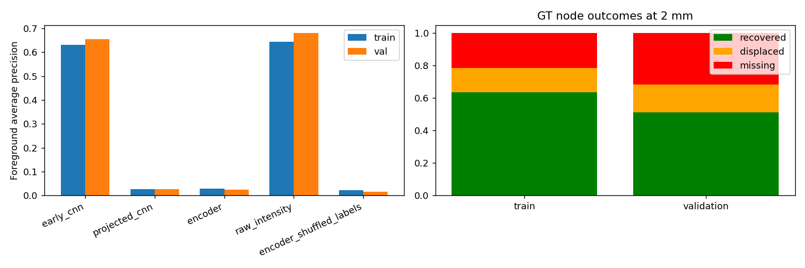
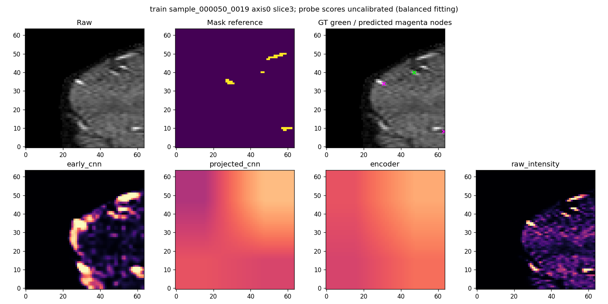
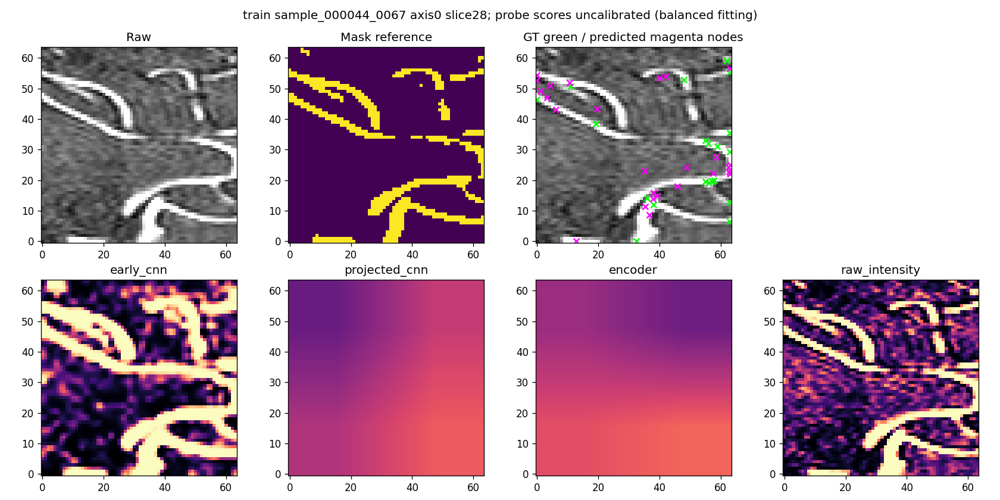
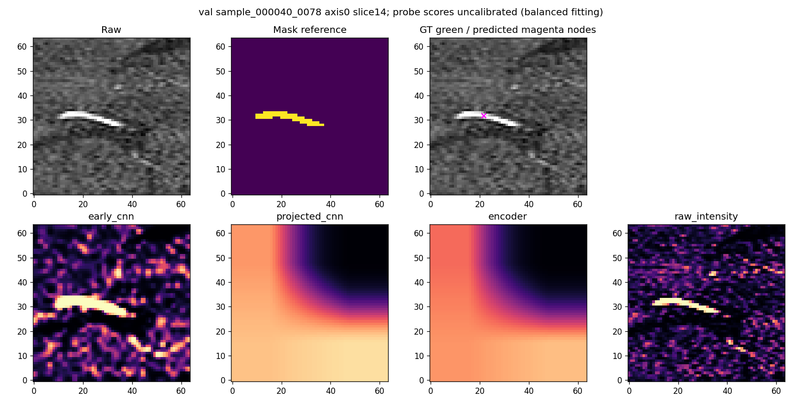
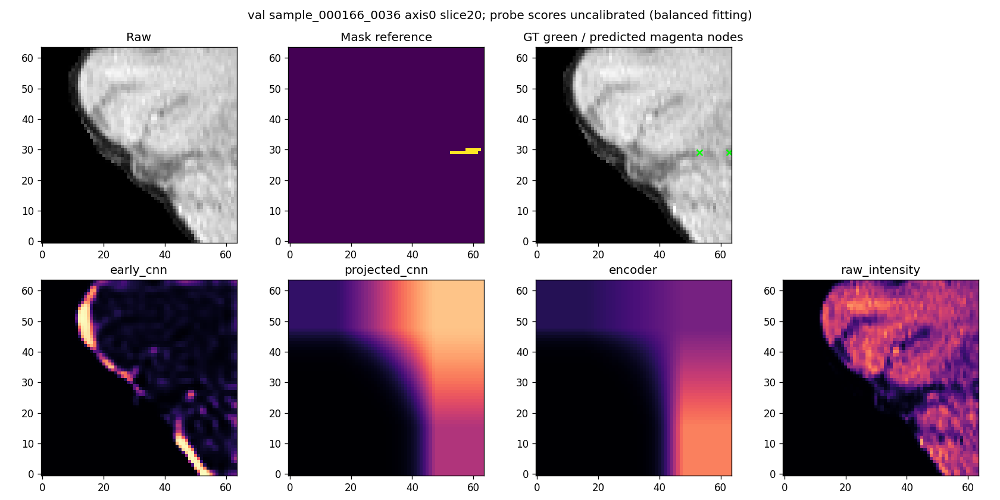

# IXI frozen-feature and node diagnostics

Checkpoint: /lustre/fsn1/projects/rech/vnc/upz25mj/experiments/gnbm/spline_learning/ixi_transfer_20261015/runs/ixi_delayed_spline/best.pt; step 28170
Training patches: 128; validation patches: 64

## Foreground probes

| Probe | Train AP | Validation AP | Validation foreground prevalence |
|---|---:|---:|---:|
|early_cnn|0.6318|0.6551|0.0086|
|projected_cnn|0.0263|0.0271|0.0086|
|encoder|0.0287|0.0246|0.0086|
|raw_intensity|0.6437|0.6802|0.0086|
|encoder_shuffled_labels|0.0231|0.0157|0.0086|

## Node outcomes at 2 mm

| Split/type | GT nodes | Recovered | Displaced (2–4 mm) | Missing |
|---|---:|---:|---:|---:|
|train/all|2721|1726|407|588|
|train/boundary|1127|785|152|190|
|train/junction|877|593|134|150|
|train/termination|717|348|121|248|
|train/other|0|0|0|0|
|val/all|1657|847|283|527|
|val/boundary|665|412|104|149|
|val/junction|573|275|103|195|
|val/termination|417|159|76|182|
|val/other|2|1|0|1|

## Interpretation limits

Inspect probe-history.json before interpreting a weak probe: incomplete readout optimization can mimic absent information.
A projected-CNN/encoder gap localizes a loss of linear accessibility on a common spatial grid, not necessarily complete information destruction.
Natural-prevalence AP is primary. Scores and Dice at 0.5 are not calibrated after balanced foreground/background fitting.
Train/validation gaps are descriptive; patch populations and difficulty differ. See per-patch CSV and subtype counts.
Missing/displaced/duplicate categories use the recorded tolerance rules and do not establish anatomical truth.

