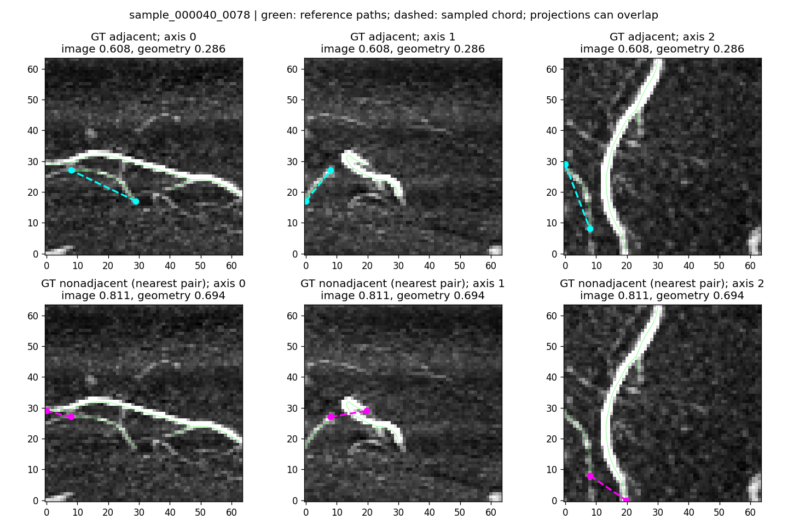
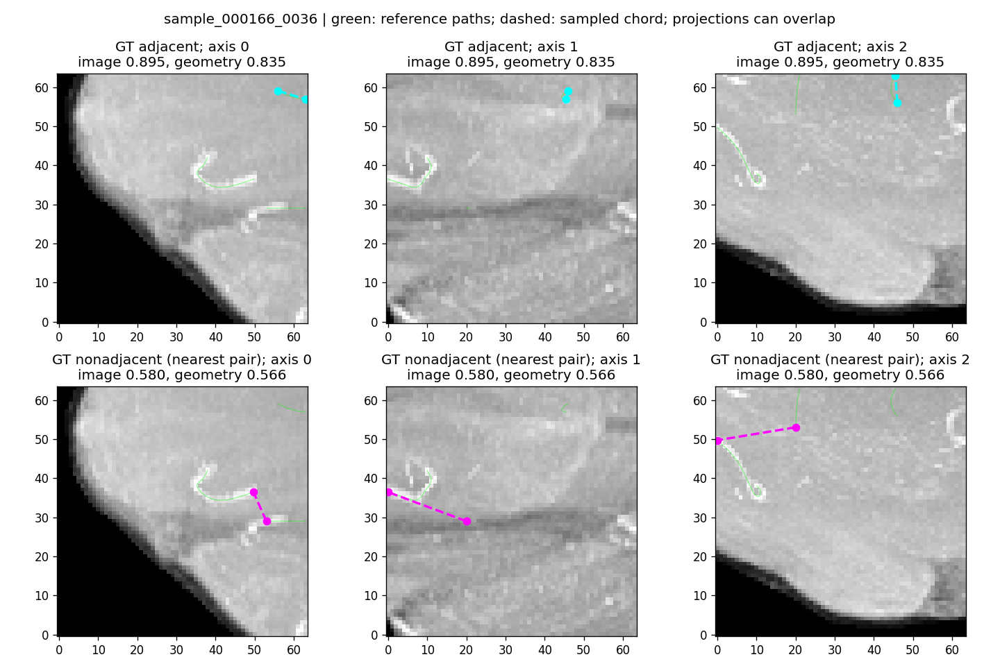

# IXI relation isolation

|Split|Arm|Pairs|AP|Precision @.5|Recall @.5|
|---|---|---|---:|---:|---:|
|train|native|matched|0.48480071988000045|0.7422907488986784|0.13087378640776698|
|train|token_refit|matched|0.5976181036769205|0.3125460348637368|0.98873786407767|
|train|geometry_only|all_gt|0.3691781029408037|0.13780556382521253|0.861277651436841|
|train|geometry_only|matched|0.40201471231380564|0.13726199084116655|0.8846601941747573|
|train|image_geometry|all_gt|0.47325768970651794|0.20699503698848207|0.9139962786851354|
|train|image_geometry|matched|0.48482221690828214|0.2113849973399539|0.9258252427184466|
|val|native|matched|0.4701747693266609|0.6859903381642513|0.1256637168141593|
|val|token_refit|matched|0.377431506190525|0.2570550433081866|0.8141592920353983|
|val|geometry_only|all_gt|0.3482871143141051|0.11523822023887649|0.8847833389318105|
|val|geometry_only|matched|0.4043227585257578|0.15049713769207593|0.8840707964601769|
|val|image_geometry|all_gt|0.3504528506937261|0.14800200077808037|0.8945246892845146|
|val|image_geometry|matched|0.4260579824868342|0.18643754619364375|0.8929203539823009|

