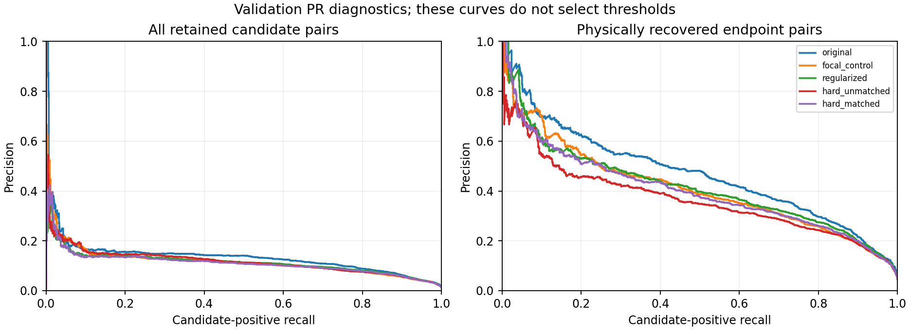

## Computed results

Completed cache-only analysis; 256 training / 128 validation patches.
Paired subject bootstrap: 26 validation subjects, 1000 resamples. Tables below use 2 mm; CSVs contain both tolerances.

### A: original scorer under each query selection

|Selection|Node recall|Node precision|Recovered edges|Edge F1|Conditional recall|Branch F1|Curve F1|Cycle MAE|
|---|---:|---:|---:|---:|---:|---:|---:|---:|
|normal|0.5627|0.5171|1130.0000|0.0737|0.1257|0.0122|0.1686|1.0391|
|spatial|0.8362|1.0000|2243.0000|0.0999|0.0722|0.0194|0.0827|0.6719|
|hungarian|0.6267|0.6267|1285.0000|0.1121|0.1619|0.0199|0.1631|1.0469|
|hungarian_rematched|0.6773|0.6773|1547.0000|0.1208|0.1448|0.0199|0.1631|1.0469|
|parent_hungarian|0.5485|0.5485|958.0000|0.0979|0.1900|0.0096|0.1184|1.0312|

|Selection / population|Train AP|Validation AP|Validation candidates|Positives|Prevalence|
|---|---:|---:|---:|---:|---:|
|normal / conditional|0.4848|0.4702|24054|1130|0.0470|
|spatial / conditional|0.4251|0.3685|51918|2243|0.0432|
|hungarian / conditional|0.5100|0.4658|29768|1285|0.0432|
|hungarian_rematched / conditional|0.5011|0.4424|35819|1547|0.0432|
|parent_hungarian / conditional|0.5286|0.4790|22333|958|0.0429|
|hungarian_training_labels / assignment_only|0.4153|0.3558|77550|2977|0.0384|
|common_identity / conditional|0.4690|0.4453|2969|138|0.0465|

Hungarian training labels include distant assignments; their AP is not positional graph accuracy.
Hungarian and normal AP generally condition on different pairs; common_identity uses identical endpoint identities across all selections.

### B: training-calibrated operating points

|Head|Policy|Threshold|Validation precision|Recall|Edge F1|Curve F1|Component MAE|Cycle MAE|
|---|---|---:|---:|---:|---:|---:|---:|---:|
|original|fixed_0p5|0.50000000|0.1623|0.0477|0.0737|0.1686|19.2891|1.0391|
|original|train_max_f1|0.38203655|0.1226|0.2338|0.1608|0.4178|2.3203|19.5234|
|original|train_preserve_precision|0.49767304|0.1654|0.0511|0.0780|0.1751|19.0234|1.0859|
|focal_control|fixed_0p5|0.50000000|0.1262|0.1088|0.1169|0.3032|11.4297|5.7031|
|focal_control|train_max_f1|0.40448664|0.1099|0.1834|0.1374|0.3844|4.6562|16.9297|
|focal_control|train_preserve_precision|0.43983041|0.1189|0.1589|0.1360|0.3572|6.8984|11.8828|
|regularized|fixed_0p5|0.50000000|0.1135|0.1861|0.1410|0.3884|4.8047|16.5078|
|regularized|train_max_f1|0.45868195|0.1116|0.2052|0.1446|0.3993|3.9609|19.9375|
|regularized|train_preserve_precision|0.76723074|0.1433|0.0699|0.0939|0.2208|16.3672|2.2891|
|hard_unmatched|fixed_0p5|0.50000000|0.1281|0.1498|0.1381|0.3355|9.2734|10.7266|
|hard_unmatched|train_max_f1|0.53953152|0.1350|0.1337|0.1343|0.3155|10.8281|8.1562|
|hard_unmatched|train_preserve_precision|0.42711208|0.1156|0.1787|0.1404|0.3759|6.5781|16.6250|
|hard_matched|fixed_0p5|0.50000000|0.1184|0.1407|0.1286|0.3398|8.1875|9.7109|
|hard_matched|train_max_f1|0.42542359|0.1115|0.1743|0.1360|0.3742|5.2500|15.2500|
|hard_matched|train_preserve_precision|0.54534786|0.1233|0.1233|0.1233|0.3147|10.1641|7.4297|

|Head|Train conditional AP|Validation conditional AP|Train all-retained AP|Validation all-retained AP|
|---|---:|---:|---:|---:|
|original|0.4848|0.4702|0.1574|0.1361|
|focal_control|0.6624|0.4098|0.1895|0.1164|
|regularized|0.5874|0.4153|0.1688|0.1136|
|hard_unmatched|0.5417|0.3659|0.2756|0.1173|
|hard_matched|0.6268|0.3996|0.1762|0.1110|

### Uncertainty for principal comparisons

|Comparison|Population/policy|95% interval|
|---|---|---|
|AP: focal_control vs original normal|all_selected|[-0.026840464299980674, -0.01242950729055655]|
|AP: regularized vs original normal|all_selected|[-0.028311605279191573, -0.01678044139984555]|
|AP: hard_unmatched vs original normal|all_selected|[-0.027570462666467434, -0.0077889478339268695]|
|AP: hard_matched vs original normal|all_selected|[-0.030880347839521156, -0.01852875664169949]|
|AP: hungarian vs original normal|all_selected|[0.053315052624815853, 0.10456667904972167]|
|AP: focal_control vs original normal|conditional|[-0.07772375904541104, -0.03981385659439307]|
|AP: regularized vs original normal|conditional|[-0.07353633544719848, -0.0300515422962983]|
|AP: hard_unmatched vs original normal|conditional|[-0.12916322824334348, -0.0779884329672799]|
|AP: hard_matched vs original normal|conditional|[-0.09155203340266391, -0.04345971362546333]|
|AP: hungarian vs original normal|conditional|[-0.03310441396380175, 0.026844180783197953]|
|Edge F1: focal_control vs original|common training-precision target|[0.041268113171204275, 0.07514666178735611]|
|Curve F1: focal_control vs original|common training-precision target|[0.16225111393719285, 0.20088948786673477]|
|Edge F1: regularized vs original|common training-precision target|[0.0010695871793901565, 0.03207102880968755]|
|Curve F1: regularized vs original|common training-precision target|[0.03217403763509626, 0.05907983989758092]|
|Edge F1: hard_unmatched vs original|common training-precision target|[0.04546679318469856, 0.08014894652146629]|
|Curve F1: hard_unmatched vs original|common training-precision target|[0.17778534163997367, 0.2248511345394622]|
|Edge F1: hard_matched vs original|common training-precision target|[0.03091209257150521, 0.05983896576206674]|
|Curve F1: hard_matched vs original|common training-precision target|[0.12352546127525195, 0.15363730817297488]|

### C: combined diagnosis and next experiment

1. Original conditional AP is 0.4658 on localized Hungarian-selected validation pairs versus 0.4702 on normal pairs. Candidate differences and their paired AP intervals above prevent attributing this gap solely to matching.
2. Under localized Hungarian correspondence, training AP is 0.5100 versus validation 0.4658. Training is an in-sample fit measure, not an independent generalization estimate.
3. Node selection and ranking remain distinct: compare recovered edges with conditional recall and AP in A. Distant Hungarian assignments are not counted as recovered endpoints; the rematching sensitivity row isolates correspondence from selected query identity.
4. Heads with positive paired AP intervals on both candidate populations: none. Heads with positive edge-F1 and Curve-F1 intervals at the common training precision target and no larger point cycle error: none. These are descriptive comparisons, not a pre-registered selection rule. Threshold changes cannot improve AP; training precision need not transfer.
5. Another mining/sampling change remains unsupported unless it survives ranking and calibrated connectivity comparisons. Positive intervals identify candidates for confirmation, not a replacement model or proof of anatomical topology. No random-negative auxiliary control was trained in experiment 7, so mining-specific causality remains unresolved.
6. The next bounded experiment should first address the weakest measured link: if matching/calibration leaves poor localized-pair validation ranking, compare a small relation readout using additional local image evidence against an equal-capacity token/geometry control on the same pairs. This is a hypothesis to test, not proof that image features will help. Existing chord-image results were weak, so a new feature probe must change its context explicitly. Multiscale transformer attention is not justified by this diagnostic alone.

Recommended priority: retain the original scorer unless a calibrated alternative shows a convincing validation gain without harmful topology tradeoffs; review these results before any further training.

Outputs: `/lustre/fsn1/projects/rech/vnc/upz25mj/experiments/gnbm/ixi_relation_matching_calibration_20261019-234456`. Detailed AP intervals, graph intervals, per-patch/per-subject tables, assignment distances, PR curves, length/distance strata and input hashes are preserved.

