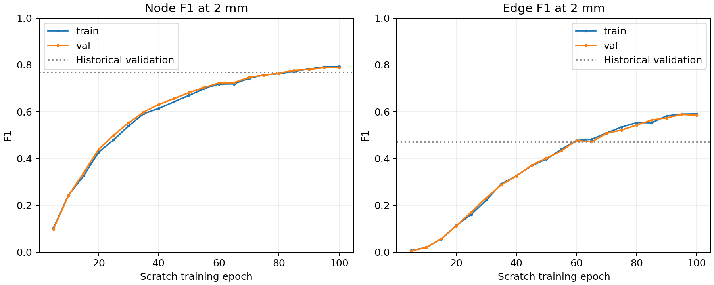
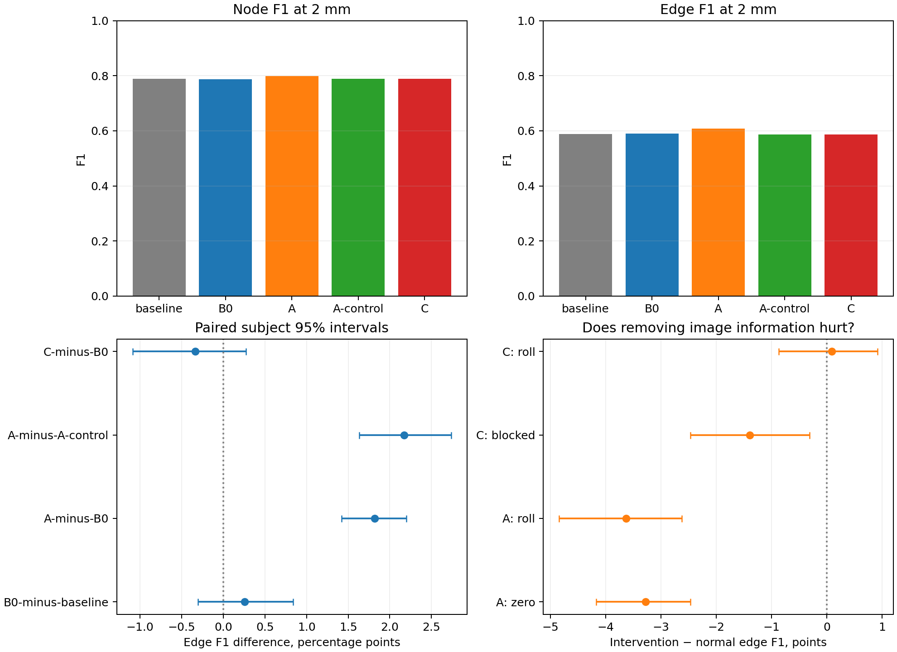

# Fine CNN features for vascular graphs — 24–25 October 2026

Storage update (25 October): dormant NPZ predictions are retained in a verified compressed archive. [Restore instructions](../../experiments/fine_feature_architecture/ARCHIVED_PREDICTIONS.md). Checkpoints, measured results and reconstructions remain in place.


Follow-up: the [completed two-seed, 12,000-update local-refinement study](local_refinement_long_study.md) confirms image-conditioned gains and supports coordinate-only refinement as the simpler IXI-transfer candidate. C remains deferred.


Status: **completed**. The random-initialized baseline finished 100 epochs / 78,200 updates; epoch 95 was selected by the predefined validation criterion and passed every quality-gate floor. All four fully unfrozen 3,000-update pilots, feature interventions and reconstruction evaluations completed. Ten targeted CPU checks, 18 augmentation checks, the scratch learnability gate and the selected-checkpoint architecture gate passed. SLURM accounting confirms at most two concurrent H100s and 7.903 allocated H100-hours across this study's jobs.

**Decision:** prioritize A, local image-conditioned refinement, for a future longer controlled training comparison. It improves over both continuation and the no-image control, with paired subject intervals excluding zero and corroborating image interventions. C now uses its fine pathway, but does not improve over continuation; longer C training is not justified by this pilot alone. These conclusions concern SyntheticMRI and one training seed. No longer architectural run or combined A+C model was launched.

The predeclared protocol is in [execution_plan.md](../../experiments/fine_feature_architecture/execution_plan.md).
Machine-readable settings and dataset membership are in
`experiments/fine_feature_architecture/plan.json`. This study preserves all earlier
checkpoints and starts one new SyntheticMRI K8 baseline from random weights.

## Audit findings and protocol corrections

- The prior [multiscale pilot](multiscale_pretrained_feasibility.md) changed losses
  when loading its checkpoint. Both continuations deteriorated, and fine attention
  started at only 0.01% on a 4³ feature grid. It did not test a functional baseline
  trained with the requested objective or meaningful use of finer image evidence.
- `configs/finetune_synthetic_mri_focal.yaml` includes `losses/focal.yaml`, which
  enables **edge focal** too. The intended historical recipe is the immediate
  unweighted node-focal override used by `full_dataset_node_focal`, with baseline
  matched-node edge CE and ratio upsampling 0.15. The actual criterion uses
  softmax focal `-(1-p_t)^2 log(p_t)` with weights `[1,1]` from step zero.
- The earlier [node refinement](metrics/3-ixi-node-refinement-pilot.md) freezes the
  backbone and detaches sampled feature maps. Its coordinate improvements cannot
  establish behavior under full unfreezing. This study retains detached sampling
  centers but enables gradients into sampled CNN features explicitly; the default
  remains compatible with old experiments.
- A-control retains the identical head with zero local-image inputs. Its unused
  image-input weights mean equal parameter count is not equal active capacity.
  Paired inference interventions in trained A additionally test image information.
- C tests layer2 at 8³ instead of layer3 at 4³ and uses an initial fine/coarse
  attention ratio increasing from 1e-4 to 0.1 over the first 500 pilot updates. The first preflight showed that immediately enabling 0.1 moved some coordinates by 0.363 of the patch width; it fitted the tiny set, but would confound a short low-LR pilot with recovery from a large perturbation. The fixed warm-in corrects this issue. Strict coarse-only parity remains a correctness test, but
  active C is allowed a measured initial perturbation rather than forcing the
  new pathway to be negligible. Architectural variants remain independent. The layer2 map has nominal stride8 and retains spatial variation (preflight spatial standard deviation/RMS0.77), but its residual blocks and SE gates give a broad receptive field: an8³ grid is not proof of fine anatomical information. Inference interventions, not map size, decide actual feature use.
- K8 geometry retains the established detached-to-detector loss route, avoiding
  the known coupled scratch failure; the geometry head itself trains normally.
  No matcher, target representation, query count or loss weights are changed.

## Execution and correctness evidence

- Scratch smoke **1516044**: random weights; all 140 nodes and 103 edges of eight training patches fitted by update250, maintained through1500. Full batch32 forward/backward passed. Tiny weights discarded.
- Baseline **1516046 → 1516050**: epochs1–50 then51–100 of one scheduled run, with full optimizer/scheduler/RNG checkpoints. No loss transition or pretrained initializer.
- Immediate C initialization preflight **1516150**: passed gradients/tiny fits but exposed an excessive step-zero perturbation; preserved as `architecture-instant-preflight.json`.
- Revised warm-in preflight **1516326**: passed all four arms, CUDA/reference forward/backward at 2³+8³, coarse-only/identity parity, feature gradients and batch32 memory. C initial coordinate max difference0.000976, logit difference0.01071. The preflight uses a compressed32-update warm-in for its64-update tiny fit; the actual pilots use500 updates and the final selected-checkpoint check uses64/256.
- Historical reference **1516151**: completed full480-patch metrics under this study's unchanged evaluation code. Original patient-level split audited:64 training/13 validation patients; no historical training-patient overlap with these validation patients.
- Selected-baseline architecture gate **1516210**, then pilot array **1516330**, tasks0–3 = B0/A/A-control/C with concurrency `%2`. Both artifact assertions and Slurm `afterok` block dependent training on failure.

The actual selected-checkpoint gate fitted all four arms to node/edge F1 = 1 on the eight training patches after 256 updates; those weights were discarded. A and A-control were exactly prediction-identical to B0 before training. Active C's maximum normalized coordinate/logit differences on this gate were 0.000757 / 0.002230; its coarse-only predictions passed the strict parity check. The larger cached 96-patch step-zero comparison below found no node-retention flips. Per-head deformable-attention migration preserves compatible coarse rows, copies the level embedding, initializes the new projection separately, and initializes local fine offsets. CUDA/reference forward and backward checks covered both feature resolutions; fine projections, offsets, attention weights and the live A image pathway received gradients.

### Actual optimization and evaluation settings

The baseline uses all 25,000 existing training patches (64 subjects) and the existing 480 validation patches (13 disjoint subjects), batch32, seed364505, AdamW with LR7e-5, weight decay1e-4, betas(0.9,0.999), epsilon1e-8, one epoch of warmup from1e-9 and polynomial decay with power0.9 over100 epochs. Node focal is unweighted softmax focal with gamma2 from the first update; edge CE weights are[1,1], with the established matched-pair ratio upsampling0.15 and tolerance0.02. No edge focal or classification curriculum is active. Original matcher, loss weights, targets, rotations/noise and K8 geometry are retained; spline-incompatible zoom stays off. Batch-normalization statistics update during training and are fixed during evaluation.

Selection uses full-validation physical edge F1 at2 mm, with node F1 at1 mm as tie-breaker, every five epochs. The study script overrides the legacy selection/checkpoint-monitor fields in the inherited config; `plan.json` and the script define the actual schedule. Selected epoch95 is update74,290; `latest.pt` preserves epoch100/update78,200. Both are retained.

All pilots start from that exact selected checkpoint with fresh AdamW, identical images and augmentation order, batch32 and3000 updates. LR warms up for100 updates to7e-6, then polynomially decays to1e-6. Final update3000 is evaluated without checkpoint selection. All active backbone, transformer and prediction-head parameters train; the existing dormant relation-attention sub-block remains inactive. Geometry retains the established `graph_only` gradient route in every arm. C alone uses its declared500-update initialization warm-in, with zero extra logit offset thereafter. Config sidecars retain the baseline schedule fields; the pilot loop explicitly applies these bounded settings.

Node and relation thresholds remain0.5. Physical metrics use one-to-one spatial associations at1/2 mm; raw-query coverage is an oracle proposal bound, not attainable classification performance. Relation scores are evaluated on the unchanged query-pair population. Native and common-v2 reconstruction metrics retain their existing, distinct protocols. Validation and training monitoring have identical definitions; final training metrics cover the fixed128-patch augmentation-free subset, not the entire training population.

Commands (repository root, established Jean Zay environment):

```bash
python scripts/fine_feature_architecture.py prepare
python -m unittest tests.test_focal_losses tests.test_multiscale_relationformer tests.test_fine_feature_architecture -v
python -m pytest tests/test_augmentation_geometry.py tests/vessel/test_spline_augmentation.py -q
sbatch --time=00:30:00 cluster/jean_zay/fine_feature_architecture.slurm smoke
sbatch --dependency=afterok:1516044 --kill-on-invalid-dep=yes cluster/jean_zay/fine_feature_architecture.slurm baseline --until-epoch 50
sbatch --dependency=afterok:1516046 --kill-on-invalid-dep=yes cluster/jean_zay/fine_feature_architecture.slurm baseline --until-epoch 100
sbatch --time=00:30:00 cluster/jean_zay/fine_feature_architecture.slurm preflight
sbatch --time=01:00:00 cluster/jean_zay/fine_feature_architecture.slurm historical
sbatch --time=01:00:00 --dependency=afterok:1516050:1516326 --kill-on-invalid-dep=yes cluster/jean_zay/fine_feature_architecture.slurm architecture-smoke
sbatch --array=0-3%2 --time=02:00:00 --dependency=afterok:1516210 --kill-on-invalid-dep=yes cluster/jean_zay/fine_feature_architecture.slurm pilot
python scripts/report_fine_feature_architecture.py
```

Artifacts under `experiments/fine_feature_architecture/`: `plan.json` (resolved recipe, budgets and sample IDs), `split-audit.json`, `jobs.json`, `smoke.json`, `tiny-fit.json`, CPU check logs, both preflight JSONs, selected-checkpoint `architecture-gate.json`, `baseline-gate.json`, and per-run configurations/checkpoints/gradients/predictions/reconstruction summaries. Baseline `best.pt` and `latest.pt` are separate; pilot final files are `model-3000.pt`. Images and node-coordinate targets were hashed over every training batch; edge/spline tensors were not independently hashed. Source archives record dependent-job code; the first baseline's scientific implementation is preserved in the explicitly timestamped during-epoch2 snapshot. Earlier experimental artifacts are unchanged.

Every listed job completed with exit code0. Baseline segments took3:11:32 and3:10:12. Pilot array tasks and their underlying SLURM IDs were B0=`1516330_0`/`1523744`, A=`1516330_1`/`1523745`, A-control=`1516330_2`/`1524122`, C=`1516330_3`/`1516330`; their allocation durations were18:52,20:07,19:17 and21:44. Collector `1522540` completed after the array; final CPU-only report regeneration added population parity and more explicit hash-scope reporting. See `accounting.psv`, `accounting-summary.json` and `report-final.log`.

Checkpoint/config/source SHA256 values are in `artifact-manifest.json`. All paths below are relative to `experiments/fine_feature_architecture/runs/`:

| Checkpoint | SHA256 |
|---|---|
| `baseline/best.pt` | `d4bc78ad3eb7c1c29c9be8ec3e2927e88f2f45e6f34a3cb8be9ade5fd9d2431c` |
| `baseline/latest.pt` | `e846b7af1b68b0577e628dbd41491ac9ac5d05e9cbfc5bdee45b8e6ac0de1109` |
| `B0/model-3000.pt` | `1858ccdce8174b81b2490f6e2fcf5338eb877d6d036da4fee21c3c666ffd4643` |
| `A/model-3000.pt` | `99f5842d7d8bc0452209368909cda70f9d52ad0c8f74f4ddf2c11753fb9f3af9` |
| `A-control/model-3000.pt` | `2b49de7811e8e3c463646a4991650b881887d07092ce83f9ab4090df2c6b82e9` |
| `C/model-3000.pt` | `bf79af3041a04f099810901c0367ad8b860636a041ee3a0f286a3c2161ed5712` |

The historical reference is `/lustre/fsn1/projects/rech/vnc/upz25mj/experiments/gnbm/spline_learning/plant_generalization_20261014_da_b32_w1_restart/runs/vessels_spline/best.pt`, SHA256 `06513f58b7b032c9eb4f7be7820312941e7bac08fb97915f263d48f1b894facb`. Its actual recipe includes weighted node CE[0.25,0.75] and edge focal, with a different training history. It is a compatible architecture/evaluation reference, not a matched loss ablation or the initializer for this baseline.

No long architectural runs or combined A+C model are scheduled.

## Critical assessment and next decision

**The baseline is functional.** Scratch tiny-set fitting ruled out a basic localization/connectivity learnability failure. Full training improved steadily; at the selected checkpoint, validation node/edge F1 at2 mm is0.7882/0.5881, compared with0.7670/0.4701 for the compatible historical reference. Training-subset scores0.7910/0.5894 are close to validation. Endpoint-conditional relation recall0.9540 and mean patch conditional AP0.9743 show that connectivity is useful when endpoints are recovered. This is still an imperfect detector: raw/filtered recall at2 mm is0.8982/0.7702, and1 mm node F1 is only0.4698. The historical filtered recall is actually higher at2 mm (0.7860), despite lower precision and weaker connectivity. Do not describe the new baseline as uniformly superior or attribute its improvement solely to focal loss.

**A provides evidence for useful local image information.** Against B0, node F1 improves by3.45 percentage points at1 mm and1.15 points at2 mm; against A-control, the gains are3.76 and1.10 points. The corresponding2 mm edge F1 improvements are1.82 points [1.42,2.20] and2.17 points [1.63,2.74]. Mean Hungarian localization error falls by0.045 mm versus B0. The retained populations are almost identical:9647 nodes for A,9652 for B0 and9661 for A-control across10080 GT nodes. A recovers111 more GT nodes than B0 at2 mm while retaining five fewer candidates; simply retaining more proposals does not explain the gain. Common-v2 branch/curve F1 also improves (0.2227/0.6409 versus0.1914/0.6191).

Zeroing or spatially shifting A's local map moves normally retained proposals by0.347/0.401 mm on average and reduces2 mm edge F1 by3.28/3.63 points. These interventions leave relation probabilities exactly unchanged; the improvement is chiefly endpoint localization rather than direct relation rescoring. The confidence correction is small, and correct-versus-false AUROC does not improve. A-control brings no clear improvement over B0. The combined capacity-control and intervention evidence supports the image contribution, despite unequal active capacity in the zero-input control. Component/cycle-count errors do not improve uniformly, so higher branch/curve and edge F1 are not evidence that topology is solved.

**C is active but has not shown an incremental benefit.** Fine attention is4.1–6.7% in the encoder and6.8–7.2% in the decoder; most fine mass has sampling centers inside the volume. Fine projection weights change by1.80% in relative norm. Blocking the fine pathway moves normally retained nodes by0.290 mm and lowers edge F1 by1.40 points [0.31,2.47] on the intervention subset. Thus neither missing gradients nor permanent near-zero attention explains this result. However, shifting the fine grid changes retained coordinates by only0.093 mm on average and has no clear F1 penalty. Blocking also renormalizes coarse attention, so its penalty alone does not establish beneficial fine spatial reasoning. Broad receptive fields, SE/global context and redundant coarse information remain plausible explanations.

C versus B0 is effectively tied in node F1 at both tolerances, with2 mm edge F1 delta−0.34 points [−1.09,+0.27]. Localization is slightly worse by0.0072 mm [0.0023,0.0117]. On the fixed64-patch monitor, C edge F1 dips from0.5812 to0.5633 at1000 updates and recovers to0.5794 at2000; B0 reaches0.5831 at2000. Small fine-projection changes and recovery after warm-in suggest that adaptation of the pretrained network may constrain the pilot, but do not prove it. The tiny-fit success establishes optimization feasibility, not validation benefit.

**Recommended next work, not launched:** prioritize a longer matched fully unfrozen A-versus-B0/A-control comparison, retaining the same objective and selection protocol and including another seed. Do not expand A or combine A+C yet. For C, first distinguish inherited optimization constraints from redundant/insufficiently local features. If C remains a research priority, the observed adaptation dip and small projection changes justify a *small matched random-initialization B0-versus-C diagnostic*, with the same fine-map interventions; they do not justify a full from-scratch architecture run automatically. This short pretrained pilot is insufficient to reject multiscale attention in general.

### Limits on inference

There is one training seed,13 validation subjects, and no untouched test evaluation. The same validation cohort selected the baseline, gated execution and assessed the pilots; paired bootstrap intervals describe subject variation conditional on this selected model and do not include selection or training-seed uncertainty. Final pilots were not selected by validation. Multiple reported metrics and interventions are exploratory, without multiplicity correction. Intervention estimates use128 validation patches; normal headline metrics use480. Confidence calibration is spatial-label-relative, and neither threshold calibration nor a count/precision sweep was performed in this architecture study. A's comparable retained counts and simultaneous precision/recall gains help interpretation but do not replace a full operating-curve comparison. The earlier node-verifier work addresses a different filtering question.

Mean all-query displacement in the intervention table includes background queries; the retained-query values above are more relevant to graph outputs. Inside-center attention mass is a sampling diagnostic, not exact interpolation support. Spatial rolls wrap at the boundary and zeroing/blocking changes the feature distribution. A-control has the same parameter count but fewer active inputs. C uses a distinct declared initialization schedule and a low fine-tuning LR shared with B0; equal updates do not imply equal convergence or equal compute. The native and physical matching protocols differ, and absolute scores must not be interchanged. These results support prioritizing local refinement on SyntheticMRI; they do not establish transfer to IXI or BRAVA.

<!-- RESULTS -->
## Measured results

Baseline gate: **PASS**, selected epoch 95. Checkpoint: `experiments/fine_feature_architecture/runs/baseline/best.pt`.

| Gate, 2 mm | Value | Required | Passed |
|---|---:|---:|---|
| raw_recall | 0.8982 | ≥ 0.82 | True |
| node_f1 | 0.7882 | ≥ 0.7 | True |
| edge_f1 | 0.5881 | ≥ 0.4 | True |
| conditional_recall | 0.9540 | ≥ 0.7 | True |
| hungarian_mm | 1.3802 | ≤ 1.8 | True |

### Physical node/edge metrics at 1.0 mm

| Model | Raw recall | Filtered recall | Node precision | Node F1 | Edge F1 | Conditional edge recall | Hungarian mm |
|---|---:|---:|---:|---:|---:|---:|---:|
| historical | 0.5499 | 0.4535 | 0.4321 | 0.4425 | 0.1436 | 0.8153 | 1.5034 |
| baseline | 0.5922 | 0.4591 | 0.4810 | 0.4698 | 0.2022 | 0.9630 | 1.3802 |
| B0 | 0.5971 | 0.4712 | 0.4921 | 0.4815 | 0.2166 | 0.9717 | 1.3556 |
| A | 0.6371 | 0.5049 | 0.5275 | 0.5159 | 0.2513 | 0.9654 | 1.3106 |
| A-control | 0.5945 | 0.4684 | 0.4887 | 0.4783 | 0.2072 | 0.9694 | 1.3644 |
| C | 0.5969 | 0.4710 | 0.4923 | 0.4814 | 0.2113 | 0.9705 | 1.3628 |

### Physical node/edge metrics at 2.0 mm

| Model | Raw recall | Filtered recall | Node precision | Node F1 | Edge F1 | Conditional edge recall | Hungarian mm |
|---|---:|---:|---:|---:|---:|---:|---:|
| historical | 0.8741 | 0.7860 | 0.7489 | 0.7670 | 0.4701 | 0.7747 | 1.5034 |
| baseline | 0.8982 | 0.7702 | 0.8070 | 0.7882 | 0.5881 | 0.9540 | 1.3802 |
| B0 | 0.8972 | 0.7710 | 0.8052 | 0.7878 | 0.5907 | 0.9577 | 1.3556 |
| A | 0.9087 | 0.7820 | 0.8171 | 0.7992 | 0.6089 | 0.9540 | 1.3106 |
| A-control | 0.8969 | 0.7718 | 0.8053 | 0.7882 | 0.5872 | 0.9578 | 1.3644 |
| C | 0.8986 | 0.7713 | 0.8061 | 0.7883 | 0.5873 | 0.9563 | 1.3628 |

### Existing native and common-v2 reconstruction protocols

| Model | Native node F1 | Native edge F1 | Branch F1 | Curve F1 | Same-endpoint chord Curve F1 |
|---|---:|---:|---:|---:|---:|
| historical | 0.8730 | 0.7229 | 0.1024 | 0.5069 | 0.4750 |
| baseline | 0.8703 | 0.8109 | 0.1788 | 0.6126 | 0.5602 |
| B0 | 0.8724 | 0.8078 | 0.1914 | 0.6191 | 0.5650 |
| A | 0.8746 | 0.8113 | 0.2227 | 0.6409 | 0.5888 |
| A-control | 0.8728 | 0.8093 | 0.1846 | 0.6186 | 0.5650 |
| C | 0.8711 | 0.8085 | 0.1894 | 0.6173 | 0.5636 |

Historical is evaluated afresh on the identical 480 validation patches with the same code and thresholds. Its different training population, initializer history and loss recipe preclude attributing differences solely to node focal. Native F1 and physical one-to-one F1 are different protocols.

### Training/validation and confidence discrimination

| Model / split | Node F1, 2 mm | Edge F1, 2 mm | Duplicate fraction | Correct-vs-false AUROC | Correct-vs-duplicate AUROC | Reliable-label ECE | Component MAE | Cycle MAE |
|---|---:|---:|---:|---:|---:|---:|---:|---:|
| historical / train | 0.7703 | 0.4816 | 0.0405 | 0.9109 | 0.7564 | 0.0779 | 2.8125 | 1.4531 |
| historical / val | 0.7670 | 0.4701 | 0.0418 | 0.9108 | 0.7464 | 0.0779 | 2.5083 | 1.5188 |
| baseline / train | 0.7910 | 0.5894 | 0.0294 | 0.9043 | 0.7489 | 0.0356 | 0.7969 | 1.5625 |
| baseline / val | 0.7882 | 0.5881 | 0.0239 | 0.9085 | 0.7505 | 0.0360 | 0.8938 | 1.4750 |
| B0 / train | 0.7961 | 0.5953 | 0.0254 | 0.9062 | 0.7519 | 0.0353 | 0.7266 | 1.5703 |
| B0 / val | 0.7878 | 0.5907 | 0.0261 | 0.9102 | 0.7558 | 0.0370 | 0.8854 | 1.5750 |
| A / train | 0.8065 | 0.6212 | 0.0307 | 0.9042 | 0.7423 | 0.0307 | 0.7188 | 1.4609 |
| A / val | 0.7992 | 0.6089 | 0.0261 | 0.9052 | 0.7488 | 0.0333 | 0.8979 | 1.5063 |
| A-control / train | 0.7993 | 0.6044 | 0.0277 | 0.9079 | 0.7593 | 0.0360 | 0.7266 | 1.5703 |
| A-control / val | 0.7882 | 0.5872 | 0.0262 | 0.9080 | 0.7559 | 0.0367 | 0.8667 | 1.6375 |
| C / train | 0.7912 | 0.5847 | 0.0291 | 0.9065 | 0.7522 | 0.0345 | 0.8359 | 1.5938 |
| C / val | 0.7883 | 0.5873 | 0.0254 | 0.9072 | 0.7520 | 0.0365 | 0.8646 | 1.6021 |

Confidence categories use the raw-query maximum-cardinality/minimum-distance association at 2 mm; duplicates are surplus candidates within tolerance. ECE uses the existing conservative spatial-label mask and is annotation-relative. It is not calibrated on validation. Training evaluation is the fixed 128-patch, augmentation-free monitor.

### Paired subject uncertainty

Differences below are fractions (multiply by 100 for percentage points). Intervals resample the 13 subjects, preserving patch pairing, for 2,000 bootstrap draws. They do not include training-seed uncertainty.

| Comparison, 2 mm | Node F1 delta [95% CI] | Edge F1 delta [95% CI] | Raw recall delta [95% CI] |
|---|---:|---:|---:|
| baseline-minus-historical | +0.0212 [+0.0145, +0.0287] | +0.1180 [+0.1010, +0.1356] | +0.0241 [+0.0174, +0.0309] |
| B0-minus-baseline | -0.0004 [-0.0038, +0.0029] | +0.0026 [-0.0030, +0.0084] | -0.0010 [-0.0039, +0.0017] |
| A-minus-B0 | +0.0115 [+0.0088, +0.0144] | +0.0182 [+0.0142, +0.0220] | +0.0115 [+0.0078, +0.0152] |
| A-minus-A-control | +0.0110 [+0.0078, +0.0145] | +0.0217 [+0.0163, +0.0274] | +0.0118 [+0.0077, +0.0161] |
| A-control-minus-B0 | +0.0005 [-0.0016, +0.0025] | -0.0036 [-0.0084, +0.0008] | -0.0003 [-0.0026, +0.0015] |
| C-minus-B0 | +0.0006 [-0.0022, +0.0032] | -0.0034 [-0.0109, +0.0027] | +0.0014 [-0.0008, +0.0037] |

### Initial prediction correspondence

Comparison with B0 on the same 32 training and 64 validation patches, before any pilot updates. Query-pair ordering and ground-truth nodes/edges match exactly. A and A-control are exactly prediction-identical. C uses its initial warm-in offset.

| Arm | Maximum query displacement, mm | Maximum object-probability change | Maximum relation-probability change | Total retention flips |
|---|---:|---:|---:|---:|
| A | 0 | 0 | 0 | 0 |
| A-control | 0 | 0 | 0 | 0 |
| C | 0.0777368 | 0.00198638 | 0.00248146 | 0 |

### Paired localization results at 1 mm

| Comparison | Node F1 delta [95% CI] | Edge F1 delta [95% CI] | Raw recall delta [95% CI] |
|---|---:|---:|---:|
| A-minus-B0 | +0.0345 [+0.0303, +0.0387] | +0.0347 [+0.0278, +0.0428] | +0.0400 [+0.0357, +0.0452] |
| A-minus-A-control | +0.0376 [+0.0341, +0.0411] | +0.0441 [+0.0388, +0.0497] | +0.0426 [+0.0380, +0.0472] |
| C-minus-B0 | -0.0000 [-0.0046, +0.0047] | -0.0053 [-0.0122, +0.0016] | -0.0002 [-0.0054, +0.0054] |

### Actual image-information contribution

Deltas are intervention minus normal inference on the same 128 validation patches. Negative F1 means removing/shifting the information hurts. These interventions are diagnostic distribution shifts, so interpret them together with the separately trained A-control.

| Model / intervention | Node F1 delta [95% CI], 2 mm | Edge F1 delta [95% CI], 2 mm | Mean query shift, mm | Object probability change | Relation probability change |
|---|---:|---:|---:|---:|---:|
| A / zero | -0.0167 [-0.0212, -0.0125] | -0.0328 [-0.0417, -0.0247] | 0.3136 | 0.0001482 | 0 |
| A / roll | -0.0178 [-0.0233, -0.0126] | -0.0363 [-0.0485, -0.0262] | 0.364 | 0.0002366 | 0 |
| C / blocked | -0.0011 [-0.0067, +0.0051] | -0.0140 [-0.0247, -0.0031] | 0.9178 | 0.02668 | 0.01123 |
| C / roll | +0.0024 [-0.0027, +0.0068] | +0.0009 [-0.0087, +0.0092] | 0.2831 | 0.003993 | 0.002433 |

| C attention layer | Fine mass | Fine inside-center mass |
|---|---:|---:|
| decoder.encoder.layers.0.self_attn | 0.06723 | 0.06008 |
| decoder.encoder.layers.1.self_attn | 0.04076 | 0.03674 |
| decoder.encoder.layers.2.self_attn | 0.04334 | 0.03926 |
| decoder.encoder.layers.3.self_attn | 0.04763 | 0.04312 |
| decoder.encoder.layers.4.self_attn | 0.04567 | 0.04146 |
| decoder.encoder.layers.5.self_attn | 0.05298 | 0.04880 |
| decoder.decoder.layers.0.cross_attn1 | 0.07239 | 0.07041 |
| decoder.decoder.layers.1.cross_attn1 | 0.06832 | 0.06531 |
| decoder.decoder.layers.2.cross_attn1 | 0.06784 | 0.06448 |
| decoder.decoder.layers.3.cross_attn1 | 0.07108 | 0.06887 |

All four SHA256 hashes of images and node-coordinate targets over every training batch match. Edge and spline targets were not independently hashed; their dataset, loader, augmentation and random seeds are shared. Resolved configurations match after removing the declared architectural settings. Final pilot checkpoints are predeclared update 3000, not picked by validation.

### Baseline learning trajectory

| Epoch | Update | Mean training objective | Validation node F1, 2 mm | Validation edge F1, 2 mm | Raw recall, 2 mm |
|---|---:|---:|---:|---:|---:|
| 5 | 3910 | 4.2166 | 0.0988 | 0.0050 | 0.1502 |
| 10 | 7820 | 3.3576 | 0.2421 | 0.0201 | 0.3685 |
| 15 | 11730 | 2.8837 | 0.3386 | 0.0568 | 0.5007 |
| 20 | 15640 | 2.5591 | 0.4385 | 0.1122 | 0.6146 |
| 25 | 19550 | 2.3356 | 0.4995 | 0.1710 | 0.6778 |
| 30 | 23460 | 2.1631 | 0.5527 | 0.2320 | 0.7186 |
| 35 | 27370 | 2.0268 | 0.5982 | 0.2872 | 0.7611 |
| 40 | 31280 | 1.9160 | 0.6309 | 0.3252 | 0.7869 |
| 45 | 35190 | 1.8220 | 0.6557 | 0.3704 | 0.8043 |
| 50 | 39100 | 1.7644 | 0.6809 | 0.4016 | 0.8207 |
| 55 | 43010 | 1.6862 | 0.7030 | 0.4325 | 0.8391 |
| 60 | 46920 | 1.6305 | 0.7228 | 0.4772 | 0.8509 |
| 65 | 50830 | 1.5783 | 0.7242 | 0.4711 | 0.8607 |
| 70 | 54740 | 1.5345 | 0.7468 | 0.5076 | 0.8720 |
| 75 | 58650 | 1.4996 | 0.7559 | 0.5216 | 0.8752 |
| 80 | 62560 | 1.4638 | 0.7639 | 0.5428 | 0.8803 |
| 85 | 66470 | 1.4340 | 0.7765 | 0.5644 | 0.8907 |
| 90 | 70380 | 1.4061 | 0.7801 | 0.5737 | 0.8923 |
| 95 | 74290 | 1.3810 | 0.7882 | 0.5881 | 0.8982 |
| 100 | 78200 | 1.3607 | 0.7883 | 0.5850 | 0.8997 |







Exact numeric evidence and all 1/2-mm bootstrap differences: `experiments/fine_feature_architecture/analysis.json`. Bootstrap seed231123; training seed364505.

<!-- END RESULTS -->
