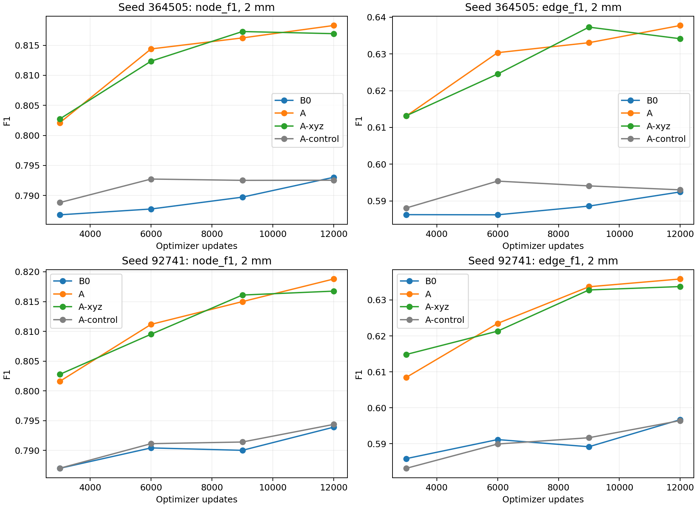

# Longer image-conditioned local refinement — 25 October 2026

Status: complete. All eight 12,000-update runs and final analysis passed, with at most two concurrent H100s. Ten CPU checks and GPU gate1534537 passed; all four arms fitted the eight-patch subset to node/edge F1=1 and passed batch32 backward checks. This study follows
[fine_feature_architecture_study.md](fine_feature_architecture_study.md).

## Decision and critical assessment

Image-conditioned coordinate refinement merits a subsequent bounded, fully unfrozen
IXI transfer comparison against B0. Prefer A-xyz as the simpler primary candidate,
while retaining combined A as a reference if confidence calibration becomes a
transfer bottleneck. This is a recommendation, not an automatically launched run.
C remains deferred; no A+C model was trained.

The improvement reproduces in both fine-tuning seeds and persists beyond the short
pilot. At the fixed 12,000-update endpoint, two-seed mean node F1 at 1 mm is 0.4886
for B0, 0.5695 for A and 0.5701 for A-xyz. Mean edge F1 at 2 mm is 0.5946, 0.6368
and 0.6339 respectively. A-control remains close to B0 (0.5947 edge F1).
The paired A-xyz minus B0 edge gain is +0.0393, with exploratory crossed
subject/seed 95% interval [+0.0313, +0.0467]. Gains remain at matched retained
counts and matched precision, and Branch/Curve F1 improve in both seeds.
Mean Hungarian localization error falls from approximately 1.344 mm to 1.213 mm.

The benefit grows over this study's own schedule: A's mean edge F1 advantage over
B0 increases from +0.0247 at 3,000 updates to +0.0422 at 12,000; A-xyz increases
from +0.0279 to +0.0393. A-xyz is close to a plateau by 9,000 updates, and its
first-seed secondary checkpoint is at 9,000. There is no basis here for automatically
extending the schedule further. Training-monitor and validation scores remain close,
but the monitor covers only 128 training patches.

Confidence correction is not demonstrated to be necessary. A-xyz retains about
93% of A's mean 2-mm edge-F1 gain and essentially all Branch/Curve gains. The
A-xyz minus A edge difference is -0.0029 [-0.0087, +0.0035] at 2 mm; at 1 mm its
mean is slightly positive. Disabling A's confidence residual alone has negligible
effect. These observations support simplification, not formal equivalence: only
two fine-tuning seeds were tested, and both share one source checkpoint. Removing
the confidence outputs saves only 258 parameters, so the advantage is conceptual
simplicity rather than a meaningful compute reduction.

Image information contributes beyond the extra head: A and A-xyz beat the no-image
control, and zeroing or spatially shifting local features substantially disrupts
predictions. The large intervention drops also reveal co-adaptation: upstream
coordinates become dependent on the trained correction. Ablation damage must not
be interpreted as the incremental gain over B0. This dependence is a transfer risk
under real-image domain shift and motivates evaluating raw recovery, calibrated
operating points and image interventions again on IXI.

The gain is primarily localization and recovered graph correspondences, not a
general solution to topology or confidence ranking. Correct/false and
correct/duplicate AUROC slightly decrease, while ECE improves; coordinate changes
also change the spatial labels underlying these diagnostics. Duplicate fractions
slightly increase. Component-count errors do not consistently improve, and cycle
errors are mixed for A-xyz. Conditional relation recall remains near 0.95 and is
slightly lower than B0. The unchanged relation architecture can exploit better
node locations, but the remaining connectivity errors still deserve separate work.
Results are paired validation evidence on 13 subjects, not a held-out test claim.

## Fixed design and implementation

The [execution plan](../../experiments/local_refinement_long/execution_plan.md)
was written before training. Exact resolved source configuration, dataset IDs,
budgets and selection rules are in `experiments/local_refinement_long/plan.json`.
Two fine-tuning seeds,364505 and92741, each run B0, combined A, coordinate-only
A-xyz and no-image A-control for12,000 updates. This is a fourfold duration increase
over the earlier pilot. All shared parameters start from the exact same selected
clean SyntheticMRI scratch checkpoint at epoch95, SHA256
`d4bc78ad3eb7c1c29c9be8ec3e2927e88f2f45e6f34a3cb8be9ade5fd9d2431c`.
The source is `experiments/fine_feature_architecture/runs/baseline/best.pt`.

The backbone, transformer and all active prediction heads remain trainable. Node
softmax focal gamma2 (weights[1,1]) and matched edge cross-entropy (weights[1,1],
ratio upsampling0.15) are unchanged. K8 spline geometry, its established graph_only
gradient route, Hungarian matcher, relation architecture,120 object queries,
rotations/noise, dataset and subject-disjoint split are unchanged. The dormant
legacy relation attention block is still inactive. There is no multiscale attention
or edge focal. C is deferred, not rejected, and no A+C or IXI run is included.

All arms use25,000 training patches/64 subjects,480 validation patches/13 subjects,
batch32, fresh AdamW (weight decay1e-4, betas0.9/0.999, epsilon1e-8),100-update warmup
to7e-6 followed by polynomial decay(power0.9) to1e-6 at12000 updates. Batch-normalization
statistics update in training and freeze for evaluation. Complete images and target
structures are hashed over every update; hashes must match within seed and differ
between seeds. The longer schedule has a different horizon from the old3000-update
pilot; comparisons of duration use the new study's own matched checkpoints.

A reuses the27-sample, radius4-voxel early-CNN local head with128 hidden units and
zero-initialized coordinate/confidence residual outputs. A-xyz retains the identical
hidden layer but uses three outputs and returns Stage1 logits unchanged. This saves
only258 parameters; the simplification is primarily removal of a learned confidence
correction. The optional compact layout preserves old five-output checkpoint loading
by default. Both image heads pass gradients into CNN features; sampling centers
remain detached. A-control zeros the local inputs while retaining the five-output
head, so its nominal parameter count is matched but its active capacity is smaller.
Image interventions provide an additional test of image contribution.

## Model selection and statistical interpretation

Primary results use update12000 in every run. Secondary checkpoints maximize full
validation edge F1 at2 mm among3000/6000/9000/12000, breaking ties with node F1 at1 mm
and then earlier update. No outcome-dependent extension or seed selection is allowed.
All checkpoints and intermediate evaluations are preserved. The source baseline was
already selected on these validation subjects; this is not an untouched test estimate.

Paired subject bootstrap preserves patch pairing and resamples the same subjects
across seeds. Report each seed, their mean/range, per-seed paired intervals and
exploratory crossed subject/seed intervals. Two fine-tuning seeds share one source
baseline initialization and cannot establish broad initialization robustness or
formal equivalence of combined and coordinate-only models.

Node/relation thresholds remain0.5 in headline metrics. Additional cached analyses
compare equal per-patch retained counts using B0's predictions, interpolated
validation matched-precision curves, and train-calibrated thresholds at precision
targets0.5/0.7/0.8/0.9 at each spatial tolerance. Calibration uses the fixed128 training
monitor patches; thresholds remain fixed on validation. Validation curve interpolation
is descriptive, label-informed and not a calibrated deployment rule. No GT count is
used in the matched-count analysis. Relation scores remain unchanged under candidate
selection. Confidence calibration uses conservative spatial labels, not all queries
unmatched by the training matcher.

Final A/A-xyz evaluations include zeroed and spatially shifted image features on the
same128 validation patches. Combined A additionally has confidence-only and
coordinate-only corrections disabled independently at inference. These are
interventions on a trained model, not independent training variants. We verify query
correspondence, unchanged raw relation probabilities under the interventions, valid
graph indices and spline/curve endpoint agreement with the refined graph nodes.
Native/common-v2 reconstruction and physical1/2-mm matching remain separate protocols.

## Commands and artifacts

From the repository root, using `cluster/jean_zay/env.sh`:

```bash
python -m unittest tests.test_focal_losses tests.test_fine_feature_architecture tests.test_local_refinement_long -v
python scripts/local_refinement_long.py prepare
sbatch --time=00:20:00 cluster/jean_zay/local_refinement_long.slurm smoke
sbatch --array=0-7%2 --dependency=afterok:1534537 --kill-on-invalid-dep=yes cluster/jean_zay/local_refinement_long.slurm train
python scripts/report_local_refinement_long.py
```

Smoke job1534537; training array1534540, tasks0–3 for seed364505 and4–7 for92741,
with arm order B0/A/A-xyz/A-control. Each run has a three-hour ceiling, one H100,
and array concurrency is two. Machine-checkable smoke assertions and afterok block
longer work if checks fail. Prior checkpoints and results are preserved.

Artifacts: `experiments/local_refinement_long/{plan.json,execution_plan.md,jobs.json,
smoke.json,cpu-checks.log,source-*.zip}`. Per-run config, progress, gradient diagnostics,
selection, complete target hashes, raw graph caches and reconstruction records are
under `<seed>/runs/<arm>/`. Checkpoints are `model-{3000,6000,9000,12000}.pt`.
`artifact-manifest.json` records SHA256 and sizes for every study checkpoint, run
configuration, immutable job source ZIP and relevant final implementation file.
`accounting.psv` and `accounting-summary.json` record actual allocations, including
failures and recovery. Total H100 allocation was **10.7633 hours**, including
0.0564 hours for the correctness job, 1.9183 failed-allocation hours and 2.0342
recovery hours. Recovery includes data-only replay while holding a GPU allocation.
The peak was two concurrent H100s; measured peak model memory was about 6.17 GiB.
CPU collectors used 0.9844 allocated core-hours. Allocation time includes startup,
evaluation and replay and should not be read as GPU compute utilization.

Successful first-seed B0/A jobs were1534608/1534609 (array1534540 tasks0/1).
First-seed A-xyz/A-control recovered in1540960 tasks2/3 (raw IDs1540966/1540960).
Second-seed B0/A/A-xyz/A-control completed in1540961 tasks4/5/6/7 (raw
IDs1542088/1542089/1545436/1540961). First-seed operating analysis1541391 and
final report1540969 completed. Original collector1534655 failed before Python.

Recovery/dependency commands, in addition to the original submissions above:

```bash
sbatch --time=01:30:00 --array=2-3%2 cluster/jean_zay/local_refinement_long.slurm train --resume-step 9000
sbatch --array=4-7%2 --dependency=afterok:1540960 --kill-on-invalid-dep=yes cluster/jean_zay/local_refinement_long.slurm train
sbatch --dependency=afterany:1540961 cluster/jean_zay/local_refinement_long_report.slurm
sbatch --dependency=afterok:1540960 cluster/jean_zay/local_refinement_long_report.slurm --operating-seed 364505
```

Primary checkpoints are `<seed>/runs/<arm>/model-12000.pt` under the study root.
Secondary selections are identical except seed364505 A-xyz (`model-9000.pt`) and
A-control (`model-6000.pt`). All four saved checkpoints per run remain available.

## Storage interruption and recovery

The first-seed B0/A runs completed, but the project's500,000-file quota interrupted A-xyz's final checkpoint save and A-control's9000-update evaluation. Second-seed tasks and the original collector failed before Python execution. A one-byte write reproduced errno122; project quota inspection identified the file-count limit despite ample free disk space. This study's NPZ predictions were preserved byte-for-byte in verified caches.zip archives. The write probe and archived-metric checks then passed. Existing checkpoints and prior studies are unchanged.

Recovery uses intact9000-update model/optimizer states, deterministic data-only replay and exact batch-hash checks; only the remaining3000 optimizer updates are run. New raw caches are archived directly, and the report loader supports both loose NPZ files and logical paths into archives. Original interrupted histories and partial evaluation archives are retained. Recovery array1540960 precedes second-seed array1540961; the two-H100 limit remains in force. This is an I/O recovery, not an experimental redesign.

Both replay proofs passed. All four full input/target hashes match within each seed:
`b90fb9dc598488b31eab445118e7ad4b160813c301b6d09351ecba4c9a8da88c`
(364505) and `cbe78de25ad5c0eccfb39ea4c69e8deb9117687b9bac4572503acb82cca52cd8`
(92741). The134 already-written A-control update9000 predictions match the
recovered evaluation bitwise. Recovery does not guarantee bitwise CUDA optimization:
A-xyz's three available repeated loss observations differ by0.00042,0.00836 and
0.00078. The source model/optimizer, schedule and complete data stream are verified;
the lost original final weights were unavailable for a parameter comparison.

### Native reconstruction metrics (separate protocol)

The native normalized-coordinate protocol uses a different matching tolerance from the physical 1/2-mm tables. Its F1 values must not be compared directly with physical F1. These are final-checkpoint values; corresponding common-v2 Branch/Curve results and paired intervals appear below.

| Seed | Arm | Native node F1 | Native edge F1 |
|---|---|---:|---:|
| 364505 | B0 | 0.8718 | 0.8104 |
| 364505 | A | 0.8796 | 0.8137 |
| 364505 | A-xyz | 0.8776 | 0.8155 |
| 364505 | A-control | 0.8728 | 0.8083 |
| 92741 | B0 | 0.8751 | 0.8128 |
| 92741 | A | 0.8813 | 0.8168 |
| 92741 | A-xyz | 0.8786 | 0.8127 |
| 92741 | A-control | 0.8746 | 0.8122 |

<!-- RESULTS -->
## Completed measurements

Primary comparison: fixed update12000. Tables retain both fine-tuning seeds; they share one source baseline. Bootstrap intervals resample paired subjects and seeds (2000 draws, seed251026); two seeds cannot characterize a population of training initializations reliably. Per-seed paired-subject intervals and fixed-seed subject intervals are also retained in analysis.json.

### Physical validation metrics at 1.0 mm

| Seed | Arm | Raw recall | Recall | Precision | Node F1 | Edge F1 | Hungarian mm |
|---|---|---:|---:|---:|---:|---:|---:|
| 364505 | B0 | 0.6062 | 0.4754 | 0.4975 | 0.4862 | 0.2154 | 1.3446 |
| 364505 | A | 0.7011 | 0.5543 | 0.5813 | 0.5674 | 0.3085 | 1.2132 |
| 364505 | A-xyz | 0.6991 | 0.5542 | 0.5795 | 0.5665 | 0.3078 | 1.2127 |
| 364505 | A-control | 0.6037 | 0.4758 | 0.4983 | 0.4868 | 0.2181 | 1.3461 |
| 92741 | B0 | 0.6029 | 0.4804 | 0.5023 | 0.4911 | 0.2230 | 1.3438 |
| 92741 | A | 0.7002 | 0.5599 | 0.5836 | 0.5715 | 0.3069 | 1.2104 |
| 92741 | A-xyz | 0.7006 | 0.5625 | 0.5854 | 0.5737 | 0.3135 | 1.2139 |
| 92741 | A-control | 0.6015 | 0.4780 | 0.5000 | 0.4887 | 0.2180 | 1.3504 |

### Physical validation metrics at 2.0 mm

| Seed | Arm | Raw recall | Recall | Precision | Node F1 | Edge F1 | Hungarian mm |
|---|---|---:|---:|---:|---:|---:|---:|
| 364505 | B0 | 0.9013 | 0.7754 | 0.8115 | 0.7930 | 0.5924 | 1.3446 |
| 364505 | A | 0.9263 | 0.7993 | 0.8382 | 0.8183 | 0.6377 | 1.2132 |
| 364505 | A-xyz | 0.9232 | 0.7991 | 0.8356 | 0.8169 | 0.6341 | 1.2127 |
| 364505 | A-control | 0.9010 | 0.7746 | 0.8113 | 0.7925 | 0.5930 | 1.3461 |
| 92741 | B0 | 0.9014 | 0.7766 | 0.8120 | 0.7939 | 0.5967 | 1.3438 |
| 92741 | A | 0.9244 | 0.8022 | 0.8361 | 0.8188 | 0.6358 | 1.2104 |
| 92741 | A-xyz | 0.9252 | 0.8008 | 0.8334 | 0.8168 | 0.6337 | 1.2139 |
| 92741 | A-control | 0.9027 | 0.7769 | 0.8127 | 0.7944 | 0.5964 | 1.3504 |

### Paired final differences

| Comparison | Tolerance | Node F1 delta [95% interval] | Edge F1 delta [95% interval] | Per-seed edge deltas |
|---|---|---:|---:|---|
| A-minus-B0 | 1.0 mm | +0.0808 [+0.0752, +0.0871] | +0.0885 [+0.0761, +0.1013] | 92741: +0.0839, 364505: +0.0931 |
| A-minus-B0 | 2.0 mm | +0.0251 [+0.0206, +0.0291] | +0.0422 [+0.0322, +0.0515] | 92741: +0.0391, 364505: +0.0453 |
| A-xyz-minus-B0 | 1.0 mm | +0.0815 [+0.0757, +0.0864] | +0.0914 [+0.0824, +0.0999] | 92741: +0.0905, 364505: +0.0923 |
| A-xyz-minus-B0 | 2.0 mm | +0.0234 [+0.0205, +0.0262] | +0.0393 [+0.0313, +0.0467] | 92741: +0.0370, 364505: +0.0417 |
| A-xyz-minus-A | 1.0 mm | +0.0006 [-0.0033, +0.0040] | +0.0029 [-0.0058, +0.0098] | 92741: +0.0066, 364505: -0.0007 |
| A-xyz-minus-A | 2.0 mm | -0.0017 [-0.0054, +0.0016] | -0.0029 [-0.0087, +0.0035] | 92741: -0.0021, 364505: -0.0036 |
| A-minus-A-control | 1.0 mm | +0.0817 [+0.0761, +0.0870] | +0.0896 [+0.0810, +0.0976] | 92741: +0.0889, 364505: +0.0904 |
| A-minus-A-control | 2.0 mm | +0.0251 [+0.0207, +0.0296] | +0.0421 [+0.0323, +0.0519] | 92741: +0.0394, 364505: +0.0447 |
| A-xyz-minus-A-control | 1.0 mm | +0.0823 [+0.0759, +0.0874] | +0.0926 [+0.0847, +0.1016] | 92741: +0.0955, 364505: +0.0897 |
| A-xyz-minus-A-control | 2.0 mm | +0.0234 [+0.0201, +0.0268] | +0.0392 [+0.0304, +0.0476] | 92741: +0.0373, 364505: +0.0411 |

### Graph reconstruction and training/validation behavior

| Seed | Arm | Train/val node F1, 2 mm | Train/val edge F1, 2 mm | Branch F1 | Curve F1 | Chord Curve F1 | Components MAE | Cycles MAE | Duplicate fraction |
|---|---|---|---|---:|---:|---:|---:|---:|---:|
| 364505 | B0 | 0.7976/0.7930 | 0.6043/0.5924 | 0.1942 | 0.6220 | 0.5671 | 0.9021 | 1.5417 | 0.0250 |
| 364505 | A | 0.8219/0.8183 | 0.6427/0.6377 | 0.2757 | 0.6692 | 0.6136 | 0.9042 | 1.4354 | 0.0274 |
| 364505 | A-xyz | 0.8180/0.8169 | 0.6381/0.6341 | 0.2742 | 0.6709 | 0.6174 | 0.8833 | 1.4708 | 0.0280 |
| 364505 | A-control | 0.7986/0.7925 | 0.6019/0.5930 | 0.1974 | 0.6223 | 0.5674 | 0.8562 | 1.5292 | 0.0254 |
| 92741 | B0 | 0.7943/0.7939 | 0.5979/0.5967 | 0.1986 | 0.6225 | 0.5693 | 0.8708 | 1.5146 | 0.0256 |
| 92741 | A | 0.8212/0.8188 | 0.6405/0.6358 | 0.2754 | 0.6707 | 0.6191 | 0.8750 | 1.4896 | 0.0279 |
| 92741 | A-xyz | 0.8204/0.8168 | 0.6371/0.6337 | 0.2784 | 0.6690 | 0.6154 | 0.8854 | 1.5417 | 0.0298 |
| 92741 | A-control | 0.7974/0.7944 | 0.6048/0.5964 | 0.1956 | 0.6206 | 0.5668 | 0.9104 | 1.5479 | 0.0265 |

| Comparison | Branch F1 delta [95% interval] | Curve F1 delta [95% interval] |
|---|---:|---:|
| A-minus-B0 | +0.0792 [+0.0681, +0.0905] | +0.0476 [+0.0438, +0.0522] |
| A-xyz-minus-B0 | +0.0799 [+0.0711, +0.0884] | +0.0477 [+0.0434, +0.0520] |
| A-xyz-minus-A | +0.0007 [-0.0074, +0.0073] | +0.0001 [-0.0035, +0.0042] |
| A-minus-A-control | +0.0790 [+0.0694, +0.0884] | +0.0485 [+0.0438, +0.0535] |
| A-xyz-minus-A-control | +0.0798 [+0.0722, +0.0878] | +0.0485 [+0.0450, +0.0527] |

### Confidence and conditional relations

| Seed | Arm | Correct/false AUROC | Correct/duplicate AUROC | ECE | Edge precision, 2 mm | Edge recall, 2 mm | Conditional edge recall |
|---|---|---:|---:|---:|---:|---:|---:|
| 364505 | B0 | 0.9086 | 0.7570 | 0.0353 | 0.5873 | 0.5977 | 0.9551 |
| 364505 | A | 0.8992 | 0.7358 | 0.0257 | 0.6353 | 0.6402 | 0.9503 |
| 364505 | A-xyz | 0.8983 | 0.7335 | 0.0263 | 0.6287 | 0.6397 | 0.9501 |
| 364505 | A-control | 0.9086 | 0.7547 | 0.0349 | 0.5881 | 0.5980 | 0.9573 |
| 92741 | B0 | 0.9098 | 0.7551 | 0.0360 | 0.5904 | 0.6032 | 0.9580 |
| 92741 | A | 0.9010 | 0.7393 | 0.0280 | 0.6282 | 0.6437 | 0.9502 |
| 92741 | A-xyz | 0.8988 | 0.7356 | 0.0282 | 0.6254 | 0.6423 | 0.9512 |
| 92741 | A-control | 0.9084 | 0.7530 | 0.0357 | 0.5898 | 0.6032 | 0.9535 |

### Matched-count comparisons

Each patch retains the same number as its paired B0 prediction at threshold0.5. No GT count is used. Query rankings differ; the relation head and its scores are unchanged.

| Comparison | Tolerance | Node F1 delta [95% interval] | Edge F1 delta [95% interval] |
|---|---|---:|---:|
| A-minus-B0 | 1.0 | +0.0794 [+0.0741, +0.0848] | +0.0874 [+0.0757, +0.0984] |
| A-minus-B0 | 2.0 | +0.0234 [+0.0191, +0.0272] | +0.0395 [+0.0296, +0.0494] |
| A-xyz-minus-B0 | 1.0 | +0.0822 [+0.0767, +0.0868] | +0.0918 [+0.0836, +0.0999] |
| A-xyz-minus-B0 | 2.0 | +0.0231 [+0.0205, +0.0260] | +0.0368 [+0.0287, +0.0435] |
| A-xyz-minus-A | 1.0 | +0.0028 [-0.0004, +0.0053] | +0.0044 [-0.0044, +0.0119] |
| A-xyz-minus-A | 2.0 | -0.0003 [-0.0030, +0.0036] | -0.0027 [-0.0087, +0.0061] |
| A-minus-A-control | 1.0 | +0.0807 [+0.0754, +0.0856] | +0.0888 [+0.0797, +0.0972] |
| A-minus-A-control | 2.0 | +0.0244 [+0.0195, +0.0291] | +0.0416 [+0.0313, +0.0529] |
| A-xyz-minus-A-control | 1.0 | +0.0835 [+0.0777, +0.0881] | +0.0932 [+0.0858, +0.1023] |
| A-xyz-minus-A-control | 2.0 | +0.0241 [+0.0210, +0.0278] | +0.0389 [+0.0312, +0.0468] |

### Matched-precision validation curves

Descriptive interpolation of additive counts between adjacent thresholds at each seed's B0 precision (0.5 threshold), choosing the highest interpolated recall if multiple brackets exist. The mixture weight solves expected TP / expected retained count = target precision, then F1 is recomputed. These use validation labels and are not deployable calibrated inference results; interpolated graph metrics summarize a threshold mixture, not a single reconstructed graph.

| Seed | Tolerance | Arm | Target precision | Recall | Edge F1 |
|---|---|---|---:|---:|---:|
| 364505 | 1.0 | B0 | 0.4975 | 0.4754 | 0.2154 |
| 364505 | 1.0 | A | 0.4975 | 0.5935 | 0.2640 |
| 364505 | 1.0 | A-xyz | 0.4975 | 0.5940 | 0.2626 |
| 364505 | 1.0 | A-control | 0.4975 | 0.4762 | 0.2179 |
| 364505 | 2.0 | B0 | 0.8115 | 0.7754 | 0.5924 |
| 364505 | 2.0 | A | 0.8115 | 0.8158 | 0.6226 |
| 364505 | 2.0 | A-xyz | 0.8115 | 0.8145 | 0.6191 |
| 364505 | 2.0 | A-control | 0.8115 | 0.7745 | 0.5931 |
| 92741 | 1.0 | B0 | 0.5023 | 0.4804 | 0.2230 |
| 92741 | 1.0 | A | 0.5023 | 0.5991 | 0.2632 |
| 92741 | 1.0 | A-xyz | 0.5023 | 0.5995 | 0.2667 |
| 92741 | 1.0 | A-control | 0.5023 | 0.4762 | 0.2186 |
| 92741 | 2.0 | B0 | 0.8120 | 0.7766 | 0.5967 |
| 92741 | 2.0 | A | 0.8120 | 0.8158 | 0.6228 |
| 92741 | 2.0 | A-xyz | 0.8120 | 0.8152 | 0.6211 |
| 92741 | 2.0 | A-control | 0.8120 | 0.7773 | 0.5960 |

### Train-calibrated operating points

Thresholds are chosen on128 training-monitor patches at target precision0.5 (1 mm) or0.8 (2 mm) and then applied unchanged to validation. Achieved validation precision need not match the target. All four targets0.5/0.7/0.8/0.9, their train scores and thresholds are in operating.json.

| Seed | Tolerance | Arm | Threshold | Val precision | Val recall | Val edge F1 |
|---|---|---|---:|---:|---:|---:|
| 364505 | 1.0 | B0 | 0.500 | 0.4975 | 0.4754 | 0.2154 |
| 364505 | 1.0 | A | 0.350 | 0.5097 | 0.5894 | 0.2724 |
| 364505 | 1.0 | A-xyz | 0.325 | 0.4925 | 0.5957 | 0.2595 |
| 364505 | 1.0 | A-control | 0.525 | 0.5068 | 0.4690 | 0.2201 |
| 364505 | 2.0 | B0 | 0.475 | 0.7973 | 0.7843 | 0.5850 |
| 364505 | 2.0 | A | 0.450 | 0.8082 | 0.8179 | 0.6207 |
| 364505 | 2.0 | A-xyz | 0.450 | 0.8080 | 0.8164 | 0.6171 |
| 364505 | 2.0 | A-control | 0.475 | 0.7971 | 0.7843 | 0.5854 |
| 92741 | 1.0 | B0 | 0.500 | 0.5023 | 0.4804 | 0.2230 |
| 92741 | 1.0 | A | 0.350 | 0.5123 | 0.5951 | 0.2689 |
| 92741 | 1.0 | A-xyz | 0.350 | 0.5140 | 0.5953 | 0.2750 |
| 92741 | 1.0 | A-control | 0.500 | 0.5000 | 0.4780 | 0.2180 |
| 92741 | 2.0 | B0 | 0.500 | 0.8120 | 0.7766 | 0.5967 |
| 92741 | 2.0 | A | 0.450 | 0.8075 | 0.8180 | 0.6196 |
| 92741 | 2.0 | A-xyz | 0.450 | 0.8054 | 0.8183 | 0.6159 |
| 92741 | 2.0 | A-control | 0.500 | 0.8127 | 0.7769 | 0.5964 |

### Image and correction interventions

Intervention minus normal on the same128 validation patches. All raw relation probabilities remain exactly unchanged. Image intervention scores for coordinate-only A are exactly unchanged too.

| Arm | Intervention | Node F1 delta, 2 mm | Edge F1 delta, 2 mm | Mean retained-node displacement, mm |
|---|---|---:|---:|---:|
| A | zero | -0.0952 [-0.1097, -0.0774] | -0.1538 [-0.1785, -0.1263] | 1.1096 |
| A | roll | -0.2590 [-0.2704, -0.2477] | -0.3058 [-0.3288, -0.2828] | 1.3741 |
| A | no-confidence | +0.0000 [-0.0009, +0.0010] | -0.0005 [-0.0022, +0.0016] | 0.0000 |
| A | no-coordinate | -0.1105 [-0.1343, -0.0843] | -0.1738 [-0.2069, -0.1361] | 1.1790 |
| A-xyz | zero | -0.0915 [-0.1055, -0.0753] | -0.1456 [-0.1686, -0.1236] | 1.1196 |
| A-xyz | roll | -0.2532 [-0.2690, -0.2388] | -0.2938 [-0.3206, -0.2684] | 1.3767 |

### Predefined secondary checkpoint selection

| Seed | Arm | Selected update | Node F1, 2 mm | Edge F1, 2 mm |
|---|---|---:|---:|---:|
| 364505 | B0 | 12000 | 0.7930 | 0.5924 |
| 364505 | A | 12000 | 0.8183 | 0.6377 |
| 364505 | A-xyz | 9000 | 0.8173 | 0.6373 |
| 364505 | A-control | 6000 | 0.7927 | 0.5954 |
| 92741 | B0 | 12000 | 0.7939 | 0.5967 |
| 92741 | A | 12000 | 0.8188 | 0.6358 |
| 92741 | A-xyz | 12000 | 0.8168 | 0.6337 |
| 92741 | A-control | 12000 | 0.7944 | 0.5964 |

Secondary paired comparisons are in analysis.json; primary conclusions use equal final budgets. Every saved reconstruction passed edge-index and spline/curve endpoint checks.



Exact numeric evidence: experiments/local_refinement_long/analysis.json; per-seed operating.json includes threshold curves and calibration.

<!-- END RESULTS -->
