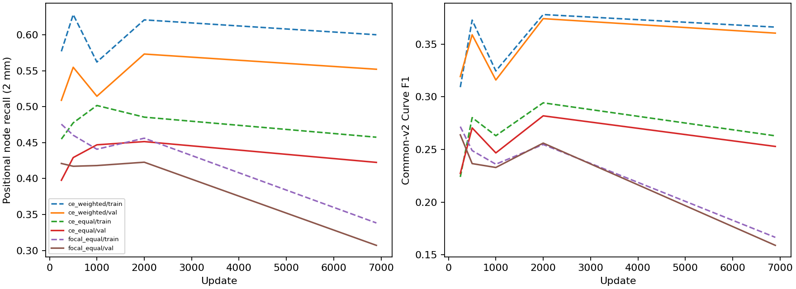

# Controlled IXI node class-weight and focal-loss continuation

2026-10-20. Status: prepared; no scientific results asserted before jobs finish.

## Audit and motivation

The Slurm queue was empty at the initial audit. Image-aware A–D had been implemented but **not submitted**; no image-aware submission record existed. Those arms retain their original image-information objective and frozen focal-edge policy. They do not include focal+ratio or CE+ratio edge ablations. The submission tables below and in [report 9](9-ixi-image-aware-relation-learning.md) record the accepted jobs when submitted. No existing job was cancelled.

Current IXI parent `ixi_transfer_20261015/runs/ixi_delayed_spline/best.pt` (step 28170) was inspected directly: node **weighted CE [0.25,0.75]**, edge **focal gamma 2 [1,1]**, balancing **none**, matched-only candidates, cap9999/no positive cap; node/edge curricula disabled. The local-image node-refinement checkpoint overlays trained coordinate/classification/refinement parameters on that parent and keeps spline-loss weight zero.

Existing evidence checked:

- Reports [4](4-ixi-relation-isolation.md), [6](6-ixi-query-attribution.md), [7](7-ixi-mechanism-batch.md), [8](8-ixi-relation-matching-calibration.md), the focal configurations, criterion implementation and research roadmap.
- The earlier frozen-feature 256-patch regularized-CE continuation already tested edge CE + ratio balancing. It does not train the node classifier; repeating it unchanged is skipped. No prepared/submitted **IXI edge focal + ratio** comparison was found. That missing edge ablation is deferred rather than automatically launched.
- An older [IXI 300-epoch object-focal study](../evidence/focal_ixi_300ep/README.md) and its configurations already exist, using a different extraction/8,000-patch population, node-type models and historical held-out evaluations. The object-focal YAML inherits the weighted node class setting, and lacks a CE [1,1] arm. It is not equivalent to the present three-way control. Its test scores are not used to select settings or evaluate this batch; no old test evaluation is repeated.
- Existing synthetic focal matrices/full-data studies are not repeated on synthetic MRI. No additional unmatched hard-negative supervision or architecture experiment is added.

### Colleague evidence (provided by the researcher)

The colleague's synthetic-MRI study evaluated 20,160 test patches: baseline CE/CE+upsampling gave node AP0.6422, edge AP0.6810, cycle MAE1.360, SMD0.00080; node focal/edge CE+upsampling gave 0.6540,0.6892,0.456,0.00072. Adding matched-edge focal reduced cycle error further but increased fragmentation/worsened SMD. Hard unmatched supervision often suppressed necessary connections. These are **externally reported synthetic results**, not new IXI measurements or independently reproduced numbers.

The node recipe also changed class weights from [0.25,0.75] to [1,1], so focal modulation and weighting were confounded. The IXI comparison below separates them.

## Controlled matrix

|Arm|Node classifier|Node weights|Edge objective, all arms|
|---|---|---|---|
|A `ce_weighted`|Weighted CE|[0.25,0.75]|CE [1,1] + ratio0.15, tolerance0.02|
|B `ce_equal`|CE|[1,1]|same|
|C `focal_equal`|Softmax focal gamma2|[1,1]|same|

A→B changes weighting; B→C changes focal modulation at identical weights; A→C tests the combined recipe. Optional focal [0.25,0.75] is omitted to prioritize this minimal comparison. Full resolved configurations must differ only in node classification settings.

## Initialization and trainable state

Common initializer: the **same mature IXI parent plus the same local-image refinement overlay** as report9. Absolute checkpoint paths and SHA256 identities are stored in `experiments/ixi_node_focal_ablation/{plan,submission}.json`; benchmark/smoke checks require identical initial full-model hashes and trainable parameter names across arms.

**Scientific limitation:** this parent was trained with focal edges. All three arms transition to CE+ratio and restart the optimizer identically at time zero. Therefore the A/B/C comparison isolates node settings **conditional on this shared edge-loss transition and initialization**. It is not a fresh CE-baseline training estimate, and transient interactions are possible. A short convergence failure cannot establish that focal loss fails from scratch. This shared transition is acknowledged rather than concealed or treated as an edge-loss comparison.

Trainable: image encoder, transformer/decoder, original node classifier, coordinate predictor, local-image node refinement and relation head. The pretrained spline head is frozen, preserving the local-refinement stage's zero spline-loss policy. The full detector is in training mode, including its BatchNorm running statistics; unlike the previous frozen probes, node supervision can influence shared image/token representations. The established node-refinement feature sampler detaches its sampled map/coordinates, but the normal decoder→backbone and original classifier paths remain trainable. The GPU smoke explicitly checks **node-classification-only gradients** reaching the classifier, decoder and encoder.

Preserve matching (actual refined logits/coordinates, class cost2/node cost5), box/node-coordinate loss definitions and weights, candidate selection/caps, edge weight6, node-class weight4, augmentation transforms and all non-node loss settings across arms. No unmatched mining, degree/topology addition or image-adapter modification. GT count overflow and unsupported graph cases fail rather than silently dropping supervision.

## Population, budget and checkpoints

- Training: **2,048 deterministic IXI patches,123 subjects**; validation: **512 patches,26 disjoint subjects**. Reuse report9's official-split manifest and preserve prior pilot IDs. No new independent subjects are created by the extra patches. All sites are represented as available from official metadata.
- Evaluate an unaugmented fixed **256-training-patch monitoring population covering all123 training subjects** and all512 validation patches. The remaining training patches participate in optimization. Training/validation geometry metrics therefore use different sample counts, explicitly reported. Every arm/checkpoint uses exactly these same IDs. No full2,649-patch validation or test sweep.
- Train with the same existing MRI rotate/zoom/noise and spline-aware augmentation; batch8, deterministic replacement order and per-update Python/NumPy/Torch seed201021+update. Workers0 ensure augmentation RNG does not depend on worker scheduling. Save the minibatch-order SHA256. Hungarian assignments may evolve differently between arms as outputs learn; the algorithm and supervision policy remain fixed.
- AdamW7e-5, original betas/epsilon/weight decay; identical **constant scheduler** and fresh optimizer in every arm. This bounded continuation does not resume the historical polynomial schedule. No validation tuning.
- Benchmark: each arm3 warm-up +32 timed full-network updates, discarded afterward. Choose `min(20000, floor(3300/(1.2*slowest_seconds_per_update)/100)*100)` common updates, require ≥200. Budget is selected once on throughput and written to `benchmark/budget.json`, with memory/parameter counts; it is unknown until the queued benchmark completes. Target45–55 minutes for the slowest arm; faster arms stop at identical updates. This is explicitly a **learning-curve pilot**, potentially too short for convergence.
- Save at250,500,1000,2000 and final when within the chosen budget; atomic replaceable recovery snapshot every250. All predefined checkpoints are evaluated; none selected using validation. Training90-minute wall allocation, internal80-minute deadline and interruption checkpoint. Separate GPU inference allocations preserve training time.

## Evaluation: uniqueness and graph reconstruction

Inference batch1 throughout, avoiding historical batch-dependent drift. Full256-query caches preserve embeddings, node scores/coordinates and all original relation logits from each trained checkpoint; new inference is necessary because node/backbone/relation weights now change. Existing frozen caches cannot substitute for these trained predictions. Standard original node/edge decoding is unchanged; no NMS or GT selection at inference.

At both **1 and2 mm**, use the existing spatial one-to-one mapping and common-v2 graph definitions:

- Node precision/recall/F1, query counts before/after confidence filtering, raw-query recall, retained matched/unmatched counts, node-count bias/MAE.
- Spatial duplicate candidates per recovered GT node; high-confidence duplicate counts at the fixed diagnostic score0.9; raw/retained correct-versus-duplicate ROC AUC. Spatial assignment is score independent; a nearby query is not anatomical truth simply because it was selected. Save query IDs, scores and categories for independent inspection.
- Pooled raw-query match AP is a descriptive confidence-label AP, **not box/detection mAP**. Primary node evidence remains physical recovery and uniqueness. Standard positional edge F1, TP/FP/FN, full-GT and conditional relation recall; unmatched-endpoint false edges; common-v2 Branch/Curve F1; component/cycle errors.
- Per-patch, per-subject and pooled results at every predefined update, for training and validation separately. Node AUC is undefined when a population lacks either matched or duplicate queries; retain NA.
- Paired subject bootstrap of final validation differences,1000 resamples, seed191032: A→B,B→C,A→C for recovery/precision, duplicate multiplicity, high-confidence duplicates per patch, node-count MAE, mean per-patch raw correct/duplicate AUC, edge/Branch/Curve F1 and component/cycle MAE. Pooled AUC and mean per-patch AUC are distinct reported estimands. Keep all patches from each subject together. Exploratory single-seed comparisons, no multiplicity adjustment.

Fixed decoder cutoffs are part of this primary node-loss recipe comparison. Changes in relation confidence/selection may affect graph precision/recall; no claim about relation-ranking superiority follows solely from graph F1 or cycle reduction. Inspect lost legitimate nodes alongside duplicate suppression.

## Verification and dependency structure

Local targeted tests: configurations differ only in node classification; actual criterion CE/focal match their formulas and backpropagate; uniqueness accounting distinguishes a rejected legitimate query from a high-confidence duplicate; minibatch sequences share deterministic prefixes. Full detector forward/backward and tiny collection run on the queued GPU/CPU smoke gates before benchmark/training.

Node GPU stages begin **afterany the complete image-aware training array**, preserving image A–D and keeping the two-H100 cap across both batches. Node smoke→CPU tiny evaluation/collection→benchmark→training array `0-2%2`→GPU prediction array `0-2%2`→CPU evaluation `aftercorr`→final collector `afterok`. GPU prediction starts after all three training arms, preventing overlap from exceeding the GPU cap. No queue polling is needed. Failed prerequisites block subsequent stages. No running jobs are cancelled.

Wall limits: GPU smoke45min, CPU smoke30min, benchmark30min, training90min/arm, checkpoint inference90min/arm, CPU geometry4h/arm, final collector2h. Established Jean-Zay H100/CPU accounts/partitions; no `--mem` directives. Large predictions/checkpoints/runtime archives use SCRATCH; compact evidence is copied under `docs/research/evidence/ixi_node_focal_20261020/`.

## Reproduction and pending interpretation

```bash
python3 cluster/jean_zay/submit_ixi_node_focal.py --submit
# Later: read completed results immediately, with no training/inference/polling.
python3 scripts/collect_ixi_node_focal.py --show
```

Output structure: `<SCRATCH root>/{smoke,benchmark,runs,predictions,evaluation,results}`. Final collector appends results, uncertainty and learning curves to this report and completed priorities to the roadmap. No scientific outcome is asserted until those stages succeed.

If B improves uniqueness over A without losing legitimate recall while C adds little, class weighting is the leading measured factor. If C improves over B, focal modulation contributes under this continuation protocol. If only training improves or learning curves are still moving, generalization/convergence remain unresolved. No automatic additional edge sweep follows.

## Accepted submission

Output: `/lustre/fsn1/projects/rech/vnc/upz25mj/experiments/gnbm/ixi_node_focal_20261020-114355`.

|Stage|Job|Dependency|
|---|---|---|
|gpu_smoke|1332023|afterany:1331642|
|cpu_smoke_collection|1332025|afterok:1332023|
|benchmark|1332027|afterok:1332025|
|training|1332028|afterok:1332027|
|prediction|1332029|afterok:1332028|
|evaluation|1332030|aftercorr:1332029|
|collection|1332031|afterok:1332030|
## Completed results

|Arm|Population|Node precision|Node recall|Edge F1|Branch F1|Curve F1|Component MAE|Cycle MAE|
|---|---|---:|---:|---:|---:|---:|---:|---:|
|ce_weighted|train|0.4568|0.6002|0.1341|0.0278|0.3661|4.5664|12.9883|
|ce_weighted|val|0.4365|0.5522|0.1189|0.0216|0.3604|4.3750|13.7246|
|ce_equal|train|0.5686|0.4576|0.1248|0.0230|0.2629|4.5859|3.6836|
|ce_equal|val|0.5474|0.4225|0.1165|0.0181|0.2528|4.5449|3.9160|
|focal_equal|train|0.5386|0.3383|0.0869|0.0077|0.1665|5.2695|2.7422|
|focal_equal|val|0.5293|0.3071|0.0767|0.0063|0.1589|4.8145|2.6875|

Paired subject intervals are in `bootstrap.json`; uniqueness and all intermediate training/validation metrics are in the companion CSVs. A vs B isolates class weighting, B vs C isolates focal modulation. Spatial correct-versus-duplicate AUC is diagnostic, not an inference feature. Pooled raw AUC is reported separately from the bootstrap mean per-patch AUC.

This is a short continuation pilot conditioned on a mature focal-edge checkpoint and a common transition to edge CE/ratio upsampling. Inspect learning-curve trends before drawing convergence conclusions. The node loss can change Hungarian assignments and hence which queries represent supervised endpoints; the matching algorithm and edge candidate policy remain identical. Do not interpret higher node AP/recall as improved uniqueness unless duplicate multiplicity and graph false edges also support it. No result here is a test-set estimate.

Next decision: if B improves over A while C does not improve over B, prioritize weighting rather than focal modulation. If C improves uniqueness over B without losing legitimate-node recall, confirm with a longer matched-budget study. If gains occur only on training subjects or curves have not stabilized, investigate generalization or extend the learning-curve budget before rejecting focal loss. No edge-loss or architecture sweep is automatically warranted.

Output: `/lustre/fsn1/projects/rech/vnc/upz25mj/experiments/gnbm/ixi_node_focal_20261020-114355`.



