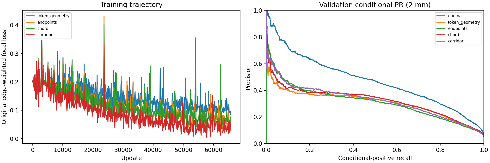

# IXI image-aware relation residuals: larger controlled experiment

Date: 2026-10-20. Status: implementation and local checks complete; queued smoke, preparation, benchmark, training and evaluation are dependency gated. **No scientific results are available at submission.**

## Question and prior evidence

Does fine-resolution image evidence improve validation connectivity ranking beyond the original decoder tokens and predicted geometry? Reports [4](4-ixi-relation-isolation.md), [6](6-ixi-query-attribution.md), [7](7-ixi-mechanism-batch.md) and [8](8-ixi-relation-matching-calibration.md) motivate this experiment: localization gains alone did not resolve relation errors; Hungarian query selection was insufficient; small relation-only continuations fitted training better without improving validation ranking. These observations motivate testing information content and generalization with more patches, rather than another hard-negative policy.

Primary comparison: validation conditional relation AP against **both** the frozen original scorer and the token/geometry residual control. All-retained AP, calibrated graph errors and generalization gaps provide separate evidence. More predicted edges, fewer components or higher Curve F1 alone do not establish improvement.

## Data and frozen state

- Exactly **2,048 training and 512 validation patches**, from the existing official IXI split: **123 training subjects and 26 disjoint validation subjects**. No test data. Preserve all previous 256/128 pilot IDs. The pilot already covered these subjects; expansion adds within-subject coverage, not new independent subjects.
- Deterministic selection seed **201020**. Start with pilot IDs, then favor subjects with fewer selected patches, with acquisition-site balance as a secondary criterion and seeded hash tie breaking. Official train/validation pools contain 10,000/2,649 patches. Site labels HH/Guys/IOP come from the original source manifest; unknown labels remain explicit.
- Dataset: `/lustre/fsn1/projects/rech/vnc/upz25mj/datasets/IXI/transfer_splines_k8_20261015`. Audit of every selected GT graph passed: maximum 153 nodes, no parallel or self-loop edges. No graph filtering or GT simplification was introduced.
- Parent detector: `.../experiments/gnbm/spline_learning/ixi_transfer_20261015/runs/ixi_delayed_spline/best.pt`, step 28170. Frozen local-image refinement: `.../experiments/gnbm/spline_learning/ixi_node_refinement_20261018/local_image/trained-heads.pt`. Absolute paths and SHA256 identities are recorded in `experiments/ixi_image_relation_learning/{plan,submission}.json` and cache metadata.
- Reuse the original full-query cache `.../ixi_query_diagnostics_20261019/pilot-1291329-local_image` and early maps from `.../ixi_mechanisms_20261019-220459/features`. Verify the existing 384-patch replay evidence and the exact cache/map/GT hashes recorded by experiment 8. Recompute only small heads to check coordinates, confidences, retained query IDs and all 32,640 relation logits. Existing spline replay bound is 0.001 mm; observed historical maximum was about 0.000563 mm. Refined coordinate replay gate is 0.003 mm, probability gate 0.0002, retained IDs and relation decisions must agree exactly; logits must agree within 3e-6 absolute/relative tolerance.
- New detector extraction is **batch size one**, matching the old cache. All arms read the same frozen outputs. Cache all 256 query tokens, two relation tokens, refined coordinates/logits, all original pair logits, GT annotations and the layer0/relu1 feature map. Sample images using predicted coordinates only. GT masks are used only for evaluation accounting, never as adapter inputs.
- Shared maps remain float32, 64 × 32 × 32 × 32; no enormous all-pair image-feature tensors. The estimated shared logical working set is approximately **23.6 GB** before NPZ compression/extra metadata, partly referencing existing maps. A 4,096/1,024 design would roughly double this; it is **not submitted**. Cache sizes and GPU peak allocation are recorded by preparation/benchmark. Large runtime files live under SCRATCH.

## Four controlled residual arms

`new margin = frozen original margin + residual`; equivalently add `[-residual/2, +residual/2]` to the two original class logits. The final residual layer starts at exactly zero. The original relation head, image backbone, transformer, node heads and spline head are frozen.

|Arm|Information supplied to the shared adapter|
|---|---|
|A: `token_geometry`|Endpoint token mean/absolute difference, both shared relation tokens, normalized midpoint/absolute separation, physical chord length and min/max object confidence. Image slots are zero.|
|B: `endpoints`|A plus 27 trilinear samples around each predicted endpoint, offsets −4/0/+4 input voxels along each axis. Symmetric mean/absolute difference retains the neighborhood structure.|
|C: `chord`|B plus 16 evenly spaced straight-chord samples; other cross-section slots are zero.|
|D: `corridor`|B plus 16 longitudinal positions × a deterministic 3 × 3 cross-section at offsets −4/0/+4 mm, perpendicular to the predicted physical endpoint displacement.|

Every arm has the same 64→8 image projection and 128→64→1 residual trunk and identical parameter count (495,497). Zeroed slots make the control comparable in nominal capacity; effective image-dependent capacity necessarily differs. Endpoint tokens and image features enter separately. Arm D uses structured flattened pooling through the shared trunk, without a transformer redesign. Physical-axis canonicalization and symmetric token/endpoint features preserve undirected scores. Coincident endpoints use a deterministic fallback frame. Border samples use the existing border-padding convention. The bounded square corridor may miss highly curved paths; it is not a vessel-path oracle. No all-pair predicted splines suitable for negative-pair feature construction were available, so candidate regions are entirely GT independent.

Trilinear alignment reproduces the layer0 stride-two convolution centers, including the half-feature-voxel grid offset and D/H/W→W/H/D grid ordering. A crafted anisotropic non-square example checks this convention.

## Supervision and optimization

- Reproduce the actual checkpoint Hungarian matcher on **refined coordinates and refined classification logits**, using its original normalized-coordinate L1 and classification cost weights (5 and 2). An assigned query can still be spatially inaccurate. Assignments are frozen supervision metadata, not inference features.
- Reuse `GraphCriterion._matched_edge_pool` and `_classification_loss`: focal edge classification, gamma 2, balancing mode `none`, no unmatched-query candidates or new hard-negative mining, original regularized sampling/cap 9999 and no positive cap. Positive supervision and pair sampling are identical across arms. Preserve original edge-loss weight 6; no node losses or extra auxiliary losses are optimized.
- Cached original logits are the established **symmetric average of both endpoint orders**. The original supervised population/sampling is retained; direction randomization cannot alter the residual score. This explicitly uses the inference-symmetric frozen scorer as the common base, rather than training one orientation of the original head.
- AdamW learning rate 7e-5; checkpoint optimizer betas/epsilon/weight decay. Batch eight patches, deterministic seeded sampling with replacement, identical patch order and candidate sampling seeds for every arm. Only adapter parameters enter the optimizer. Log sampled positive/candidate counts and verify equality across arms.
- All four arms start from identical adapter weights and exact baseline predictions. Benchmark weights are discarded. Frozen-input digests, finite gradients and nonzero residual-head gradients are checked; local tests verify image-projection gradients and absence of frozen-input gradients.
- **Matched update budget is determined once by the queued benchmark**: 8 warm-up + 200 timed updates per arm, then `min(100000, floor(3300 / (1.15 × slowest_seconds_per_update) / 100) × 100)`. Require at least 2,000 updates; otherwise fail and block training. The target is approximately 48–55 minutes for the slowest arm, with faster arms ending earlier at the same update count. A numeric budget cannot be reported before this benchmark without waiting for GPU jobs. It will be written to `benchmark/budget.json`.
- Save checkpoints and scores at 1,000, 2,000 and the common final update, with atomic recovery checkpoints every 500 steps. A 90-minute H100 allocation per arm reserves time for cache loading, scoring and cleanup. An 80-minute internal deadline and termination handling save an interrupted checkpoint and mark the run unsuccessful, blocking dependent evaluation. No full RelationFormer training is performed.

## Evaluation and uncertainty

All five scorers use identical retained nodes, query ordering, pair indices, labels and frozen spline geometry. Score files verify exact original margins, offsets and sample IDs. Normal inference retains the original confidence decision. Evaluation uses the established one-to-one **1 mm and 2 mm positional mapping**, separately from the training Hungarian assignment.

- Primary: pooled training/validation conditional AP, all-retained AP, prevalence/candidate counts and PR curves. Conditional candidates have both endpoints positionally matched; all-retained candidates include unmatched endpoints. Never combine these populations into one AP comparison. Preserve pilot-versus-additional-validation breakdowns.
- Geometry: training-defined GT arc-length and endpoint-distance quartiles; positive-bin ranking against the same conditional negative population; endpoint-confidence groups; nearby nonadjacent negatives (GT endpoint distance ≤5 mm). Save full-GT and conditional positive recall by length quartile, and per-patch/subject/site results. GT paths and length bins are evaluation metadata only.
- Graphs: positional node/edge precision/recall/F1 and TP/FP/FN, conditional relation recall, unmatched-endpoint false edges, duplicate counts, original common-v2 Branch/Curve F1, components/cycles and absolute errors, mean node/edge counts and pooled degree histograms. Retain every positive-length record for further inspection.
- Calibrate **separately at each matching tolerance using training only**: fixed 0.5, threshold maximizing positional edge F1, and maximum recall preserving the original scorer's training precision at 0.5. Apply unchanged to validation. Save validation-only equal-precision PR readouts explicitly as nondeployable diagnostics. No validation checkpoint or hyperparameter selection.
- Paired subject bootstrap: 1,000 resamples of the 26 validation subjects, seed 191032, keeping each subject's patches together. Report AP and AP differences against both original and A, plus edge/Curve F1 and component/cycle-error differences. These are exploratory single-seed intervals with no multiplicity correction; patches are not independent subjects.
- Fixed three validation subjects selected in manifest order: TP/FP/FN pair views with actual endpoint/chord/corridor samples overlaid, and companion point-coordinate JSON. Displayed pair links are straight for inspection; metric curves use the unchanged spline head. GT reference paths are shown as annotations, not sampled input features.

## Verification and orchestration

Completed before submission: four focused unit tests covering physical feature alignment, all-pair indexing, identical capacity/zero residual baseline, nonzero-residual endpoint invariance including coincident endpoints, image/no-image behavior and gradient isolation. Full deterministic manifest/GT graph audit passed.

Queued gates: GPU smoke (three training + three validation patches, including previously uncached cases), tiny three-update training in every arm, then CPU evaluation of all five scorers and aggregate collection. Only successful smoke/collection permits the once-only expanded cache. Only a successful shared-cache build permits benchmark/original evaluation. Only the benchmark permits training.

|Stage|Resource/wall time|Dependency|
|---|---|---|
|GPU smoke|1 H100, 30 min|none|
|Tiny CPU evaluation/collection|4 CPUs, 30 min|afterok GPU smoke|
|Shared preparation|1 H100, 90 min|afterok tiny collection|
|Throughput benchmark|1 H100, 30 min|afterok preparation|
|Four training arms|H100 array `0-3%2`, 90 min each|afterok benchmark|
|Original graph evaluation|4 CPUs, 4 h|afterok preparation|
|Adapter graph evaluation|4 CPU tasks per array element, `0-3%2`, 4 h each|aftercorr corresponding training element|
|Final aggregate/report|4 CPUs, 2 h|afterok original and all adapter evaluations|

Slurm uses established `vnc@h100`, `gpu_p6`, H100 constraint and `vnc@cpu`/`cpu_p1`; no unsupported memory directives. Invalid dependencies are cancelled. At most two training GPUs run concurrently. No duplicate submission is allowed when the exact experiment's submission record exists. Large caches and staged runtime archives use SCRATCH. Existing detector caches, checkpoints and prior conclusions are preserved.

## Outputs, commands and interpretation

Implementation: `models/image_relation_adapter.py`, `scripts/ixi_image_relation_learning.py`, `scripts/evaluate_ixi_image_relations.py`, `scripts/collect_ixi_image_relations.py`, targeted adapter tests and Jean-Zay submitter/wrappers.

```bash
# Submit once (already submitted when accepted IDs appear below).
python3 cluster/jean_zay/submit_ixi_image_relations.py --submit
# Print completed results without inference, training, collection or waiting.
python3 scripts/collect_ixi_image_relations.py --show
```

Large outputs: `<SCRATCH experiment root>/{cache,benchmark,runs,evaluation}`. `benchmark/budget.json` records actual updates, throughput, parameter counts and GPU memory. `runs/*/summary.json` separates training/scoring/wall duration. `evaluation/*` contains scores, thresholds, intermediate AP, per-patch/subject/site tables, length recall, degree distributions and fixed 3D examples. Final collector writes `results.md`, CSV/JSON bootstrap evidence and curves at the root, copies compact evidence to `docs/research/evidence/ixi_image_relation_learning_20261020/`, appends measured results to this report, and records completed findings/priorities in the roadmap.

Interpretation after completion:

1. Image arms improving validation AP over both controls support further investigation of fine CNN relation evidence and the lightweight adapter before a multiscale transformer.
2. Improved training fit without validation ranking gains motivates investigating site robustness and supervision quality under this design.
3. Similar token-only/image gains leave extra capacity or continued training as sufficient explanations.
4. No adapter gain limits this particular information/sampling/objective design; it does not rule out all image-aware methods. Preserve the original scorer while reconsidering representation and supervision.

All graph conclusions must jointly inspect false edges and cycle errors. No multiscale transformer, binary-mask-input oracle, new hard-negative loss or 4,096/1,024 expansion belongs to this batch.

## Accepted submission

Output root: `/lustre/fsn1/projects/rech/vnc/upz25mj/experiments/gnbm/ixi_image_relation_learning_20261020-113444`.

|Stage|ID|Dependency|
|---|---|---|
|gpu_smoke|1331638|none|
|cpu_smoke_collection|1331639|afterok:1331638|
|shared_cache|1331640|afterok:1331639|
|throughput_benchmark|1331641|afterok:1331640|
|training|1331642|afterok:1331641|
|original_evaluation|1331643|afterok:1331640|
|adapter_evaluation|1331645|aftercorr:1331642|
|collection|1331646|afterok:1331643:1331645|

Actual common updates will be written by the queued benchmark to `benchmark/budget.json`; no training begins until it succeeds.

## CPU reporting recovery

Empty-graph degree histograms caused NumPy float-to-integer addition failures after the primary metric tables were saved. Explicit integer conversion fixes the arithmetic. Two targeted regressions pass; real saved-table replay was verified locally. Recovery checks all expected sample/tolerance/policy rows, reads existing scores and graph/length tables, and completes reporting without model inference, graph-metric recomputation or training. A separate reporting completion marker now gates collection. Original jobs and result tables are preserved.

- saved_table_recovery: `1344394`, `afterany:1331643:1331645`.
- collection: `1344395`, `afterok:1344394`.

Recovery waits for the original evaluation array to finish before touching its output folders. Retrieve: `python3 scripts/collect_ixi_image_relations.py --show`.
## Completed results

Frozen dataset: 2048 training / 512 validation patches; 26 validation subjects.
All adapters compared at update 65600. Original scorer has zero further updates.

|Scorer|Train conditional AP|Validation conditional AP|Validation all-retained AP|
|---|---:|---:|---:|
|original|0.4856|0.4723|0.1253|
|token_geometry|0.6044|0.3058|0.0777|
|endpoints|0.6394|0.3113|0.0833|
|chord|0.6468|0.3216|0.0882|
|corridor|0.6445|0.3211|0.0889|

|Image arm|Reference|Conditional AP difference: paired 95% interval|All-retained AP difference|
|---|---|---|---|
|endpoints|original|[-0.1762331077399786, -0.14446747881844924]|[-0.04868210569556284, -0.03484885482858969]|
|endpoints|token_geometry|[-0.014974921422470207, 0.027981053532356897]|[8.633121039858805e-05, 0.012093428127006096]|
|chord|original|[-0.1674168901888431, -0.1343847192597514]|[-0.044588013807320095, -0.02950155787975389]|
|chord|token_geometry|[-0.0029939481154729205, 0.03440075538025805]|[0.0055082280752560536, 0.01575520564066627]|
|corridor|original|[-0.16814313080522464, -0.13193146539731687]|[-0.04335689428747157, -0.029281941055504933]|
|corridor|token_geometry|[-0.009083713273264706, 0.044931597693531056]|[0.005563886317298051, 0.017100792907536477]|

|Scorer|Policy|Precision|Full GT recall|Edge F1|Branch F1|Curve F1|Component MAE|Cycle MAE|
|---|---|---:|---:|---:|---:|---:|---:|---:|
|original|fixed_0p5|0.1554|0.0521|0.0780|0.0118|0.1732|16.2148|0.9941|
|original|train_max_f1|0.1202|0.2114|0.1533|0.0291|0.3874|2.7168|13.2949|
|original|train_preserve_precision|0.1571|0.0541|0.0805|0.0118|0.1770|16.0781|1.0156|
|token_geometry|fixed_0p5|0.0892|0.1234|0.1036|0.0189|0.3061|7.3633|11.2734|
|token_geometry|train_max_f1|0.0873|0.2117|0.1237|0.0264|0.3705|3.0605|26.0703|
|token_geometry|train_preserve_precision|0.1091|0.0095|0.0175|0.0047|0.0626|20.3594|0.6836|
|endpoints|fixed_0p5|0.0917|0.1255|0.1060|0.0216|0.3284|6.1680|9.7832|
|endpoints|train_max_f1|0.0916|0.1897|0.1236|0.0276|0.3710|3.1172|19.7402|
|endpoints|train_preserve_precision|0.0915|0.1193|0.1036|0.0204|0.3229|6.6133|8.9922|
|chord|fixed_0p5|0.1031|0.1487|0.1218|0.0258|0.3632|5.4570|10.4688|
|chord|train_max_f1|0.0984|0.2076|0.1335|0.0311|0.4044|2.8926|20.2598|
|chord|train_preserve_precision|0.1030|0.1367|0.1175|0.0252|0.3552|6.2109|9.0469|
|corridor|fixed_0p5|0.1024|0.1363|0.1169|0.0283|0.3621|5.4375|8.4922|
|corridor|train_max_f1|0.0998|0.1710|0.1261|0.0304|0.3911|3.5938|13.7051|
|corridor|train_preserve_precision|0.1001|0.1782|0.1282|0.0306|0.3944|3.4316|14.7480|

### Interpretation and limitations

Image arms with positive paired conditional-AP intervals against BOTH the frozen original and token/geometry control: none. This is exploratory evidence from one seed and reused validation subjects, with multiple comparisons and no multiplicity adjustment.
Compare training/validation AP and predefined intermediate checkpoints to distinguish fitting from generalization. If token-only gains match image gains, added capacity/training remains sufficient to explain the result. Failure of these adapters rules out this particular sampling/training design, not all image-aware relation learning.
Ranking AP is independent of the calibrated cutoff. Training-max-F1 and the common original training-precision policy use training labels only; their validation precision may differ. Validation-only equal-precision readouts are explicitly diagnostic. Fewer components and increased Curve F1 do not establish anatomical correctness when false cycles increase.
Recommendation: if an image arm improves validation ranking against both controls and its calibrated graph errors are acceptable, confirm the lightweight adapter before a larger transformer change. If it only improves fitting, examine site/generalization and label reliability. If no adapter improves ranking, retain the original scorer and review the relation representation/supervision before another architecture change. No multiscale or mask-input experiment was launched.

Supporting files: evaluation/*/{ranking.csv,ranking-strata.csv,per-subject.csv,per-site.csv,positive-lengths.csv,intermediate-ranking.json,validation-only-precision.json}; bootstrap JSONs; fixed 3D PNGs and sampling-point JSONs.
Full outputs: `/lustre/fsn1/projects/rech/vnc/upz25mj/experiments/gnbm/ixi_image_relation_learning_20261020-113444`.




<!-- BEGIN CHEAP DIAGNOSTICS relation 20261026 -->
## Cached early relation learning and overfitting —26 October2026

This new analysis reuses the completed study’s **saved scores**, without new GPU inference, optimizer updates, architecture or loss changes. The original2048/512 patches and123/26 disjoint subjects remain fixed. Pair offsets/order, sample IDs/splits, labels and frozen original margins were checked exactly at every checkpoint. New evidence: paired subject uncertainty for early versus original/control ranking, plus fixed and **training-selected** edge operating points. Earlier intermediate AP measurements are reused, not presented as newly trained results.

| Scorer | Conditional AP train /val, 1k | Conditional AP train /val, 2k | Conditional AP train /val, 65,600 |
|---|---:|---:|---:|
| Original | 0.48556 /0.47235 | same frozen scorer | same frozen scorer |
| token_geometry | 0.49136 /0.47526 | 0.49437 /0.47660 | 0.60440 /0.30584 |
| endpoints | 0.50368 /0.48980 | 0.50959 /0.49074 | 0.63940 /0.31130 |
| chord | 0.50791 /0.49550 | 0.51625 /0.50156 | 0.64677 /0.32164 |
| corridor | 0.50803 /0.49444 | 0.51952 /0.50191 | 0.64450 /0.32114 |

| Early scorer | Reference | AP difference, 2 mm [95% subject interval] |
|---|---|---:|
| token_geometry/1000 | original | +0.00291 [+0.00071, +0.00517] |
| token_geometry/2000 | original | +0.00425 [+0.00135, +0.00711] |
| endpoints/1000 | original | +0.01745 [+0.01441, +0.02113] |
| endpoints/1000 | token_geometry/1000 | +0.01454 [+0.01200, +0.01697] |
| endpoints/2000 | original | +0.01839 [+0.01480, +0.02256] |
| endpoints/2000 | token_geometry/2000 | +0.01415 [+0.01150, +0.01670] |
| chord/1000 | original | +0.02316 [+0.01960, +0.02682] |
| chord/1000 | token_geometry/1000 | +0.02024 [+0.01768, +0.02279] |
| chord/2000 | original | +0.02921 [+0.02484, +0.03393] |
| chord/2000 | token_geometry/2000 | +0.02496 [+0.02153, +0.02802] |
| corridor/1000 | original | +0.02209 [+0.01843, +0.02590] |
| corridor/1000 | token_geometry/1000 | +0.01918 [+0.01622, +0.02219] |
| corridor/2000 | original | +0.02956 [+0.02415, +0.03529] |
| corridor/2000 | token_geometry/2000 | +0.02531 [+0.02090, +0.02969] |

| Early scorer | Policy | Validation edge F1 | Difference vs original [95% subject interval] |
|---|---|---:|---:|
| chord/2000 | fixed_0p5 | 0.10245 | +0.02444 [+0.01988, +0.02943] |
| chord/2000 | max_f1 | 0.15996 | +0.00666 [+0.00447, +0.00900] |
| chord/2000 | preserve_precision | 0.13147 | +0.05100 [+0.04431, +0.05812] |
| corridor/2000 | fixed_0p5 | 0.10013 | +0.02212 [+0.01699, +0.02686] |
| corridor/2000 | max_f1 | 0.16082 | +0.00752 [+0.00500, +0.01004] |
| corridor/2000 | preserve_precision | 0.13849 | +0.05803 [+0.05089, +0.06550] |

Original validation edge F1 is0.07801 at0.5,0.15330 using its training-max-F1 threshold, and0.08047 under the training baseline-precision policy. Chord/corridor2k reach0.13147/0.13849 under their independently training-selected precision-preserving policies; attained validation precision is0.15400/0.15475 versus original0.15710. Training precision constraints do not force exactly equal validation precision. Edge intervals condition on the selected training thresholds and omit their calibration-sample uncertainty. Early Branch/Curve/topology were not recomputed here, so these ranking/edge gains do not establish complete graph superiority.

The intervals use1,000 paired whole-subject draws (seed191032), preserving pooled pair prevalence and tied scores. Conditional and all-retained AP remain separate; full1/2-mm tables, pair/positive counts, source-score SHA256 and training-calibrated edge F1/recall/conditional-recall policies are in `/lustre/fswork/projects/rech/vnc/upz25mj/projects/DenseVesselGraph/experiments/cheap_diagnostics_20261026/relation-analysis.json` and adjacentCSV files. Fixed relation threshold0.5 remains unchanged in that policy. No validation thresholds choose the reported training-calibrated policies.

Early image-versus-matched-token-control intervals exclude zero for: endpoints/1000, endpoints/2000, chord/1000, chord/2000, corridor/1000, corridor/2000. This is retrospective development evidence across multiple inspected checkpoints/arms, not an independently validated early-stopping rule. The late training/validation divergence demonstrates overfitting of this frozen-feature residual recipe; it does not justify another long relation run. Retain the original scorer as the operational reference until a predefined short schedule or train-only stopping rule is confirmed on disjoint subjects. Additional data must mean new subjects or an explicit independent confirmation, not merely reusing these validation outcomes.

No automatic relation training was submitted: saved checkpoints already answer this bounded diagnostic. No new Branch/Curve experiment is implied; the earlier full reconstruction tables remain authoritative for their evaluated checkpoints. Wider corridors are still bounded image context, not multiscale attention or GT paths.
<!-- END CHEAP DIAGNOSTICS relation 20261026 -->

<!-- R06 SUBMITTED 20261027 -->
## R06 modern SyntheticMRI token enrichment submitted — 27 October 2026

N08 is complete and negative against count-matched controls; it does not establish a token-information deficit or justify new selection heuristics. N06’s relation-informative alternatives and near-nonadjacent confusion leave a bounded question about image information. This explicitly authorized R06 test changes relation-specific 552D embeddings, distinct from the historical IXI edge-logit residuals above. CPU sampler/capacity tests and both-seed GPU smoke **1613831** passed. GPU array **1613949** uses at most one H100 at a time; dependent collector **1613951** will publish actual measured outcomes. No scientific training result is asserted by submission.

Fixed modern A-xyz seeds 364505/92741 (12k checkpoints), 128 existing training-monitor patches/32 subjects and unchanged 480 validation patches/13 subjects; this is a limited residual-learning pilot rather than full-population detector retraining. R0 original; R1 active parameter-matched token-only residual; R2 local 3×3×3 CNN residual; R3 original-head-only continuation. Zero-initialized 552D corrections feed only the frozen original relation head; original logits, coordinates and spline inputs are retained. Shared relation tokens are unchanged. Existing matched-pair CE, positive balancing and seeds/budgets stay fixed; no R07 mining. Checkpoints at 0/100/300/1k/2k, with fixed 2k primary and shuffled-feature inference. Original weights and failed historical studies are preserved. Isolated branch/worktree `research/r06-relation-token-20261027` / `gnbm-r06-relation-token-20261027`; exact protocol, hashes and jobs under its `experiments/r06_relation_tokens_20261027`. No large, unfrozen or combined study was launched.

<!-- BEGIN R06 RELATION TOKENS 20261027 -->
## R06 — Relation-specific 552D CNN token enrichment — 27 October 2026

The predeclared gate for a fully unfrozen confirmation did not pass. Retain original A-xyz inference; no fully unfrozen or combined R06+R07 experiment was launched.

**Measured outcome: the CNN branch is used, but this residual does not improve the original modern A-xyz relation predictor.**

1. **Image information is used, without a net baseline gain.** R2 minus shuffled-image all-retained AP is +0.007732 [0.002736, 0.013344] / +0.011343 [0.006843, 0.015530] across the two seeds. Nevertheless, R2 minus original R0 is −0.009691 / −0.006233, with both subject intervals below zero. Image sensitivity is not evidence that R2 improves the original embeddings.

2. **No convincing advantage over the parameter-matched token control.** Final R2 conditional AP is slightly below R1 in both seeds; R2−R1 all-retained AP is +0.002577 / +0.001388 and edge F1 +0.001755 / +0.000629, with all four subject intervals including zero. R2 often outperforms the continued-head control in all-retained AP, but that control also degrades versus R0. Extra trainable capacity/continued supervision does not rescue the original scorer here.

3. **Early gains do not persist.** R2 validation all-retained AP at 100 updates is 0.828191 / 0.822567 versus R0 0.827375 / 0.821966; at 2k it falls to 0.817684 / 0.815733. These small early fluctuations are descriptive and do not establish a validated early stopping rule. Training conditional AP rises to 0.983150 / 0.986247 while validation falls to 0.973575 / 0.974823. Training Hungarian-pair CE decreases while validation CE increases. Training all-retained AP does not consistently improve either. This raises a supervision-population question alongside the observed generalization gap; the experiment does not isolate its cause or show uniformly better training on every inference candidate.

4. **Graph reconstruction deteriorates.** R2−R0 edge F1 is −0.003678 [−0.005682, −0.000958] / −0.002978 [−0.005733, −0.000496]. It loses 37/38 TP, adds 10/removes 9 FP, and increases component MAE by 0.0750/0.0729 and cycle MAE by 0.04375/0.03333. Original node counts, coordinates and classification logits stay unchanged. Mean retained-pair rank correlations with R0 are 0.9846/0.9869 and 421/419 edge decisions change: the embeddings alter ranking, rather than merely applying a common scalar calibration.

**Recommendation:** keep R0 and the negative result. N08 does not support more of the tested selection heuristics. Prioritize a focused review of spatial quality, assignment/alternative-query label coherence and the matched-training-versus-retained-inference population; keep the independently owned R07 study separate and do not repeat its sampler automatically. The present negative result is limited to 128 training patches, this residual architecture and 2k updates; it does not rule out every use of CNN information.

**Decision gate and scope.** N08 completed negatively against count-matched controls. It supplies no deployable query-selection improvement and does not establish an absence of token information. N06 identifies relation-informative alternatives and residual close-nonadjacent confusion, while normal conditional AP is already about 0.978. This leaves a bounded information-content question. The present experiment is explicitly a modern SyntheticMRI token residual, not the older IXI endpoint/chord/corridor edge-logit adapter.

**Fixed comparison.** Both modern A-xyz seeds 364505/92741 at update 12,000; original 128 training-monitor patches/32 subjects and 480 validation patches/13 disjoint subjects. Training the new modules on the monitor is a bounded pilot, not full 25k-patch population learning. No test access. All detector/CNN/transformer/node/refinement/spline weights and BN statistics are frozen. Original coordinates and logits are retained exactly in evaluation; replay/cache parity and frozen-state hashes are recorded. Relation tokens stay unchanged.

R0: original relation head. R1: token-only residual. R2: image-conditioned residual using 27 samples around the existing refined coordinates, at offsets −4/0/+4 input voxels in each axis on layer0/relu1. Both residuals produce 552D corrections, have identical active trainable parameter counts, and zero-initialized output. Each uses token/context LayerNorm→64D projection→ReLU, concatenated into a 552D linear output. R1 fills the 1728D context slot with a fixed repetition of token components: no CNN information, same trainable layers, but a rank-limited redundant input; this is not a claim of equal independent input dimensionality. Only the relation branch consumes the corrected embeddings; node classification/coordinates/spline use originals. R3_head continues only the original relation head and is a supervision/capacity reference, not a parameter-matched arm. R2_shuffled permutes local CNN vectors among queries at inference.

All trainable arms use the unchanged matched-pair CE, ratio-positive upsampling 0.15, cap 9999, no unmatched mining, edge weight 6, AdamW peak LR 7e-6, 20-step warmup, weight decay 1e-4, batch eight, 2,000 updates. Identical patch order, random endpoint orientation, labels and balancing are verified with sampling digests. Save 0/100/300/1000/2000; final 2000 is primary, early points descriptive. Inference batch one; node/edge cutoffs stay 0.5. Geometry-bin quartiles use training GT only.

**Primary table: validation at 2 mm, fixed final 2,000 updates.**

| Seed | Arm, final | Conditional AP | All-retained AP | Edge F1 | TP / FP / FN | Conditional recall | β0 / β1 MAE |
|---:|---|---:|---:|---:|---|---:|---|
|364505|R0|0.977632|0.827375|0.634134|4912 / 2901 / 2767|0.950097|0.8833 / 1.4708|
|364505|R1|0.974082|0.815107|0.628700|4874 / 2952 / 2805|0.942747|0.8979 / 1.5083|
|364505|R2|0.973575|0.817684|0.630456|4875 / 2911 / 2804|0.942940|0.9583 / 1.5146|
|364505|R2_shuffled|0.972648|0.809952|0.629176|4850 / 2888 / 2829|0.938104|0.9313 / 1.4417|
|364505|R3_head|0.972622|0.809140|0.630460|4835 / 2824 / 2844|0.935203|0.9979 / 1.3896|
|92741|R0|0.977971|0.821966|0.633730|4932 / 2954 / 2747|0.951205|0.8854 / 1.5417|
|92741|R1|0.975047|0.814345|0.630123|4897 / 2967 / 2782|0.944455|0.9292 / 1.5604|
|92741|R2|0.974823|0.815733|0.630751|4894 / 2945 / 2785|0.943877|0.9583 / 1.5750|
|92741|R2_shuffled|0.973140|0.804391|0.630711|4859 / 2870 / 2820|0.937126|1.0167 / 1.4375|
|92741|R3_head|0.973110|0.803635|0.630101|4848 / 2861 / 2831|0.935005|1.0271 / 1.4646|

| Seed / arm (final, validation 2 mm) | Nearby nonadjacent FP / candidates | Long-arc Q4 TP / eligible / GT | Tortuosity Q4 TP / eligible / GT | Signed edge / component / cycle bias per patch |
|---|---|---|---|---|
|364505 / R0|51 / 109|1440 / 1601 / 1967|1265 / 1387 / 1952|+0.2792 / +0.2542 / +1.4500|
|364505 / R1|51 / 109|1417 / 1601 / 1967|1242 / 1387 / 1952|+0.3063 / +0.2646 / +1.4875|
|364505 / R2|57 / 109|1411 / 1601 / 1967|1248 / 1387 / 1952|+0.2229 / +0.3542 / +1.4937|
|92741 / R0|51 / 112|1425 / 1588 / 1967|1275 / 1404 / 1952|+0.4313 / +0.2729 / +1.5250|
|92741 / R1|49 / 112|1404 / 1588 / 1967|1261 / 1404 / 1952|+0.3854 / +0.3375 / +1.5437|
|92741 / R2|51 / 112|1399 / 1588 / 1967|1260 / 1404 / 1952|+0.3333 / +0.4042 / +1.5583|

R2 does not recover the long/tortuous-edge deficit: long-arc TP falls 1440→1411 / 1425→1399 at identical eligible endpoints; tortuous TP falls 1265→1248 / 1275→1260. Nearby nonadjacent GT negatives are sparse (109/112 pairs), so their 51→57 / 51→51 FP counts should not be overgeneralized. Positive-bin full-GT and conditional recall, with training-defined cutoffs, are saved separately.


AP uses identical candidates and positive prevalence within each seed/split/tolerance; conditional AP includes only spatially recovered endpoints, while all-retained AP also includes unmatched endpoints. Per-arm candidate/positive counts are in `analysis.json`. Full 1/2-mm counts, near-nonadjacent false-positive rates, training-defined long/tortuous-bin recovery, signed graph counts, ranking correlations and decision changes are saved.

| Seed / split, 2 mm | Conditional pairs / positives / prevalence | All-retained pairs / positives / prevalence |
|---|---|---|
|364505 / train|18943 / 1425 / 0.075226|27307 / 1425 / 0.052184|
|364505 / val|67858 / 5170 / 0.076189|99280 / 5170 / 0.052075|
|92741 / train|19165 / 1436 / 0.074928|27485 / 1436 / 0.052247|
|92741 / val|68128 / 5185 / 0.076107|100100 / 5185 / 0.051798|

| Seed | R2 minus reference, final | Conditional AP difference [95% CI] | All-retained AP difference [95% CI] | Edge F1 difference [95% CI] |
|---:|---|---|---|---|
|364505|R0|-0.004057 [-0.004729, -0.003292]|-0.009691 [-0.014400, -0.004973]|-0.003678 [-0.005682, -0.000958]|
|364505|R1|-0.000508 [-0.001648, +0.000521]|+0.002577 [-0.000519, +0.006328]|+0.001755 [-0.001167, +0.004449]|
|364505|R3_head|+0.000953 [-0.000435, +0.002423]|+0.008544 [+0.004563, +0.013000]|-0.000004 [-0.002201, +0.002706]|
|364505|R2_shuffled|+0.000927 [-0.000655, +0.002543]|+0.007732 [+0.002736, +0.013344]|+0.001280 [-0.001630, +0.004844]|
|92741|R0|-0.003148 [-0.004100, -0.002145]|-0.006233 [-0.011347, -0.001774]|-0.002978 [-0.005733, -0.000496]|
|92741|R1|-0.000224 [-0.001158, +0.000672]|+0.001388 [-0.002415, +0.005347]|+0.000629 [-0.001945, +0.003340]|
|92741|R3_head|+0.001713 [+0.000367, +0.003080]|+0.012098 [+0.008613, +0.015529]|+0.000650 [-0.002013, +0.003012]|
|92741|R2_shuffled|+0.001683 [+0.000204, +0.003106]|+0.011343 [+0.006843, +0.015530]|+0.000040 [-0.003258, +0.002777]|

Intervals resample whole validation subjects (1,000 graph draws; 500 AP draws, seed 271026). These reused development cohorts share a source model; intervals omit source-training and seed uncertainty. No validation threshold or checkpoint selection. Same-population AP changes test ranking beyond a common monotonic logit calibration; graph F1/TP/FP/topology are separate requirements.

Slurm smoke **1613831**, sequential training array **1613949**, CPU collector **1613951**. R06 used at most one H100 at a time under the shared submission lock, with a global limit of two.


Artifacts: sibling worktree `gnbm-r06-relation-token-20261027`, branch `research/r06-relation-token-20261027`, `experiments/r06_relation_tokens_20261027`. Its `large` symlink points to isolated SCRATCH features/scores/checkpoints. `plan.json`, `submission.json`, `smoke.json`, `analysis.json`, `checkpoint-manifest.json`, `ranking/*.npz`, per-patch/per-subject tables and source snapshots preserve provenance. Original A-xyz checkpoint hashes are unchanged: `a1210fe958dffe0e588d38222cb62bf48b58e9b238fc57c027ec1c7a795277c9` / `9646b7b266dec3463d94d16cfbcef0332044a9bf0d599c2319a2eff2c93d3e53`.

The initial conclusion is limited to this frozen-head residual, training cohort and short schedule. If negative, preserve existing query-selection negatives: N08 does not justify more heuristics. The better-supported next question is assignment/spatial-quality/connectivity supervision, keeping R07 independent; neither arbitrary embedding capacity nor blanket unmatched-negative mining is established as a cure.

<!-- END R06 RELATION TOKENS 20261027 -->

<!-- R06 REPEATED REQUEST AUDIT 20261027 -->
### R06 repeated-request audit and reporting completion — 27 October 2026

The renewed R06 prompt matches the **already completed** modern two-seed experiment above. The architecture, old IXI R05 evidence, N06 token intervention, negative N08 selection study, modern A-xyz training report, frozen-state/parity evidence and R06 sampled-loss/capacity controls were reviewed. **No duplicate training, source inference, architecture modification, query-selection mechanism, R07 supervision combination or fully unfrozen confirmation was launched.** Existing weights, numerical results and source annotations are preserved.

The four research questions have the following measured answers:

1. **CNN information is used, but improved relation embeddings versus original R0 were not demonstrated.** R2 exceeds shuffled-image all-retained AP by +0.007732/+0.011343 (both subject intervals positive), yet remains below original R0 by −0.009691/−0.006233 (both intervals negative). Image sensitivity alone is not a net benefit.
2. **No convincing advantage over token-only capacity control R1.** R2 conditional AP is slightly lower in both seeds. R2−R1 all-retained AP (+0.002577/+0.001388) and Edge F1 (+0.001755/+0.000629) intervals include zero. R1/R2 each have 221,816 active trainable parameters; R1's repeated-token context is rank-limited, which remains an explicit control limitation.
3. **Small early gains do not persist/generalize.** R2 all-retained validation AP at 100 updates is 0.828191/0.822567, versus original 0.827375/0.821966. At the predefined 2,000-update endpoint it falls to 0.817684/0.815733; training conditional AP increases while validation conditional AP/CE deteriorate. These exploratory early fluctuations do not authorize a validation-selected early winner.
4. **Inferred graph quality worsens versus original.** R2 Edge F1 0.630456/0.630751 versus original 0.634134/0.633730; both paired difference intervals are negative. R2 loses 37/38 true edges, does not consistently reduce false edges, and increases component/cycle MAE. Node coordinates/class logits, shared relation tokens and spline inputs remain unchanged.

**Single remaining direction supported for review:** spatial query identity and assignment/alternative-query supervision coherence, including generalization to normally retained query populations. This is a hypothesis, not a demonstrated causal fix. N08 supplies no deployable selection improvement, and completed R07 does not justify repeating matched-negative emphasis or automatically adding unmatched supervision. Retain original A-xyz; no unfrozen R06 confirmation or architecture search is justified by this pilot.

**One reporting gap was identified:** modern R06 common-v2 Branch/Curve F1 had not been calculated. CPU-only job **1625936** now completes that requested metric block from saved R06 final scores and compatible **original frozen K8 candidate curves** cached for R07. It does not use R07 trained relation scores/sampling or rerun a model. R0/R1/R2, continued-head and shuffled-image arms are evaluated on the same frozen geometry at fixed 0.5 thresholds; direct two-patch smoke passed, including both checkpoint/manifests, R0 score parity and cached-versus-recomputed baseline geometry. Full per-arm node/edge counts are checked against existing R06 results before publication. The collector will append tables and paired whole-subject Branch/Curve intervals automatically. This reporting supplement is pending; the primary negative learning result remains complete.

Supplement evidence: `../gnbm-r06-relation-token-20261027/experiments/r06_relation_tokens_20261027/geometry_completion_20261027`; no prior primary report/artifact was replaced. Retrieval from projects, without inference or training:

```bash
python3 gnbm-r06-relation-token-20261027/scripts/show_r06.py
```

<!-- R06 GEOMETRY REPORTING COMPLETED 20261027 -->
### R06 geometry-metric completion from saved predictions — 27 October 2026

The repeated R06 request matches the completed experiment above; no training, inference, architecture change or unfrozen confirmation was repeated. The missing common-v2 Branch/Curve metrics below reuse R06 final score vectors and compatible original frozen K8 candidate curves cached during R07 preparation. **No R07 trained scores or sampling policy enters this comparison.** Checkpoint hashes, split/sample/GT identities, query-pair ordering, original R0 score parity, original geometry parity and reproduced per-arm node/edge counts passed.

| Seed | Scorer, validation | Branch F1 | Curve F1 | Component MAE | Cycle MAE |
|---:|---|---:|---:|---:|---:|
|364505|R0|0.273976|0.670871|0.8833|1.4708|
|364505|R1|0.268968|0.670032|0.8979|1.5083|
|364505|R2|0.268676|0.670009|0.9583|1.5146|
|364505|R2_shuffled|0.269711|0.669427|0.9313|1.4417|
|364505|R3_head|0.268412|0.670014|0.9979|1.3896|
|92741|R0|0.278753|0.669204|0.8854|1.5417|
|92741|R1|0.274380|0.667373|0.9292|1.5604|
|92741|R2|0.271642|0.665883|0.9583|1.5750|
|92741|R2_shuffled|0.272191|0.667206|1.0167|1.4375|
|92741|R3_head|0.272036|0.666099|1.0271|1.4646|

| Seed | R2 comparison | Branch F1 difference [95% subject CI] | Curve F1 difference [95% subject CI] |
|---:|---|---|---|
|364505|R2 minus R0|-0.005301 [-0.008577, -0.002350]|-0.000863 [-0.003800, +0.002081]|
|364505|R2 minus R1|-0.000292 [-0.003727, +0.003479]|-0.000024 [-0.001642, +0.001397]|
|364505|R2 minus R3_head|+0.000263 [-0.003528, +0.005172]|-0.000005 [-0.001948, +0.002164]|
|364505|R2 minus R2_shuffled|-0.001035 [-0.005363, +0.004409]|+0.000582 [-0.002027, +0.003519]|
|92741|R2 minus R0|-0.007111 [-0.010850, -0.002664]|-0.003321 [-0.006533, -0.000472]|
|92741|R2 minus R1|-0.002738 [-0.006465, +0.000865]|-0.001490 [-0.002796, +0.000008]|
|92741|R2 minus R3_head|-0.000395 [-0.003389, +0.002852]|-0.000216 [-0.002085, +0.001835]|
|92741|R2 minus R2_shuffled|-0.000549 [-0.004643, +0.004239]|-0.001323 [-0.004128, +0.001180]|

These geometry metrics supplement the completed negative discrimination/reconstruction result; they do not change the failed predeclared R06 confirmation gate. Image shuffling shows that CNN information is used, but final conditional AP/F1 are below original R0 in both seeds and there is no convincing R1 advantage. A possible Curve F1 gain must be assessed alongside the existing TP/FP/cycle counts; geometric coverage alone does not demonstrate connectivity improvement. Tiny early AP fluctuations are exploratory; no validation-selected stopping rule or new training is introduced. Retain original A-xyz. The better-supported remaining question concerns spatial identity, assignment and relation-label consistency; N08 and the completed R07 sampler negatives remain binding evidence, not invitations to repeat them or launch blanket unmatched mining.

This remains a 128-training/480-validation-patch, two-seed frozen residual pilot. It cannot rule out all CNN relation features or establish a causal training fix. Matched parameter counts do not make R1 redundant token-context input rank equal to independent CNN input rank. No test subjects were inspected.

CPU reporting job: `1625936`. Evidence: sibling `gnbm-r06-relation-token-20261027/experiments/r06_relation_tokens_20261027/geometry_completion_20261027` (`summary.json`, per-patch/per-subject CSVs, identity manifest and smoke). Retrieve with `python3 gnbm-r06-relation-token-20261027/scripts/show_r06.py` from projects.
