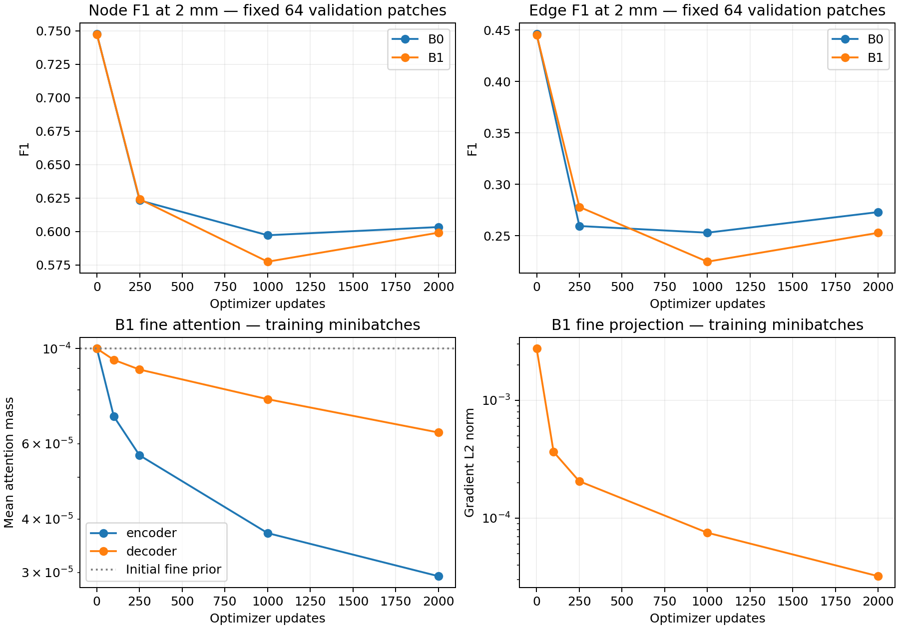

# Pretrained two-level RelationFormer pilot — 23–24 October 2026

Storage update (25 October): dormant NPZ predictions are preserved in a verified archive; [restore instructions](../../experiments/multiscale_pretrained/ARCHIVED_PREDICTIONS.md). Checkpoints and reported results remain in place.


## Decision

**Do not scale up this continuation or reject multiscale attention.** The implementation passes migration, CUDA, reference-point, gradient and tiny-fit checks. After 2,000 matched updates, B1 improves full-validation node F1 by 1.25 percentage points at 2 mm (paired subject 95% CI +0.61 to +1.85), but edge F1 changes by −0.34 points (−1.70 to +0.89). Raw 2-mm proposal recall is essentially unchanged. The new fine pathway is functionally almost unused at inference, so this is not evidence that useful fine image information improves reconstruction.

Both arms deteriorate from the common pretrained baseline on the fixed validation monitor. Retain the implementation and checkpoints as a bounded negative continuation result. Diagnose optimization before increasing training duration. A small matched B0/B1 from-scratch comparison is a justified *future diagnostic* because the near-parity pretrained continuation suppresses the new feature branch despite connected gradients and successful tiny fits. It would test whether that initialization constrains learning; the current result does not isolate pretrained weights from the deliberately tiny fine-attention prior or the shared loss/optimizer transition. No scratch comparison or longer training has been submitted.

## Question and scope

Does a second CNN feature level help the existing trained detector when the backbone, transformer and all active prediction heads are unfrozen? B0 is the original single-level model; B1 adds only the preceding CNN stage. This is a bounded SyntheticMRI development experiment, not a convergence test or a new from-scratch comparison. No held-out test data are used.

The source is the established MRI-only K8 checkpoint from the matched source-transfer study:

```text
/lustre/fsn1/projects/rech/vnc/upz25mj/experiments/gnbm/spline_learning/plant_generalization_20261014_da_b32_w1_restart/runs/vessels_spline/best.pt
SHA256: 06513f58b7b032c9eb4f7be7820312941e7bac08fb97915f263d48f1b894facb
```

Its saved selection is validation Branch F1 followed by native edge F1; best epoch 100, update 31,300. Existing full-validation native node/edge F1 are 0.87028/0.72243, versus 0.86806/0.71949 for the sibling MRI-only straight model. Those historical native selection scores use a different evaluation protocol from the physical 1/2-mm recall below and are not directly comparable. K8 is retained rather than introducing a new geometry head. The older `finetune_vessels_full_300ep` reports higher native scores on a different boundary-target population and evaluation cap; those numbers are not a valid ranking on the current prepared K8 targets. This checkpoint choice follows the established compatible MRI-only source family, not a new test-set search.

**Actual source recipe:** weighted node CE `[0.25,0.75]`, edge focal gamma 2, no edge ratio upsampling. It is not a node-focal checkpoint. Both B0 and B1 make the same explicit requested transition to unweighted node focal gamma 2 and matched-pair edge CE `[1,1]`, with the historical ratio upsampling to 0.15 (tolerance 0.02). No Hungarian-unmatched relation negatives are added. The matcher, coordinate/box losses, loss weights, K8 head and `graph_only` spline gradient route remain unchanged. Architectural conclusions are conditional on this shared loss transition and optimizer restart.

## Minimal architecture and migration

- B0: `encoder.layer4`, 2³ locations for a 64³ input, 2,048 channels projected to 552.
- B1: the same coarse level at index 0 plus `encoder.layer3`, 4³ locations, 1,024 channels with one new 1×1 projection to 552. The backbone executes once; the fine feature hook retains gradients.
- Both: 120 object queries, two relation tokens, six encoder/four decoder layers, six attention heads and four sampling points per level. No new graph nodes or queries, local refinement module, backbone, loss family or spline representation is added.
- All compatible tensors are copied bitwise. Old coarse projections and level embeddings are preserved. Expanded attention/offset rows are migrated **within each head**, respecting the `[head, level, point, coordinate]` layout; concatenating a flat old tensor would be wrong.
- New fine offset query weights start at zero; their radial biases cover `(1..P)/P` fine-grid cells, keeping the initial sampling footprint local. Fine attention rows copy the source point distribution with a log-prior shift `log(1e-4)`, giving a small nonzero initial fine mass. Fine level embeddings copy the old level embedding. The new CNN projection is freshly seeded. Coarse offsets remain bitwise preserved.
- Attention still uses the normal softmax over levels and points. There is no new learned gate, forced warmup of the fine level or special learning rate for new parameters. The small initial mass is deliberately monitored for potential optimization suppression.
- Inference-only interventions disable fine-level attention with renormalization over the coarse level, or roll the fine CNN map by one cell along each axis. These are contribution diagnostics, not extra trained variants.

Coarse-first flattening, level start offsets and W/H/D sampling-coordinate ordering are tested with unequal rectangular maps. The production patches have all-valid feature masks; the existing padding convention is preserved. Return values and single-level checkpoint key names are unchanged. The legacy inactive relation-attention sub-block remains inactive; every parameter on an active backbone/transformer/head path is trainable.

## Matched protocol

Both arms reuse the prior subject-disjoint SyntheticMRI prepared population: 4,096 training patches and 480 validation patches from 13 held-out volumes. Training memberships and source-to-validation split audit come from `experiments/multidataset_continuous/plan.json`; no splits or targets are regenerated. The pilot uses batch 8, 2,000 updates, constant AdamW LR 7e-5, betas/epsilon/weight decay inherited from the checkpoint, and fresh optimizer state for both models. This short constant-LR restart is shared; it is not a continuation of the historical long schedule. Seed: 231123.

The precomputed sample-index schedule and first augmented image batch are hashed and compared. Existing right-angle rotations and intensity augmentation are shared; zoom remains disabled. BN trains normally and saved running statistics are used for evaluation. Eight fixed training patches receive a separate 512-update, batch-4, no-augmentation learnability check; those weights are discarded before the pilot.

Monitor at updates 0/250/1,000 on 32 training and 64 validation patches; final evaluation uses 128 training and all 480 validation patches. The final checkpoint is predeclared. B1 fine-blocked/fine-rolled evaluation uses the existing fixed 128-patch validation monitor and is paired against the corresponding subset of normal inference. No validation-selected checkpoint replaces the final comparison.

Metrics: spatial maximum-cardinality one-to-one raw/filtered node recall and F1 at 1/2 mm; Hungarian and nearest-proposal localization distances; annotation-correct edge precision/recall/F1, endpoint-conditional relation recall/AP; component/cycle errors. Node/edge cutoffs remain 0.5. Conditional AP is a mean over patches with at least one localized positive pair and is explicitly population-dependent. Continuous spline accuracy is not a new comparison in this experiment.

## Correctness gate

CPU migration, reference-point, near-parity, strict fine-disabled parity and fine-path gradient tests passed. The first unit-test draft used an untrained attention matrix whose zero initialization correctly gives zero positional-embedding gradient; the test now uses nonzero query-dependent matrices to represent migration from a trained source. This was a test-fixture correction, not a model change to manufacture gradients.

The first GPU smoke (1492547) exposed an initialization failure: copying/scaling pretrained offsets placed several encoder layers outside the feature grid, and the new-offset gradient gate failed. B0 had fitted the eight patches, but B1 stopped before updating; dependent pilots 1492788/1492789 were cancelled before startup. Only the new fine offsets were changed to the local radial initialization described above. Original audit artifacts are preserved in `smoke-1492547/`. The revised gate is job 1492967; pilots are 1492968/1492969.

The real-checkpoint GPU gate checks the compiled two-level operator and gradients against the PyTorch reference, step-zero predictions, actual feature shapes, active-module gradients, and the eight-patch fits. The pilot depends on its success and also checks the completion artifact at startup.

<!-- RESULTS -->
## Completed bounded pilot

Both arms used identical sample schedules and first augmented batches (SHA256 checked). All comparisons below use the predeclared update-2,000 checkpoint. Intervals are paired 95% percentile bootstrap intervals from 2,000 resamples of the 13 validation subjects, not independent patch resamples. They describe subject variation for one training seed.

| Validation metric | B0, 1 mm | B1, 1 mm | B0, 2 mm | B1, 2 mm |
|---|---:|---:|---:|---:|
| Raw one-to-one recall | 0.3412 | 0.3527 | 0.7431 | 0.7416 |
| Filtered recall | 0.2225 | 0.2381 | 0.5856 | 0.5955 |
| Node precision | 0.2339 | 0.2522 | 0.6155 | 0.6308 |
| Node F1 | 0.2281 | 0.2449 | 0.6002 | 0.6126 |
| Edge recall | 0.0348 | 0.0342 | 0.2633 | 0.2538 |
| Edge F1 | 0.0356 | 0.0359 | 0.2695 | 0.2661 |
| Endpoint-conditional edge recall | 0.8558 | 0.8270 | 0.8311 | 0.8111 |
| Mean patch conditional AP | 0.9606 | 0.9450 | 0.9010 | 0.8917 |
| Duplicate fraction | 0.0059 | 0.0049 | 0.0277 | 0.0267 |
| Hungarian distance, mm | 2.0342 | 2.0223 | 2.0342 | 2.0223 |
| Nearest proposal distance, mm | 1.5626 | 1.5681 | 1.5626 | 1.5681 |
| Component-count MAE | 2.0229 | 2.2292 | 2.0229 | 2.2292 |
| Cycle-count MAE | 1.9958 | 1.7437 | 1.9958 | 1.7437 |

| B1 − B0, validation | 1 mm delta [95% CI] | 2 mm delta [95% CI] |
|---|---:|---:|
| raw_recall | +0.0115 [+0.0038, +0.0197] | -0.0015 [-0.0083, +0.0049] |
| node_recall | +0.0156 [+0.0025, +0.0285] | +0.0099 [+0.0038, +0.0156] |
| node_precision | +0.0183 [+0.0047, +0.0320] | +0.0153 [+0.0072, +0.0232] |
| node_f1 | +0.0169 [+0.0034, +0.0302] | +0.0125 [+0.0061, +0.0185] |
| edge_recall | -0.0005 [-0.0060, +0.0046] | -0.0095 [-0.0227, +0.0023] |
| edge_f1 | +0.0003 [-0.0054, +0.0056] | -0.0034 [-0.0170, +0.0089] |
| conditional_recall | -0.0287 [-0.0632, +0.0105] | -0.0200 [-0.0306, -0.0102] |
| hungarian_mm | -0.0119 [-0.0337, +0.0118] | -0.0119 [-0.0337, +0.0118] |
| nearest_mm | +0.0055 [-0.0109, +0.0236] | +0.0055 [-0.0109, +0.0236] |
| beta0_mae | +0.2062 [+0.0541, +0.3429] | +0.2062 [+0.0541, +0.3429] |
| beta1_mae | -0.2521 [-0.4701, -0.0731] | -0.2521 [-0.4701, -0.0731] |

### Learning and actual fine-feature contribution

Learning curves below use the same 64 validation patches at every step; these are distinct from the final full-validation table.

| Arm / update | Raw recall, 2 mm | Filtered recall | Node F1 | Edge F1 | Hungarian mm |
|---|---:|---:|---:|---:|---:|
| B0 / 0 | 0.8556 | 0.7772 | 0.7476 | 0.4460 | 1.6068 |
| B0 / 250 | 0.7562 | 0.6292 | 0.6233 | 0.2594 | 2.0025 |
| B0 / 1000 | 0.7388 | 0.5842 | 0.5972 | 0.2529 | 2.0647 |
| B0 / 2000 | 0.7467 | 0.5943 | 0.6033 | 0.2729 | 2.0646 |
| B1 / 0 | 0.8556 | 0.7765 | 0.7475 | 0.4454 | 1.6062 |
| B1 / 250 | 0.7932 | 0.6292 | 0.6242 | 0.2779 | 1.9638 |
| B1 / 1000 | 0.7199 | 0.5602 | 0.5774 | 0.2247 | 2.1315 |
| B1 / 2000 | 0.7228 | 0.5878 | 0.5991 | 0.2527 | 2.0960 |

| Final split, 2 mm | Raw recall | Filtered recall | Node F1 | Edge F1 |
|---|---:|---:|---:|---:|
| B0 / train | 0.7283 | 0.5720 | 0.5873 | 0.2403 |
| B0 / val | 0.7431 | 0.5856 | 0.6002 | 0.2695 |
| B1 / train | 0.7377 | 0.5933 | 0.6086 | 0.2616 |
| B1 / val | 0.7416 | 0.5955 | 0.6126 | 0.2661 |

Interventions use the identical 128-patch validation subset. Deltas are intervention minus normal B1; negative recall/F1 means the normal fine pathway helps. Rolling changes fine-map spatial correspondence but retains its values. Blocking renormalizes all attention onto the coarse level.

| Intervention | Node F1 delta [95% CI], 2 mm | Edge F1 delta [95% CI], 2 mm | Mean query displacement, mm | Mean absolute object-probability change |
|---|---:|---:|---:|---:|
| blocked | +0.0003 [+0.0000, +0.0008] | +0.0003 [+0.0000, +0.0008] | 0.00167 | 3.57e-05 |
| roll | +0.0000 [+0.0000, +0.0000] | +0.0000 [+0.0000, +0.0000] | 3.45e-05 | 2.82e-07 |

Final fine attention mass and mass with sampling centers inside the feature volume are averaged over the final 128 training + 480 validation snapshots. Inside-center mass is a sampling diagnostic, not exact interpolation support.

| Attention module | Fine mass | Fine inside-center mass |
|---|---:|---:|
| decoder.encoder.layers.0.self_attn | 0.000058 | 0.000045 |
| decoder.encoder.layers.1.self_attn | 0.000014 | 0.000009 |
| decoder.encoder.layers.2.self_attn | 0.000015 | 0.000011 |
| decoder.encoder.layers.3.self_attn | 0.000014 | 0.000010 |
| decoder.encoder.layers.4.self_attn | 0.000031 | 0.000022 |
| decoder.encoder.layers.5.self_attn | 0.000045 | 0.000034 |
| decoder.decoder.layers.0.cross_attn1 | 0.000060 | 0.000046 |
| decoder.decoder.layers.1.cross_attn1 | 0.000065 | 0.000050 |
| decoder.decoder.layers.2.cross_attn1 | 0.000065 | 0.000044 |
| decoder.decoder.layers.3.cross_attn1 | 0.000064 | 0.000044 |

### Correctness, tiny fits and resources

Compiled CUDA/reference forward max error: 3.58e-07; gradient max errors: [9.5367431640625e-07, 1.52587890625e-05, 1.9073486328125e-06]. 847 compatible tensors were copied bitwise.
Step-zero pred_nodes: fine-disabled max error 7.75e-07; active-fine max error 0.000921 in normalized coordinates.
Step-zero pred_logits: fine-disabled max error 7.03e-06; active-fine max error 0.00897 in logits.

Across the larger 96-patch step-zero population, active B1 versus B0 has maximum query displacement 0.1494 mm, object-probability difference 0.01071, and relation-probability difference 0.00230. Two of 11,520 candidate retention decisions change. This is near parity, not bitwise equality with the active new path.

B0: eight-patch fit after 512 updates: node recall 1.0000, edge F1 1.0000; pilot job 1492968, 2000 updates, 11.95 min including evaluation, peak allocated GPU memory 2.66 GiB.
B1: eight-patch fit after 512 updates: node recall 1.0000, edge F1 1.0000; pilot job 1492969, 2000 updates, 12.62 min including evaluation, peak allocated GPU memory 2.68 GiB.



Full numeric evidence, all bootstrap metrics and per-step gradient norms: `experiments/multiscale_pretrained/analysis.json`.

<!-- END RESULTS -->

## Commands and artifacts

Run from the repository root with the established Jean Zay environment:

```bash
python -m unittest tests.test_multiscale_relationformer -v
python scripts/multiscale_pretrained.py prepare
sbatch cluster/jean_zay/multiscale_pretrained.slurm smoke
# Actual submissions use afterok on the successful smoke job:
sbatch --dependency=afterok:1492967 --kill-on-invalid-dep=yes cluster/jean_zay/multiscale_pretrained.slurm train B0
sbatch --dependency=afterok:1492967 --kill-on-invalid-dep=yes cluster/jean_zay/multiscale_pretrained.slurm train B1
python scripts/report_multiscale_pretrained.py
```

The wrapper uses one H100 per job and node-local temporary dependency staging. At most two pilot jobs run together. No longer run or scratch comparison is automatically submitted.

All new artifacts are under `experiments/multiscale_pretrained/`:

- `plan.json`: exact source checkpoint, inherited and pilot losses, target memberships, seed, budgets and resolved base config.
- `provenance.json`: verified source checkpoint SHA256 and implementation hashes.
- `cpu-correctness.log`, `gpu-correctness.json`, `tiny-fits.json`: correctness and learnability evidence.
- `runs/B{0,1}/config.json`, `migration.json`, `batch-proof.json`: matched configurations, migration and data-order verification.
- `runs/B{0,1}/model-2000.pt`: final weights with config and source provenance.
- `runs/B{0,1}/training.json`: losses, per-module gradients and per-layer fine-attention/inside-volume mass.
- `runs/B{0,1}/predictions-<step>-<mode>/`: numeric predictions, per-patch rows, exact records and summaries.
- `runs/B{0,1}/complete.json`: actual updates, runtime, memory and projection changes.
- `analysis.json`: paired subject uncertainty, matched-data/config assertions, population parity, intervention effects and learning curves.
- `jobs.json`, `logs/`, `scheduler.txt`: scheduler provenance, completion and the preserved failed initialization attempt.
- `config-checks.log`: 18 existing experiment-configuration checks passed; the two targeted multiscale tests also passed on CPU and GPU.
- `docs/research/evidence/multiscale_pretrained/pilot.{png,pdf}`: standalone learning and fine-path diagnostic figure.

## What the completed evidence distinguishes

1. **Broken migration or disconnected gradients:** not supported after the initial offset repair. The real-checkpoint gate preserves 847 compatible tensors bitwise, passes coarse-only prediction parity, checks the compiled multilevel CUDA forward/backward operator, and observes nonzero new offset/attention gradients in every active layer. Both architectures fit all 140 nodes and 103 edges of the eight-patch set by 128 updates. The coarse backbone, transformer and prediction heads remain trainable throughout.
2. **Failure to learn or use the fine pathway:** supported for this continuation. Fine-projection weights move by 4.79% of their initial norm, but its gradient norm drops from 0.00274 to 0.0000322 (about 85-fold). Final fine attention mass is only 0.0014–0.0065%, below its initial 0.0100%. Sampling remains inside the feature volume for a substantial fraction of that already tiny mass; the repaired branch is not simply entirely out of bounds. Blocking fine attention changes mean query position by only 0.00167 mm and improves, rather than harms, node/edge F1 by approximately 0.03 points. Spatially rolling fine features changes mean position by 0.0000345 mm and does not change the reported graph counts. Parameter updates alone therefore do not establish use of fine image information.
3. **Useful multiscale reconstruction versus a changed optimization trajectory:** the modest node-F1 gain cannot be attributed to meaningful fine-feature use at inference. At 2 mm, conditional relation recall falls by 2.00 points (paired CI −3.06 to −1.02); component error rises while cycle error falls. There is no reconstruction win. The intervention is an inference diagnostic and cannot exclude transient fine-path effects during training.
4. **Ordinary validation overfitting:** not the obvious pattern. Final training-subset node/edge metrics are similarly poor to validation, while the tiny fixed subset is fitted perfectly. On the same 64 validation patches, B0 node/edge F1 fall from 0.7476/0.4460 to 0.6033/0.2729; B1 falls from 0.7475/0.4454 to 0.5991/0.2527. The common loss transition, constant-LR optimizer restart, augmentation and BN dynamics are plausible continuation factors, not causes isolated by this experiment. First establish a non-degrading B0 continuation before interpreting a longer B1 run.

These measurements do not show that the finer CNN representation lacks useful information, nor do they test the architecture's convergence from scratch. They show that this parity-preserving pretrained optimization did not meaningfully recruit it within the bounded budget.

## Interpretation limits

One seed and a short fine-tuning budget do not establish convergence or architectural limits. The new level is 4³, still coarse relative to the image. Fine attention mass alone is not evidence of useful image information: gradients, parameter movement, normal-versus-blocked predictions, spatial scrambling and reconstruction changes must agree. A poor short run with unused fine features motivates diagnosing migration/optimization; it does not prove that multiscale attention is ineffective. Recommend a small matched scratch comparison only if the completed evidence specifically implicates pretrained optimization, and do not launch it automatically.
