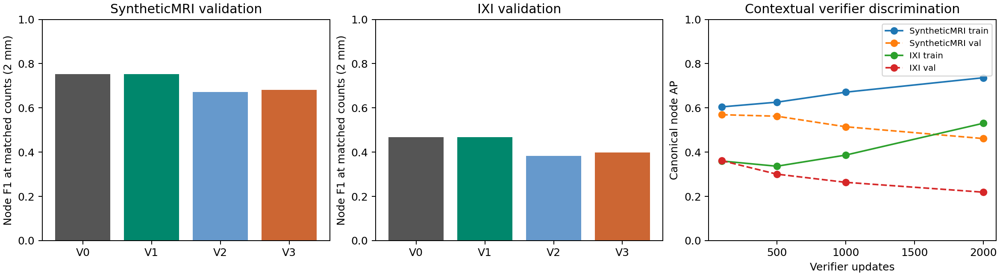

# Node verifier feasibility — 23 October 2026

Storage update (25 October): dormant NPZ predictions are retained in a verified compressed archive. [Restore instructions](../../experiments/node_verifier_feasibility/ARCHIVED_PREDICTIONS.md). Checkpoints, measured results and reconstructions remain in place.


## Scope and protocol

This is a small development experiment, with no test-set evaluation. It reuses the October 23 frozen IXI/SyntheticMRI detector populations and BRAVA D1 final checkpoint. Read alongside [October 21](EXPERIMENT_REVIEW_20261021.md), [October 22](EXPERIMENT_REVIEW_20261022.md), [October 23](EXPERIMENT_REVIEW_20261023.md), and the [research architecture](../../research/architecture.md). The older [local refinement pilot](metrics/3-ixi-node-refinement-pilot.md) moved coordinates and used early CNN samples; this experiment holds coordinates fixed and tests decoder-feature rescoring only.

The numerical evidence is in `experiments/node_verifier_feasibility/`. `protocol.json`, `jobs.json`, per-patch files and exact cached sample records accompany this report. Original results are preserved.

- V0: original object probability, default 0.5 cutoff.
- V1: original probability with training-selected threshold and spatial NMS.
- V2: independent residual object-logit rescoring.
- V3: contextual residual object-logit rescoring using five nearest predicted neighbors.

V2/V3 each have 58,129 parameters: a 64-wide decoder-token projection, shared message MLP, symmetric mean aggregation and scalar residual output initialized to zero. They take image-derived decoder embeddings, two logits, normalized coordinates, and physical neighbor offsets. V2 uses its own features in place of neighbors and zero offsets, preserving parameter count. No query IDs, GT features, degree labels, extra nodes or coordinate changes enter the model. Exact neighbor-distance ties at the fifth-neighbor boundary receive fractional weights, avoiding arbitrary query-order dependence.

Stage 1 is frozen in eval mode and features are cached once. All methods use exactly the same raw candidate population, including low-confidence queries. The unchanged relation head scores every raw pair; its orientation logits are averaged before softmax, following existing inference. New retained nodes therefore have genuine original-head edge scores. The joint detector objective, Hungarian matcher, spline head and edge loss are untouched by verifier training.

## Spatial supervision

Labels use maximum-cardinality, minimum-distance one-to-one matching within 2 mm. Canonical matched queries with only one GT anchor in range are positives. Queries farther than 3 mm from all anchors are annotation-relative negatives. A surplus query within 2 mm is a duplicate negative only when its localization error is more than 0.5 mm worse than the selected representative; its loss weight is 0.25. Other alternatives, multi-anchor ambiguity and the 2–3 mm band are ignored. Canonical positives can still have nearly equivalent ignored alternatives; these labels are an operational uniqueness convention, not anatomical certainty.

This avoids blanket Hungarian-unmatched negatives. The synthetic and IXI targets also have extraction uncertainty. BRAVA manual annotations are incomplete: annotation-unmatched candidates are not confirmed anatomical false positives. No BRAVA verifier is fitted using these negative labels.

## Baseline recovery bounds

Full saved validation populations; physical one-to-one node matching. Raw recall is the maximum recoverable node count within the tolerance, **not** achievable precision at inference. Oracle selection uses GT to retain a minimum-distance representative for each recovered node. Its graph result is illustrative for that representative choice, not an oracle maximizing edge recovery.

| Dataset | Patches | Raw recall 1 mm | Filtered recall 1 mm | Raw recall 2 mm | Filtered recall 2 mm |
|---|---:|---:|---:|---:|---:|
| IXI | 512 | 0.42162 | 0.23577 | 0.78179 | 0.49702 |
| SyntheticMRI | 480 | 0.54990 | 0.45347 | 0.87411 | 0.78601 |
| BRAVA D1 | 1,796 | 0.23748 | 0.12493 | 0.56318 | 0.34093 |

The raw-versus-filtered gap is substantial, but missing or insufficiently localized proposals also limit a coordinate-preserving verifier, especially at 1 mm. These bounds do not imply that frozen features can distinguish the right representatives.

At 2 mm, filtering loses **3,731 / 888 / 6,842 recoverable GT-node occurrences** on IXI/SyntheticMRI/BRAVA respectively (raw minus filtered one-to-one counts). It rejects 6,175 / 2,944 / 9,722 canonical valid query representatives, a larger number because a different retained query can still cover the same GT anchor. These are overlapping patch occurrences, not distinct anatomical nodes. At 1 mm the net recoverable losses are 2,435 / 972 / 3,465. Individual GT identity can change under rematching, so gross rescued/lost counts are also retained separately in `baseline.json`.

| Dataset | Correct vs duplicate confidence AUC | Correct vs annotation-unmatched AUC | Mean correct / duplicate confidence |
|---|---:|---:|---:|
| IXI | 0.62268 | 0.81099 | 0.3952 / 0.2473 |
| SyntheticMRI | 0.74636 | 0.91082 | 0.6700 / 0.2518 |
| BRAVA D1 | 0.57148 | 0.78536 | 0.4218 / 0.3300 |

These categories are defined by spatial canonical matching, independent of confidence. Changing the canonical representative among nearly coincident queries can change the category AUC without changing coverage; ambiguous cases are therefore treated separately during training.

BRAVA D1 oracle node selection gives 2-mm recall 0.56318, edge F1 0.03524 and conditional relation recall 0.06676 at the unchanged edge cutoff 0.5 (352 correct of 529 predicted edges; 5,273 GT edges have both endpoints recovered). Node selection alone cannot be assumed to repair default connectivity.

On the fixed 128-patch/eight-subject BRAVA validation monitor, training selects threshold 0.75 and NMS radius 0.5 mm. V0→V1 node precision is 0.2471→0.3100, recall 0.3246→0.2786 and F1 0.2806→0.2935 (paired F1 difference interval [+0.0049,+0.0208]). Edge F1 is 0.01558→0.01469, difference interval [−0.00406,+0.00186]. It rescues one GT occurrence while losing 101. At matched retained counts, NMS reduces node F1 to 0.2786 (difference interval [−0.00358,−0.00044]) and leaves edge F1 essentially unchanged. This is a precision/count trade-off, not evidence that duplicate suppression resolves BRAVA detection or connectivity. Full accounting is in `results/BRAVA/baseline-policy.json`.

## Small experiment and correctness

Each dataset uses the existing 256 training-monitor patches and 128 subject-disjoint validation-monitor patches: 123/26 IXI training/validation subjects and 64/13 SyntheticMRI volumes. Membership is inherited from the original plan and explicitly checked for subject overlap. Existing checkpoint-to-validation split audits are reused. V2 and V3 share initial parameter draws, minibatch order, AdamW LR 0.001, weight decay 0.0001, batch size 8 and 2,000 updates. A separate 600-update one-patch clean-label overfit check precedes each fit and is discarded. Final update 2,000 is predeclared; saved updates 100/500/1,000 are diagnostic trajectories, not validation-selected replacements.

Both datasets and both modules fitted the reliably labeled tiny patch to 100% accuracy with final weighted BCE below 4e-8. Unit tests establish identity initialization, gradients into the token projection, query correspondence for edge recovery, duplicate ambiguity handling, and permutation equivariance including tied coordinates. Trained real-feature GPU permutation error is zero for V2 and at most 7.63e-6 for V3.

Extracted coordinates and object probabilities agree **exactly** with the October 23 caches. Original retained-pair relation scores agree within 5.37e-7 (IXI) and 1.61e-6 (SyntheticMRI), the small numerical difference from scoring larger pair batches. Training uses cached detached tensors; no Stage-1 parameters or BN buffers are updated.

Thresholds are selected on training node F1 from 0.05:0.05:0.95; NMS radii are 0/0.5/1/2 mm. The same policy search is available to V1/V2/V3. Matched-count comparisons retain exactly V0's count on each patch; NMS ranks unsuppressed candidates first and fills from suppressed candidates if necessary. This isolates ranking at the same per-patch budget. The matched-precision PR envelope is descriptive and uses validation labels to locate operating points; it is **not** a deployable threshold policy. Actual attained precision and thresholds are retained. Edge cutoff remains 0.5 for every policy.

Paired 95% percentile intervals use 1,000 subject bootstrap draws with seed 231023. They quantify development-subject uncertainty, not training-seed uncertainty. Brier/ECE and reliable AUC use the explicitly supervised subset; canonical AP and correct/duplicate AUC use all raw candidates.



[Exportable figure PDF](evidence/node_verifier_feasibility/feasibility.pdf). Paired uncertainty is tabulated below.

<!-- RESULTS -->
## Completed result and decision

**Decision: revise verifier supervision/training before considering any end-to-end fine-tuning. Keep V1 as the operational control; do not expand the architecture or launch longer training.** The tested contextual verifier fails the main feasibility criterion on both datasets. It improves some metrics over independent rescoring, but is substantially worse than original/calibrated classification at matched counts and matched precision. This is a negative result for the present frozen-decoder-feature recipe, not proof that all contextual verification is impossible.

The first discriminative experiments therefore do not pass the transfer gate: no BRAVA V2/V3 transfer inference or verifier training was launched. BRAVA D1 still receives full cached recovery analysis and a cached V0/V1 comparison; its independent unfrozen detector learnability tests completed below.

### Training-calibrated inference, 2 mm

128 validation patches per dataset. Rescued/lost counts compare unique spatial GT coverage with V0 on the same patch; rescuing some anchors while losing many more is not a net improvement.

|Dataset|Arm|Precision|Recall|F1|Duplicates / retained|Rescued / lost|
|---|---|---|---|---|---|---|
|SyntheticMRI|V0|0.7266|0.7804|0.7525|0.0415|0/0|
|SyntheticMRI|V1|0.7701|0.7568|0.7634|0.0225|0/64|
|SyntheticMRI|V2|0.7085|0.6475|0.6767|0.0153|42/403|
|SyntheticMRI|V3|0.7340|0.6354|0.6811|0.0102|28/422|
|IXI|V0|0.4550|0.4812|0.4677|0.1012|0/0|
|IXI|V1|0.4769|0.4620|0.4693|0.0952|0/70|
|IXI|V2|0.4379|0.2893|0.3484|0.0615|112/811|
|IXI|V3|0.4298|0.3179|0.3655|0.0768|147/742|

Selected node thresholds and NMS radii:

|Dataset|Arm|Threshold|NMS mm|
|---|---|---|---|
|SyntheticMRI|V0|0.5000|0|
|SyntheticMRI|V1|0.8500|0.0|
|SyntheticMRI|V2|0.6500|2.0|
|SyntheticMRI|V3|0.6000|2.0|
|IXI|V0|0.5000|0|
|IXI|V1|0.7000|0.0|
|IXI|V2|0.4500|1.0|
|IXI|V3|0.3500|1.0|

For original scores, training chooses **no NMS** on both datasets. Threshold calibration slightly improves node F1 while reducing recall; SyntheticMRI edge F1 also improves, IXI edge F1 decreases. The paired V1−V0 node-F1 intervals are [+0.0069, +0.0146] (SyntheticMRI) and [-0.0016, +0.0052] (IXI). Thus simple suppression was tested but was not the training-selected best policy for either original detector.

### Equal retained-node counts, 2 mm

Every method retains exactly V0's per-patch predicted count. V1 and V0 have identical rankings because V1 selected radius zero; changing a scalar threshold cannot improve a matched-count ranking.

|Dataset|Arm|Retained|Recall|F1|Duplicates / retained|Rescued / lost|
|---|---|---|---|---|---|---|
|SyntheticMRI|V0|2919|0.7804|0.7525|0.0415|0/0|
|SyntheticMRI|V1|2919|0.7804|0.7525|0.0415|0/0|
|SyntheticMRI|V2|2919|0.6961|0.6713|0.0226|52/281|
|SyntheticMRI|V3|2919|0.7057|0.6805|0.0202|48/251|
|IXI|V0|3853|0.4812|0.4677|0.1012|0/0|
|IXI|V1|3853|0.4812|0.4677|0.1012|0/0|
|IXI|V2|3853|0.3939|0.3829|0.0838|197/515|
|IXI|V3|3853|0.4104|0.3989|0.0898|222/480|

Context has a modest benefit over V2 on IXI, but both learned scorers lose substantial recall relative to V1. Fewer duplicates alone do not establish useful verification.

### Unchanged-relation graph outcomes, 2 mm

The first four metrics use training-calibrated node selection. The last uses matched node counts. Relation probabilities and their 0.5 cutoff are unchanged throughout.

|Dataset|Arm|Edge F1|Conditional recall|Component MAE|Cycle MAE|Matched-count edge F1|
|---|---|---|---|---|---|---|
|SyntheticMRI|V0|0.4455|0.7621|2.6484|1.6953|0.4455|
|SyntheticMRI|V1|0.4599|0.7724|2.8672|0.8984|0.4455|
|SyntheticMRI|V2|0.3094|0.6430|4.9531|1.1094|0.3093|
|SyntheticMRI|V3|0.3214|0.6549|4.8828|0.6953|0.3273|
|IXI|V0|0.0513|0.1127|19.1250|0.9531|0.0513|
|IXI|V1|0.0461|0.1037|17.7578|0.8203|0.0513|
|IXI|V2|0.0139|0.0684|11.2188|0.7812|0.0215|
|IXI|V3|0.0131|0.0535|13.0781|0.9375|0.0195|

Lower component/cycle errors at a more restrictive threshold can accompany fewer recovered nodes and edges. Under matched counts V3 does not repair graph connectivity; it increases component error relative to V1 in both datasets.

### Paired subject uncertainty

95% intervals for differences (0–1 scale). Precision-envelope intervals condition on the descriptively selected validation thresholds and do not include their selection uncertainty. All intervals omit training-seed variation.

|Dataset|Comparison|Policy|Recall difference|Node F1 difference|Edge F1 difference|
|---|---|---|---|---|---|
|SyntheticMRI|V3−V1|calibrated_2.0|[-0.1336, -0.1082]|[-0.0933, -0.0701]|[-0.1535, -0.1233]|
|SyntheticMRI|V3−V1|matched_count_2.0|[-0.0844, -0.0655]|[-0.0819, -0.0629]|[-0.1318, -0.1062]|
|SyntheticMRI|V3−V1|precision_envelope_2.0|[-0.1478, -0.1231]|[-0.0809, -0.0578]|[-0.1390, -0.0992]|
|SyntheticMRI|V3−V2|calibrated_2.0|[-0.0261, +0.0019]|[-0.0094, +0.0176]|[-0.0072, +0.0310]|
|SyntheticMRI|V3−V2|matched_count_2.0|[-0.0011, +0.0211]|[-0.0011, +0.0203]|[+0.0033, +0.0335]|
|SyntheticMRI|V3−V2|precision_envelope_2.0|[+0.0102, +0.0411]|[+0.0000, +0.0284]|[+0.0005, +0.0437]|
|IXI|V3−V1|calibrated_2.0|[-0.1623, -0.1271]|[-0.1183, -0.0901]|[-0.0420, -0.0243]|
|IXI|V3−V1|matched_count_2.0|[-0.0831, -0.0588]|[-0.0810, -0.0563]|[-0.0418, -0.0222]|
|IXI|V3−V1|precision_envelope_2.0|[-0.2457, -0.2143]|[-0.1573, -0.1286]|[-0.0534, -0.0325]|
|IXI|V3−V2|calibrated_2.0|[+0.0142, +0.0435]|[+0.0023, +0.0310]|[-0.0056, +0.0050]|
|IXI|V3−V2|matched_count_2.0|[+0.0065, +0.0267]|[+0.0064, +0.0256]|[-0.0083, +0.0055]|
|IXI|V3−V2|precision_envelope_2.0|[-0.0332, -0.0020]|[-0.0291, +0.0009]|[-0.0098, -0.0006]|

### Matched precision: descriptive PR envelope

The common target is V0's validation precision. All learned operating points attain that target within 0.0013 absolute precision on the 0.005 threshold grid. They use validation labels only to measure the PR envelope, never to claim an achievable calibrated policy.

|Dataset|Arm|Target precision|Attained precision|Recall|Threshold|
|---|---|---|---|---|---|
|SyntheticMRI|V0|0.7266|0.7266|0.7804|0.5000|
|SyntheticMRI|V1|0.7266|0.7266|0.7804|0.5000|
|SyntheticMRI|V2|0.7266|0.7278|0.6188|0.8150|
|SyntheticMRI|V3|0.7266|0.7267|0.6446|0.4900|
|IXI|V0|0.4550|0.4550|0.4812|0.5000|
|IXI|V1|0.4550|0.4550|0.4812|0.5000|
|IXI|V2|0.4550|0.4554|0.2690|0.5600|
|IXI|V3|0.4550|0.4556|0.2523|0.6600|

V3 loses recall versus V1 even when precision is matched. IXI V3 also trails V2 at this operating point, despite its positive matched-count node-F1 difference. There is no consistent contextual ranking advantage across operating conditions.

### Strict localization and oracle bounds on the same pilot patches

Achievable matched-count results at 1 mm:

|Dataset|Arm|Recall 1 mm|Node F1 1 mm|Edge F1 1 mm|
|---|---|---|---|---|
|SyntheticMRI|V0|0.4397|0.4240|0.1334|
|SyntheticMRI|V1|0.4397|0.4240|0.1334|
|SyntheticMRI|V2|0.3797|0.3662|0.0926|
|SyntheticMRI|V3|0.3801|0.3665|0.0914|
|IXI|V0|0.2265|0.2201|0.0113|
|IXI|V1|0.2265|0.2201|0.0113|
|IXI|V2|0.1820|0.1769|0.0036|
|IXI|V3|0.1864|0.1812|0.0053|

GT-dependent oracle node selection, reported separately:

|Dataset|Tolerance mm|Oracle node recall|Oracle node F1|Unchanged-head edge F1|Conditional relation recall|
|---|---|---|---|---|---|
|SyntheticMRI|1.0|0.5368|0.6986|0.2263|0.5265|
|SyntheticMRI|2.0|0.8705|0.9308|0.5126|0.4820|
|IXI|1.0|0.4065|0.5781|0.0435|0.1154|
|IXI|2.0|0.7604|0.8639|0.0963|0.0829|

These are **candidate-selection bounds**, not attainable detector/verifier results. The minimum-distance node oracle is not optimized for relation recovery and can choose a different duplicate query than the relation head learned to connect.

### Training versus validation discrimination and calibration

AP uses all canonical spatial labels; reliable AUC and Brier/ECE use only supervised queries. Brier/ECE are for the raw scorer probabilities, before NMS. The V1 threshold sweep does not perform temperature/probability calibration.

|Dataset|Arm|AP train / val|Reliable AUC train / val|Val correct/duplicate AUC|Val Brier|Val ECE|
|---|---|---|---|---|---|---|
|SyntheticMRI|V0|0.5955/0.5606|0.9163/0.9015|0.7386|0.0957|0.0875|
|SyntheticMRI|V1|0.5955/0.5606|0.9163/0.9015|0.7386|0.0957|0.0875|
|SyntheticMRI|V2|0.6919/0.4376|0.9963/0.8910|0.6708|0.1160|0.1078|
|SyntheticMRI|V3|0.7362/0.4614|0.9982/0.9055|0.6778|0.1122|0.1046|
|IXI|V0|0.3080/0.3103|0.8045/0.7759|0.6294|0.0760|0.0703|
|IXI|V1|0.3080/0.3103|0.8045/0.7759|0.6294|0.0760|0.0703|
|IXI|V2|0.4872/0.2187|0.9941/0.7818|0.5560|0.0689|0.0683|
|IXI|V3|0.5304/0.2191|0.9970/0.7746|0.5431|0.0705|0.0700|

Training reliable AUC approaches 1, whereas validation canonical AP falls below the original detector. Tiny-set fitting and nonzero gradients rule out basic implementation/optimization failure. Lower IXI Brier despite lower canonical AP/coverage illustrates why calibration alone is not the success criterion under strong negative prevalence and ignored ambiguity.

Early-checkpoint validation trajectories below use raw scorer ranking **without NMS**, at V0's fixed per-patch node count, so their final rows differ from the NMS-assisted primary comparison. No early checkpoint is substituted for the predeclared final result.

|Dataset|Arm|Update|Count-matched F1, no NMS|Canonical AP|Reliable AUC|
|---|---|---|---|---|---|
|SyntheticMRI|V2|100|0.7266|0.5688|0.9282|
|SyntheticMRI|V2|500|0.7029|0.5614|0.9261|
|SyntheticMRI|V2|1000|0.6482|0.5086|0.9094|
|SyntheticMRI|V2|2000|0.6351|0.4376|0.8910|
|SyntheticMRI|V3|100|0.7234|0.5692|0.9286|
|SyntheticMRI|V3|500|0.7060|0.5624|0.9272|
|SyntheticMRI|V3|1000|0.6557|0.5148|0.9151|
|SyntheticMRI|V3|2000|0.6457|0.4614|0.9055|
|IXI|V2|100|0.4680|0.3417|0.8290|
|IXI|V2|500|0.4442|0.2996|0.8302|
|IXI|V2|1000|0.4229|0.2585|0.8064|
|IXI|V2|2000|0.3850|0.2187|0.7818|
|IXI|V3|100|0.4640|0.3614|0.8372|
|IXI|V3|500|0.4384|0.3005|0.8374|
|IXI|V3|1000|0.4168|0.2636|0.8166|
|IXI|V3|2000|0.3925|0.2191|0.7746|

### What failed: proposals, features, or context?

1. **Proposal insufficiency is real but does not explain the learned degradation.** Full-population raw recall caps any fixed-coordinate verifier at 0.7818 IXI / 0.8741 SyntheticMRI at 2 mm and 0.4216/0.5499 at 1 mm. However, V0/V1 recover substantially more nodes than the learned verifiers from the exact same candidates. V3's loss relative to V1 is a selection failure within that recoverable population.
2. **The decoder features contain some useful signal.** IXI V3 canonical validation AP initially rises from V0's 0.3103 to 0.3614 at update 100; reliable AUC also improves early. A claim that frozen embeddings contain no relevant information is contradicted by these early discrimination results. They do not produce a matched-count coverage improvement.
3. **The present supervision/optimization does not preserve useful inference ranking.** Approximately 22–24% of queries are ignored by the ambiguity rules. Excellent fit on the reliable subset does not imply appropriate scores for ignored alternatives or selection of relation-compatible representatives. Both learned scorers overfit; canonical AP degrades as training discrimination rises. This suggests a label/coverage-objective and generalization issue worth inspecting before more training, rather than a need for a larger context module. The experiment does not causally separate label choice from feature generalization.
4. **Context is insufficient, not universally information-free.** It gives a positive IXI matched-count V3−V2 node-F1 interval and a SyntheticMRI edge-F1 improvement over V2, but fails decisively against V1. Extra architectural capacity or longer unfrozen runs are not supported. This is not a “works on SyntheticMRI, fails on IXI” outcome: the primary criterion fails on both.
5. **Relations remain an independent limitation.** Even GT-dependent node selection leaves low conditional relation recovery on IXI/BRAVA at the unchanged cutoff. Rescoring a different representative can also reduce recovered edges; the verifier must be judged on graph outcomes, not just reliable-query classification.

<!-- END RESULTS -->

## BRAVA learnability protocol

Eight fixed training patches from eight subjects, selected only by target count (5–25 nodes, at least three edges), are shared by scratch and IXI initialization. The full detector is unfrozen for 512 updates, batch size 4, with augmentation disabled so this is a learnability check. LR is 3.5e-5 for the encoder and 7e-5 elsewhere. Node CE weights remain `[0.25,0.75]`; edge CE uses equal weights and the existing candidate policy. K8 geometry and its `graph_only` gradient route are unchanged. The October 23 recovery used edge **focal**, so this CE test is explicitly a separate diagnostic, not an exact continuation of that loss configuration.

Monitors at 0/16/64/128/256/512 inspect raw and filtered node recovery, spatial-oracle selection with unchanged relations, Hungarian distances and assignment churn, assigned/unassigned confidence, localization gradients into the coordinate head/backbone/decoder, and BN running-statistic drift. Paired train/eval-mode monitors use identical batches and restore all buffers afterward. Conditional relation recovery is reported both for spatially recovered endpoints and for localized Hungarian GT-positive pairs. These are training-subset results, not generalization evidence or complete anatomical annotation validation.

<!-- BRAVA -->
Both 512-update runs completed. These eight patches contain 100 annotated nodes and 55 edges.

| Initializer / update | Raw recall 2 mm | Filtered recall 2 mm | Node F1 | Edge F1 | Hungarian mean distance mm |
|---|---:|---:|---:|---:|---:|
| Scratch / 0 | 0.000 | 0.000 | 0.000 | 0.000 | 23.461 |
| Scratch / 128 | 0.130 | 0.120 | — | 0.000 | 5.262 |
| Scratch / 256 | 0.680 | 0.630 | 0.6058 | 0.3119 | 2.025 |
| Scratch / 512 | 0.930 | 0.930 | 0.8986 | 0.8393 | 0.886 |
| IXI / 0 | 0.650 | 0.130 | — | 0.000 | 3.452 |
| IXI / 64 | 0.950 | 0.920 | — | 0.6739 | 0.896 |
| IXI / 256 | 0.990 | 0.990 | 0.9900 | 0.9636 | 0.409 |
| IXI / 512 | 0.990 | 0.990 | 0.9900 | 0.9818 | 0.330 |

All rows above use **eval mode**, including saved BN statistics. Scratch's final train-mode recall/edge F1 is 0.980/0.9273 versus eval 0.930/0.8393; IXI's is 0.990/0.9725 versus eval 0.990/0.9818. BN mode has a measurable scratch inference effect, but this is not a BN-training intervention and does not establish BN as the cause of the historical failure. Mean RMS running-buffer change is 0.794 scratch / 0.324 IXI (descriptive, scale-dependent).

Final assigned/unassigned object probabilities are 0.9835/0.00370 for scratch and 0.9980/0.000315 for IXI. Scratch assignment churn drops from 0.98 at update 16 to 0.06 at 512; IXI drops from 0.73 to 0.02. These compare successive monitor assignments, whose update spacings differ; they are not per-update switch rates. Final Hungarian mean/median distances are 0.886/0.554 mm (scratch) and 0.330/0.284 mm (IXI).

Localization gradients are finite and nonzero in all three inspected components. At update 1, coordinate-head / encoder / decoder L2 norms are 1.30/12.34/54.10 (scratch) and 0.99/4.06/2.69 (IXI); all remain nonzero at 512. Full loss and gradient records are in `complete.json`. Thus missing localization gradients or a disconnected optimization path do not explain this tiny-set behavior.

At 512, default conditional relation recall among spatially recovered endpoints is 0.940 scratch / 1.000 IXI. Among localized Hungarian GT-positive pairs it is 0.9796 (49 pairs) / 0.9630 (54 pairs). Both node localization and relation fitting are learnable on this fixed subset. Spatial and Hungarian assignments can select different equivalent queries, so their conditional numbers need not coincide.

**Before or after filtering?** Scratch's initial and early tiny-set failure is overwhelmingly before filtering (raw recall 0.00/0.03/0.13 at 0/64/128). At 512 there is no raw-versus-filtered recall gap. The historical full-population D3 remains poor before filtering too (raw recall 0.31264), with another large filtering loss (filtered 0.10557). That historical run is therefore **not solely a threshold failure**. Conversely, zero-shot IXI on these eight BRAVA patches starts with a much larger filtering gap (0.65→0.13), and the short unfrozen fit repairs both confidence and localization.

The clean-subset success rules out an inherent inability of this architecture/objective implementation to memorize the selected BRAVA targets. It does **not** distinguish full-population heterogeneity, augmentation, annotation incompleteness, source bias, or focal-versus-CE optimization as causes of the old run. No longer scratch run is justified by this result alone, and none was launched.
<!-- END BRAVA -->

## Reproduction and artifacts

Run from `Graph-Native-Betti-Matching-Representation` with the repository's Jean Zay PyTorch environment. GPU wrappers stage dependencies into node-local `/tmp/node-verifier-$SLURM_JOB_ID`. Initial attempts 1483320/1483324 failed before inference while unpacking runtime packages into the workspace (quota exceeded); only their temporary runtime copies were removed. No experiment results were deleted.

```bash
python -m unittest tests.test_node_verifier -v
python scripts/node_verifier_feasibility.py baseline
sbatch cluster/jean_zay/node_verifier_gpu.slurm verifier SyntheticMRI
sbatch cluster/jean_zay/node_verifier_gpu.slurm verifier IXI
python scripts/node_verifier_feasibility.py evaluate --dataset SyntheticMRI
python scripts/node_verifier_feasibility.py evaluate --dataset IXI
python scripts/node_verifier_feasibility.py brava-policy
sbatch cluster/jean_zay/node_verifier_gpu.slurm brava scratch
sbatch cluster/jean_zay/node_verifier_gpu.slurm brava ixi_spline
python scripts/report_node_verifier.py
```

Do not submit all four GPU commands concurrently: actual BRAVA jobs depend on both verifier jobs, limiting use to two H100s. No long training, architecture expansion, loss-weight sweep, new geometry experiment or end-to-end verifier training was launched.

| Job | Work | State / elapsed |
|---|---|---|
| 1483320 / 1483324 | Initial runtime staging | Failed before inference / 25 s each |
| 1483623 | SyntheticMRI extraction + V2/V3 fits | Completed / 2m09s |
| 1483624 | IXI extraction + V2/V3 fits | Completed / 2m09s |
| 1483632 | BRAVA scratch, 512 updates | Completed / 1m33s |
| 1483633 | BRAVA IXI initialization, 512 updates | Completed / 1m31s |

BRAVA submissions used `--dependency=afterany:1483623:1483624`. All completed jobs exited 0. CPU aggregation was restarted after caching invariant NMS rankings across threshold sweeps; this changes runtime only. All trained weights and predictions were reused.

Exact source checkpoints:

```text
IXI:
/lustre/fsn1/projects/rech/vnc/upz25mj/experiments/gnbm/spline_learning/ixi_transfer_20261015/runs/ixi_delayed_spline/best.pt
SyntheticMRI:
/lustre/fsn1/projects/rech/vnc/upz25mj/experiments/gnbm/spline_learning/plant_generalization_20261014_da_b32_w1_restart/runs/vessels_spline/best.pt
BRAVA D1 (cached baseline):
/lustre/fsn1/projects/rech/vnc/upz25mj/experiments/gnbm/multidataset_continuous_20261022/runs/D1_IXI/model-030000.pt
```

Physical neighbor positions use the image's affine/spacing metadata (stored alongside targets for convenience), not GT-derived anatomical features. Stage-1 checkpoint and population hashes remain in the source plan; new code hashes and exact controls are in `protocol.json`.

- Source plan and exact detector checkpoint paths/hashes: `experiments/multidataset_continuous/plan.json`.
- New config: `experiments/node_verifier_feasibility/protocol.json`; resolved BRAVA configs: `brava/{scratch,ixi_spline}/config.json` under that root.
- Extracted features and exact input records: `cache/{IXI,SyntheticMRI,BRAVA}/complete.json` (BRAVA only if the transfer diagnostic is run).
- Verifier checkpoints: `runs/{IXI,SyntheticMRI}/{V2,V3}-{100,500,1000,2000}.pt`.
- Training and tiny-fit evidence: `runs/<dataset>/training.json` and `*-overfit.json`.
- Metrics and per-subject resampling inputs: `results/<dataset>/{summary,patches}.json`; PR curves: `V*-pr.json`.
- BRAVA weights and diagnostics: `brava/<initializer>/{model-000512.pt,monitor.json,complete.json}`.
- Scheduler history: `jobs.json`; logs: `logs/<jobid>.{out,err}`.

## Limitations

One seed, small training population and development validation only. Spatial supervision has reference uncertainty and ignores ambiguous candidates; high tiny-set accuracy does not certify anatomical truth. This minimal verifier does not sample early high-resolution CNN neighborhoods, so a negative result concerns contextual reasoning over the existing decoder features, not every possible image-conditioned verifier. Matched-count ranking uses V0's predicted counts, not GT counts. Precision-envelope points are explicitly descriptive. Graph metrics here are physical node/edge precision–recall, endpoint-conditioned relation recovery and component/cycle errors; no new spline/Curve-F1 experiment is implied. Bootstrap intervals do not cover training randomness or the full adaptive research history.
