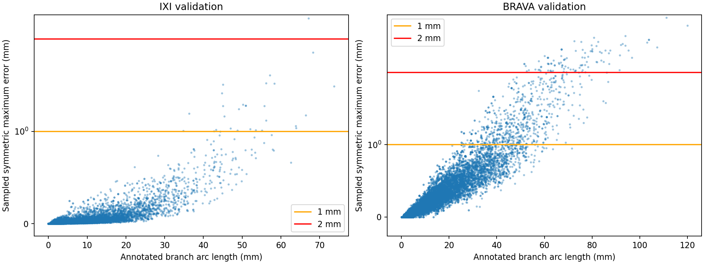

# IXI and BRAVA — adequacy of actual 8-control spline targets

GT-only analysis of the complete prepared training and validation populations; no test targets, GPU inference or training. Existing targets and graph anchors were not changed.

## Metrics and numerical precision

Distances are to the **corresponding original dense branch**, in physical millimetres, in both directions. This prevents nearby unrelated vessels from hiding errors. Shortcutting appears in dense→spline distances; overshoot appears in spline→dense distances. Uniform arc sampling is0.1 mm; all vertices are also included in maximum-distance checks. Cubic splines are adaptively tessellated to a0.01-mm Hausdorff error bound. The true continuous symmetric maximum is bounded by `[sampled maximum −0.01, sampled maximum +0.06]` mm (lower bound clipped to zero). Threshold exceedance is labelled definite only when the lower bound exceeds the threshold; borderline cases are reported separately. Mean/P95 and coverage are arc-sampled numerical approximations.

Same-edge Curve F1 is a geometry-only diagnostic, not the whole-graph common-v2 score: each spline is evaluated only against its own branch. Topology/anchors are fixed GT, so connectivity scores would be tautological.

## Actual cached K=8 targets

|Dataset|Split|Patches|Branches|Median max mm|P95 max mm|Worst max mm|Definitely >1 mm|Definitely >2 mm|Same-edge Curve F1 at1 mm|
|---|---|---:|---:|---:|---:|---:|---:|---:|---:|
|BRAVA|train|8768|93248|0.183|1.022|4.999|5.16%|0.86%|0.9749|
|BRAVA|val|1796|19446|0.178|1.011|5.259|5.01%|0.70%|0.9767|
|IXI|train|10000|184726|0.009|0.164|3.813|0.19%|0.01%|0.9980|
|IXI|val|2649|51937|0.009|0.149|2.659|0.18%|0.00%|0.9986|

|Dataset|Split|Patches with any definite >1-mm branch error|Patches with any definite >2-mm branch error|
|---|---|---:|---:|
|BRAVA|train|35.03%|7.82%|
|BRAVA|val|35.86%|6.85%|
|IXI|train|3.35%|0.22%|
|IXI|val|3.32%|0.04%|

## Length dependence

|Dataset|Split|Arc-length interval mm|Branches|P95 maximum mm|Definitely >1 mm|Definitely >2 mm|
|---|---|---|---:|---:|---:|---:|
|BRAVA|train|0–10|43475|0.193|0.00%|0.00%|
|BRAVA|train|10–25|32396|0.596|0.04%|0.00%|
|BRAVA|train|25–50|14455|1.281|15.14%|0.11%|
|BRAVA|train|50–100|2897|2.861|89.13%|26.13%|
|BRAVA|train|100–∞|25|4.950|100.00%|100.00%|
|BRAVA|val|0–10|9133|0.183|0.00%|0.00%|
|BRAVA|val|10–25|6722|0.577|0.00%|0.00%|
|BRAVA|val|25–50|3009|1.261|15.25%|0.03%|
|BRAVA|val|50–100|576|2.923|88.37%|22.57%|
|BRAVA|val|100–∞|6|5.091|100.00%|100.00%|
|IXI|train|0–10|144962|0.036|0.00%|0.00%|
|IXI|train|10–25|32490|0.219|0.00%|0.00%|
|IXI|train|25–50|6897|0.827|1.94%|0.00%|
|IXI|train|50–100|377|2.192|58.09%|6.10%|
|IXI|val|0–10|41428|0.035|0.00%|0.00%|
|IXI|val|10–25|8660|0.210|0.00%|0.00%|
|IXI|val|25–50|1752|0.806|2.00%|0.00%|
|IXI|val|50–100|97|1.867|58.76%|1.03%|

## Diagnostic additional controls

Only the predefined subset below was refitted; it is enriched for difficult branches and does **not** estimate population prevalence. Fits use the unchanged production endpoint-constrained least-squares procedure with257 arc-length fitting samples and the same anchors/connectivity. K=8 replay differences are retained to distinguish fit reproduction from capacity changes. These are target fits, not trained model comparisons.

|Dataset|Split|Controls|Diagnostic branches|Median maximum mm|P95 maximum mm|
|---|---|---:|---:|---:|---:|
|BRAVA|train|8|137|1.978|4.413|
|BRAVA|train|12|137|0.922|2.291|
|BRAVA|train|16|137|0.687|1.448|
|BRAVA|val|8|72|2.910|3.658|
|BRAVA|val|12|72|1.483|2.356|
|BRAVA|val|16|72|0.902|1.397|
|IXI|train|8|128|0.951|2.524|
|IXI|train|12|128|0.293|1.093|
|IXI|train|16|128|0.144|0.661|
|IXI|val|8|90|1.238|1.874|
|IXI|val|12|90|0.392|0.848|
|IXI|val|16|90|0.201|0.455|

## Requested BRAVA example: sample_000002_0222

This example is **already a64³ training patch**, not a whole-brain fit. Its longest branches remain long within the crop. All its edges are included in the diagnostic refits.

|Edge|Original arc mm|Sampled maximum mm|Mean symmetric mm|Dense coverage at1 mm|
|---|---:|---:|---:|---:|
|14|82.11|2.930|0.933|0.6051|
|18|76.66|1.406|0.591|0.8477|
|1|67.80|1.318|0.506|0.9072|
|32|57.72|1.044|0.415|0.9896|
|25|55.82|2.448|0.618|0.8357|
|8|46.65|0.634|0.235|1.0000|
|24|36.90|0.595|0.214|1.0000|
|7|27.57|0.551|0.111|1.0000|

## Subject-level uncertainty

Equal weight per subject;1,000 subject-bootstrap resamples. These values need not equal the edge-weighted population table.

|Dataset|Split|Metric|Subject mean|95% interval|
|---|---|---|---:|---|
|BRAVA|train|fraction_definite_exceed_1p0|0.05285|[0.04906, 0.05709]|
|BRAVA|train|fraction_definite_exceed_2p0|0.00894|[0.00749, 0.01047]|
|BRAVA|train|mean_symmetric_distance_mm|0.09306|[0.08995, 0.09613]|
|BRAVA|val|fraction_definite_exceed_1p0|0.05031|[0.04535, 0.05634]|
|BRAVA|val|fraction_definite_exceed_2p0|0.00662|[0.00485, 0.00891]|
|BRAVA|val|mean_symmetric_distance_mm|0.09006|[0.08579, 0.09384]|
|IXI|train|fraction_definite_exceed_1p0|0.00200|[0.00171, 0.00232]|
|IXI|train|fraction_definite_exceed_2p0|0.00013|[0.00007, 0.00021]|
|IXI|train|mean_symmetric_distance_mm|0.01179|[0.01140, 0.01220]|
|IXI|val|fraction_definite_exceed_1p0|0.00169|[0.00104, 0.00243]|
|IXI|val|fraction_definite_exceed_2p0|0.00001|[0.00000, 0.00004]|
|IXI|val|mean_symmetric_distance_mm|0.01085|[0.01007, 0.01164]|

## Interpretation and limitations

Use the all-population error prevalence and long-branch strata together: good average coverage can coexist with severe local shortcuts. An edge exceeding a chosen maximum-error tolerance demonstrates approximation loss in that cached target before model learning. It does not prove that every8-control fit is inadequate or that extra controls will be easy for the network to learn. Reduced error after12/16-control refits supports additional geometric capacity on those branches, not improved learned graph reconstruction. A non-monotonic refit error is possible because this is least squares, not minimax fitting, and knot grids differ.

Patches overlap and the same anatomical branch may recur; counts describe **patch-edge occurrences**, not independent anatomical vessels. Per-subject summaries and1,000-resample subject-bootstrap intervals avoid treating patches as independent subjects; they do not capture training-seed uncertainty. IXI extracted guides and BRAVA manual traces differ in provenance and possible annotation noise. Total turning angle depends on source discretization; use it alongside tortuosity and length. No vessel segmentation is read. No claim about optimal query budget or a changed architecture follows from this GT-only analysis.

## Reproduction

`python3 scripts/analyze_spline_target_capacity.py collect --root /lustre/fsn1/projects/rech/vnc/upz25mj/experiments/gnbm/spline_target_capacity_20261022-102555`

Lightweight results: `python3 scripts/analyze_spline_target_capacity.py show --root /lustre/fsn1/projects/rech/vnc/upz25mj/experiments/gnbm/spline_target_capacity_20261022-102555`.
