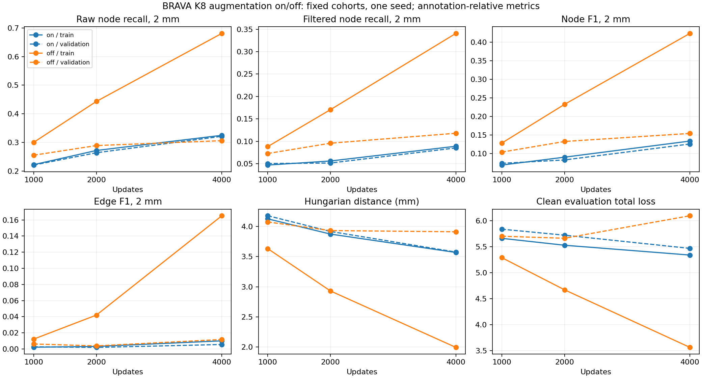

## D07: controlled original-K8 augmentation on/off — 27 October 2026

Disabling augmentation improves representative training reconstruction on node and edge F1. Validation node F1 improves modestly, but the edge-F1 gain is uncertain across subjects (its paired 95% interval includes zero). Validation raw 2-mm localization recall decreases and Hungarian distance worsens. The much larger train gain, declining clean training loss and worse final validation loss are consistent with increased memorization/overfitting; this is not a broadly improved or recovered detector. The matched comparison supports an optimization cost of this augmentation regime under the fixed budget, while one seed and reused development subjects limit the generalization claim. Connectivity remains weak in both training arms and on validation. Recommended follow-up, not launched: separately isolate exposure/training budget with a predefined schedule, or assignment/optimization with fixed exposure; change one factor at a time and retain the generalization gap as an explicit endpoint.

Final off−on train node/edge F1: +0.2908/+0.1551; validation: +0.0285/+0.0062. These are annotation-relative graph errors against incomplete SWC traces. Brain masks are not vessel masks.

**Execution and evaluation recovery.** Smoke 1600406 passed. Both training tasks in array 1612527 reached 4,000 updates and saved net/optimizer, then exited with the final batch-parity assertion; initial collector 1612529 was cancelled. Inference-only job 1612855 recovered the final saved checkpoints with **zero optimizer updates**, followed by CPU collector 1612856. Failed logs and the original checker source are preserved. Complete image-stream hashes were not written before that failure; patch order is reconstructed exactly from the frozen deterministic runner and saved plan, rather than represented as a recovered live hash. Primary evaluation stays at batch eight. The batch-one/eight audit covers the first eight fixed patches per population per arm: maximum coordinate drift 0.140169 mm, node-score drift 0.000308961, relation-score drift 0.00502178; node/relation 0.5-threshold crossings across this audit: 0/21. This is measured numerical drift, not exact batch-size invariance.

**Matched protocol.** Fresh K8-only control and treatment use the identical clean SyntheticMRI source, 1,248 training patches/39 subjects, fixed seed 261039, batch eight, patch order, fully trainable active detector/relation parameters, node focal gamma 2, established edge CE, AdamW and 4,000-update warmup/cosine schedule. Backbone LR 3.5e-5, other parameters 7e-5, 100-step warmup, 30% floor. `graph_only` spline route; no K24/C1/split/refinement/relation variants. Saved BN, clean inputs, batch eight and unchanged 0.5 node/edge thresholds are used for evaluation at exactly 1k/2k/4k. All targets, matching and physical metric functions are unchanged.

The historical augmentation-on run included auxiliary geometry heads, so whole-run exact parity was not established and it was not reused as the causal control. Both new arms remove those heads. Existing augmentation is three independent quarter-turn draws and Gaussian noise (probability 0.35, maximum standard deviation 0.015). The off loader draws and discards that transform before returning the clean image/target, preserving Python/NumPy/Torch RNG state for stochastic loss sampling. Smoke checks verified exact clean inputs and identical post-loader RNG, finite backward passes, and zero geometry-to-detector gradients. Initial parameter hashes match, and both arms use the identical deterministic patch stream recorded in `training-patch-stream.jsonl.gz` (32,000 draws; 25 or 26 per patch).

Source checkpoint: `/lustre/fswork/projects/rech/vnc/upz25mj/projects/Graph-Native-Betti-Matching-Representation/experiments/fine_feature_architecture/runs/baseline/best.pt`; SHA256 `d4bc78ad3eb7c1c29c9be8ec3e2927e88f2f45e6f34a3cb8be9ade5fd9d2431c`. Full checkpoint paths/hashes: `experiments/brava_augmentation_20261026/analysis.json` → `checkpoint_provenance`. Source snapshot, target/manifest hashes, plans, Slurm jobs, losses and all prediction caches are isolated under `experiments/brava_augmentation_20261026`.

| Updates | Population | Aug | Raw R1 / R2 | Filtered R1 / R2 | Node / edge F1 (2mm) | Hungarian mm | Relation recall / AP (2mm) |
|---:|---|---|---|---|---|---:|---|
|1000|representative_train|on|0.0549 / 0.2225|0.0098 / 0.0469|0.0685 / 0.0022|4.128|0.2000 / 0.4119|
|1000|representative_train|off|0.0768 / 0.3004|0.0246 / 0.0882|0.1278 / 0.0123|3.633|0.4444 / 0.3969|
|1000|validation|on|0.0536 / 0.2211|0.0129 / 0.0503|0.0732 / 0.0027|4.180|0.2500 / 0.4707|
|1000|validation|off|0.0646 / 0.2555|0.0199 / 0.0728|0.1035 / 0.0062|4.076|0.3333 / 0.3942|
|1000|tiny_reference|on|0.0448 / 0.3035|0.0000 / 0.0398|0.0661 / 0.0000|3.330|0.0000 / 0.5000|
|1000|tiny_reference|off|0.0846 / 0.3184|0.0299 / 0.0647|0.1036 / 0.0150|3.056|0.5000 / 0.6667|
|2000|representative_train|on|0.0734 / 0.2720|0.0159 / 0.0560|0.0898 / 0.0032|3.875|0.3000 / 0.2387|
|2000|representative_train|off|0.1566 / 0.4434|0.0613 / 0.1706|0.2324 / 0.0421|2.929|0.5875 / 0.5368|
|2000|validation|on|0.0688 / 0.2642|0.0154 / 0.0515|0.0823 / 0.0020|3.918|0.2727 / 0.2413|
|2000|validation|off|0.0859 / 0.2892|0.0307 / 0.0957|0.1322 / 0.0038|3.933|0.2121 / 0.1626|
|2000|tiny_reference|on|0.0697 / 0.3284|0.0050 / 0.0398|0.0645 / 0.0000|3.285|0.0000 / undefined|
|2000|tiny_reference|off|0.1841 / 0.4876|0.0647 / 0.1443|0.2014 / 0.0000|2.534|0.0000 / 0.3250|
|4000|representative_train|on|0.0878 / 0.3250|0.0253 / 0.0889|0.1334 / 0.0101|3.569|0.3030 / 0.4478|
|4000|representative_train|off|0.3394 / 0.6810|0.1809 / 0.3409|0.4242 / 0.1652|1.992|0.7884 / 0.7395|
|4000|validation|on|0.0927 / 0.3215|0.0250 / 0.0852|0.1255 / 0.0056|3.576|0.2368 / 0.2467|
|4000|validation|off|0.0943 / 0.3063|0.0381 / 0.1179|0.1540 / 0.0118|3.913|0.3846 / 0.3398|
|4000|tiny_reference|on|0.0995 / 0.3731|0.0149 / 0.0299|0.0513 / 0.0000|3.060|0.0000 / undefined|
|4000|tiny_reference|off|0.3731 / 0.7463|0.1791 / 0.3234|0.4235 / 0.1530|1.711|0.7368 / 0.6440|

Confidence quantiles, correct-versus-duplicate ranking, canonical AP, eligible-relation denominators/AP, components/cycles, signed node/edge/component/cycle counts, subject bootstrap differences and assignment churn are retained in `analysis.json`. `per-patch.json`, `per-subject.json` and `reconstruction-differences.json` preserve paired denominators and nearest-GT displacement differences. Conditional relation recall/AP depend on localized endpoints and may have small positive denominators.

| Population (4k, off−on) | Node F1 difference [95% subject CI] | Edge F1 difference [95% subject CI] |
|---|---|---|
|representative_train|+0.2908 [+0.2658, +0.3146]|+0.1551 [+0.1294, +0.1785]|
|validation|+0.0285 [+0.0189, +0.0379]|+0.0062 [-0.0009, +0.0125]|
|tiny_reference|+0.3722 [+0.2884, +0.4513]|+0.1530 [+0.0864, +0.2200]|

Intervals use 1,000 paired whole-subject bootstrap draws. They quantify development-subject uncertainty, not training-seed uncertainty.

| Population / aug (4k) | β0 / β1 MAE | Signed nodes / edges per patch | Signed β0 / β1 per patch |
|---|---|---|---|
|representative_train / on|4.537 / 0.244|-11.012 / -8.344|-2.425 / +0.244|
|representative_train / off|2.519 / 1.681|-6.487 / -3.225|-1.581 / +1.681|
|validation / on|4.465 / 0.246|-10.723 / -8.480|-1.996 / +0.246|
|validation / off|3.047 / 1.480|-7.816 / -4.523|-1.812 / +1.480|
|tiny_reference / on|3.438 / 0.062|-10.500 / -7.000|-3.438 / +0.062|
|tiny_reference / off|1.312 / 0.312|-5.938 / -4.438|-1.188 / +0.312|

**Fit versus generalization:** clean representative-training total loss falls 5.341→3.563 with augmentation off, while validation total loss rises 5.469→6.098 and validation edge CE rises 0.269→0.354. Validation raw 2-mm recall changes 0.3215→0.3063, despite improved confidence-filtered recall 0.0852→0.1179. Validation predicted edges increase 527→1540, true edges 9→25, with cycle MAE 0.246→1.480. Thus the modest validation operating-point gain does not establish improved anatomical reconstruction or justify a general recommendation to disable augmentation.

| Population / aug (4k) | Correct-versus-duplicate AUC | Canonical node AP | Assignment churn 2k→4k |
|---|---:|---:|---:|
|representative_train / on|0.5265|0.1880|0.5918|
|representative_train / off|0.6610|0.4954|0.3852|
|validation / on|0.5093|0.1563|0.6067|
|validation / off|0.5273|0.1707|0.4839|

Lower assignment churn does not itself prove better localization; the validation off arm has more stable assignments but larger Hungarian distance. Correct/duplicate labels and confidence quantiles use the established 2-mm spatial association.

Losses on optimization minibatches are logged every 10 updates in each run’s `training.json`; the on/off optimization inputs differ by design. Clean representative-training/validation/tiny losses at each checkpoint use the identical evaluation code and batching and are in `analysis.json` → `losses`; these are the matched fit/generalization comparisons.

The unchanged 16-patch subset is an additional diagnostic evaluated by both cohort-trained models; it is not a new tiny-set training arm. Earlier tiny-set overfit had 256 draws/patch versus about 25.64 here, with a different LR schedule and augmentation. It does not prove that the larger experiment merely needs more epochs. No test subjects were inspected, no threshold/checkpoint was selected from validation, and no follow-up was launched. Previous negative results remain unchanged.
