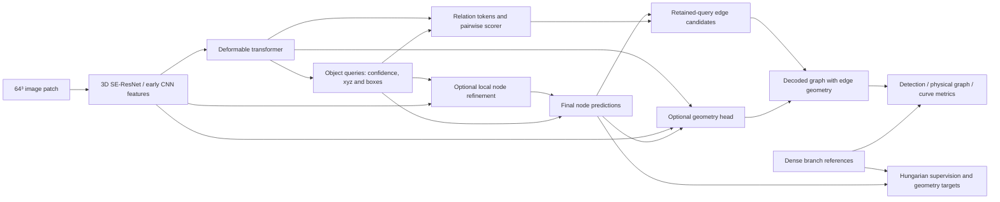

# Architecture and repository map

<!-- NATIVE2D CURRENT POINTER 20261028 -->
> Latest native2D result: **Native2D-03 corrected-target pilot completed** (B0/A-xyz6,000 updates each; no filtered graph recovery at0.5). [Final comparison, dataset readiness and stopping decision](../docs/research/native2d_heldout_20261028.md#completed-corrected-target-comparison). Native2D-02 remains preserved with its unstable-target and post-training-timeout caveats.

Consolidated 23 October 2026. This is the current map; the older [repository graph](../docs/repo-graph.md) contains useful historical details but includes superseded paths, dataset sizes and status statements. See [decisions](decisions.md) for rationale and [experiments](experiments.md) for configuration-specific results.

## Model and data flow

MRI intensities are the normal input. IXI binary-vessel-mask input is a separate diagnostic configuration. BRAVA `seg/` files are **brain masks**, retained for legacy loading/skull stripping; they are not vessel labels, geometry features or vessel-support ground truth.

## Components and code

| Component | Implementation | Contract |
|---|---|---|
| Configuration | [configs/loader.py](../configs/loader.py), [base config](../configs/base.yaml) | Merge overlays and validate; resolved run configs/manifests override stale prose defaults |
| Dataset discovery and mixing | [data/loaders/mixed.py](../data/loaders/mixed.py), [SyntheticMRI-style loader](../data/loaders/synthetic_mri.py), [common batching](../data/loaders/common.py) | IXI/BRAVA use the common 3D layout; graph targets, domains and physical metadata travel with images |
| Augmentation | [data/spline_augmentation.py](../data/spline_augmentation.py), [augmentation documentation](../docs/AUGMENTATION.md) | Apply the same spatial transform to image, graph and geometry; preserve the physical metric. Binary masks use nearest interpolation and no MRI intensity noise/centering |
| Graph preparation | [transfer target preparation](../scripts/prepare_transfer_splines.py), [target utilities](../data/spline_targets.py), [BRAVA preparation](../scripts/prepare_brava.py) | Preserve original dense paths and crop provenance; reject unsupported topology/capacity explicitly |
| Detector | [models/relationformer.py](../models/relationformer.py) | 3D CNN, deformable transformer, object embeddings, node coordinates/boxes and pair relations |
| Training assignment | [models/matcher.py](../models/matcher.py) | Diagnostic lineage uses Hungarian cost `5 × normalized-coordinate L1 − 2 × object probability`; assignment is not a physical localization guarantee |
| Node refinement | [models/node_refinement.py](../models/node_refinement.py) | Samples early CNN neighborhoods; predicts coordinate and optional confidence residuals. The later frozen verifier is a separate tested rescoring module, not part of these representation arms; no heatmap is active |
| Fixed geometry | [models/spline.py](../models/spline.py), [local CNN geometry](../models/local_spline_geometry.py) | Cubic endpoint-constrained B-splines; K-specific bases; physical chord residuals; endpoints remain predicted nodes |
| Adaptive geometry | [models/adaptive_geometry.py](../models/adaptive_geometry.py) | Shared-trunk K-specific projection bank plus separately trained selector; learned four-section C0/C1 curves; GT-independent simplification |
| Explicit split targets | [data/adaptive_split_targets.py](../data/adaptive_split_targets.py) | Inserts degree-2 graph nodes, retains original branch IDs and weighting metadata; full training integration remains pending |
| Joint objectives | [training/losses/criterion.py](../training/losses/criterion.py), [routed criterion](../scripts/controlled_spline_unfreeze.py) | Node/box/coordinate/class/relation losses; optional geometry and topology terms. Freeze/gradient routes are experiment-specific |
| Inference | [training/evaluation/inference.py](../training/evaluation/inference.py) | Confidence-selected queries and all retained undirected pairs; average orientation logits **before softmax**; no GT matching at inference |
| Common graph metrics | [common-v2](../metrics/common_vessel_metrics.py), [branch contraction](../metrics/branch_connectivity.py), [geometry distances](../metrics/representation_geometry.py) | Original dense-reference geometry, physical anchor matching, degree-2 contraction, explicit curve/polyline support |
| Native metrics | [training/evaluation/metrics.py](../training/evaluation/metrics.py) | Detection/AP/AR, established SMD and topology conventions; do not substitute these for physical endpoint-correct adjacency |

## Coordinates, targets and representation boundaries

- Arrays use D/H/W order. Node centers are normalized by **axis size**, not `(size−1)`; grid-sampling conversions account for CNN strides and voxel centers.
- `pred_nodes` includes center coordinates and box extents. Physical graph matching uses the first three coordinates.
- A target cache maps normalized coordinates to relative physical millimeters using `metric`. Recovering global placement additionally needs the source affine, patch start and padding. Patch NIfTI headers alone can be insufficient.
- Spline caches contain `nodes`, `edges`, `controls`, `curves`, `guides`, `metric`, `full_paths` and `path_offsets`, with boundary metadata where available. Original dense paths are the geometric evaluation reference; fitted controls/curves are training targets.
- Standard splines are cubic with clamped endpoints and uniformly spaced interior knots. Different K means different bases; control arrays must not be truncated to change K.
- Topological anchors and geometric controls are distinct. Standard spline-target construction contracts degree-2 chains even when an upstream adaptive graph retained guide vertices. Explicit splitting must bypass that contraction.
- C0 piecewise joins use cubic-knot multiplicity 3; C1 joins use multiplicity 2. Four local K8 sections have 29/26 global control vectors, respectively. These are geometry parameters inside an edge, not new object queries.
- BRAVA SWC scaling/orientation and five explicit reflections belong to dataset preprocessing, not per-model fitting. All trace variants of a subject remain in the same split. See [BRAVA provenance](../docs/research/BRAVA_preparation.md).

## Datasets and stable roots

Paths below are current prepared populations, not interchangeable historical cohorts.

| Dataset | Prepared root under `/lustre/fsn1/projects/rech/vnc/upz25mj/datasets/` | Scope |
|---|---|---|
| IXI | `IXI/transfer_splines_k8_20261015` | 10,000 train /2,649 validation /2,178 test patches; current studies select fixed development cohorts |
| BRAVA | `Brava/prepared_swc_20261020-132057/transfer_splines_k8` | 8,768 /1,796 /2,043 patches, 39/8/9 subjects; 56 image subjects and 111 valid trace variants in preparation |
| SyntheticMRI source | `syntheticMRI/transfer_source_k8_25k_20261015` | 25,000 train /480 validation prepared source patches; recent geometry pilot selects 4,096 training patches |
| Historical SyntheticMRI comparison | Separate SCRATCH experiment manifests | Common examples: 10,000 training and1,952 validation; do not infer membership from size alone |

IXI/SyntheticMRI dense paths are extracted/generated references with anatomical uncertainty. BRAVA paths are manually traced but incomplete; SWC forest topology is not proof that full anatomy is acyclic. Training split metadata and source-checkpoint training populations must both be checked for leakage.

## Loss and gradient contracts

The current multi-dataset recovery recipe uses weighted node CE `[0.25,0.75]`, matched-pair edge focal gamma2 without ratio upsampling, existing coordinate/box terms and residual-control geometry weight `1.4739989612791453`. Other historical arms deliberately change these settings and remain separate experiments.

`graph_only` geometry detaches detector tokens and endpoints; local geometry sampling detaches CNN maps. Frozen-head runs also freeze model parameters and BN buffers. Joint geometry feedback into the detector is a separate intervention, not implied by training a spline head. The geometry objective averages per control coordinate and original branch; bank projections are averaged per branch. Explicit splitting needs original-branch weighting before training.

Betti H0/H1 losses, FGW matching, domain adaptation and alternative edge losses exist in repository history/configuration. Their availability does not mean they are enabled in a given stable experiment. Read each resolved config and checkpoint metadata.

## Metrics system

| Layer | Main questions and measures |
|---|---|
| Representation fit | Directed/symmetric centerline distances, maximum/HD95/coverage, length/tortuosity, topology preservation, controls and anchors versus error |
| Learned geometry | Predicted curve versus original dense branch; actual endpoints, correctly localized endpoint subsets and clearly labelled endpoint-neutral/oracle diagnostics |
| Complete reconstruction | Node/edge precision-recall-F1 at1/2 mm, detection mAP/mAR, conditional relation AP/recall, Branch F1, Curve F1, component/cycle errors, duplicates and efficiency |

Common-v2 uses physical 1-mm anchors/curve coverage and 0.25-mm curve sampling. GT-capacity audits use denser numerical checks and conservative bounds; their same-edge geometry scores are **not** whole-graph common-v2 Curve F1. Native box-based edge F1 and physical endpoint-correct edge F1 measure different things. Betti counts and SMD alone cannot establish correct connectivity. Detailed definitions and controlled counterexamples remain in the [metric protocol](../docs/research/metrics/vessel-core-v1.md), [metric results](../docs/research/metrics/core-metrics-results.md) and [original metric plan](../docs/research/vascular_graph_metrics.md).

## Current implementation evidence

The [23 October review](../docs/research/EXPERIMENT_REVIEW_20261023.md) records completed training of the adaptive projection bank and C0/C1 heads on IXI/SyntheticMRI, plus BRAVA full-detector recovery. These implementations are exercised; their results do not yet select a universal best representation. Explicit split targets are tested, while split-graph/oracle-node training and full end-to-end representation comparisons remain pending.

## Node verifier and BRAVA learnability diagnostics

[NodeVerifier](../models/node_verifier.py) is a separate, zero-initialized **residual object-logit scorer**, not a coordinate refiner. V2 independent and V3 five-neighbor contextual variants each have 58,129 parameters: 64-wide decoder-token projection, message MLP, symmetric aggregation and scalar residual. Inputs are cached detached decoder embeddings, original two-class logits, predicted coordinates and physical neighbor offsets. Tied neighbor distances receive fractional weights to preserve query-permutation equivariance. No early CNN-neighborhood sampling, GT inputs, query IDs, new coordinates or graph nodes enter this module.

Stage 1 and its BN state stay frozen. All raw candidates, including confidence-rejected queries, retain original-head relation scores; orientation logits are averaged before softmax. Edge threshold stays 0.5. Verifier fitting changes neither Hungarian matching nor detector/geometry/relation losses. Its separate spatial labels ignore ambiguous alternatives and the 2–3 mm band; duplicate negatives have weight 0.25. These are annotation-relative labels, unsuitable as confirmed anatomical negatives for incomplete BRAVA traces.

Runners: [feasibility/cache/evaluation](../scripts/node_verifier_feasibility.py), [spatial metrics](../scripts/node_verifier_metrics.py), [BRAVA tiny-set training](../scripts/brava_learnability.py), [report collector](../scripts/report_node_verifier.py), [exact protocol](../experiments/node_verifier_feasibility/protocol.json). See the [completed report](../docs/research/node_verifier_feasibility.md) for identity/permutation/gradient and cache-parity checks. The feasibility gate failed; this module is **not adopted in the main reconstruction pipeline**. The eight-patch BRAVA diagnostic unfreezes the detector and uses edge CE (unlike the previous focal recovery run), no augmentation, and K8 `graph_only` geometry. No auxiliary heatmap or end-to-end verifier training was added.

## Experiment runners, storage and runtime dependencies

- Current orchestration: [multi-dataset training](../scripts/multidataset_graph_training.py), [evaluation](../scripts/multidataset_graph_evaluation.py), [collector](../scripts/collect_multidataset_graph.py), [submission](../cluster/jean_zay/submit_multidataset_continuous.py). Earlier studies retain their own runners and plans.
- Python/PyTorch/CUDA and the compiled deformable-attention extension must match the Jean-Zay environment. Core numerical dependencies include NumPy/SciPy, imaging readers such as NiBabel/MedPy/VTK-PyVista, scikit-learn, Matplotlib and Plotly. Use the pinned runtime scripts rather than silently upgrading packages.
- Entry points: [Jean-Zay setup](../cluster/jean_zay/README.md), [environment](../cluster/jean_zay/env.sh), [runtime staging](../cluster/jean_zay/stage_spline_runtime.sh), [runtime repair](../cluster/jean_zay/ixi_mechanism_runtime.sh).
- Code/configs/manifests and compact evidence stay in the repository. Datasets, full caches, checkpoints and runtime staging stay on SCRATCH; current GPU concurrency is capped at two H100s across training/inference.
- All node decisions and relation scores must reproduce under the chosen inference batch size before comparing cached variants. Keep checkpoint/source hashes, IDs, query order, BN mode and thresholds with results.

Detailed operational documentation: [model](../docs/MODEL.md), [loading](../docs/DATA_LOADING.md), [training](../docs/TRAINING.md), [losses](../docs/LOSSES.md), [evaluation](../docs/EVALUATION.md), [configuration](../configs/README.md). Their historical examples do not override newer experiment-specific protocols.

## Companion project: Image-to-Graph-Vessel

The [legacy project inventory](image-to-graph-vessel.md) maps the sibling 2D/3D RelationFormer pipelines, cross-dimension adapters, mixed source/target loaders, optional adversarial/SupCL/EMA/HNM components and native evaluation tools. Its graph outputs are nodes and connectivity; inspected 3D sources do not implement the current spline heads. Configuration schema, compiled CUDA/runtime compatibility, preprocessing and metric parity require explicit checks before reuse.

<!-- NATIVE2D IMPLEMENTATION 20261027 -->
## Native 2D implementation boundary — 27 October 2026

The existing [companion-project report](image-to-graph-vessel.md#native-2d-journal-extension--27-october-2026) now documents the native `native2d/` port: original ResNet/deformable2D transformer, modern focal/CE Hungarian criterion, optional nine-sample coordinate-only A-xyz and endpoint-constrained2D K8 `graph_only` geometry. XY/WH tensors, pixel-center augmentation, original dense2D paths and explicit unit metadata remain native2D. A zero-plane adapter reuses common-v2 metrics only; no singleton-depth3D network is used. `models.build_model` explicitly dispatches spatial_dims2; existing3D constructors/state keys remain unchanged. Use `native2d.config` and dedicated scripts, not the existing3D training/config CLI. Original-size GPU and tiny learning checks are queued separately; this is not a full training result.

<!-- COMPLETED RESULTS REVIEW 20261028 -->
## Verified execution status — 28 October 2026

Native2D-01 now passes the original-width ResNet101/512D forward/backward and the ResNet18/64D two-crop 1,000-update learning gate; its actual results and remaining integration/data limits are in the [existing companion report](image-to-graph-vessel.md#native-2d-completion-review--28-october-2026). This does not establish full-population 2D training or a benefit from the optional refiner. Existing 3D constructors/checkpoints remain preserved.

The completed BRAVA D08 reference uses256 object queries, original K8 `graph_only` geometry, node softmax focal gamma2/equal weights and matched-edge CE ratio0.15, **without** node refinement. Its full-cohort recipe and final weakness are documented in the [BRAVA review](../docs/research/BRAVA_experiment_plan.md#reviewed-final-d08-results--28-october-2026). Earlier architecture/loss defaults above describe their own historical runs; D08 is not a retroactive relabelling of those experiments.

<!-- NATIVE2D HELDOUT AUTHORIZED 20261028 -->
## Native 2D held-out continuation — 28 October 2026

User-authorized controlled B0/A-xyz training supersedes the earlier full-training deferral once the gates pass. [Protocol and source audit](../docs/research/native2d_heldout_20261028.md): 17 AV-WIDE training images, 6 validation, 6 reserved test; image07 excluded for a self-loop; image-disjoint only. Full original-width 128² optimizer/overfit and PyTorch attention throughput gate precedes bounded training. No 3D architecture change, new matching, denoising or proposals. Measured status and accepted jobs are recorded in the existing registry’s Native2D-02 section.

<!-- NATIVE2D HELDOUT FINAL 20261028 -->
The bounded original-width Native2D-02 pilot now has genuine final6,000-update results on506 image-disjoint AV-WIDE validation crops. Both arms retain no predictions at the fixed0.5 threshold: node/edge F1=0; no A-xyz or spline benefit established. Full-width learning/gradient/throughput gates passed. Stop without extending training. B0 saved all training/final evaluation before a redundant initialization-checkpoint evaluation timed out; A-xyz completed normally. [Completed interpretation and dataset readiness](../docs/research/native2d_heldout_20261028.md#completed-bounded-result-and-stopping-decision). REAVER diaphragm4/2-image targets are prepared separately with micron calibration; no additional training launched.
